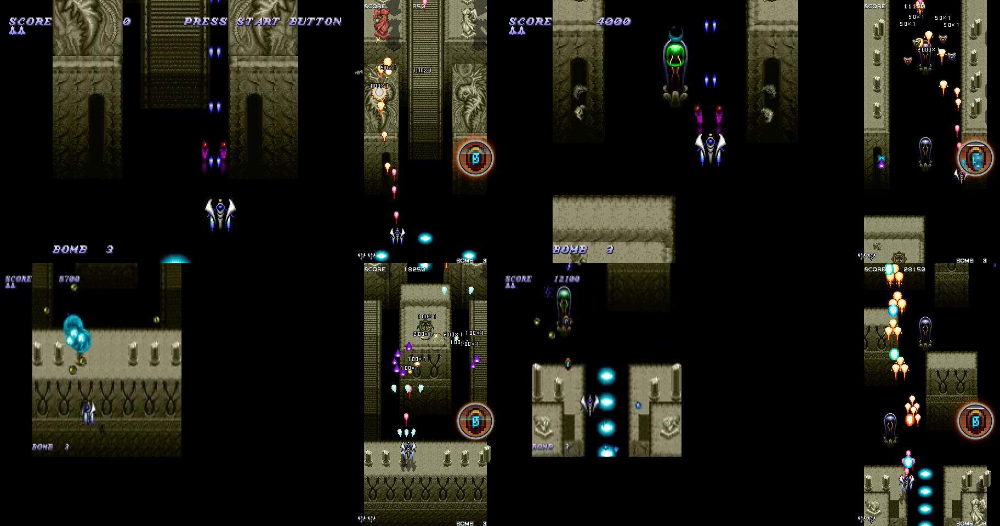
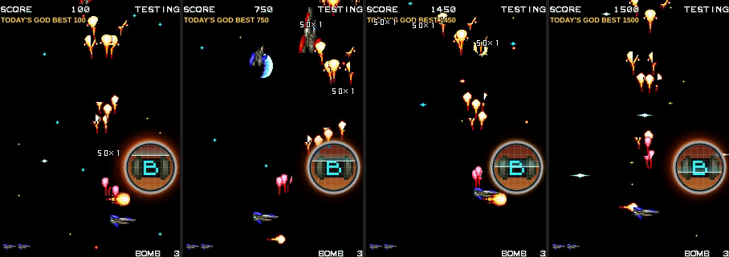
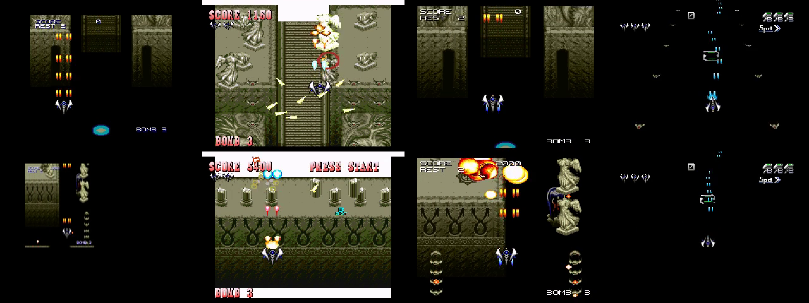
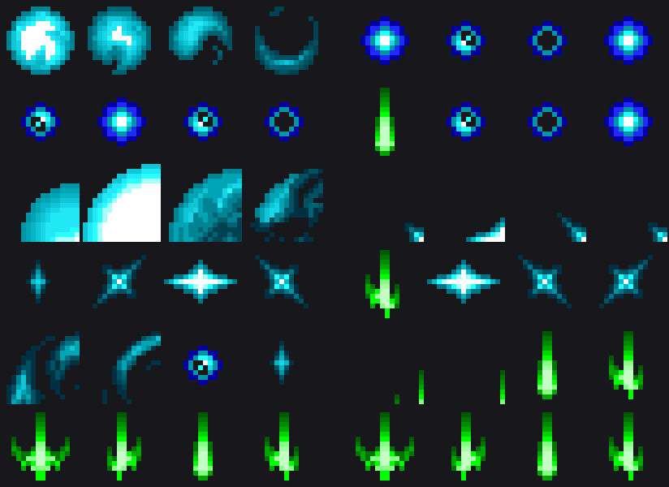

# Dezaemon 2 parity: the Saturn first

A plan for playing a Dezaemon 2 cart on the web exactly as the Saturn plays
it, written against one cart — the community game **Ramsie**
(`dev-fixtures/Saturn/Dez 2 - Ramsie.sav`, the raw cart, not the cloud level
of the same name) — on 2026-10-26, and the differences the testdrive found
on the way. The other five targets this repo exports to (Super Famicom,
PS1 Kids!, PS1 Dezaemon+, the 64DD and the PS2 port) come after the Saturn
here, in the order their formats allow them to get close at all.

"1:1 parity" in this document means: the same cart, started the same way,
puts the same objects on screen at the same scroll position with the same
art, firing the same bullets at the same rate, dying to the same number of
hits, dropping the same items with the same effects — on a field the same
shape — so that a recording of the two sides can be diffed object by object
and the diff is empty. Everything short of that is listed below as a
difference, with what the hardware does (and where it is traced), what the
web does today (and where in the code), and what closes it.

The companion [README-Weapons.md](README-Weapons.md) covers the weapon
systems of every target and what it would take to let a player drop any
Dezaemon weapon as an item.

## 1. The testdrive

### How it was run

`deno task testdrive:parity` grew four flags for this — `--sav` (with
`--slot`), `--full` and `--saturn-export`, all in `scripts/testdrive-parity.ts`;
the samplers are `scripts/lib/parity-survey.ts`:

```bash
deno run -A scripts/testdrive-parity.ts --sav "dev-fixtures/Saturn/Dez 2 - Ramsie.sav" --full --targets saturn,web --console-seconds 60 --max-mb 0 --keep-frames
```

- `--sav FILE` plays a cart instead of a cloud level. The level is the
  cart's fresh import (`levelRecordFromCart` in
  `packages/shmup-harbor/lib/shelf.ts`, the function the desktop build's
  shelf and the sav-profiler go through; `build:ps2 --sav` decodes through
  `lib/ps2/build.ts` instead, with the same decoder underneath); the cloud
  record named `Ramsie` is never read.
- `--full` turns the boss rush off: every pane plays the game's first
  stage from its start. The **Saturn pane plays the original cart**, put on
  the disc byte for byte (`disc:inject --sav`, the boot image relocated to
  LBA 3101 on a track 83 sectors longer); every other pane plays the import
  written back out by its exporter. `--saturn-export` puts that round trip
  on the Saturn too, to tell importer losses from runtime divergences.
- Under `--full` the Saturn, web and PS2 panes keep a **survey**: every
  object on screen sampled at 10 Hz into `panes/<id>.survey.json` — on the
  Saturn straight out of yabause's heap (sprite index, position, hp,
  attack word, hit attributes, formation key, status and mode words,
  flags and zoom for all 256 object slots, plus the map scroll, the
  dynamic rank, the boss phase, lives and the play state — the flags, zoom
  and boss phase were added after run 1 and are empty in its file), on the
  web out of the Phaser scene (every enemy by name,
  key and placement id, every bullet by frame and texture key, items, the
  ship, the boss, the stage's scroll position). Both keep a birth log — the
  first sample an object was seen in; the web's records the nearest enemy
  at that moment for a bullet, the Saturn's logs a slot whenever its sprite
  index changes and carries no shooter, so a Saturn bullet is attributed
  afterwards to the nearest zako in the same sample (the scratch comparer
  does this; note that a slot re-used by the same sprite logs no birth, so
  the Saturn's counts of the ship's SUB missiles are low).

Output: `build/testdrive/parity/ramsie-sav-full/` — `panes/saturn.mp4`,
`panes/web.mp4`, the two survey files (10 MB and 1.2 MB), `rush.json`
(the import), `report.json`. The web pane ran under god mode (`?god=1`) so
its 60 s are one unbroken take; the Saturn pane's ship is mortal and the
pilot rewound 52 deaths, so its 60 s are nine kept spans — the survey's
samples carry wall time and the kept spans, and every number below was
mapped onto the kept run's own clock before it was compared.

### What each pane played

| Pane | Source | Start | Clip |
| --- | --- | --- | --- |
| Saturn (yabause, EmulatorJS, JP BIOS, no cartridge) | the cart itself | PLAY → U → START, read off HWRAM | 60.2 s kept of 218 s wall, 52 deaths cut |
| Web (2028-ai runtime) | `levelRecordFromCart` | `?stage=0&story=0&god=1` | 62 s, 622 samples |
| SFC, Kids!, Dezaemon+, 64DD | the import through each writer | each console's own menus | run 2, see §3 |
| PS2 (web host of the AthenaEnv build) | the import through `build:ps2` | SELECT + L1 + R1 (turbo, god) | 60 s, 332 samples (run 3, see §3) |

Five runs in all: the survey above (run 1), the four cart-and-card panes
(run 2, §3), the PS2 pane (run 3, §3), the import's round trip on the
Saturn (run 4, §3) and the stage-0 boss rush on the Saturn and the web
(run 5, P8). The commands are in §6, and run 1's `report-survey.md` — the
rig's own record-by-record reading of the two surveys, which §2's tables
reproduce — sits beside its `report.json` (§5, Phase 0); a copy is at
[docs/parity-ramsie-survey.md](docs/parity-ramsie-survey.md).

Run 6 (2026-11-10) is the web pane alone, on the Saturn field, on a box
with no disc: the cart rebuilt from the project's own save library and
checked against its recorded SHA-256, and the Saturn's side taken from run
1 as a saved reading (P1;
[docs/parity-ramsie-field-survey.md](docs/parity-ramsie-field-survey.md)).
The letters in this document are run 1's. The roster has since gained the
four records only a big shot spawns (P2), so run 6's report letters the
same records differently — W, the ground turret, is its AA, and X its AB —
and its Id and Rec columns are the names that hold.

### The cart

Ramsie is a five-stage vertical game with 2P join-in (settings `+0x00` =
`0x02`), 160 placed enemy records (26/30/36/44/24 per stage; records
defined but never placed, such as stage 0's 3, 5, 13 and 24, are not among
them), 14 songs, no 3D models, and a settings block the decoder names byte
by byte except its last three (`+0x5D`–`+0x5F`). Stage 0 ("level 1") places 269 zako
over 26 records on a 20-column × 768-row grid and one size-class-2 boss at
row 423; its scroll runs at 0.75 px per frame (45 px/s) with a decaying
raster sine over the first 16 rows, slows to 0.5 and 0.25 past row 384, and
parks at row 416 with the boss loop between rows 384 and 448.

Fourteen of the 26 records fire: six on bullet type 0 (records 1, 2, 32,
52, 53, 54), two on type 2 (33, 34), and **six on type 3** — the "big
shot" — records 4, 7, 38, 48, 49 and 56 (the decoder marks 56's appearance
as no-fire; the Saturn fired its big shot twice in the run, so that gate
does not apply to a type-3 record). Eleven more have a firing appearance
but geometry nibble 0 and are silent on hardware. Player 1 starts on preset
0: MAIN 2 VULCAN B, SUB 1 H-MISSILE, CHARGE 1 CANNON, BOMB 5 EDIT B with the
variant bit; power 2 of 7, options 0 of 4, autofire every frame. Player 2
starts on preset 1: SHADOW, OPTION C, LASER, EDIT A. The eight item slots
are the four weapon-change items, power-up, bomb stock, speed-up and
barrier, all bouncers. The three global bullet configs are blue (type 0),
teal (type 1) and green (type 2) — no Ramsie bullet is purple.

## 2. Saturn against web: the differences

Numbered by how much of the player's experience each one changes. "Trace"
names what is still to be read out of GAME.CMP before the fix can be exact;
"Code" names where the web does it today.



### P1. The web plays on a 256×480 window; the Saturn on 320×224

**Landed 2026-11-10 as an opt-in field mode, and re-surveyed on the web's
side the same day** (run 6, below: seventeen records within 4 px of the
Saturn's, every bullet kind on both sides, the ground turret still out —
the Saturn pane itself was not run again and T21 is not traced, for want of
the disc on that box; the paragraphs from **Measured** on are the
measurement the field answers). `?field=saturn` plays a Dezaemon import on
the Saturn's own screen, with the engine's numbers applied with no scale
factor. A **vertical** cart boots at 320×224: the 20-column grid lies 1:1
from x 0 and the 224-px background at 48..272. A **horizontal** cart is
the same simulation with that screen turned across it — 320 px along the
scroll axis, whose coordinate runs from −96 at the entry edge to 224 at the
exit edge, and the 224-px playfield band (lateral 48..272) across — and
the runtime draws a horizontal cart transposed, so its field is **224×320**:
screen x = lateral − 48, screen y = scroll coordinate + 96. The shipped
game, and every level without the flag, keeps 256×480.

| Rule | Vertical cart, 320×224 | Horizontal cart, 224×320 | Source |
| --- | --- | --- | --- |
| Wave gate | `row·16 − 272` (was `− 512`): a row is spawned 48 px above a 224-px top | `row·16 − 368`: 48 px beyond an entry edge at −96 | traced (`+0x152E8`: `0xE800` / `0xB800`); the vertical one surveyed |
| Spawn, scroll axis | the row's own line shifted by the band byte, subtracted for air and added for ground: a 16/32/64-px-tall air sprite starts at y −32/−40/−56, every foot 24 px above the screen | the same with the horizontal band table, which follows the sprite's width: a 16/32/64-px-wide one at scroll −128/−136/−152 (y −32/−40/−56) | traced (`+0x1679A`, tables `+0x22044` / `+0x2204C`) |
| Spawn, lateral | the cell's left edge plus half the band's width (`col·16 + w/2`) | the cell's edge plus half the band's **height** (`col·16 + h/2`), the side that lies along the lateral axis on the turned screen | vertical traced (`+0x169EE`) and surveyed; horizontal **deduced** from it |
| Change-channel lines | 62 / 112 / 164 px, band-shifted, unscaled | 14 / 48 / 116 px of the scroll coordinate (y 110 / 144 / 212), its own band table | traced |
| Steering kink / split | 64 / 96 px of flight (were 128 / 192) | the same | traced |
| Fire window | lateral 48..272, scroll 0..224 | lateral 48..272, scroll −96..224: the whole screen | traced (`+0x1983E`) |
| Ship | x 60..259, y 20..212, whatever the art's width | **provisional**: the same insets about its own window — lateral 60..259, scroll −76..212 (x 12..211, y 20..308) | vertical traced (`+0xAB0E`); horizontal untraced (T22) |
| Shots and enemy bullets leave | by the despawn box, x 16..304, y −16..256 | **provisional**: the same margins, lateral 16..304, scroll −112..256 (x −32..256, y −16..352) | vertical traced (`+0x173A4`); horizontal untraced (T22) |
| Boss arrival and death presets | in the screen's own px (were doubled along the scroll) | 1:1 as well, but from the vertical tables: the two horizontal-only preset blocks are not decoded | decoded |
| Title, staff roll, SCORE and BOMB | at their Saturn coordinates, no 32-px window and no band | the untransposed 320×224 picture's middle 224 columns in a band 48 px down; SCORE and BOMB as on the tall screen | measured (vertical) |
| **An enemy leaves** | under y 256, or 16 px outside the grid at the sides | under y 352, or 16 px outside the grid (x −64..288) | **provisional**: the box's bottom line; a zako's own bound is per size class (`+0x4C8C`) and unread (T21) |
| **A ground object's start** | with its row, like an air one, the band byte added | the same | **provisional**: the engine's separate start word (`0x8800`) is not applied; run 6 measures what that costs (below, T21) |

It is a boot flag because the screen's size is baked into the Phaser
config and copied into some twenty module-level `GW`/`GH` pairs before any
level has loaded; `DEZA_FIELD` is read ahead of all of them, so they
follow it. The boot cannot know the cart's orientation either, so the flag
has two values and nobody types the second: once the level resolves, the
boot scene opens the page again on the field the level needs
(`dezaFieldFor`, `dezaFieldFits`) — `?field=saturn-h`, 224×320, for a
horizontal cart, `?field=saturn` for a vertical one asked for the other,
and no flag at all for a level that is no Dezaemon import. The page fits
the canvas at the field's size and is not turned (`html.field-saturn`,
`lib/game-page.ts` and the exported app's shell); a cabinet backdrop or
bezel is not drawn (it frames the tall screen); the title's WORLD BEST
block and the game-over portrait are left out, and the story is off,
because those three are laid out on 480 lines. The rig takes
`--field saturn` with `--full` (§6) and reads the orientation off the
import: the web pane is recorded at the field's size, the pilot flies
inside the ship's clamps and `--survey-lead` defaults to 0.

**Re-surveyed: run 6, the web pane on the field against run 1's Saturn.**
The Saturn pane plays the original cart whatever the web does, so run 1's
Saturn side still stands; it was carried to a box with no disc as a saved
reading (`--saturn-reading`, §5 Phase 0;
[docs/parity-ramsie-saturn.reading.json](docs/parity-ramsie-saturn.reading.json)
is run 1's, transcribed from its report) and the web pane played Ramsie's
stage 0 on the field for 62 s, four takes. The report of the last is
[docs/parity-ramsie-field-survey.md](docs/parity-ramsie-field-survey.md).
With no lead taken out, every placed record both runs saw comes on at the
Saturn's own scroll position:

| Record | Saturn first seen (scroll) | Web on the field (scroll) | Δ |
| --- | --- | --- | --- |
| C (2) | 340 | 337 | −3 |
| X (53) | 468 | 467 | −1 |
| L (32) | 769 | 772 | +3 |
| R (38) | 801 | 803 | +2 |
| F (7) | 995 | 992 | −3 |
| J, K (27, 28) | 1091 | 1091 | 0 |
| Z (56) | 1152 | 1154 | +2 |
| E (6) | 1203 | 1204 | +1 |
| A, B (0, 1) | 1632 | 1636 | +4 |
| I (26) | 1923 | 1923 | 0 |
| D (4) | 1955 | 1954 | −1 |
| S, Y (39, 54) | 2193 | 2193 | 0 |
| U, V (48, 49) | 2433 | 2436 | +3 |

Seventeen records, the largest difference 4 px against a tolerance of one
row (16) and a 10 Hz sampler that moves 4.5 px a tick. No record failed
that tolerance in any of the four takes, and in the three whose rows were
read none was more than 4 px out. B is judged now: the web builds R's
big shots as objects of record 1 (P2), and the sampler marks each with the
key of the enemy that fired it, so B's first placement is no longer taken
for R's first shot. That is Phase 1's first acceptance — "every record's
first-seen scroll matches the Saturn's within one row" — met for the gate.
Its second, a type-0 bullet crossing the field in the same number of
frames, needs the Saturn's own samples and was not measured.

**The ground turret W is the one finding left, 320 px early.** The web
spawns record 52 with its row (first seen at scroll 467, at y −37: 8 px
under a row then standing at −45), fires it and lets the ship kill it on
the way down; the Saturn logged it first at scroll 787 at y 283, 8 px
under a row then standing at 275 — below the screen — and parked it at
315. Both sides hold W at its row plus the band byte; what differs is
when it exists, and that is the ground start the field does not apply. One
arithmetic lead for T21, not a trace: the Saturn's first position is, to
one sampler tick, `0x8800` read as an UNSIGNED word — 272 px, 48 px past
the exit edge at 224 — plus W's band byte, 8; and 784, the scroll that puts
W's row at 272, is `row·16 + 48`. The signed reading the notes carry
(−240 px) puts it at −232. An exit-edge start would also explain why that
word is the same in a vertical and a horizontal game, whose exit edges are
both at 224, while the air word differs with the entry edge (−48, −144).
What an object started there is for — it can only be carried further out —
is exactly what the trace has to say, so the field keeps its provisional
rule and the report keeps failing on W until it does.

**Bullet kinds agree, and their counts are the pilots'.** With the big
shots built as objects on both sides, every kind is now seen on both
(Saturn | web, births in the take reported): record 5's cells 30 | 31,
record 13's 9 | 20, record 3's 8 | 8, record 1's 8 | 6, record 24's 1 | 1,
type 0 16 | 11 — P2's re-survey as well, with one side saved. The type-0
count is not stable enough to judge: over the four takes the web fired 1,
0, 10 and 11, and the take with none fails the report's "one side only"
rule. Stepped frame by frame with the ship left where it starts, it fires
six. Most of Ramsie's type-0 shooters open with a reload of 14..42 fire
ticks (1.9–5.6 s at the opening rank, the same `interval + rand % window`
on both sides), and on a 224-px field the ship has usually killed them by
then — web lives of 2.2–4.0 s in the take reported against the Saturn's
2.7–4.0 — so the Saturn's sixteen are a handful of volleys (X's five are
one burst) and the web's zero to eleven are the same few dice. Settling it
takes what Phase 0 still lists: the same pad log on both sides and a
seeded take.

**A horizontal cart on its field.** Checked in a browser on Biometal Gust
(a horizontal cart of the community collection, 40 s of its stage 0): the
boot asked for `?field=saturn` reopened itself at 224×320; rows came on at
`row·16 − 368` (rows 50, 51 and 52 first seen at scroll 435, 452 and 469
against gates of 432, 448 and 464); a 32×32 air zako was first seen at
y −36 and −34 (it starts at −40), a 64×32 ground one at −40; columns 5 to
14 centred at `col·16 + h/2 − 48`; the ship was stopped at x 12 and 211
and at y 308; nothing lived past y 352.



What that does not show is a Saturn beside it: no horizontal cart has been
surveyed, so the rules marked deduced or provisional above are exactly
that, and three things are still open there. The picture is the Saturn's
turned a quarter turn, as this runtime has always drawn a horizontal cart:
the ship, its shots and the grid's zako are drawn the way their author
painted them for a landscape screen, so a faithful frame needs those
sprites turned −90° and the canvas +90° (enemy bullets, items and some
effects, which the engine itself turns, are then right as they are). The
boss parks where the tall screen's rule puts it, with the vertical preset
tables. And the horizontal ship clamps and despawn box are T22.

**Measured.** Every placement row enters the web's screen 240 scroll-px
(4.7–5.8 s at 45 px/s) before it enters the Saturn's, on thirteen of the
eighteen records that appeared in both runs (B is left out because the
Saturn key it carries is also the key of R's big shots — the rig's
`report-survey.md` now tells the two apart by proximity to a live R and
judges B at +1 px — and W, the ground turret, is its own story below):

| Record | Saturn first seen (run s / scroll) | Web first seen (s / scroll) |
| --- | --- | --- |
| C (2) | 6.8 / 340 | 2.1 / 97 |
| X (53) | 9.8 / 468 | 5.0 / 227 |
| L (32) | 16.7 / 769 | 11.7 / 529 |
| R (38) | 17.4 / 801 | 12.4 / 561 |
| F (7) | 21.8 / 995 | 16.7 / 754 |
| J, K (27, 28) | 24.0 / 1091 | 18.8 / 848 |
| Z (56) | 25.4 / 1152 | 20.2 / 912 |
| E (6) | 26.6 / 1203 | 21.3 / 961 |
| A (0) | 36.6 / 1632 | 30.9 / 1393 |
| I (26) | 43.1 / 1923 | 37.3 / 1681 |
| D (4) | 43.8 / 1955 | 38.0 / 1713 |
| S, Y (39, 54) | 49.1 / 2193 | 43.4 / 1955 |
| U, V (48, 49) | 54.4 / 2433 | 48.7 / 2194 |

The scroll itself paces the same (web 45.0 px/s; Saturn 42.5–45.0 per
span, the emulator's clock) and the grid is the same: both lay the
20-column, 320-px map out at 1:1. What differs is the window onto it and
the gate. The Saturn draws all 320 px across and 224 px ahead of the
bottom edge, with SCORE and BOMB overlaid on the play area; the web shows
the middle 256 px (32 px cut from each side — V spawns at Saturn x 35 and
U at 284, inside the Saturn's picture and outside the web's) and **480 px
ahead**. Its spawn gate is `row·16 − 512` against the Saturn's `row·16 −
272` (48 px above a 224-px top), which is the 240 px exactly: a row comes
into view 5.3 s earlier and is on screen more than twice as long. Two
smaller offsets ride along: the web places every sprite's centre at
`col·16 + 16` where the Saturn centres it at `col·16 + w/2` (8 px right
for a 16-px sprite, exact at 32, 16 px left at 64), and spawns everything
40 px above its top where the Saturn starts an air object 48 px above and
a ground object 240 px above, each shifted by its band's byte.

Everything that depends on screen distance follows: an enemy bullet moves
at the hardware's px per Saturn frame on both sides (measured: a Saturn
type-0 bullet at rank 14 flew 1.22 px per frame = `(4·14 + 256)/256`; the
runtime's "doubled for the taller playfield" factor cancels against a /512
in the decoder and lands on the same number) but has 480 px to cross
instead of 224 — 7.1 s instead of 3.3 s at rank 8; the bullet-steering
kinks and splits trigger at 128/192 px instead of 64/96; the
change-channel trigger lines are scaled by 480/224. In the 60 s kept run
the Saturn fired 18 type-0 bullets and 49 big shots; the web fired 51 and
123 — the same records, on screen longer where the ship kills them (mean
time on the field, Saturn | web, as `report-survey.md` reads it on the
kept clock: D 1.1 | 5.1 s, E 0.8 | 2.1, F 33.1 | 9.4, J 5.7 | 4.4 — F
parks on the Saturn's screen). The two pilots, the two windows and the
Saturn ship's
weapon changes (P4) confound every such count; the per-record scroll
positions above are the clean measurement.

**The ground turret W never enters the Saturn's screen.** Record 52 (the
angel statue, ground bit set, appearance 0) is first seen by the Saturn at
scroll 787 at y 283 — already 51 px below the bottom edge for a row placed
at 736 — slides to y 315 and parks there with status word 0 for the rest
of the run, as FORMAT.md L858-874 says a ground object standing below its
line on the opening screen does ("keeps waiting, for ever"). The web spawns
it at y −37 like an air enemy and credits it with 17 of its 51 type-0
bullets. X (record 53, the same row, air) spawns normally on both. The
ground spawn offset and the arm test are traced (`+0x152E8`, `+0x1679A`,
`+0x589E`); the web arms a ground record like an air one.

- Hardware: screen 320×224 (despawn box x 16..304, y −16..256), scroll
  window [0, 224] px, the ship clamped to x 60..259 / y 20..212, spawns
  48 px (air) / 240 px (ground) above the entry edge shifted by the band
  byte, a ground object armed only when it has fallen back to its line;
  FORMAT.md L232, L581-582, L858-876, L1205, L1242.
- Code: `GAME_DIMENSIONS` 256×480; `gridLeft = (GW − cols·16)/2`; the
  wave gate `scrollPos >= row·16 − 512` and the spawn at `GH + scroll −
  (row·16 + 8)`; `CHANNEL_TRIGGER_SCALE = 480/224`; `DEZA_STEER_PX = 2`;
  `dezaVolley`'s `(rank·4/512 + speedAdd)·2`.
- Fix (landed, above — a vertical cart's 320×224 and a horizontal cart's
  224×320): a Dezaemon **field mode** for imports — the simulation on the
  Saturn's 320×224 screen, letterboxed or scaled into the page (the
  Saturn's own 4:3), the gate and spawns at the traced 272/48/240 px with
  the band shift and the width-aware centre, the ground arm rule, bullet
  speed and steering distances in Saturn px with no scale factors, the
  ship clamp at x 60..259 / y 20..212. This is the single largest change
  and the precondition for comparing anything else by eye; until it lands,
  every timing comparison must be made in scroll px, as the survey does.
- Trace: T21 — the ground start and a zako's despawn bound; T22 — a
  horizontal game's ship clamps and despawn box. The vertical clamp, the
  air offset and the arm test are traced; draw order is T18.

### P2. "Purple fireballs": the big shot is drawn with 2028.Ai's stock bullet

**Landed 2026-10-27** (the trace is in FORMAT.md "Bullet type 3"; the
paragraphs below are the measurement it answered). A big shot is not a
bullet and has no updater of its own: `+0x190AE` takes a slot from the
150-slot enemy pool, `+0x18E7C` writes `b5 | 0x80` as its formation key
and runs the band's spawn wrapper — the same seven wrappers the grid uses —
into the ordinary zako initialiser `+0x153C8` with `record = BASE[band] |
(b5 & 15)`, so the object IS that record, spawned where the shooter stands:
its hp, armour, death word, fire config, class and appearance script, and
it moves as that script says. The decoder now names the record and the key
(`decodeBigShot`), the roster walk carries every record a big shot names
(`spawnClosure`, the death child's walk widened — Ramsie stage 0 gains 3, 5,
13 and 24 as spawn-only entries, so their frames reach the atlas), the
mapper resolves it to `dezaemon.bigShotChild`, and the runtime spawns that
roster entry as a zako (`spawnBigShot`, beside `spawnDeathChild`) on the
hardware's cadence: the reload counts down every frame and refills from
the interval on the frame it reads 0, in or out of the fire window, so the
period is interval + 1 frames; the interval comes from the shooter's own
band's table (T20, below). `configs[3]` is gone. A big shot that leaves
the field upward is retired at once (it was born on the field, so above
the top edge it is outside the despawn box `+0x173A4`), and a zako the
behaviour driver retires is now removed whether or not it has a hitbox —
without that, D's armoured shots parked above the screen until the pool
was full. What still differs is the fire window's geometry (P1: the
hardware's 224-px screen and 48..272-px lateral band are applied on the
web's 256×480 field) and the per-row fire gate's first tick on an import
older than the entry rows.

**Measured.** The web fired 123 `normalProjectile0.gif` bullets in 60 s —
the stock 2028.Ai soldier bolt, a 14×20 violet teardrop (mean RGB
130, 35, 203) — 120 of them attributed to the five type-3 records that
appeared: D (45), U (32), V (17), F (16), R (10); the other three landed
on I, J and W by nearest-enemy attribution, and I and J are geometry-0
records the runtime never fires, so those were type-3 shots whose shooter
had moved on (`report-survey.md` hands all three back: two to D and V,
the nearest type-3 shooters alive, and the one by W to U, which had left
the field a tick before). On the Saturn the same records spawn **class-99 objects
built through another record's spawn wrapper**: D's shots carry sprite
index 119 and formation key 141 (record 13's art and placement id), record
13's hp (12800 units, 2.5 weapon-1 hits), the band's contact attack (256)
and record 13's **ARMOUR bit** — all 518 of them are indestructible and
shatter the player's shots; U and V's carry sprite 87 / key 133 (record 5,
hp 25600), F's 79 / 131 (record 3, 12800), R's 71 / 129 (record 1, 12800 —
a key B's own spawns share), Z's 163 / 160 (record 24, hp 51200, band-2
attack 512), none armoured: 703 births carrying borrowed sprites over the
wall run. The web's are bullets with hp 1. Z is the sixth shooter: the
decoder marks its appearance (0x79) no-fire and the web Z never fires,
while the Saturn fired its big shot about two seconds after each Z entry.
(Settled 2026-10-27: the no-fire bit is a property of the script ROW, not
the appearance — the row load `+0x4F24` copies each row's flags into the
mode word the dispatcher tests — and 0x79's glide rows are silent while its
40-tick hover rows fire. The runtime gates on the live row now;
`APPEARANCE_NOFIRE` says only which appearances open silent.)

Why, in order (as it stood before the fix):

1. `mapSaveToGame` clones `defaults.starterEnemy` for every zako, whose
   `bulletData.texture` is `normalProjectile0-2.gif`, and only overwrites
   its speed (`map-to-game.js` ~315-378).
2. `dezaemonBullets.art` has three entries (types 0-2, refs 132-143);
   there is no `art[3]`.
3. `updateEnemyFire`'s big branch calls `dezaVolley(scene, enemy, st, 1, …)`
   with `fire.mode === 3`; `art = dezaemonBullets.art[3]` is undefined, so
   the volley falls back to the enemy's `projData` — the stock bolt
   (`game.bundle.js` ~6484-6522, 6640-6655).
4. The importer extracts the art a big shot names only when that record
   is itself placed: R's names record 1, which B places, so its frames are
   on the atlas as `deza0_00_*`; D, F, U/V and Z name records 13, 3, 5 and
   24, which nothing places, and `extractEnemySprites` draws only the roster
   `projectForEditor` builds — placed records plus death-word children (the
   atlas has `deza0_00`..`deza0_56` for the 19 distinct placed sprites,
   identical art de-duplicated: record 4 draws as `deza0_02`, 1 as
   `deza0_00`, 7 as `deza0_06`). Nothing outside `decode-enemy.js` reads
   `bigShot`.
5. The shot's speed comes from `configs[3]`, the blast byte `0x44` read as
   a bullet config — a reading FORMAT.md L1212 refutes ("nothing reads
   +0x28 as a bullet config") and `decode-settings.js` L81-85 still
   documents as a quirk; the runtime computes the same number live from
   `cfgs[fire.mode]`, so the config and the runtime have to change together.
6. The boss has the same fallback: `DEZA_BOSS_BULLET` is the same three
   frames, and a fire point whose slot names no texture draws it (tinted
   light blue). Ramsie's boss was not reached in this run; its pattern 1
   fires a type-0 spiral, which the bank covers.

- Hardware: `+0x190AE` takes a slot from the enemy pool (`0x06068A40`
  over slots 99..248 — "class 99" was that pool's first slot) and
  `+0x18E7C` runs the band's spawn wrapper into the zako initialiser with
  `record = BASE[band] | (b5 & 15)`, `BASE = [0,16,24,32,48,52,56]`
  (`0x0608603C`); the character `base + (index & mask)·step` is that
  record's; no aim bit; deterministic reload, period interval + 1 frames
  from the band's table (Ramsie: D every 12 frames, U/V every 4, F and R
  every 60, Z every 30 in its hover rows). FORMAT.md "Bullet type 3".
- Round trip (§3): because the importer carried no record for a big shot,
  the cart writer handed records 3, 5 and 13 to other enemies, and the
  written cart's D, F, U and V fired those — one-hit, unarmoured, in the
  wrong art. The records are roster entries now (placements 0), so
  `freeIndex` can keep them at their own index; the round trip is to be
  re-measured (Phase 6).
- Code, after the fix: `decodeBigShot` (`record`, `key`),
  `bigShotInterval`, `spawnClosure` in `decode-stage.js`,
  `dezaemon.bigShotChild` in `map-to-game.js`; `spawnBigShot`,
  `dezaFireWindow` and the row gate in `updateEnemyFire`
  (`game.bundle.js`); `DEZA_MAX_LIVE_ZAKO` is the pool's 150. The PS2 port's
  zako patch (`packages/shmup-harbor/lib/ps2/runtime-patches.ts`) still
  fires its stand-in bullet for type 3.
- Trace: closed (T1, T20 below). What the survey called the shots' fall
  and halt was record 13's own script (appearance 0x9a: a 384-unit drift
  down, then a slow turn).

### P3. The ship fires 2028.Ai's art, not the cart's

**Seen in the frames.** The Saturn draws VULCAN B's own sprite (global bank
ref 54, a purple twin bolt, sprite index 15 in the survey) and, in the slot
pair 68-69, two objects with sprite index 21 (ref 62) carrying attack
13312 — the level-0 entry of the SUB-1 table `+0x21D6C`, so H-MISSILE's by
inference; FORMAT.md names index 21 only among the "other indices" charge,
SUB, pod and bomb shots use. The web draws Duke's cyan
`bigProjectile_0-3.png` for every sprite-drawn MAIN shot (types 1-4, 6, 7),
for CHARGE 1 and 3 and for the pods; MAIN 5 (SHADOW) and CHARGE 2 (LASER)
are not sprites at all but rectangles in a shared Graphics layer, the
homing tails are drawn into the same layer, and the bombs are shapes.
Ramsie paints all of refs 48-93 (charge glow, seven shots, beam segments,
ten option figures, two bomb sets, sparks, the dome, the tall missile,
smoke).

- Hardware: shot sprite index hardcoded per MAIN weapon (14/15/16/18/19/20/27
  → refs 53/54/55/57/59/61/68), invariant across level; charge, SUB and
  option bullets at refs 56/62/64/66 and 69/70/74/75, the ten option
  figures at 69-78, the two bombs at 79-86, sparks, dome, tall missile and
  smoke at 87-93. FORMAT.md L333-397, L1951-1970.
- Code: `spawnDezaPlayerShot` / `dezaSpawnPod` draw
  `playerBulletFrames(pd.shootNormal)`; the columns and tails go into
  `dezaBeamGfx`; `map-to-game.js` writes only the ship's idle frames into
  `playerData.texture`, and nothing in the importer reads refs 48-93 at all
  (`GLOBAL_WEAPON_SLOTS` in `decode-sprites.js` is the cart writer's
  painting map, used on export to put a web game's shot frames into those
  refs).
- Fix: extract refs 48-93 as named frames (`dezaWeapon<ref>_<n>`), give
  each MAIN/CHARGE/pod/bomb spawner its ref, and replace the beam Graphics
  for MAIN 5 and CHARGE 2 with the beam segments at refs 57-60.
- Trace: which slot each of the 7×5 weapon levels reads for its *effect*
  art (FORMAT.md L1990-1993 — the base shots are traced, the fire/glow
  frames per level are not).

### P4. Items: the weapon-change pickups do nothing

**Measured.** In 62 s the web dropped sixteen items in eight co-located
pairs: eight weapon-change pickups (five drawn `dezaItem0`, one each
`dezaItem1-3`, all named `3way`) from four kills of record 6, whose death
word cycles the slots, plus two pairs of power-ups (`dezaItem4`), one of
bomb stock and one of barrier. The ship collected six of them — three
weapon changes and the dezaItem2 at 25.6-25.8 s, both power-ups at
50.8 s; the rest fell off the bottom — and its weapon never changed: the
pickups set the stock `shootMode` (`normal → 3way → big` in the survey's
shot label). `p.dezaLoadoutIndex` is written in exactly two places, both
initialisation; nothing switches a preset.

**Every death-word item drops twice.** The importer bakes the death word's
item into the wave cell's digit (`decode-stage.js` `deathDrop`, advancing
its own per-stage cycle counter in placement order), and `enemyDie` drops
that `itemName` and then runs the death word again (`runDeathWord`, with
the runtime's own per-kill counter `deathItemCycle`), so every such enemy
drops two items at one spot — the baked copy wearing the first icon of its
type, the rolled copy the cycled slot's own. The engine advances one global
counter per kill, once. The Saturn ship, flown by a
pilot that only sways and fires, **changed loadout twice in the same
stage**: its shots were VULCAN B (sprite 15, attack 6656) and H-MISSILE
(sprite 21, attack 13312) for the first minute of wall time, then HOMING
(sprite 18, attack 320 — preset 2) with a block of four pods in slots
64-67, then BOUND (sprite 27, attack 8960 — preset 3); rewinds brought
preset 0 back and preset 3 again. Every bullet, kill or dps comparison
after the first pickup compares different weapons. The import collapses the nine
item types to six drop names (`ITEM_TYPE_DROPS = [2,2,2,2,9,5,4,1,3]`), so
four different weapon changes arrive as one name and could not pick a
preset even if the runtime switched.

Also in the item path: every drop falls straight down at 1 px per tick
(Ramsie's eight slots are all bouncers — 15 frames still, then 45°
diagonals off the playfield edges, blink-out after 1024 frames; movement
types 0/1/2 are decoded and never read); the barrier is a 4-second timer
where the Saturn's persists across respawns; standalone pickups (ids
`0xE8-0xEF`) are hung on the nearest enemy of their column instead of
spawning where they were placed (Ramsie's stage 0 places none, so this is
read from the code, not measured); and the stock pickup effects ride
underneath — a power-up also turns the stock shot to `big`, a speed-up to
`speed_high` (interval × 0.6), a weapon change to `3way`, and `big` and
`3way` reset the speed to normal — which is how the stand-in autofire grows
a 3-way spread the Saturn never has and loses a speed-up at the next
pickup. The slot is already known on the death-word path (`runDeathWord`
passes the slot's icon); only its name is collapsed to the six-way digit.

- Hardware: effect table `+0x25ACC`: 0-3 weapon change to preset 0-3 (the
  handler `+0x1CF3C` is named in `decode-settings.js`, not in FORMAT.md),
  4 barrier, 5 bomb +1 (cap 99), 6 score (`+0x24` index), 7 power-up = +1
  OPTION (`*0x0608411C`, cap ship byte +2), 8 speed-up = +1 POWER
  (`*0x06084120`, cap ship byte +1); movements 0/1/2. FORMAT.md
  L1210-1211.
- Code: `collectItem` (`game.bundle.js` ~10667-10751), `deathWordItemName`
  (~11085-11103), `decode-stage.js` `deathDrop`/`ITEM_TYPE_DROPS`,
  `dropItem` physics (~17870-17890).
- Fix: carry the item SLOT through the pipeline (record → `itemName` →
  pickup) instead of a six-way digit; switch `dezaLoadoutIndex` on types
  0-3 (rebuild pods, re-arm charge, as the engine's six rebuild events do);
  implement the three movements; make the barrier respawn-persistent; drop
  a death-word item once, from the runtime's counter, and stop baking it
  into the cell; spawn placed pickups where they are placed; stop applying
  the stock shot modes on an import.
- Trace: `+0x1CF3C` internals (what a weapon change resets: in-flight
  shots, gauge, counts); the barrier's duration and hit rule; the bomb-stock
  seed (the runtime hard-codes 3) and the spare-ship count (hard-codes 2).

### P5. SUB weapons 1-4 fire, on untraced geometry; Ramsie's player 1 flies one

**Landed 2026-11-09, without the disc — the handlers are still untraced.**
Until then SUB 1-4 (H-MISSILE, S-MISSILE, G-MISSILE, RF-LASER) were "stood
in for" by Duke's stock autofire (interval 23 ticks, damage 1). They now
have their own handler (`fireDezaSub`), and the stock autofire is switched
off while one is equipped (`dezaSubOwnsShot`). Ramsie's preset 0 is
H-MISSILE and preset 2 is G-MISSILE. On the Saturn the survey saw
H-MISSILE's objects (sprite 21, attack 13312 — the top of its per-level
table `+0x21D6C`) in slots 68-69 alongside VULCAN B's.

What the web's SUB 1-4 stand on:

| | Source |
| --- | --- |
| Reload 24 / 32 / 10 / 32 frames, one dispatcher call per re-arm | traced (`+0x21C60`, `+0x21C68`); that the drain is a plain 1 a frame is assumed from MAIN 1-6 |
| Damage at OPTION 0 and OPTION 4 (13312/5120, 19712/11520, 256/128, 1024/1152) | traced (the tables' ends) |
| Damage at OPTION 1-3 | **interpolated** in even steps, as every traced five-entry table of this engine runs |
| H-MISSILE at OPTION 0 = two shots of 13312, in slots of their own (not MAIN's 30) | surveyed (slots 68-69) |
| No ×1.5: that rule pays for SUB = 0 | traced (`+0xBA00` tests the SUB field) |
| SUB 1-4 fire through a held charge | traced (the lockout stores flag 3 only for SUB 7, `+0xA2EA`) |
| Shot count above OPTION 0, muzzles, speeds, acceleration, homing, lifetime, the 12-slot window | **provisional — invented**, from the editor's names |
| G-MISSILE and RF-LASER bill per overlapping frame | **assumed** from the size of their tables (two orders under 1 and 2, like MAIN 4-6) |

The provisional behaviours: H-MISSILE launches 2-6 missiles straight up that
accelerate and turn toward the nearest target; S-MISSILE 2-6 that fly dead
straight, accelerating; G-MISSILE a slow piercing fan of 2-6; RF-LASER a
diagonal pair that reflects off the side walls for 96 frames. All of it is
the `DEZA_SUB_*` constant block in `game.bundle.js`, written so the trace
replaces numbers, not structure. They draw the ship's stock shot art (P3).
The web still has no SUB button: it autofires SUB as it autofires MAIN.

- Hardware: dispatcher `+0x15128`, jump table `+0x15150` entries 1→`+0xF498`
  … 4; cadence twins `+0x21C60 = [0,1,1,1,1,1,3,0]` / `+0x21C68 =
  [0,24,32,10,32,1,8,0]`; damage tables `+0x21D6C` (13312..5120) in
  FORMAT.md L1209, and `+0x21D8C` (19712..11520), `+0x21DAC` (256..128),
  `+0x21DCC` (1024..1152) read out of the spawn sites and recorded only in
  `decode-settings.js` L45-47. FORMAT.md L1231 says the rest is untraced.
- Code: `fireDezaSub`, `dezaStepSubHoming`, the SUB gate at the end of
  `updateDezaWeapons`, `dezaSubOwnsShot` and the `DEZA_SUB_*` block in
  `game.bundle.js`; `tests/deza_sub_weapons_test.ts` pins the traced and
  surveyed rows of the table above and leaves the provisional ones free.
- Trace: still the second on the list (T2) — the four handlers' geometry,
  speed, lifetime and homing rules, the middle of each damage table, the
  billing period of 3 and 4, and the SUB slot window.
- **The hp divisor is not what made the web need five hits on D**
  (corrected 2026-11-09; this paragraph used to say the trace "decides the
  hp divisor"). Ramsie's D is 25600 units, hp 5 at the 5120 divisor. The
  web's own VULCAN B bullet does 6656/5120 = 1.3 and always killed D in
  four, as the Saturn does; the shot that needed five was the flat
  1-damage stock autofire standing in for H-MISSILE, which is gone now
  (two H-MISSILEs of 13312 kill D). Every traced weapon divides by the same
  number hp does, so the divisor cancels out of its hit count; `shotDamage`
  (keyed on the SUB field, 20 for Ramsie) only sets what the runtime's
  remaining flat-damage sources are worth.
- **The drift that was real was the importer's rounding**, fixed the same
  day: hp was `max(1, ceil(units / divisor))`, whole steps against
  fractional damage. A 12800-unit enemy (Ramsie's F and R) became hp 3 and
  took three VULCAN B bullets at OPTION 0 where the Saturn takes two; at
  OPTION 2-4 a 256-unit enemy took two instead of one. hp is the unrounded
  ratio now (`unitsToHp` in `map-to-game.js`; the runtime treats a residue
  under `DEZA_HP_EPS` as spent and no longer rounds the 2P ×1.5), so the
  count is `ceil(units / attack)` for every weapon and level
  (`map-to-game.test.js`). A cart imported before this keeps its rounded hp
  until it is re-imported (`deno task level:reimport`).

### P6. Enemy bullets: all shootable, half-speed crossing, a garbage config

- **The art is right, and the trace that says otherwise is wrong.** Every
  Saturn type-0 bullet in the survey carries sprite index 55; FORMAT.md
  L304-331 maps char slots 55-58 to global-bank refs 104-107 and says the
  decoder's refs 132-143 "are NOT where the engine reads shot art". Ramsie
  decides it: refs 104-107 hold cells 988-991 — the cyan swirl and crescent
  of blast animation A — while refs 132-135 hold cells 96-99, a small blue
  ring with a white centre, and the blue rings are what the Saturn frame
  shows under X's turret at 13.4 s of the run (and what the web draws as
  `dezaBullet0`). The engine's char-slot table at `+0x27F1C` gives slot 55
  → ref 104 and slot 65 → ref 132, so the per-object sprite index resolves
  ten entries further on than L304-331 assumed (65-68 / 69-72 / 73-76 for
  types 0 / 1 / 2 = refs 132-135 / 136-139 / 140-143 — the decoder's
  reading, verified on screen). Two consequences: the section is to be
  corrected, and the cart writer's `BULLET_ENGINE_SLOTS`, which paints each
  firing enemy's projectile over refs 104/108/124 "to make shots visible",
  is painting over the blast frames — the round-trip cart shows it (§3):
  refs 104-107 hold the type-0 bullet's blue cells where the cart had the
  explosion, and 132 and 136 hold the green type-2 cell.
- Every imported bullet has hp 1, can be shot down and shatters a player
  shot; the hardware does that only for a bullet whose config bit 7 is set
  (`cfg.flag`, decoded, never read). None of Ramsie's three configs sets it.
  Code: the enemy-bullet sweep ~17756-17836 (and a stale comment at ~12024
  saying the opposite).
- Speed: see P1 — right per Saturn frame, wrong per screen.
- The steered children of geometry 9 and the kink of geometry 8 fire at
  twice the traced distance (P1).
- Type 3's `configs[3]` (P2).
- The fire window: landed 2026-10-27 as `dezaFireWindow` — the hardware's
  rule (`+0x1983E..+0x1987E`: the scroll coordinate on the 224-px screen,
  96 px above it allowed in a horizontal game, and the lateral coordinate
  within 48..272 of the 320-px grid) applied to the web's field as y
  0..GH and x 16..GW−16; the window's height is P1's.
- The fire gate is per script ROW (flags bit 4, copied into the mode word
  at every row load, `+0x4F24`), not per appearance: landed 2026-10-27 in
  `updateEnemyFire`, with the reload counting through a silent row as it
  does off the field. Ramsie's Z fires in its hovers.
- Blasts: the save's blast anims A/B (refs 102-131) and their hold nibbles
  ride on the record (`dezaemonBullets.blastArt`) and are never drawn; the
  web plays 2028.Ai's `explosion00-06.gif`. Death presentation byte 4 bits
  2-3: only `silent` is honoured, small and full blasts draw the same.

### P7. The ship: constants where the cart has fields

| Rule | Saturn | Web |
| --- | --- | --- |
| Spare ships | lives byte `0x06084354` starts at 2 (two icons under SCORE in Ramsie's HUD); the seed byte is untraced | `DEZA_SPARE_SHIPS = 2` — matches Ramsie's opening, by constant |
| Bomb stock | Ramsie's HUD opens on BOMB 3; the seed byte is untraced | 3 at every spawn — matches Ramsie's opening, by constant |
| Speed | velocity table `+0x21A22`, 64 B per POWER level | 3 px per tick, constant; `dezaPower` written and never read |
| Autofire | ship byte +3 → [60,30,15,10,5,3,2,1] frames (Ramsie: 1) | stock interval 23 ticks (13 after a speed-up pickup); `ships[].autofireFrames` shipped, unread |
| Hit box | not traced (clamp x 60..259, y 20..212 is) | 16×32 vs bullets and hulls, 24×40 vs items; y clamp 50..GH−20 |
| Respawn | not traced | immediate at (spawnX, GH−80), 2000 ms blink, world keeps running |
| Rapid button, per-tap caps | A = MAIN + charge, B = SUB, C = bomb, R = rapid; `+0x21C50` caps | autofire; burst caps forced to 0; charge on its own key |

### P8. The boss

Ramsie's stage-0 boss is a size-class-2 core that is **unpainted** on the
cart (the web shows it invisible over the chamber, fighting through its
parts — as the hardware presumably does: whether the Saturn draws nothing
or the placeholder cell is unverified). Its pattern 0 is two armoured
type-4 turrets (records 45/46, hp 2,496,000, indestructible) and a
**type-5 beam** at (0, −25); pattern 1 swaps the beam for a type-0 spiral
(shot function 12); patterns 2/3 bring the 64×64 figure pieces.

- Parts never fire on the web (`spawnDezaPart` sets `projData` null and no
  `deza` block); on hardware a part is a zako built by the same initialiser
  and fires its record's bullet config.
- The type-5 beam and type-6 flame are invented stand-ins (`BEAM_KEYS`, five
  tinted stock bolts); only their period table `+0x21FA0` is traced.
- The HP-stage transition's invulnerability (`+0x1BF56`) is not modelled;
  the web flashes the camera instead.
- How the core cycles its frames across the fight is untraced
  (FORMAT.md L2015-2017); whether a type-4 part follows a moving boss
  (L2038-2041).
- Armoured type-3 (respawning) parts respawn one per fire point (a
  deliberate departure); Ramsie's armoured turrets are type 4 and never
  respawn, so this cart does not exercise it. The live-object cap is 48
  against the hardware's 150-slot pool.
- A fire point whose slot names no texture draws the stock purple bolt
  (`DEZA_BOSS_BULLET`, tinted light blue) — the P2 fallback reaches the
  boss fight too.

The full-stage run never reached the boss: the web parks its scroll at
6472 for the boss at row 423 and the Saturn loops the background between
6144 and 7168, while the surveys stopped at 2686 (Saturn, 60 s kept of
218 s wall) and 2797 (web, 62 s). The boss rush (run 5, `--sav --stage 0
--targets saturn,web`: the import's stage trimmed to a showcase of its 26
enemy types and the boss, written to a cart for the Saturn) did:

- Saturn: 60 s kept of 83 s wall, 8 deaths cut. The showcase is cleared in
  the stage's black opening by 6 s (score 3200); from then on the score
  stalls at 3200-3500 for the remaining 50 s while an eagle, a cyan moth
  and a horned head hold the top of the screen among purple pods and pink
  shots, and nothing is drawn where the core sits — the fight P8 describes,
  with nothing the pilot can kill.
- Web: failed twice. The boss came on at 2.6 s with hp 900/900; the rush
  pilot fired for 18 s with `hits 0` (hp 900 → 873 from something other
  than its shots) and the attempt ended with the ship out of the stage; the
  second attempt the same. The rig's hp window (55 %) was never entered,
  so there is no clip: Ramsie's stage-0 boss is unbeatable for the pilot on
  both machines, for the same reason (armoured parts, an unpainted core),
  and a boss comparison needs the survey on the Saturn's boss slots (T15)
  rather than an hp window.

### P9. 2028.Ai is still underneath

Switched off for an import already: the ROUND/FIGHT card, CONTINUE?, the
99-second boss timer, G, the HP/COMBO band, ship hit points (the tweet
button is gone from every build). Still applied, and visible in the web
clip: the SP gauge (every kill pays `spgage` 4, a stamped default; a full
gauge would fire 2028.Ai's cut-in when no bomb is armed — every Ramsie
preset arms one, so on this cart the divergence is the stock meter
itself), the touch bomb disc, score popups on every kill ("100×1"), the
combo counter, the STAGE CLEAR flash and card, stock boss voices and
explosions, the 48-object live cap, the stock pickup effects (P4),
`se_guard`/`se_barrier` samples. Decoded and unread: the per-stage flags
for a continuation part (bit 0) and keep-scroll-on-death (bit 6); the HUD
frame/palette byte (`+0x01`, Ramsie frame 6 palette 7) is decoded and then
dropped by `map-to-game.js` before it reaches the record, so its fix is
importer and runtime.

**The dynamic rank's "power" term is the OPTION count, and the web's
stand-in overshoots.** The Saturn's rank byte (`0x06090A2E`) climbed 8 →
10 → 13 → 16 → 19 → 22 (at 5, 10, 20, 30, 50 s) and sat at **32** for the
last twenty seconds of the wall run. The target is `[8,32,80,64][R] +
4·power + 8·stage` = 32 + 4·power at NORMAL on stage 0; Ramsie's ship
starts at POWER 2 and OPTION 0, so a plateau at 32 means the term reads
the OPTION array (`*0x0608411C`), as every weapon table does since the
2026-09-12 swap. The web's `dezaRankTick` reads 3 when any ship's stock
`shootMode` is not `normal`, else 1 — a target of 36 or 44, never 32 —
and ramps down at −1 per 128 frames where the engine's NORMAL rate is
one per 16. Rank sets enemy bullet speed and the fire-tick rate, so this
drifts every late-stage bullet.

The web's live-object cap also differs in kind: `DEZA_MAX_LIVE_ZAKO`
**drops** a wave cell outright when that many objects are live (and gates
boss parts the same way), where the hardware pools 150 enemy slots and the
survey counted 152 live objects at once — Ramsie's stage 2 places 504
spawns. The constant is the pool's 150 since 2026-10-27 (the allocator
`0x06068A40` runs over slots 99..248 and a full pool drops the spawn, which
is what the cap does); it was 48.

### P10. What already matches (and the plan does not touch)

Scroll pacing from the curve (45 px/s, easing, the raster waves — type 3,
the line-zoom bulge, as a whole-layer stand-in); spawn columns; the zako
record (hp in units — D's 25,600 units are 25,600 on both sides; the hit
counts differ only through the divisor, P5), the 256 appearance scripts, the six
special classes, the four change channels and their triggers, terrain ride;
fire geometries 0-15 with the burst handlers; the three bullet configs'
art for types 0-2 (the web's `dezaBullet0_0` births all came from the
type-0 records C, X, W, L, Y); death word drops, children and chains;
MAIN 1-7, CHARGE 1-3, OPTION pods, bombs by nibble; boss movement scripts,
HP bands, parts' hp by type, arrival/death selectors; title entrance; staff
roll; BGM sequencing with the kernel accompaniment; drop shadows by the
stage flag. These were traced and wired between 2026-08-28 and 2026-10-14
(`static/dezaemon-parity.html` has the history); the survey confirms the
pieces of them a 60-second stage exercises.

### Summary

| # | Difference | Kind | Blocks 1:1 | Trace needed |
| --- | --- | --- | --- | --- |
| P1 | **landed 2026-11-10 as `?field=saturn`** — a vertical cart on 320×224, a horizontal one on 224×320, with the engine's gate, spawn, lines, clamps and despawn box; re-surveyed on the web's side (run 6): seventeen records within 4 px. The default screen is still 256×480 | runtime geometry | the ground start (W, 320 px early); a Saturn run beside the field; a horizontal cart's art turn, boss presets and survey | ground start, zako bound (T21); horizontal clamps and box (T22); draw order (T18) |
| P2 | **landed 2026-10-27** — a big shot is the named record spawned as a zako; its art, hp, armour and script are the record's; re-surveyed with P1 (run 6): each record's cells on both sides | importer + runtime | a Saturn run beside it for the counts | none |
| P3 | ship's shots, pods, charge and bombs drawn with Duke's art / shapes | importer + runtime | yes | effect art per level |
| P4 | weapon-change items inert; drops fall; barrier timed; cycle baked | runtime + importer | yes | `+0x1CF3C`, barrier, stock seeds |
| P5 | SUB 1-4 fire on provisional geometry (landed 2026-11-09); hp no longer rounded | runtime + importer | yes | SUB handlers (T2) |
| P6 | every bullet shootable; blasts stock; type-3 config | runtime | yes | blast objects (T17) |
| P7 | ship speed/autofire/stock constants | runtime | yes | hit box, respawn, seeds |
| P8 | parts silent, beam/flame invented, no HP-stage invulnerability | runtime | yes | types 5/6, core frames |
| P9 | SP gauge, popups, combo, caps, HUD, flags unread | runtime | yes (presentation) | rank "power" term |

## 3. The other targets

These are exports, not emulations: each writer re-authors the level in a
format that cannot hold most of what the Saturn plays, so "parity" there
means "as close as the format allows", and the gap is known before any
pane runs. The round trip is the same import the web plays, written out,
so every P-item above that lives in the importer (P2's missing art, P4's
collapsed item types) reaches these targets too.

Run 2 (`--targets sfc,kids,plus,n64dd --reuse all`) played Ramsie's whole
first stage on the four cart-and-card targets; its clips sit beside the
Saturn's in the same folder:

| Pane | Kept | Deaths cut | Wall | What the frames show |
| --- | --- | --- | --- | --- |
| Super Famicom (snes9x) | 31.8 s of 60 | 193 | 906 s (the cap) | Ramsie's corridor in 15-colour rows, the ship firing the ROM's yellow twin shot; the pilot cannot survive the stage's first half-minute at the writer's straight-down enemies |
| PS1 Kids! (pcsx_rearmed) | 60 s | 64 | 272 s | the scenery through the fixed 256-colour bank, the level's shot art on the ship, statues firing pink sparks, a PRESS START 2P prompt, B items |
| PS1 Dezaemon+ (pcsx_rearmed) | 60 s | 8 | 81 s | the scenery, the ship over Athena's factory sheet, the sample's orange fireballs for every enemy bullet, SCORE / REST / BOMB HUD |
| 64DD (mupen64plus-next) | 60 s | 17 | 98 s | no map (the donor's is not carried for this stage): bats and statues as 64×32 billboards on black, the ship model, three bomb icons and a Spd meter |



None of the four is a comparison with the Saturn in the survey's sense —
these panes read only lives and the ship's position — and every one is the
import written through a format that cannot hold most of what the Saturn
plays, so the gap is known before any pane runs. The writers' losses, from
their own FORMAT documents:

| Target | Carries | Loses or approximates |
| --- | --- | --- |
| Super Famicom (`build:sfc`) | scenery, enemy art in 5 size classes, waves on their rows, a boss frame, ship poses, title, story rows | movement = straight down only; hp = nearest of 8 values at 25/hit (a guess); every drop digit → one drop bit, the item kind cycling through the ROM's `$82:EB7D`; weapons, bullets, items, music = the ROM's; stage 2 = two chained bosses; 6 stages |
| PS1 Kids! (`build:kids`) | scenery, waves, zako strips, two-phase boss (native), ship shot/bomb from the level, six fixed items, seven enemy-bullet quads from the level's art | movement pattern 4 only; hp = nearest of the class's three counted values; digits 4/5 drop nothing; ship shot/bomb TYPE bytes unnamed (sample's); enemy bullet records = the sample's; music = a disc file number |
| PS1 Dezaemon+ (`build:plus`) | scenery, waves, zako in 5 classes, one boss picture, ship poses, title, story | scripts 8-15 (straight down) only; hp at 24/hit; **no drops written at all** (`dropsItem` never passed); item table fixed (weapon 5 / option / power / weapon 1 / speed / weapon 2 / bomb); songs silent; stage 2 = two chained bosses costing one of 5 stages |
| 64DD (`build:ddd`) | billboard frames (≤64×32), waves on the ship's plane, boss entry, ship model, item icons, story portraits | shot always bullet 1, no projectile art; hp byte 0-15 (1-16 hits); drops → shot/bomb/shield/bonus1 (no digit reaches laser, 1UP or bonus2); GAM loadout byte left to the template; the map a template's or unset, a template's effects never carried; music a template's or 24 blank songs; a stage's sheet and model table can run out (Ramsie's stage 3 lost its boss: "the 3GR sheet or the 3MD table ran out of room"); stage 2 = two chained bosses |
| PS2 (`build:ps2`) | opens on one exported stage and carries the later four as game.json stages the port plays on into; the stock port's weapons and four power-ups; the Dezaemon zako entry scripts and fire pulse; boss stage 2 and overlay by patch | no tile scroller (terrain rides fall back to plain rows), no steering, no Dezaemon weapons/bombs/charge/pods, digits 4/5 drop nothing, slot B every third move, slot C never, 120 steps/s, music the base game's; `dezaemonBullets` is read by the zako patch but never shipped in level.json |

None of the five plays the level's own music; none of the five is known
to have run on real hardware, and neither is the Saturn cart or disc (the
PS2 build has been played in PCSX2); the SFC and PSX parity pages' ledes
still say "nothing is played, mapped or written back" against FORMAT
documents that describe both writers (the N64 page is current). Priority
after the Saturn: Dezaemon+ (its item table can select
weapons 0-5 and it has power, speed, option and bomb pickups, so it is the
one console besides the Saturn that could carry a loadout — see
README-Weapons.md), then Kids! (native two-phase boss, level-supplied
shot/bomb art), then the 64DD, then the SFC, whose save holds no weapon
data at all.

### The PS2 pane (run 3)

The port's web host played the `build:ps2` export of the import for 60 s
under TURBO and GOD, surveyed like the web (the dump came back as 68 MB
of JSON in 35 pieces; handed back by value, as the first two attempts did,
it took the renderer down). What it measured, against the Saturn's first
minute (§2):

- Enemies: 213 born in 62 s wearing the import's names (`deza0_02` the
  most, 28 times), 127 alive at the end, half of them resting at y −32,
  one pixel inside the host's removal line (an entry script that parks
  them above the top row; `enemyLoop` fires before it bounds-checks). The
  Saturn had at most 149 live objects of every kind, and its zako leave.
- Bullets: 189,996 born — about 3,100 a second — every one the port's
  `normalProjectile0.gif`, born at the top edge (median y −2) by those
  parked enemies (`deza0_32` 39,645, `deza0_52` 19,862, `deza0_06`
  18,562); the TURBO pulse halves every Dezaemon interval. The host drops
  a bullet 30 px outside its 256×480 field, yet 24,302 objects were alive
  at the minute's end: its logic rate fell from 222 steps/s in the first
  ten seconds to 75 in the last as the list grew, so each bullet lived
  longer in wall time and the pile grew further. The Saturn fires three
  bullet kinds from 30 slots of 150 at a fixed 60 frames/s.
- Nothing else: no item in 60 s (nothing died — the survey pilot steers
  and the ship's stock shot scored 0), no scroll value (no tile scroller),
  the ship's shot `normal`, hp 3.

For the weapon side of this pane see README-Weapons.md §2; for the
format's own losses, the table above. The pile-up is the one finding here
that the format does not explain: it is the zako patch's fire pulse and
entry scripts (in `packages/shmup-harbor/lib/ps2/`), and it needs
measuring on PCSX2 or hardware before it is called a port bug rather than
a web-host one.

### The import written back out (run 4)

`--saturn-export` plays the same import on the Saturn after `build:sav`
has written it back to a cart, survey on, so the cart run and this one
differ only by what the importer and the cart writer lose between them —
measured in play rather than read off FORMAT.md. Birth counts do not
compare between the two runs (the rewind pilot replays a span after every
death — 52 cut on the cart, 16 here — and a zako near a death is born
again at every replay); the first birth under each formation key (sprite,
hp, attack word, hit attributes, scroll position) does.

| | The cart | Written back out |
| --- | --- | --- |
| Stage layout | 23 formation keys over the first 2700 px of scroll, at 45 px/s | the same 23 enemies at the same scroll positions (±4 px), at 45 px/s |
| Record indices | A 0, B 1, C 2, D 4, F 7, I 26, J 27, K 28 … | A, B, C, I, J, K keep theirs; D is written as record 9 and F as record 8, stats intact (`freeIndex` prefers the import's index, but a better-used letter's drop variant can take it first) |
| The records a big shot names | D fires record 13 (character 119, hp 12800, armoured) every 11 frames, F record 3, U and V record 5, R record 1 (B itself), Z record 24 | the importer carries no record for a big shot, so the writer gives 3, 5 and 13 to other enemies: D's big shots become hp-256, unarmoured objects wearing that record's art, F's and U/V's likewise (hit attributes 6 where the cart's had 0); R's are still B; Z's were not seen |
| Blast-A frames, refs 104-107 | the explosion, four cells of white and teal | the type-0 bullet's four blue cells — `BULLET_ENGINE_SLOTS` paints char slots 55-58 — so an exploding enemy flashes bullets |
| Enemy bullet frames, refs 132-143 | types 0/1/2 as the decoder reads them (blue, dark teal, green) | refs 124-136 in steps of 4 (slots 63-66, painted last) hold green cells, among them 132 and 136, the first frame of types 0 and 1 |
| The ship | four shot sprites (15, 18, 19, 27) and option pods over the run: the weapon-change pickups switched presets twice | one shot sprite (14) from start to end and no pods: `encodeSettings` is never handed ships or loadouts, so `DEFAULT_LOADOUTS` and the stock ship block replace the import's; the dynamic rank climbed to 36 where the cart's plateaued at 32 |



So the writer adds three losses to the importer's: the records a big shot
names, the blast-A frames, and the first frame of bullet types 0 and 1
(the last two from one table, `BULLET_ENGINE_SLOTS`, written to char slots
the decoder has since shown are not the bullets'). All three are Phase 6
work (§5); none touches the Saturn-versus-web items of §2. The compare
scripts are in §6.

## 4. What remains to be SH-2 traced

Everything the web needs that is not in FORMAT.md yet, in the order the
Ramsie run makes it matter. Offsets are file offsets into GAME.bin
(address − `0x06064000`); the tooling is
`dev-fixtures/debug-tools/extract-disc.ts` then `sh2dis.mjs <from> <to>` and
`sh2dis.mjs --xref <address>` (README in that folder). "Blocks" names the
P-item above.

| # | What | Where to start | Blocks | Why it matters for Ramsie |
| --- | --- | --- | --- | --- |
| T1 | **Settled 2026-10-27.** The seven `+0x16070..+0x165E0` routines are the grid's own spawn wrappers, not updaters: a big shot is the record byte 5 names, spawned through the zako initialiser at the shooter's position, and moves by that record's appearance script and change channels. FORMAT.md "Bullet type 3". | — | P2 | the runtime spawns the roster entry as a zako |
| T2 | SUB weapons 1-4: H-MISSILE, S-MISSILE, G-MISSILE, RF-LASER handlers (geometry, speed, lifetime, homing) | jump table `+0x15150` entries 1-4 (`+0xF498` is entry 1) | P5 | P1's starting weapon and preset 2's: the web fires them on invented geometry until this lands. Also the middle three entries of `+0x21D6C/8C/AC/CC`, whether 3 and 4 bill per frame, the SUB slot window, and that SUB is on B. (It does not decide the hp divisor — see P5.) |
| T3 | Weapon-change pickup `+0x1CF3C`: what it resets | `+0x1CF3C`, the six pod-rebuild events | P4 | eight weapon-change pickups on stage 0 alone |
| T4 | Boss fire-point types 5 (beam) and 6 (flame): geometry, damage, duration, art | period table `+0x21FA0` and its readers in the executor `+0x19FF4` | P8 | stage-0 boss pattern 0 and 2 run a beam |
| T5 | Ship: hit box, respawn position/sequence, invincibility window, spare-ship seed, bomb-stock seed, extend rule | player init `+0x90EC`/`+0x92E6`; the lives byte's writers (`--xref 0x06084354`); death bit7 path from `+0x0635C` | P7 | every death and every bomb |
| T6 | Barrier: duration and what it absorbs (that it persists across respawns is decoded, FORMAT.md L1210) | effect table `+0x25ACC` entry 4 | P4 | Ramsie's slot 8 (type 4), dropped by record 48 |
| T7 | Ship velocity table VALUES (`+0x21A22`, 64 B per POWER level, 16 directions; that POWER indexes it at `+0xABE8` is traced) | `+0x21A22`, reader `+0xABE8` | P7 | Ramsie starts at power 2 and has speed-up items |
| T8 | Per-level weapon *effect* art: which of refs 48-93 each of the 7×5 levels draws | the five power cases per MAIN handler (`0x06070398` for weapon 1) | P3 | the cart paints all of 48-93 |
| T9 | The ordinary stage-clear sequence, stage-start, game over flow, pause | boss death init `+0x1B330`; BGM `+0x43` call site `+0xDEA`; `+0x3570`'s pause gate | P9 | five stages to clear |
| T10 | Score bookkeeping: per-player score, extends, the ranking table and name entry | score tables `0x06085EF0` / `+0x21F00` and their consumers | P9 | shared score is a web divergence by choice; the ranking screen has no trace |
| T11 | Dynamic rank "power" term: `*0x06084120` or `*0x0608411C` | `+0x4AD8` / `+0x3728` | P9 | bullet speed and fire-tick rate depend on it |
| T12 | The HUD: layout, digits, lives/bomb icons, the 7 frame sets, palettes, 2P rows | kernel `0x0600516C` / `0x06005138` and the GAME HUD painter | P9 | Ramsie asks for frame 6 palette 7 |
| T13 | SFX ids per event (only hit 63 / armour 64 are known) and the `+0x59` set byte | the 4-way table at `+0x7C9C` and the sound-request callers | P9 | Ramsie uses SFX set 3 |
| T14 | Which per-axis scale register is horizontal (`0x06095930` vs `0x06091A30`, FORMAT.md L503-504) | one capture of a mode-2 enemy without a zoom channel | P10 | the parity page's one MEANING OPEN item; Ramsie's rock (stage-0 record 26) is confounded by its ×4→0 zoom |
| T15 | Boss core frame cycling; whether a type-4 part follows a moving core; byte 0 bit 6 (rotate) and byte 1 bit 3 (option flag) | boss dispatcher `+0x1BDCC` | P8 | stage-0 core is unpainted, later stages' are not |
| T16 | The "periodic extra spawner" that also writes formation keys (FORMAT.md L790) | `--xref 0x06090530` writers | P10 | unknown spawns would show as survey births with no placement |
| T17 | Death presentation: small vs full blast objects, the blast hold nibbles' consumers | spawners `+0x1C104` / `+0x1C1F0` | P6 | every kill |
| T18 | Object draw priority / sort order (player vs enemy vs bullets vs effects) | the sort key writers around `+0x473E` | P1 | needed once the field is 320×224 and frames are compared pixelwise |
| T19 | **Settled 2026-10-27.** The seven spawn wrappers write the band's CONTACT attack as an immediate into `0x0608C720`: 256 / 512 / 512 / 768 / 1024 / 1024 / 1280 for bands 0-6 (`+0x160D4` and its six twins), independent of hp — the survey's 256 / 512 / 768 / 1024 / 1280 for bands 0 / 2 / 3 / 4-5 / 6. Not yet read by the runtime. | — | P6 | what a hull touch and a charge orb's mutual-hp trade cost on every enemy |
| T20 | **Settled 2026-10-27.** `0x6085F90` for a shooter in the four-frame bands 0-3 (records 0-47), `0x6085F80` for bands 4-6 (`+0x154E4` tests the band wrapper's frame-count word against 3); the shot goes out on the frame the reload reads 0 and the same frame refills it, so the period is interval + 1 frames (D: 12). | — | P2 | `bigShotInterval` in the decoder |
| T21 | **Not traced — the disc was not on the box (2026-11-10).** Where the ground start applies (`+0x152E8` adds the word `0x8800` for a ground object against `0xE800` = −48 px for an air one, at a gate that puts the row itself at −48), and a zako's own despawn bound per size class. What run 6 adds: on both sides W stands at its row + 8 (its band byte), and the Saturn first logs it at scroll 787, y 283 — one sampler tick from `0x8800` read UNSIGNED (272 px, 48 past the exit edge) plus 8, at the scroll `row·16 + 48` that puts the row there; the signed −240 px puts it at −232. So read first how that word is extended and what the walker's gate is for a ground cell. Without the disc, run 1's own files answer part of it: `--survey-report` on that out dir now lists every ground record's first position against its row and where each spawn parked after leaving the frame, by art band — the bound, measured (§5 Phase 0) | `+0x152E8` (RAM `0x060792E8`) and its caller `+0x15434`; the grid walker around `+0x169EE`; the spawn tail `+0x1679A`; the ground arm test `+0x589E`; the bound resolver `+0x4C8C` | P1 | W never entered the Saturn's screen and is on the web's 320 px early; the field starts a ground object with its row and retires an enemy by the shot box's bottom line until this is read |
| T22 | A horizontal game's own numbers: the ship's clamps (the vertical ones are `+0xAB0E`), the despawn box (`+0x173A4` in a vertical game), what the walker adds to a cell's edge on the lateral axis (the two further size-class tables `+0x22054` / `+0x2205C` are unread and may be it), and the two horizontal-only boss preset blocks | `+0xAB0E` and `+0x173A4` and whatever they branch to on game mode bit 0 (read in place through `u32[0x060840C0]`); the tables after `+0x2204C` | P1 | the 224×320 field takes the vertical insets about its own window, and centres a spawn at `col·16 + h/2` by deduction |

Documentation to strike at the same time, so the plan starts from the
latest readings: FORMAT.md L219 (scroll curve "open"), L304-331's bullet
ref chain (slots 55/59/63 draw refs 132-143, not 104/108/124 — P6), L440
(fire-interval table — L1115 supersedes), L970/983 (accompaniment "not yet
played"), L1118 (segmented walker), L1212 ("the runtime still fires at the
old rate" — true per screen, not per frame), L1486-1487 (part hp "not
implemented"), L1749 (the six 3D page names), the `decode-settings.js`
comments that type 3 aliases the blast byte (L81-85) and that bullet
config bit 7 "has no traced play effect" (L93 — it is the shootable bit),
`game.bundle.js` ~12024's "no bullet is shootable" and README-Technical.md
L2873's copy of it, README-Technical.md's retracted "every scale mode
zooms both axes", and the Saturn parity page's §03 "flat 32/16" line.

## 5. The plan

Each phase ends with the survey re-run on Ramsie stage 0 and a number that
has to move. The harness is first because every later phase is judged by
it.

### Phase 0 — measure (this week's work, partly landed)

Landed: `--sav --full` with the object survey on the Saturn, web and PS2
panes (the dump comes back as JSON text in 2 MB pieces — handed back by
value it took the PS2 pane's renderer down); `--saturn-export`;
`report-survey.md` beside `report.json`, written by every `--full` run
that has both surveys and by `--survey-report <out-dir>` for a run already
on disk (`scripts/lib/parity-report.ts`): per record the first-seen
scroll on each side and its difference after the web's 240 px gate lead,
enemy bullets per 1,000 scroll px, mean on-screen life, the sprites and
frames seen; each side's bullet kinds (what fired it and what it is drawn
with); the ship's objects; the web's items; and a verdict the run exits 1
on — a record more than 16 px out after the lead, a record on one side
only within the other's run, or a bullet kind on one side only. On the
first Ramsie run it fails for W (parked 320 px late on the Saturn, P1) and
the eight big-shot kinds (records 1, 3, 5 and 13: record cells on the
Saturn, the stock bolt on the web, P2), and for nothing else — the other
seventeen records on both sides are within 3 px; `--survey-lead 0` is the
setting for the end of Phase 1. Readings the report makes that the survey
alone cannot: at a rewind the Saturn sampler re-logs the objects that
survived the restore (30 such carries in run 1, 4 spawns it missed, and 4
dead slots that are no spawn at all); B's key is also R's big shots', so a
birth within 12 px of a live R is counted as the shot; a Saturn life ends
when the object has left the 320×224 frame and stopped, since the engine
parks what has exited just past the edge; and a stock bolt whose nearest
enemy is no shooter goes to the nearest type-3 shooter alive, or to one
that left the field a sample before. Two Saturn runs (the cart against its round trip) still
compare through `dev-fixtures/debug-tools/parity-compare-runs.py` and
`parity-compare-keys.py`, and `parity-cells.ts` draws a cart's bullet and
blast cells.

Added 2026-11-10, with the field's re-survey (run 6):

- **A saved Saturn reading.** Every report built on a Saturn survey now
  leaves `panes/saturn.reading.json` beside it — what the comparison uses
  and nothing else, by placement id: first sightings, lives, bullet kinds,
  the ship's objects, exits, the run's own numbers — and
  `--saturn-reading <file>` gives a run that has no Saturn survey its
  Saturn side from one. The Saturn plays the cart itself, so one reading
  judges every later web run of that cart on any box; the report says in
  its first line which it was built from. Run 1's is checked in as
  `docs/parity-ramsie-saturn.reading.json`, transcribed from its report's
  tables (seconds to 0.1, a record's lives as their mean, no positions but
  the three this document quotes): `--survey-report` on run 1's own out
  dir writes the full one, and that should replace it.
- **Big shots as objects.** The web sampler marks an enemy the runtime
  built as a big shot with the key of the one that fired it (`shotOf`),
  and the report counts it as that shooter's shot, drawn as its record's
  cells when its frame is one of the record's own (the atlas stores
  identical art once: record 1 is drawn with record 0's frames). A record
  the roster carries only to be spawned (`placements: 0`) is no placement:
  its key is never ambiguous and its row says where it is counted.
- **Ground starts and exits**, for T21: each ground record's first logged
  position on both sides beside where its own map row stood at that
  scroll, and where every Saturn spawn stopped after leaving the frame, by
  art band and edge — the engine parks an object just past its own bound,
  so that is the bound, measured. The web's position is read only on a
  Saturn field, where a pixel is an engine pixel (the web survey file says
  which field it ran on).
- A horizontal cart's Saturn frame is lateral 48..272 and scroll −96..224
  in the engine's coordinates; the life rule takes it from the import.

Next:

1. The report's blind spots: the web survey does not sample the ship's
   projectiles (the ship section names `playerData`'s textures instead),
   the Saturn survey does not name items, and R's big shots are told from
   B's spawns by a proximity rule because no sampled field separates a
   class-99 object from a placement — the Saturn sampler could read the
   object's class word and the pilot could reset the sampler's sprite
   memory after a rewind, retiring both of the report's own readings.
2. Frame-exact Saturn capture for the moments that need it. The rig does
   not step EmulatorJS (nothing in the repo has tried `Module.pauseMainLoop`
   or RetroArch's frame advance against the HWRAM counters — worth one
   attempt before building anything). Mednafen on this box steps: its
   `mednafen.cfg` binds pause to P and frame advance to N (this box's
   remaps, not the defaults) and F9 writes the framebuffer, and keys reach
   it by PostMessage without focus — but that recipe exists only in a
   session note; the repo's Mednafen code installs carts and launches
   (`lib/mednafen.ts`, `inject-mednafen-win.ts`) and the sav-profiler's key
   helper is macOS Swift. Step 0 is therefore a Windows key driver. With
   it, a `sav:step` task that arms a state at the stage start, advances N
   frames and reads the HWRAM arrays out of a save state per frame (Mednafen
   has no scripting or RAM API) gives the Saturn side the per-frame log the
   web's PROBE already has (`__dbg.stepOnce`), so spawn frame, bullet
   heading and lifetime can be compared exactly, not at 10 Hz.
3. Input parity: replay the same pad log on both sides (the web PROBE's pad
   and Mednafen's), under god mode on the web and MUTEKI on the Saturn —
   the sav-profiler's TEST PLAY route arms it (LOAD → 組立 → EDIT START →
   TEST, MUTEKI on, a state saved on START), re-driven through the Windows
   key driver — so the two runs diverge only where the simulations do.
4. A CI gate: `tests/parity_ramsie_test.ts` that loads the two survey files
   of a checked-in reference run and pins the numbers that must not regress
   (spawn scroll per record, bullet kinds per record, hp per record).

### Phase 1 — the field (P1)

Landed 2026-11-10 as `?field=saturn` (P1 above): a vertical cart's 320×224
and a horizontal cart's 224×320. Re-surveyed the same day on the web's
side (run 6): the first acceptance below is met, every record within 4 px
with no lead. Left: W, which waits on T21 — untraced, the disc was not on
the box; a Saturn pane run beside the field (the second acceptance, the
bullet's crossing time, needs its samples); and for a horizontal cart a
survey of its own, T22, the art's quarter turn and the boss presets. As
planned:

A Dezaemon import plays on the Saturn's 320×224 screen: the camera, the
wave gate and spawn offsets (272 / 48 air / 240 ground, band-shifted, the
sprite centred by its width), the ground arm rule, the ship clamp, bullet
and steering distances in Saturn px with the scale constants removed, the
despawn box, the HUD positions the kernel font already uses. Page layout
letterboxes it (the Saturn's 4:3) or scales it; the shipped game keeps
256×480. Four things make this more than a constant: `GAME_DIMENSIONS` is
baked into the Phaser config before any level loads and copied into seven
module-level `GW`/`GH` pairs, so the switch needs a boot flag or a
`game.scale.resize()` with those copies re-read; horizontal carts are
transposed onto the vertical screen today (`dezaHorizontal`, the 365/256
scroll scale, the 96-px entry margin, the untransposed title) and must
either scroll along x un-transposed in the new field or get a 224×320
field of their own; the cabinet backdrop and bezel are laid out from the
game's size; and the 2019 cabinet art assumes portrait. Accept when every
record's first-seen scroll matches the Saturn's within one row and a type-0
bullet crosses the field in the same number of Saturn frames.

### Phase 2 — the art (P2, P3, P6)

Importer: extract the records a big shot names, the player weapon refs
48-93 and the blast anims onto the atlas as named frames; write the big
shot's texture/hp/attack on the firing record; drop `configs[3]`. Runtime:
big shots as objects with that art (straight flight until T1 lands);
MAIN/CHARGE/SUB/pod/bomb art by ref; blasts A/B with their hold nibbles;
bullet bit 7 honoured (and every other bullet unshootable). Accept when the
web's bullet-kind tally for stage 0 is `dezaBullet0` and the five records'
own sprites, and the frame diff of the ship's shot column is empty.

### Phase 3 — weapons and items (P4, P5, P7)

Trace T2, T3, T5, T6, T7 first. Then: item slots carried end to end;
loadout switching on pickup; item movements 0/1/2; barrier per T6; cycle
counter per kill; placed pickups in place; stock shot modes off for
imports; SUB 1-4; the ship's speed by POWER, autofire from ship byte +3,
per-tap caps and the rapid button (a held-fire input the web now lacks),
spare ships and bomb stock from their seeds. Accept when a scripted pickup
sequence (power, speed, weapon change 1-3, bomb, barrier) leaves both
ships with the same loadout, option count, power level, stock and speed.

### Phase 4 — the boss (P8)

Trace T4, T15. Parts fire their record's config; beam and flame per the
trace; the HP-stage invulnerability; core frame cycling; the 150-slot
pool. Accept with the boss-rush form of the rig on the Saturn (the
import's boss) against the web: same part count, same bullet kinds, same
time to the morph under the same dps.

### Phase 5 — presentation (P9)

Trace T9-T13, T17, T18. SP gauge, popups, combo, voices and stock
explosions off for imports; the HUD from `+0x01`; SFX ids; stage clear,
game over, pause, ranking and name entry; per-player score (or a documented
choice to keep it shared); continuation-part and keep-scroll flags. Accept
when a full five-stage run of Ramsie plays to the staff roll with no
2028.Ai asset on screen.

### Phase 6 — the exports

With the importer whole (phases 2-3), re-run the five console panes and
revise each writer against its FORMAT document's own list. The cart writer
first, since its losses are measured (§3, the round trip): reserve the
record index every big shot names (it needs the importer's record, phase
2) so `freeIndex` cannot hand it to a drop variant; retire
`BULLET_ENGINE_SLOTS` (slots 55-66 are the blast frames and the first
bullet frames, not the bullets — the bullets are refs 132-143, which the
writer already fills); pass an import's ships, loadouts and score-item
index to `encodeSettings`; and re-run `--saturn-export` until the
round-trip survey's first births match the cart's under every key. Then
the Dezaemon+ item table and drop bit (it drops nothing today), Kids!'s
ship record bytes (an eight-shot/eight-bomb menu the writer could set once
traced), the 64DD loadout byte, and the SFC's one bit. Hardware runs for
SFC/PS1/N64 remain unclaimed and should be scheduled once the emulator
panes are stable.

## 6. Reproducing

```bash
deno run -A scripts/testdrive-parity.ts --sav "dev-fixtures/Saturn/Dez 2 - Ramsie.sav" --full --targets saturn,web --console-seconds 60 --max-mb 0 --keep-frames
```

```bash
deno run -A scripts/testdrive-parity.ts --sav "dev-fixtures/Saturn/Dez 2 - Ramsie.sav" --full --targets sfc,kids,plus,n64dd,ps2 --reuse all --console-seconds 60 --max-mb 0
```

```bash
deno run -A scripts/testdrive-parity.ts --sav "dev-fixtures/Saturn/Dez 2 - Ramsie.sav" --full --saturn-export --targets saturn --out build/testdrive/parity/ramsie-sav-full-export
```

```bash
deno run -A scripts/testdrive-parity.ts --sav "dev-fixtures/Saturn/Dez 2 - Ramsie.sav" --stage 0 --targets saturn,web
```

```bash
deno run -A scripts/testdrive-parity.ts --sav "dev-fixtures/Saturn/Dez 2 - Ramsie.sav" --full --field saturn --targets saturn,web --console-seconds 60 --max-mb 0 --keep-frames
```

The last is the first again with the web pane on the Saturn field
(`?field=saturn`, out dir `ramsie-sav-full-field`): Phase 1's acceptance
run, judged with no gate lead. On a box with no disc the same run plays
the web pane alone against a saved Saturn reading — run 6, as it was made:

```bash
deno run -A scripts/testdrive-parity.ts --sav "dev-fixtures/Saturn/Dez 2 - Ramsie.sav" --full --field saturn --targets web --saturn-reading docs/parity-ramsie-saturn.reading.json --console-seconds 60 --max-mb 0 --keep-frames
```

It needs the cart, Chrome and ffmpeg and nothing else, and exits 1 while
W is out. A horizontal cart takes the same flags; the rig reads its
orientation off the import and records the pane at 224×320 (no Saturn
reading of one exists, so there is no report):

```bash
deno run -A scripts/testdrive-parity.ts --sav "dev-fixtures/Saturn/Dez 2 - Biometal Gust.sav" --full --field saturn --targets web --console-seconds 40 --max-mb 0 --keep-frames
```

And on the box that still holds run 1's files, the full reading and the
measured half of T21 come from disk, with no disc and no emulator:

```bash
deno run -A scripts/testdrive-parity.ts --survey-report build/testdrive/parity/ramsie-sav-full
```

```bash
cp build/testdrive/parity/ramsie-sav-full/panes/saturn.reading.json docs/parity-ramsie-saturn.reading.json
```

The first rewrites that run's `report-survey.md` with the section
"Ground starts and exits" and leaves `panes/saturn.reading.json` beside
the survey; the second makes it the checked-in reference. T21's other
half is the disassembly, which needs the disc:

```bash
deno run -A dev-fixtures/debug-tools/extract-disc.ts
```

```bash
SH2DIS_BIN=dev-fixtures/.cache/saturn-disc/unpacked/GAME.bin node dev-fixtures/debug-tools/sh2dis.mjs 0x060792E8 0x06079480
```

```bash
SH2DIS_BIN=dev-fixtures/.cache/saturn-disc/unpacked/GAME.bin node dev-fixtures/debug-tools/sh2dis.mjs 0x06068C8C 0x06068D60
```

(`+0x152E8` through its caller `+0x15434`, then the resolver `+0x4C8C`;
the walker is around `0x0607A9EE` and the spawn tail at `0x0607A79A`.)

The first is the survey this document is built on; the second plays the
import on the five exports; the third puts the import's round trip on the
Saturn instead of the cart; the fourth is the boss rush (the import's
stage-0 boss on both). Needs: the Dezaemon 2 disc two folders down in
`dev-fixtures/`, `sega_101.bin` (found in a sibling `cmg/static/bios`),
Chrome and ffmpeg. Reading a Saturn survey: an object's sprite index is its
char slot (zako: band base + step × (record − the band's first record);
enemy bullets 55/59/63; a big shot the character of the record it is built
from, with that record's placement id — 128 + 16 × band + its index in the
band, not the shooter's — as its formation key); liveness is hp > 0,
not a nonzero sprite (dead slots keep theirs); map wall time onto the
`kept` spans before comparing with the web.

The comparison behind §2 is the rig's own `report-survey.md`, written by
the first command above and again, from the files already on disk, by:

```bash
deno run -A scripts/testdrive-parity.ts --survey-report build/testdrive/parity/ramsie-sav-full
```

It exits 1 on a failing verdict and 2 when a survey is missing;
`--survey-lead <px>` sets the gate lead it takes out before judging (240
on the tall screen, 0 for a `--field saturn` run), and `--saturn-reading
<file>` stands in for a Saturn survey the out dir does not hold. Behind §3, two Saturn runs compare through
the debug tools (Python 3, standard library only; the cell sheet is Deno):

```bash
python -I dev-fixtures/debug-tools/parity-compare-runs.py build/testdrive/parity/ramsie-sav-full build/testdrive/parity/ramsie-sav-full-export
```

```bash
python -I dev-fixtures/debug-tools/parity-compare-keys.py build/testdrive/parity/ramsie-sav-full build/testdrive/parity/ramsie-sav-full-export
```

```bash
deno run -A dev-fixtures/debug-tools/parity-cells.ts "build/testdrive/parity/ramsie-sav-full-export/saturn/Dez 2 - Ramsie.sav" docs/cells.png
```

The first two set two Saturn runs (the cart, the round trip) against each
other by formation key — `parity-compare-keys.py` carries Ramsie's big-shot
keys as its default list; the third draws refs 104-143 of any cart, which
is how the round trip's blast and bullet cells were checked.
