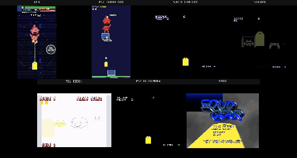
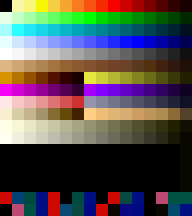
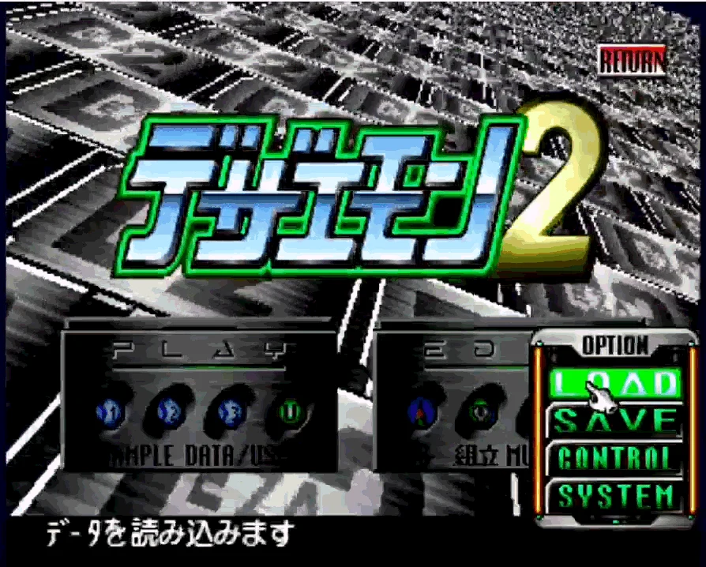
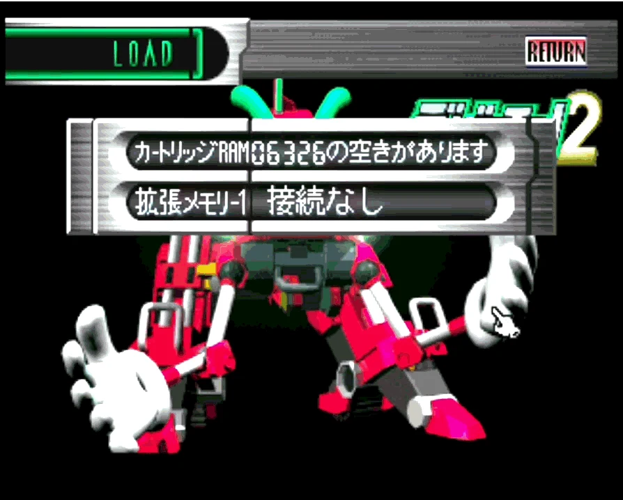
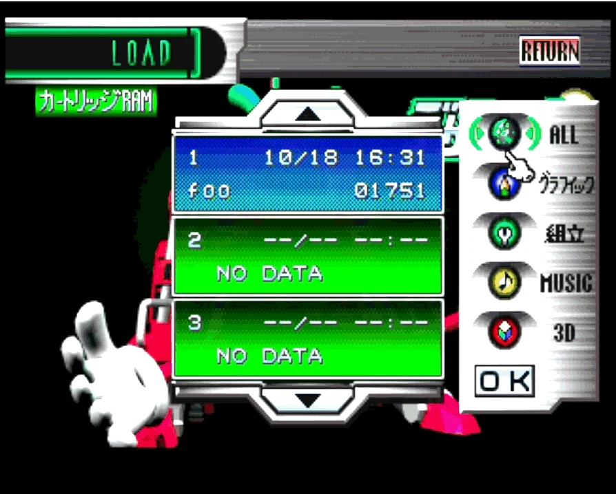
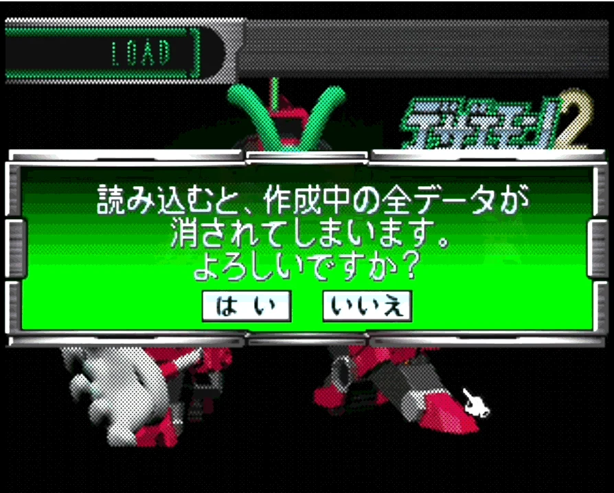
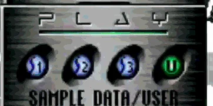
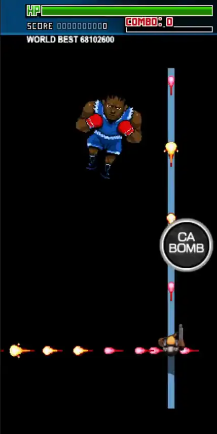

# shmupX — codemonkey.games



The final CMG launcher, rebuilt as **shmupX**: a Deno Fresh 2 + Vite app for
[Deno Deploy](https://deploy.deno.com) with a single built-in game — the shmupX
level editor, a standalone version of the cmg level editor.

The `.sav` / `game.json` pipeline (Dezaemon 2 Saturn save parsing, decoding,
mapping, atlas packing, schema validation) lives in the
[`packages/shmup-engine`](packages/shmup-engine) workspace member, published to
JSR as `@shmupx/shmup-engine`. The editor consumes it as a same-origin bundle
built by `deno task engine:bundle` into `static/engine/shmup-engine.js`.

Everything that takes what the engine produces and makes it **run somewhere
else** — the PlayStation 2 export, the packaged Windows / Linux / macOS
launchers, the Android and iOS apps, the Saturn cart, the emulator injection and
the parity profiler — is the second workspace member,
[`packages/shmup-harbor`](packages/shmup-harbor), published as
`@shmupx/shmup-harbor`. The `deno task`s below are unchanged; the app imports
what it needs of it back by name (`@shmupx/shmup-harbor/zip`, `/png`, `/export`,
…). **Port file paths in this document are relative to that package** unless
they are written out in full.

## Layout

- `main.ts`, `routes/`, `vite.config.ts` — the Fresh shell (launcher marker
  injection + static files + fs routes).
- `desktop.ts` — the packaged desktop launcher's own runtime: the loopback
  server and the window it opens. `scripts/build-desktop.ts` (in harbor) is what
  packages it (`deno task build:windows` / `build:linux` / `build:mac`, see
  below).
- `lib/ps2/`, `scripts/build-ps2.ts` — the PlayStation 2 export
  (`deno task build:ps2`, see below). Pure Deno, no toolchain to install.
- `scripts/build-sav.ts` — the **Dezaemon 2 cart export**
  (`deno task
  build:sav`, see **Writing a .sav** below): a cloud level as the
  1,114,112-byte `.sav` MiSTer's Saturn core reads, its art cut to the Saturn or
  Super Famicom palette. The editor's DOWNLOAD .SAV / → SAVE SHELF rows run the
  same engine code in the page.
- `svelte-src/` — the launcher dashboard (Svelte 5), esbuild-bundled at build
  time into `static/dashboard.bundle.js` by `deno task dashboard:build`.
- `data/games.json` → `deno task games:manifest` → `static/games.manifest.json`
  — the OTA manifest the dashboard fetches (push to main = every client sees the
  new list, no rebuild).
- `data/eshop.json` — the **eShop** catalog, the global game list (see **The
  eShop** below). Baked into the same manifest as its `eshop` array; a game is
  added by pull request, and `deno task eshop:check` validates the entries.
- `static/games/super-mario-sp/` — **Super Mario SP**, a Super Famicom cartridge
  this project can actually hand a player: a HiROM homebrew built from
  NovaSquirrel's MIT
  [snes-platformer-example](https://github.com/NovaSquirrel/snes-platformer-example)
  and rethemed with [mario-sp](https://github.com/easierbycode/mario-sp)'s art
  and its level 1. The source and the build are in `tools/super-mario-sp/`
  (`deno task super-mario-sp:rom`); only the finished `.sfc` lands here, beside
  a **vendored single-threaded EmulatorJS 4.2.3** and the page that boots it.
  Every URL in that page is relative, so the same bytes play at
  `/games/super-mario-sp/` off the static server and at `/eshop/super-mario-sp/`
  out of Cache Storage after an install — which is also why
  `/games/super-mario-sp` is listed in `lib/static-indexes.ts`, since the bare
  URL would resolve every relative URL one level too high. Single-threaded
  because an installed page is never cross-origin isolated: `emu-sw.js`'s
  `eshopFile` stamps no COOP/COEP, so there is no `SharedArrayBuffer`. Licensing
  is not this repo's MIT — see `VENDOR.md` and `NOTICE.md`.
- `static/editor/` — the shmupX level editor (single-file app). Its wave grid
  has a **VERT / HORIZ** switch on the stage rail: the same waves laid out top
  to bottom, or left to right the way a Dezaemon horizontal cart scrolls
  (auto-picked from a `.sav`'s game-mode bit). The SELECT ENEMY picker edits the
  roster it lists: `+ STOCK` adds an enemy of the game the editor booted on
  (every frame already in `game_asset`), `+ LIBRARY` one from the shared
  character library, `+ NEW` a blank record opened in the CHARACTER EDITOR, and
  each entry's `×` removes it, clearing its cells on every stage. A boss added
  from the library lands in the first free slot, and the runtime pairs stage N
  with slot `bossN` — so the import offers the open stage's slot, the Boss Lab
  tags the chip that stage fights with **STAGE nn** and gives every other chip
  **FIGHT ON STAGE nn** (A APPLY trades the two records' slots, keeping the
  stage's parking row with the slot), and PLAY from the lab with another chip
  lit asks before moving it. SAVE — the toolbar badge, the drawer row, Y on a
  pad — shows for any loaded game: an unnamed one is asked for its cloud name
  on the first press. The Atlas Manager's atlas selector keeps each atlas's
  working state (`atlasStash`): a trip to `game_ui` and back no longer drops
  the level's custom frames, and the cloud save, the `.sav` writer and the app
  export always read the level atlas (`levelAtlasState`), plus every frame a
  record names that the hosted stock atlas lacks. The UI atlases ship too: a
  frame replaced or added in `game_ui` or `title_ui` (titleG.gif, the
  wordmark the title draws, say) is packed like the level's custom frames and
  carried as `uiAtlases: { <atlasKey>: { imageDataURL, frames } }` by the
  cloud save, PLAY and the exports (`uiAtlasesForSave`); a cloud load keeps
  the record's sets and folds them into the atlas when the Atlas Manager opens
  it (`foldCloudUiAtlas`). A record saved before `uiAtlases` existed can
  carry such a frame in its level atlas instead (the cloud game `contra`'s
  titleG.gif, which the Atlas Manager showed and the title never did): the
  load moves it into the record's sets (`liftUiFramesFromLevelAtlas`), so it
  shows under `game_ui` and PLAY and the next save carry it there. Upload
  Sprites replaces a frame whose name it
  matches instead of adding a second frame under the same name. A record whose art the atlas
  has lost is healed on load: the library answers by frame name, then by
  replaying `+ LIBRARY`'s `<name>_<n>.png` renames over the library record,
  then the editor's own banks (Duke, the trooper, the roster sheet's ships);
  a set that still has one frame plays it in place of the lost ones, and only
  a set with none reaches the MISSING TEXTURES panel. ADVANCED EDITORS →
  TILEMAP and PIXELS, and the map badge on the toolbar, open the two tools
  below on the open game. A game whose stages carry no tile scenery — one that
  scrolls the runtime's `stage_loop<N>.png` behind each stage and shows
  `stage_end<N>.png` under its boss, which is every game that is not a
  Dezaemon import — gets the **Background Manager** in the map badge's place
  (ADVANCED EDITORS → BACKGROUNDS on a phone): the current art of the stage's
  set (sets 0–4; stage 5 and up reuse set N % 5), UPLOAD FILE or FROM URL in
  its place, and the stock art back. Replacements are PNG data URLs on
  `gameData.stageBackgrounds`, which ride the cloud save and PLAY's recipe;
  the runtime's level loader puts them over its own art and over the
  starfield it draws for a level with custom enemies. ADVANCED EDITORS →
  **CABINET** is the page _around_ the game, as the 2019 game's own page had
  it: a BACKDROP over the page behind everything (its `img/bg.jpg`, an
  arcade — drawn as wide as the page and as tall as the game, centered on
  it: covering the viewport instead showed its edge rows as two lines above
  and below the game on a phone), a FRAME around the screen (its
  `img/frame.jpg`, a bezel: scaled to the game's height and centered on it,
  unless a SCREEN rect — X Y W H in the picture's pixels — says where the
  game draws), the HOW TO PLAY card the
  title's button opens (its `howto_en.jpg`; without a card the title has no
  button, where it used to have one that did nothing), and the LOADING
  SCREEN — the spinner's frames, 120 ms each, over the picture drawn faintly
  under them (its `loading0..2.gif`, which are _not_ the runtime's). Each slot
  takes UPLOAD FILE or FROM URL (the loading slot takes several frames at
  once, sorted by name) and clears back to nothing or the stock spinner. The
  pictures are data URLs on `gameData.cabinet` (`{ backdrop, frame: { image,
  screen? }, howto, loading: { frames, bg? } }`, `normalizeCabinet` in
  `level-loader.js`, which drops anything else); a JPEG over 600 KB is
  re-encoded at 82% on its way in, since every boot fetches the record whole
  (the 2019 poster: 1.3 MB → 0.4 MB). The runtime's level loader puts them
  up on both roads in (`applyCabinet`) and reads the loading screen ahead of
  the level (`loadingArt`); the originals are kept in
  `static/games/2019/cabinet/` and the cloud game 2019 carries them.
  `tests/cabinet_test.ts` pins all of it.
- `static/palette.png` — the 288 Dezaemon 2 palette colours, one pixel each (see
  **The Dezaemon 2 palette** below); `palette-sheet.png` is the same as a
  picture. Both from `deno task deza:palette`.
- `static/pixel-editor/` — the **Pixel Editor**: 16×16-cell sprites drawn as
  palette indices over that palette and stored Saturn-native (see below).
- `static/tilemap-editor/` — the **SpriteX Tilemap Editor** mirrored here
  (spriteX's TILEMAP tab, plus level scenery in vertical/horizontal views, live
  pixel-sprite tiles and the **Tileset Extractor**). Both tools are in the CMG
  Desktop's Tools folder.
- `static/editor/dezaemon/` — the community Dezaemon 2 collection: 258
  `saves/Dez 2 - *.sav` games, `games-db.json` (title/developer/genre metadata,
  each game's page on satakore.com, and the YouTube id of the playthrough on
  that page) and `saves.manifest.json` — the served index the editor's .SAV LOAD
  GAME shelf reads, regenerated by `deno task deza:manifest` inside
  `deno task build`. Deploy can serve `static/` but can't list it at runtime, so
  the manifest is committed, exactly like `games.manifest.json`. A save the
  table knows gets a WEBSITE button on the import sheet and a VIEW WEBSITE row
  in the drawer; the 188 with a video get a ▶ on the shelf and on the launcher's
  coverflow, which previews it muted in place while hovered (or held, on a touch
  screen) and opens it in full on a press. Under the CMG Desktop (`/desktop/`)
  those links open in its Web Browser window rather than a browser tab — YouTube
  watch URLs are framed as the /embed/ player, since the watch page itself
  refuses embedding. 258 covers is more than left/right can walk, so the
  coverflow carries an A–Z rail down its right edge — swipe or drag it to scrub
  to a letter (`[` / `]` and the right stick step the same buckets) — and a
  filter over title, Japanese title, developer and genre, opened with `/`,
  ⌘/Ctrl+F or the ⌕ button. Buckets are derived from what is actually on the
  shelf, so a letter nobody used never appears, and pinned favorites keep their
  own ★ bucket at the top. Beside them, `mesh-library.json` is the ポリ吉 3D
  part library (224 meshes decoded from the disc's `MDLDT_01–56.CMP` by
  `deno task deza:meshlib`, committed — see **PlayStation 2** below) that the
  Model Viewer draws a save's sec7 compositions with.
- `static/editor/model-viewer.html` — the **Model Viewer**: a Dezaemon save's
  sec7 3D models (ポリ吉 part compositions, decoded by the engine but never used
  by play — the Saturn rendered them to CG cells) drawn on Phaser 4.2's
  `Mesh2D`. Phaser 4 has no 3D, so the engine package does the projection on the
  CPU (`packages/shmup-engine/src/model/`) and hands the game object flat
  screen-space triangles in painter order, coloured by pointing every UV at a
  cell of a swatch texture. Reached from the editor's toolbar badge, its
  drawer's MODEL VIEWER row and the .SAV import sheet's VIEW 3D link (the editor
  hands the decoded models over through `sessionStorage` and the viewer bridge
  database), from the CMG Desktop's Tools folder, with `?sav=<url>`, by dropping
  a `.sav` on it, or with `?demo=1`.
- `static/games/2028-ai/` — the editor's base game + play runtime (the Phaser 4
  engine that runs editor-authored levels). `game.bundle.js` here is a vendored
  prebuilt artifact — this repo has no build step for it (the sources live in
  the 2019-es7 checkout), so it carries a handful of edits by hand that a
  rebuild would silently drop:
  - `LEVEL_DATA_URL` fetches `foo.json` same-origin instead of from cmg's deploy
    origin. `tools/build-level/lib/stage.js` matches that exact string when it
    stages an offline export, so the two must change together.
  - The level loader at the top of the bundle is an **inlined copy of
    `static/phaser-plugins/level-loader.js`**, so an edit to the plugin reaches
    the game only when it is made in both places. `applyStageBackgrounds` is the
    latest: a level's own `stageBackgrounds` (see **Import, export, mods and the
    LIBRARY** below) replace the `stage_loop<N>` / `stage_end<N>` textures _and_
    their `_c` twins, and drop `stage_over_c`, because the runtime draws the
    `_c` set — `space_stars.png` under the `space_corridor.png` overlay — for
    any level with custom enemies, which every cloud level has. Awaited on both
    roads in (`mergeAtlas` and `mergeEditorAtlas`), since a `?level=` visit goes
    straight into the stage. `tests/stage_backgrounds_test.ts` checks the two
    copies carry it.
  - `applyCabinet` and `loadingArt`, with the helpers they share
    (`normalizeCabinet`, `cabinetScreenRect`, `cabinetFrameBox`,
    `cabinetBackdropBox`, `installCabinetBackdrop`, `installCabinetFrame`,
    `installCabinetHowto`): a level's **cabinet** — the page around the game,
    see the editor's CABINET above. `applyCabinet` runs first on both roads
    in: the backdrop goes over the body, sized by `cabinetBackdropBox` (the
    page's width, the game's height), the frame into `#phaser-canvas` behind
    the canvas, placed by `cabinetFrameBox` from the canvas's client rect
    (offsetTop rounds away the half pixel the page's flex centering leaves,
    and a frame laid at the rounded offset overhangs the canvas by it), both
    re-laid by a ResizeObserver whenever the page's `fitCanvas` re-sizes the
    canvas, and the HOW TO PLAY card becomes an
    overlay that defines `window.howtoModalOpen`, stopping its pointer events
    at its edge so a tap on it never reaches Phaser's window listeners (the
    title's tap zone would start the game). `loadingArt` reads the level's
    loading screen ahead of the level itself, since `loadLevel` runs in
    `create()` and the spinner is over by then: the editor's PLAY recipe or
    the baked record at hand, else the one `cabinet/loading` node off the
    database (through the alias index). `PluginBootScene.preload` calls it,
    never awaiting; `BootScene.applyLoadingArt` decodes what comes back into
    `loading_custom<N>` / `loading_bg_custom` textures and the spinner reads
    its keys from `loadingKeys` / `loadingBgKey` from then on, mid-animation
    if it is already up (it used to count three fixed stock frames).
    `TitleScene` shows its HOW TO PLAY button only when
    `window.howtoModalOpen` exists — it used to show one that did nothing on
    every page but 2019-es7's own. `tests/cabinet_test.ts` pins both copies
    and the bundle's two scenes.
  - Every font stack that read `Orbitron` — the Dezaemon title prompt
    (`dezaCellText`), the STAFF ROLL card's thanks and credit labels, and the
    standalone PAUSE panel — reads `athenaFont`: Dezaemon 2's own 8×8 game font,
    the one its kernel sets SCORE, PAUSE! and ESCAPE in. It is font 0 of the
    disc's `GFONT.BIN` (8bpp 8×8 cells from `0x800`, ASCII order; each body
    pixel carries its row index for the palette gradient and `0x0A` is a baked 1
    px drop shadow), lifted with `deno task deza:disc get` into spriteX's
    catalog as `atlases/athenaFont` (body pixels only, TEXT_SET1 order) and
    traced to TrueType by spriteX's `scripts/export-font.mjs` — one em per 8 px
    cell, so at the prompt's 8 px every glyph pixel is one canvas pixel and
    every glyph advances one grid cell. The runtime redraws the shadow with
    Phaser's text shadow (offset 1,1) rather than an outline stroke, which would
    fill a pixel face's counters in, and keeps fontStyle normal so no bold is
    synthesised. Shipped as `assets/fonts/athenaFont.ttf` beside its glyph
    sheet; `routes/games/2028-ai.tsx` and
    `tools/build-level/lib/shell-template.js` declare and preload it. The
    Orbitron files stay for the launcher and editor chrome, which still use it.
  - `tryNavigatorVibrate` returns early when
    `navigator.userActivation.hasBeenActive` is false. Chrome blocks
    `navigator.vibrate()` before the frame has been tapped and logs an
    intervention for every call; the blocked call _returns false_ rather than
    throwing, so the function's own `try/catch` never suppressed it. Upstream
    fix belongs in `2019-es7/src/haptics.js`.
  - `window.__cmgSetPaused = cmgSetPaused` exposes the cmg pause closure to
    `static/phaser-plugins/extract-mode.js`. Embedded in the launcher the
    standalone PAUSE panel is never built, so extract mode has no button to ride
    and must pause the game itself; routing through this one closure keeps a
    single `cmgPaused` flag and the per-`Sound` bookkeeping. The plugin falls
    back to its own `loop.sleep()` if the line goes missing.
  - `cmgSetTurbo` / `cmgWrapLoop` are the Guide's Turbo (see **Turbo** below):
    the page advertises it with `cmg-turbo` beside the pause listener, and
    `create2028Game` wraps the game loop's callback so every scene gets its
    delta times the factor. Standalone there is no Guide, so the PAUSE panel
    carries a TURBO switch of its own (`cmgToggleRow`, between the sliders
    and RESUME): an exported app's pause, a direct visit's.
    `tests/turbo_pause_panel_test.ts`.
  - `cmgBroadcastCheats` posts the Guide's Cheats submenu to the launcher once
    the level has resolved, because the set depends on which level is running —
    see **A Dezaemon save is not 2028.Ai** below. `routes/games/2028-ai.tsx`
    used to send a fixed list from its `<head>` and no longer does.
  - `isImportedLevel` trusts a record's `meta` when it has one: only a record
    older than the meta stamp is judged by whether its enemies carry
    `dezaemon` blocks. The shared library's characters keep those blocks, so a
    NEW GAME built out of them (`meta.version`, no `source`) used to be taken
    for a cart — its story switched off in OG mode, no CONTINUE? prompt, the
    cart's title fallback.
  - `loadLevel` opens a `?level=` visit through the title when the record is a
    whole game — `recordIsAGame`: a story, its own title art, or a second
    stage — and the URL names no stage; a bare level still opens in its stage.
    Before, every named level booted straight into `PhaserGameScene`, so a
    cloud game's own title screen and its stage-0 story were never seen on the
    web. Mirrors `static/phaser-plugins/level-loader.js`.
  - `mergeRecipe` takes a record's `stages` as the whole game: a base stage
    the record does not name is dropped from the recipe, so a two-stage cloud
    game ends after its second on the web as it does from the editor's PLAY,
    instead of running on into 2028.Ai's stages 2-4. The editor hand-off
    (`?editorPlay=1`) also applies the record's title art now (the editor
    sends it in the recipe): PLAY opens in the stage, but the ending returns
    to the title, and that title was the base game's. Both mirror
    `level-loader.js`.
  - `applyUiAtlases` stacks a record's `uiAtlases` sets (the editor's
    replacements in `game_ui` / `title_ui`) onto those textures the way the
    level's own atlas goes onto `game_asset`, on both the cloud path and the
    editor hand-off, so a replaced title plate draws from the game's art.
    A UI frame an older save left in the level atlas goes up too
    (`_liftUiFrames`): the three atlases share no frame name, so a level
    frame `game_asset` lacks and `game_ui` has is that frame, cut out and
    stacked onto `game_ui` before the level atlas lands on `game_asset`. That
    is what kept `contra`'s titleG.gif off its title, with no re-save needed.
    Mirrors `level-loader.js`.
  - `applyStoryImages` decodes a game's own story pictures
    (`storyData.customImages`) into the `advCustom_<key>` textures AdvScene
    reads, on both roads in, before the first scene starts. AdvScene used to
    decode each as its part came up, over 2028.Ai's stock portrait for the
    part, which showed until the decode finished: a flicker of the stock story
    in an Android export (`rando.apk`). `_applyCustomImage` also keeps the
    backdrop hidden, never stock, while a picture is still decoding.
    `tests/story_images_test.ts` pins both. Mirrors `level-loader.js`.
  - A custom game — a level named on the URL, an exported app's record, the
    editor's PLAY of a saved game — wears 2028.Ai's title plates only where it
    brought none of its own. `loadLevel` reads what it brought off the record
    (`customTitleArt`: `logoDataURL` or a `logo.gif` in its `game_ui` set,
    `subTitleDataURL` or a `subTitle*.gif` there, a `titleG.gif` there or left
    in its level atlas, `titleBgDataURL`) and puts that, with the game's name
    (`name`, else the key it was fetched by), on `recipe.customTitle`.
    TitleScene then draws what is missing: the name set in Orbitron on a plate
    the size of `logo.gif` for the logo (`nameLogoTexture`; the game page
    self-hosts the face for canvas text, `lib/game-page.ts`), the stock
    subtitle's genre tag alone — `assets/img/subTitleCustom.png`, the plate the
    cloud game `rando` drew — for the subtitle, the game's own ship, frame 0,
    where G stands (`shipTitleGTexture`), and `rando`'s gold 2028 for the
    scrolling backdrop in place of `title_bg.jpg`'s blue 2019 —
    `assets/img/titleBgCustom.jpg`, `rando`'s plate redrawn as an 845x480
    tile (see the scrolling backdrop below). The Android forge's
    `KEEP_FILES` stages both plates. A title plate of its own also makes the
    record a game (`recordIsAGame`), so a `?level=` visit opens on that title.
    The default visit is 2028.Ai itself and carries no `customTitle`; a cart's
    own title and an import's ship logo are settled first.
    `tests/custom_title_test.ts` pins the three copies. Mirrors
    `level-loader.js`.
  - The title's backdrop scrolls sideways without end. Its offset is kept
    within one width of its texture (`wrapTilePositionX`, folded in
    TitleScene's `update` before a frame's steps, and only on a frame that
    runs one, so the refresh blend never straddles the fold). A backdrop
    wraps without a seam only where its width is a period of its pattern.
    `rando`'s upload (the top 768x480 of it, kept as
    `scripts/2028-ai/art/titleBgCustom-rando.jpg`) is not: 768 is no period
    of its lattice, so it showed a seam at every wrap. The shared plate is
    that gold 2028 redrawn by `scripts/2028-ai/draw_2028_backdrop.py`: the
    same words, emboss, gold and grain, measured off the upload, as an
    845x480 tile, three rows of the lattice across, so it repeats exactly
    every 845 pixels; its words sit where the upload's do. The records that
    carried the whole upload (a 768x1376 PNG, kept as
    `scripts/2028-ai/art/titleBgUpload-rando.png`) as their own
    `titleBgDataURL` carry the tile instead, as a PNG
    (`scripts/2028-ai/art/titleBg2028.png`, since the PS2, Saturn and SFC
    exporters read only PNG and GIF title art): 2028.Ai's `foo.json`, which
    a plain visit bakes, and the database's `rando` and `foo`, written by
    `scripts/2028-ai/title-backdrop.ts` (a dry run unless `--apply`;
    `--revert` puts the upload back). The cloud game `gs` brings its own:
    the same gold plate reading 869, also 845x480, drawn the same way by
    `scripts/gs/draw_869_backdrop.py` and written as the level's
    `titleBgDataURL` by `scripts/gs/title-backdrop.ts` (`--revert` takes it
    back out). `tests/refresh_interpolation_test.ts`,
    `tests/custom_title_test.ts`, `tests/seamless_2028_backdrop_test.ts` and
    `tests/gs_title_backdrop_test.ts` pin them.
  - The STAFF ROLL (the title's panel and the ending's) sets shmupX's own
    credits as text, `SHMUPX_STAFF_ROLL`, unless the custom game's `game_ui`
    set carries a `staffrollName.gif`: then `ownStaffrollPlate` draws that
    plate at (15, 90) instead, as 2028.Ai's roll did, without the handles and
    tie-in links it put over it. `customTitleArt` reports it as `staffroll`.
    `2019-PS2` carries 2019's SGT plate. `tests/custom_title_test.ts` pins it.
  - A custom game's SP cut-in is `rando`'s where it drew none of its own.
    `assets/img/cutinCustom.png` is `rando`'s nine frames, a 3x3 spritesheet
    (`cutin_custom`, loaded with the subtitle plate), and `applyCustomCutin`
    paints them over `cutin0.gif`..`cutin8.gif` in `game_asset`, in place, so
    the atlas keeps its size (stacking them would add 426 rows toward a
    phone's 4096 texture limit). It runs before the game's own atlas stacks,
    so a cut-in the game drew still wins its names. A game's atlas often
    carries the stock cut-in back frame for frame — `akuma`, `hell` and
    `turbo` all do, copies the editor saved — so the paint fingerprints the
    frames it covers, and `_withoutStockCutins` leaves a copy out of the stack
    on both roads (the cloud level's atlas, the editor's working one). Custom
    here is narrower than for the title: a level named on the URL, a saved
    game's PLAY, or an exported app (`__EXPORTED_LEVEL_APP__` from the
    export's shell, `__OFFLINE_LEVEL_NAME__` from the in-game forge's). Being
    offline is not enough, because a plain visit bakes 2028.Ai's own
    `foo.json` in as its offline level, and that is the stock game, which
    keeps its cut-in. A level with `ownCutin: true` keeps the cut-in it has
    and is never painted: `2019-PS2` carries the 2019 game's nine frames in
    its atlas, which are 2028.Ai's pixel for pixel and would otherwise be left
    out as a copy. The editor loads and saves the flag beside `noStory`.
    `95-demo` carries rando's nine itself, in its own atlas under the stock
    names, with `ownCutin: true`: its eShop web build is a standalone page
    that bakes its `foo.json` in as the offline level, neither a `?level=`
    visit nor an exported app, so the loader would not paint them there
    (`scripts/95-demo/build-level.ts`, `CUTIN_SHEET`).
    `tests/custom_cutin_test.ts` pins both copies. Mirrors
    `level-loader.js`.
  - `DEZA_ROLL_STRIP_DROP`: the staff roll's credit plates land with their
    TOP edge at the traced y, not their centre, so a name sits under its label
    instead of under the typed PRESENTED BY (see the comment on the constant,
    and FORMAT.md's staff-roll row).
  - `PhaserAdvScene` past the last stage is the epilogue, and a game has one
    only if its author wrote it (`authoredEpilogue`: words or a picture under
    `stage<last+1>` that are not one of the base game's five stories the
    editor seeds a game with). A two-stage game used to play the base game's
    third-stage text before its ending, and a game whose story had no entry
    for the stage replayed its first one. The base game's own epilogue is its
    hardcoded `stage5`, which stays.
  - `PhaserAdvScene` fits a game's own story picture inside the 256×240 above
    the story box at its own shape and centres it there (`storyPictureFit`,
    `_placeBackdrop`), as the PS2's story scene does. It used to draw it at its
    own size from the top-left corner: gs's 180×240 sat 38 px left of centre,
    and the default level's 642×547 showed only its top-left quarter. The
    stock 256×220 portraits stay at 0,0. `tests/story_images_test.ts`.
  - The third-stage story of gs, and of `rando` (the game the SAVE SHELF's
    exports play), carries the glitter bunny pin on its second part:
    `storyData/customImages/stage2_part1` is the pin alone, cut out of its
    photo (`scripts/gs/art/bunnyPinUpload.jpg`: the pin on black among a
    scatter of stars) by `scripts/gs/cut_bunny_pin.py` onto a transparent
    180×240 (`scripts/gs/art/bunnyPin.png`), the size the game's other story
    pictures are, and written by `scripts/gs/story-bunny-pin.ts` (`--level
    rando` for rando; a dry run unless `--apply`; `--revert` puts back what
    the slot held: rando's raw upload, nothing on gs). gs has two stages, so
    its entry is the one past its last, and the pin makes it an authored
    epilogue: its seeded words and the pin play after stage 2, where the game
    went straight to its ending. `tests/gs_story_bunny_pin_test.ts`.
  - rando's first boss fires a beam and a Hadoken. Its slot
    (`shmupX/levels/rando/bossData/boss0`) is the Character Library's
    dezaBoss0 — Ryu riding a Hadoken, on his Dezaemon record — and out of
    both of his weapons he threw the cart's stock bullets (dezaBullet0 and
    dezaBullet2, carried as `dezaBoss0_4..11`): small red and cyan dots.
    `scripts/rando/first-boss-arms.ts` arms weapon A, his aimed shots, with
    the library's `hadouken` (the two-frame flicker hadoukenBoss fires, the
    comet of his own part 37) and weapon C, the spread and the spiral, with
    its `beam` — six frames packed under the level's sheet; the record's hp,
    patterns, parts, flame, speeds and damage stay as they are. A dry run
    unless `--apply` (`--out` writes the level as it would be, for a
    play-through on `window.__OFFLINE_LEVEL__`); `--revert` puts the stock
    bullets back and takes the frames out. Akuma (purple and red fireballs)
    and Trump (green laser, gold fireball) already fire what their records
    name. `tests/rando_first_boss_arms_test.ts`.
  - A weapon record's `facing` turns its bullets to their heading: the
    direction the art is drawn flying, in degrees clockwise from right (0 =
    right, 90 = down). `faceBulletHeading` rotates each bullet of such a
    record to its flight direction, from every boss spawner that knows it — a
    Dezaemon boss's fire points (`spawnDezaBossBullet`) and a stock routine's
    straight and aimed shots — so rando's beam, a horizontal bar, flies
    point-first wherever it is aimed. A record without it is never turned, as
    before: a fireball reads the same at any angle.
    `tests/boss_bullet_facing_test.ts`.
  - A shot turned a quarter turn is snapped onto the pixel grid
    (`snapQuarterTurn`). `pixelArt: true` has Phaser 4 round a sprite's
    corners before it draws them, but only a sprite that is merely translated
    (`vertexRoundMode` "safeAuto"); anything rotated keeps its corners
    wherever its position and its frame put them. Every stock player shot
    flies a quarter turn from its art (`shootBullets`), so a shot whose frame
    is an odd number of pixels tall — 95-demo's dart is packed 12×5 — sat
    with both long edges on half pixels while the ship rested on an integer
    x, and every pixel centre across its width landed exactly on a texel
    boundary. Nearest sampling on a boundary is the GPU's call: desktop
    rasterisers happen to answer consistently, but a phone GPU answering
    differently for the quad's two triangles dropped the dart's 1 px stem
    and tail and drew only its 5 px band, until the ship moved to a
    fractional x. A quarter-turned quad is still an axis-aligned rectangle
    whose corners share one fractional part, so rounding them keeps its
    size: an exact quarter turn at unit scale gets "fullAuto", the rounding
    straight sprites already have, from every spawner that turns a shot (the
    stock shots, `spawnDezaPlayerShot` and the homing, growing and deflected
    steps that re-turn or resize one, `faceBulletHeading`, `bossShootBeam`);
    any other angle, or a scaled shot, keeps the default, where rounding
    would make the quad flicker. `tests/quarter_turn_shot_test.ts`.
  - CONTINUE? → YES resumes on the stage that killed you, for every game. The
    Phaser port reset `stageId` to 0 there (2019-es7 275fab6, with the title's
    and the ending's resets, which stay), so a continue on gs's second stage
    went back to its first; 2019's own ContinueScene, the PS2 port and an
    imported cart never did. `tests/continue_resume_test.ts`.
  - A cheat opens the level where it asks, and holds. The Guide writes its
    Cheats into the frame's URL (`?stage=N`, `?bossRush=1`, `?boss=goki`,
    `?finalBoss=1`) and reloads it, and `PluginBootScene` read them into
    `gameState` — then showed the title, whose START (`goToAdvScene`)
    begins a fresh run: stage 0, no boss rush, no Akuma. The editor's hand-off
    never saw it (`?editorPlay=1` skips the title); the eShop's 2019 web
    build always did, since it boots like a plain visit. `cmgCheatStart` now
    reads the four off the URL in one place, a boot that asks for one goes
    straight to `PhaserGameScene` as the game's own `BootScene` always did
    (no title, no story), and `goToAdvScene` lays them back over the fresh
    state (`cmgApplyCheatStart`), so GO TO TITLE → START replays them while
    the Guide still shows them on. Mod Mode is not one of them: it changes
    which parts play, not where the run starts. `tests/cheat_boot_test.ts`
    pins all three. Upstream homes: `scripts/2028-ai/boot-entry.js` and
    `2019-es7/src/phaser/TitleScene.js`. The editor's two PLAY rows put the
    open stage on the URL as `?stage=` too, so a game saved on its second
    stage (the cloud game `rando`) read as a Start Stage cheat: PLAY GAME
    opened in that stage with no title, and either row's title then STARTed
    straight back into it. PLAY IN PHASER now hands its stage over in
    localStorage alone (`editorStageKey`, which `readEditorPlayRequest` already
    reads), and PLAY GAME opens the saved game at its title
    (`tests/editor_play_urls_test.ts`).
  - A boss dies as the boss whatever finished it. `updateDezaColumns` (the
    Dezaemon sub-weapon 5 / charge 2 columns) used to bill the boss sprite and
    hand the kill to `enemyDie`, which destroyed the sprite without telling the
    boss machinery: no death drift, no STAGE CLEAR, and a skull balloon and TIME
    label left hanging over an empty sky. It now keeps `scene.bossHp` and the
    danger balloon in step, skips the boss while it is flying in, and routes the
    kill through `bossDie` — and `enemyDie` itself hands a boss over to
    `bossDie`, so no other weapon can repeat it. Upstream fix belongs in
    `2019-es7/src/phaser/game-objects/Enemy.js`.
  - Akuma stays 2028.Ai's. `bossAdd` armed the hidden-boss sequence on stage 3
    of any run played without a continue — which every imported cart is, since
    it has no CONTINUE? — and `_startGokiSequence` then stopped time
    (`theWorldFlg`), found no `bossExtra` record in the cart's `bossData`
    (`mergeRecipe` replaces the base game's wholesale) and handed straight back
    to `bossShootStart` with the flag still set: the boss never fired, TIME sat
    at 99 and the ship could neither shoot nor bomb. The sequence is now armed
    only when the level is not a Dezaemon import and actually carries a
    `bossExtra`, and the no-record fallback lifts the time-stop before it hands
    over. Upstream fix belongs in `2019-es7/src/phaser/game-objects/Boss.js`.
  - Akuma's grab gives the world back when the run survives it. The Shun Goku
    Satsu (`gokiPlayerAttack`: a boss on his routine catching a ship that
    touches it) stops time, lands its hit and shows the KO, and only god mode
    ever lifted the stop — a web game's ship died of the hit and the run went to
    CONTINUE?, so nothing else had to. A ship out of a stock (a cart played OG,
    or the 3-HIT SHIP off) is replaced inside the hit (`dezaNextShip`), a
    shielded one survives it, a second player may still be flying: the fight
    then sat frozen on the KO for good (rando's Akuma). The grab now keeps what
    it draws (`akebonoOverlays`) and, with a player still flying and the run not
    ended, fades the KO and hands back to `bossShootStart` 800 ms after it, as
    god mode did. And a ship the grab's own hit would bounce off — blinking
    after a hit or a respawn, under a bomb, behind a barrier — is not caught, so
    the next ship out of the stock is not taken again where it appears.
    `tests/boss_goki_pattern_test.ts`.
  - The grab's KO is the end of the run, not one ship of a stock. The shipped
    game's ship dies of the hit and goes to CONTINUE?; a one-hit ship out of a
    stock (a cart played OG, the SAVE SHELF's exports among them) was replaced
    inside the hit (`dezaNextShip`), so rando's Akuma left the next ship flying
    under his KO while Trump, met once the stock was spent, ended the run. The
    stock is spent before the hit lands, so the hit is the last ship's whoever
    flies the routine. And `onSpFire` refuses while time is stopped: the grab
    hides the SP button but left it live, and a bomb tapped inside the hold
    would have held the ship invincible through the hit.
    `tests/boss_goki_pattern_test.ts`.
  - A dying enemy's successor is drawn from a pool of its own.
    `spawnDeathChild` counted everything in the air against
    `DEZA_MAX_LIVE_ZAKO` — the zako, a boss's parts (`spawnDezaPart`, up to
    the same cap), the successors themselves — so once rando's first boss had
    its parts out, a shot motorcycle died without throwing its rider. It
    counts the successors alone now, tagged `dezaSuccessor` as they spawn.
    `tests/deza_successor_pool_test.ts`.
  - `create()` drops the boss-arrival slide (`bossAppearBgFlg`,
    `bossAppearBgScroll`). The Scene instance outlives a scene.stop/start, so a
    run that ended inside the boss's first seconds — GAME OVER, GO TO TITLE,
    START — carried the slide into the next game's stage 1, whose fresh backdrop
    slid down for whatever was left of the 214 px and opened with a black band
    across its top. `tests/boss_appear_scroll_test.ts`.
  - The SP button and the bomb drop wear Contra's winged eagle
    (`assets/img/contraBomb.png`, four colours, the `contraBomb` spritesheet)
    where a cart came back with the writer's stand-in square as its bomb icon:
    the writer gives a bomb item no letter (`lib/powerup-emblems.ts`), so a web
    game exported to the SAVE SHELF played with an orange box on the button and
    on every bomb pickup. `isWriterItemSquare` knows the box by its silhouette,
    as the letters are known; an author's own bomb icon is kept. The lit face
    cycles the four colours while a bomb is in stock (`cycleSpFace`).
    `tests/contra_bomb_test.ts`.
  - A game's own face is lit across its whole disc. `updateSpGauge` crops the
    lit face over the dim one as the meter fills, to the 51x50 inside which the
    shipped meter's lit art lies; a game's own face (`drawSpFace`) lights a
    56 px disc, so cropped the same way its warm ground showed as a square
    inside the dim disc, the eagle on it. A face of the game's own
    (`spOwnFace`) is cropped to the whole disc at full, and fills from the top
    as the shipped meter does. `tests/contra_bomb_test.ts`.
  - The true ending is 2028.Ai's too. `decideEnding` sent any run whose last
    stage is index 4 to the credits from stage 3's clear unless four akebono
    finishes and no continue had unlocked it. NO STORY, which every import
    arrives with, skips that rule — but an author who turns the story scenes on
    for a five-stage cart lost its fifth stage, and a cart's bomb never counts
    as an akebono finish, so nothing could earn it back. The rule now applies
    only when the level is not a Dezaemon import. Upstream fix belongs in
    `2019-es7/src/phaser/AdvScene.js`.
  - Split Controller mode opens the two-player gate. `twoPlayerAllowed` admits a
    second ship only on `?players=2` or a save's own 2P bit, so the stock game
    could never seat the second half of a Legion Go's controller. The bundle's
    `cmg-*` message listener now takes `{ type: "cmg-splitpads-set", value }`
    from the launcher (see **Lenovo Legion Go** under **Controllers**) into
    `gameState.cmgSplitPads`, which `twoPlayerAllowed` honours like the URL
    override. Upstream home would be
    `2019-es7/src/phaser/game-objects/Player.js`.
  - The scale channel as the Saturn draws it (`applyDezaScale`): every mode
    zooms both axes and leaves the object opaque; the alpha ramp the runtime
    used to invent for large zooms is gone. Stages whose flag byte asks for the
    renderer's drop-shadow pass (`stageFlags[].dropShadow`) draw each enemy's
    shadow scaled with it and offset `64 × (zoom − 0.6875)` px in x and y — +20
    px at ×1, as FORMAT.md traced — and stages that do not get no enemy shadows.
    `globalThis.__CMG_GAME_STATE__` exposes the game state to the debug plugin.
    Upstream home: `2019-es7/src/phaser/game-objects/Enemy.js` and `Shadow.js`.
  - The level loader's `mergeRecipe` (inlined here from
    `static/phaser-plugins/level-loader.js`, patched in both) now carries a
    fetched or offline record's `meta` into the recipe. It never did, so
    everything keyed off `meta.dezaemonSettings` — the horizontal game mode, the
    ship configs, the per-stage flags — only worked through the editor's PLAY
    hand-off, and a cart served as `foo.json` (an export, the profiler) played
    with none of it.
  - Two rules of the Saturn's change channels that the behaviour driver skipped:
    a scale channel that runs from spawn now seeds the sprite's scale at its
    first value (`initEnemyBehavior`), so an object authored to come in at ×3 is
    ×3 on its first frame; and an enemy flagged `dezaNoContact` (scale off unity
    — status bit15 in FORMAT.md) no longer fires, as it already did not collide.
    Upstream home for both is `2019-es7/src/phaser/game-objects/Enemy.js`.
  - The change-channel triggers as the Saturn resolves them: the spawn packs
    the four channels' trigger bits into one status word as four independent
    3-bit fields, and the arm pass resolves each through `+0x4C8C` — a
    62/112/164 px line shifted by a signed byte indexed by the record's art
    band (±8 or 16 px, band 7 alone unshifted; air subtracts, ground adds), an
    air object arming once it has reached its line and a ground one once it
    has fallen back to it. `channelTrigger`/`armChannels` now carry the band
    (from `dezaemon.placementId`) and the ground sense; the per-channel arming
    was already there. A zoom or scale channel still waiting on its line now
    contributes ×1 (`applyDezaScale`), as the spawn-seeded registers do on
    hardware — it used to apply the channel's start value at once, so a record
    authored to appear at ×0 and grow once past its line was deleted on its
    first frame. `tests/deza_channel_triggers_test.ts` pins all of it against
    the bundle. Upstream home is `2019-es7/src/phaser/game-objects/Enemy.js`.
  - The Dezaemon divergences below, all of them keyed off `isImportedLevel()`.
  - A boss record can name its own stage-end backdrop. `stageBgEnd` on
    `bossData.boss<N>` raises the author's art behind the boss instead of the
    shipped `stage_end0..4`, so a cart can end on any sprite, atlas cell or
    rasterised tilemap it carries — see **Creating a character** below.
    `resolveStageBgEnd` takes a frame of the merged `game_asset` atlas, a
    texture key that is already loaded, or `{texture, frame}`, and falls back to
    the shipped backdrop when none of them resolve. The object form also takes
    an `alpha` (`opacity` is a synonym), 0..1, applied before the measure below
    so it is part of the object's initial state; on its own it draws the
    _shipped_ backdrop translucent, and a spec whose art does not resolve falls
    back opaque rather than half-applied. It runs where the image is created
    rather than later because the next line measures `.height`: Phaser answers
    an unregistered key with the 32 px `__MISSING` checkerboard, and the reveal
    would play as a black band. A stage with Dezaemon scenery (`dezaBg`) never
    shows a stage-end backdrop at all, so the field is inert there. Upstream
    home is `2019-es7/src/phaser/GameScene.js`.
  - A Dezaemon zako with no bank art fires its own projectile. `dezaVolley`
    re-skins every shot a Dezaemon-driven zako fires with the level's bullet
    bank (`dezaemonBullets.art[fire.mode]`), and with no bank it drew a cyan
    ring — so a web level's Dezaemon zako, which has no bank, could never show
    the projectile its record names. It now falls back to the zako's own
    `bulletData`/`projectileData` frames (`bulletFramesInAtlas`, so only art the
    atlas carries) before the ring; a cart import with a bank is unchanged. gs's
    Clevin (`scripts/gs/add-clevin.ts`) fires deza2_02's pattern with a geek
    badge this way, and an import that kept no bank — the rando level's imps
    among them — now shows each zako's own extracted shot art.
    `tests/deza_zako_own_shot_test.ts` pins it. Upstream home is
    `2019-es7/src/phaser/GameScene.js`.
  - A boss record can carry its own danger balloon. The skull that pops over a
    boss once one bomb would finish it (`boss_dengerous0..2.gif`) is swapped for
    the author's art by `dangerBalloon: {frames, x, y}` on the boss record:
    `frames` are frames of the merged `game_asset` atlas, flipped every 250 ms
    as the stock three are, and `x`/`y` place the balloon's bottom-left corner
    (a speech balloon's tail) from the boss sprite's top-left, the measure
    `BOSS_BALLOON_OFFSETS` uses. A bare array is the frames alone, at the slot's
    stock offset. `bossDangerBalloon` drops frames the atlas lacks, and with
    none left the stock skull and its offset come back: the balloon is the one
    cue that a bomb will finish the boss, so it never goes missing. It reads
    `scene.bossRecord`, the record `bossAdd` (or the hidden Akuma's takeover)
    built the fight from, or past a second stage the `stage2` record (which
    keeps the boss's balloon unless its block names one), so the record the
    player is fighting is the one that speaks. The cloud game `gs` uses it: its
    stage-2 boss, Daltonius, says "I'm Fired!!!", as Liu Kang's dragon too
    (`scripts/gs/build-stage2.ts` writes that stage, dragon and all, and
    `--revert` takes it back out; `scripts/gs/publish-daltonius.ts` puts the
    same Daltonius in the character library; the dragon's cells are kept in
    `scripts/gs/art`). The character tools carry the balloon's art with the
    boss: `referencedFrames` and `remapFrames` walk `dangerBalloon` like any
    other slot, and a `stage2` block like the record it is laid over.
    `tests/boss_danger_balloon_test.ts` pins it. Upstream home is
    `2019-es7/src/phaser/game-objects/Boss.js`.
  - The game draws at the display's own refresh rate. The game and title scenes
    step their logic at a fixed 120 Hz, so a 240 Hz monitor used to see every
    step drawn twice; `refreshApply` and the helpers beside it (before
    `TitleScene.js` in the bundle) draw step-driven motion where it would be at
    each frame's moment, and put the logic back before anything reads it.
    `?refresh=auto|max|stock` picks it. See **Drawing at the display's refresh
    rate** below; `tests/refresh_interpolation_test.ts` pins it. Upstream home
    is `2019-es7/src/phaser/GameScene.js` and `TitleScene.js`.
  - A cart's boss arms itself out of the cart. A cart has nowhere to keep a
    boss's own weapon records: the writer folds `bulletDataA/B/C` into the
    save-wide bullet bank and points the fire points at them, and the decoder
    hands them back only as `dezaemonBullets.art`, beside a record left on the
    starter's `bulletData: {}`. The Dezaemon state machine already armed itself
    out of that bank (`bossWeapon`); a boss pinned to a stock pattern
    (`attackPattern`, which a mod's web overlay lays back over the cart) read
    nothing but the record's slots and fired `normalProjectile` out of the empty
    stub. `bossAdd` now fills, on an import only, whatever slot the record left
    empty from the bank (`bankBossWeapon`, factored out of `bossWeapon`); a slot
    filled that way is marked `fromBank` so the state machine keeps reading the
    bank live, where the rank term moves. Upstream home is
    `2019-es7/src/phaser/game-objects/Boss.js`.
  - The SP button is an X-ray lens (`createSpLens`, from the Claude Design
    handoff "X-Ray effect for SP button", its final Tomograph). The CA BOMB disc
    is a permanent hologram window: the ships, their shots, enemies, enemy shots
    and pickups passing behind it are redrawn over the disc — never the stage,
    the shadows or the HUD — as a cyan luminance ramp (R 10 + 200L², G 110 +
    145L, B 140 + 115L) with 2 px scanlines at 45 %, a 1 px red/blue fringe, a 5
    px bloom and one scan line walking the disc every 1.6 s, over a 12 % field
    of 8 px grid and scanlines inside a faint cyan rim; the disc art under it is
    untouched. One 64×64 CanvasTexture, hand-drawn once per rendered frame with
    the prototype's own pixel math and shown by an Image at depth 104 (over the
    button, under the score popups) that takes no input, so the button keeps the
    tap — the same under WebGL and the Canvas renderer `Phaser.AUTO` may pick.
    The parts that never move (the field, the rim, the trail and scan line, the
    flare, the hologram's scanlines) are baked once into strips the paint
    stamps (`spLensBakeStrips`, `spLensBakeField`), and a frame with nothing
    behind the disc whose scan line is still on the same row is neither
    repainted nor uploaded: measured in the real game on a CPU slowed 4×, the
    lens went from 3.0–3.7 ms a frame to 2.3 with the ship parked behind the
    disc, and from 1.5 to 0.9 in play. `tests/sp_lens_test.ts` holds the ramp,
    the hookup and the skipped frames.
  - `GameScene.playSound` plays a one-shot effect from up to four standing
    voices per key (`playSfxVoice`), re-striking the oldest when all four are
    sounding, and drops a second strike of the same key inside one 16 ms frame
    (`sfxStrikeDue`, which holds the Dezaemon tone bank to the same rate). It
    used `sound.play(key)`, which builds a whole Phaser sound per call; the hit
    loop calls once per shot per enemy per 120 Hz step, so `rando`'s piercing
    shot raking stage 1's stacked wave asked for 86 `se_damage` in a quarter
    second and had 200+ copies of the 0.94 s sample alive at once, which is
    what stuttered its Android export. The same play now peaks at 22 live
    sounds in all. `tests/sfx_voices_test.ts`.
  - The level loader reads `shmupX/levels` and `shmupX/levelAliases` (its
    `DEFAULTS`, and the in-game Android forge's `LEVELS_PATH` / `ALIASES_PATH`,
    which now follows an alias too), and the high scores are one board and one
    cookie per game, named only once the level has resolved (`startGameScores`
    from `PluginBootScene`). See **shmupX's corner of the shared database** and
    **WORLD BEST and TODAY'S BEST, per game** below;
    `tests/shmupx_root_runtime_test.ts` and `tests/game_scores_test.ts` pin
    both. Upstream homes are `2019-es7/src/firebaseScores.js`, `gameIdentity.js`
    and `highScoreUi.js`.
  - A stage can end on its last kill. A record's `endsOnClear: true` (carried
    onto the recipe by both copies of `mergeRecipe`) makes GameScene note, in
    `create`, the spawn-order index of the last enemylist row that holds an
    enemy (`lastLiveRow`); once that row has spawned and no enemy but the boss
    is left on the field — shot down or flown off — the wave block skips the
    empty rows behind it and runs the wave's own end, `bossAdd`, which fights
    the stage's boss or clears a stage that has none. Without the flag a stage
    ends on its wave timer as before, so a runtime without this edit plays such
    a record to the end of its rows. The cloud game `95-demo` uses it: a Space
    Invaders level is over when its formation is (see **EVIL INVADERS '95 as a
    cloud game** below). `tests/95_demo_test.ts` pins both copies and the wave
    block. Upstream home is `2019-es7/src/phaser/GameScene.js`.
  - A boss can keep its whole body on the screen through Barlog's slides.
    `bossPatternBarlog` clamps where it slides a boss — its reposition, its dash
    to the ship, the dash before its dive — to 30 px from each wall, whatever
    the boss's size, so anything wider than 60 px hangs off the edge at the end
    of a slide (2028.Ai's own 128 px Barlog does). A boss record with
    `keepOnScreen: true` widens that margin to half its drawn width
    (`bossSlideMargin`), read off the record being fought, so a `stage2` that
    inherits the flag keeps it. Without the flag nothing changes. The cloud game
    `95-demo`'s CoolInvader, RainbowInvader and butt-devil trio carry it;
    `tests/95_demo_test.ts` pins the helper and the three clamps. Upstream home
    is `2019-es7/src/phaser/bosses/BossBarlog.js`.
- `lib/rtdb-root.ts` — where shmupX's own games sit in the Realtime Database it
  shares with cmg: `levels`, `levelAliases`, `atlases` and `characters` under
  `shmupX/`, beside cmg's root copies (see **shmupX's corner of the shared
  database** below).
- `mcp/` — the **character MCP server** (`deno task mcp:character`, registered
  for this repo by `.mcp.json`): clone a character out of the catalog, swap any
  frame of any sprite or atlas into its animations, its projectiles or its
  stage-end backdrop, play it, publish it. `.claude/skills/create-character/` is
  the skill that drives it from a sentence. See **Creating a character** below.
- `tools/shmupx-watch/` — the **shmupX watch** itself: a Wear OS app (Kotlin,
  Compose for Wear OS) that is two things on one wrist. A **game launcher** —
  browse the catalog, send a game to the paired desktop, drive it from there —
  built from the Claude Design handoff, and the older **agent screens** that
  dictate a sprite edit and show the preview. Its own
  [README](tools/shmupx-watch/README.md) has the screen map, the launch
  protocol, and which of the design's gestures a Pixel Watch can actually do
  (three of the five cannot).
- `tools/watch-bridge/` — one desktop side of that watch: a Node daemon that
  reads what was dictated on the wrist, runs it through `claude -p` with the
  character MCP attached, and writes the sprite back for the wrist to draw. Its
  own [README](tools/watch-bridge/README.md) has the run steps and the three CLI
  flags the whole thing hinges on.
- `static/watch-launch.js` — the _other_ desktop side: the launcher page's half
  of the watch protocol. A game picked on the wrist is started by
  `svelte-src/Dashboard.svelte`, not by the daemon, because three of the six
  kinds (arcade, SFC, PS2) live in that page's own Cache Storage and IndexedDB
  and cannot be started from a shell at all. The rules that decide whether to
  act on an incoming record are pure and tested in `tests/watch_launch_test.ts`.
- `static/music-player/` — the **music player**: AZLegendGolden's cassette
  deck (cmg's docked "AZ Legend" music app), vendored with no artist tracks so
  the launcher serves its own copy at `/music-player/`. The Guide docks it in a
  sidebar beside a running game, a game hands it its music (`?bgm=` on the URL,
  `music-player:add-albums` over postMessage, or the `cmg-music-album` the
  2028-ai runtime posts once its level resolves), and `game-bgm.js` there is
  the module a game routes its own BGM through. Its
  [README](static/music-player/README.md) has the protocol. See **The music
  player and the watch remote** below.
- `static/watch-music.js` — the launcher's half of the **watch music remote**:
  a paired watchAmp lists the deck's albums and switches the song. Same
  database and pairing code as `watch-launch.js`, its own `music` subtree;
  tested in `tests/watch_music_test.ts`.
- `tools/watchamp/` — **watchAmp**, the Wear OS MP3 player whose ♪ Desktop
  music screen is that remote's wrist end, vendored from
  [shmupX/watchAmp](https://github.com/shmupX/watchAmp) so the two halves live
  together (`deno task watchamp:build` / `watchamp:install` / `watchamp:test`).
  GPL-3.0, package `com.emre.aloud` — its own
  [README](tools/watchamp/README.md) says why neither changes.
- `packages/shmup-engine/` — the JSR module: everything for editing/exporting
  `.sav` and `game.json` games.
- `packages/shmup-harbor/` — the other JSR module: everything for **porting**
  one of them to a console, a desktop, a phone or a cartridge. `lib/ps2/`,
  `lib/export-build.ts`, `lib/export-worker.ts`, `lib/shelf.ts`,
  `lib/cart-inject.ts`, `lib/mednafen.ts`, `tools/build-level/`,
  `tools/sav-profiler/` and the `scripts/build-*` / `scripts/inject-*` CLIs
  behind the tasks below all live there, with their tests. Its own
  [README](packages/shmup-harbor/README.md) is the map.
- `spacetimedb/` — the online-2P module (see **Two players** below), published
  to SpacetimeDB. `static/netplay/` holds its generated client bindings and the
  bundled browser client.

## Tasks

```sh
deno task dev             # vite dev server (+ a Tailscale Funnel URL when available)
deno task build           # manifest + dashboard + engine bundle + vite build
deno task start           # serve the production build (_fresh/server.js)
deno task test            # shmup-engine + shmup-harbor + app tests
deno task check           # fmt + lint + type-check

deno task super-mario-sp:rom     # build the Super Famicom ROM (needs cc65)
deno task super-mario-sp:zip     # pack it into the eShop's install archive
deno task super-mario-sp:vendor  # re-fetch the pinned EmulatorJS files
deno task 2019:zip               # pack the 2019 game's PS2 web build into its eShop archive (--fetch refreshes the level first)

deno task build:windows   # the launcher as a Windows .exe
deno task build:linux     # the launcher as a Linux .AppImage
deno task build:mac       # the launcher as a macOS .app
deno task build:desktop   # …whichever of those three matches this host
deno task shelf:list      # every game name the five build targets accept
deno task build:android   # one game from the shelf as an .apk (needs a name)
deno task build:ios       # …as an unsigned .ipa (needs a name, and a Mac)
deno task publish:ios     # one game to TestFlight, built and signed on a GitHub Mac (needs a name, and a GitHub token)
deno task steam:waydroid  # that .apk into Waydroid, as a Lutris game and a Steam shortcut (Bazzite)
deno task build:ps2       # a level as a PlayStation 2 USB folder
deno task build:ps2:zip   # …as one .zip of that folder
deno task build:ps2:iso   # …plus a bootable disc image
deno task build:sav       # a level as a Dezaemon 2 cart save (.sav) for MiSTer / hardware
deno task sav:run         # …then launch it in Mednafen, cart preloaded (Windows / Linux / WSL→Windows)
deno task sav:inject      # …or merge it into one of the five save slots on the cart this machine's emulator keeps
deno task disc:inject     # …or write it onto the Dezaemon 2 disc itself, for a Saturn with no cart (the browser's): PLAY → U plays it
deno task sav:profile     # play a .sav in Mednafen and in the runtime at once and record a window of both (macOS)
deno task eshop:check     # validate data/eshop.json against the built manifest
deno task eshop:covers    # cover a published eShop game that went out without one (dry run; --write uploads)
deno task eshop:publish   # export a level as a Dezaemon 2 cart and publish it to the eShop, replacing that id (--name NAME lists it as; --dry-run writes nothing)
deno task bgm:tone        # transcribe an mp3 (path or URL) onto the Dezaemon 2 tone bank: a level's dezaemonBgm, one piece across the stages
deno task extension:zip   # pack the Sprite Picker extension into static/extension/ for the download page (part of build)
deno task level:normalize # bring a cloud level's 2019 names (normalTama0, cagage) up to today's (dry run; --write patches)
deno task level:alias     # other names a cloud game answers to (2019 -> 2019-PS2); dry run, --write sets
deno task level:reimport  # decode a cloud level's Dezaemon cart again with today's engine and publish it over the record, keeping its gameId (dry run; --write publishes, --restore puts the backup back)
deno task rtdb:split      # seed shmupX's own subtree of the database from cmg's root copies (dry run; --write copies, --force replaces)
deno task refresh:compare # stock vs max refresh: emulated 240 Hz side by side (mp4s), --live on this display, --compare saved results

deno task player2:art     # re-bake player 2's ship from shmup-party-phaser4
deno task deza:tonebank   # cut the Saturn tone bank out of a SNDPAC.BIN
deno task deza:meshlib    # decode the ポリ吉 3D part library off a disc image
deno task deza:palette    # write static/palette.png (+ palette-sheet.png) from DEZA2.PAL
deno task sfc:probe       # look inside a Super Famicom Dezaemon SRAM dump (report / png / hex / diff)
deno task sfc:stage       # copy the Dezaemon cart into static/ so a packaged launcher can boot it
deno task n64:stage       # Dezaemon 3D, translated to English, and the 64DD IPL into static/n64dd/ for the Nintendo 64DD player
deno task sfc:upload      # publish the Super Famicom library (dumps + covers + metadata) to the database
deno task psx:probe       # look inside a PlayStation Dezaemon+ / Dezaemon Kids! save (report / png / hex / diff / all)
deno task build:kids      # a level as a Dezaemon Kids! memory card (.mcr) for Mednafen / DuckStation / MiSTer
deno task build:plus      # a level as a Dezaemon+ / Select 100 memory card (.mcr)
deno task build:sfc       # a level as the Super Famicom Dezaemon cart's SRAM (.srm) for Mednafen / Snes9x / bsnes / MiSTer
deno task sfc:verify      # …then boot that .srm under the real cart in Mesen, press GAME PLAY and GAME START, and prove it is this save that plays (screenshots + report.json)
deno task sfc:openemu     # …or put it under the cart in OpenEmu (macOS): quit OpenEmu, retire the auto save state that would outrank it, install, launch
deno task build:ddd       # a level as a Dezaemon 3D 64DD disk (.ndd) beside the prototype disk's sample projects
deno task n64:probe       # look inside the Nintendo 64 Dezaemon 3D 64DD disk (ls / get / report / png / all / put / rm / convert / sys)
                          # every cart / card / disk / PS2 exporter above takes --boss-rush[=STAGE]: no waves but one showcase
                          # row of every enemy type (and the level's drops), bosses only, from that stage on (lib/boss-rush.ts)
deno task testdrive:parity # one level's boss on every target side by side — web, PS2, SFC, Saturn, Kids!, Dezaemon+, 64DD — a tool-assisted pilot fighting it, as one GIF + per-pane mp4s and input logs
                          # -- --sav "Dez 2 - Ramsie.sav" --full: a cart's first stage from its start, the ORIGINAL cart on the Saturn against its
                          # import on the web, every object sampled into panes/<id>.survey.json (README-Parity.md has the Ramsie findings)
                          # and the two surveys set against each other as report-survey.md (exit 1 on its FAIL); -- --survey-report <out-dir>
                          # rebuilds that report from a run on disk, --survey-lead <px> the web's gate lead it takes out first (240)
deno task ps2:page        # a game's PS2 download / PLAY page in static/games/<its alias, else level-ps2>/ (gs: /games/squad/): ISO, USB zip, the web build, README, the GIF
deno task powerups:atlas  # cut dev-fixtures/powerups/*.gif into the runtime's animated pickup atlas
deno task ships:atlas     # cut dev-fixtures/ship-sheet/ships.png into the editor's NEW GAME character roster
deno task tonebank:table  # re-pack the instrument map into src/audio/
deno task netplay:bundle  # bundle the online-2P browser client
deno task netplay:generate  # regenerate its bindings from the module
deno task netplay:publish   # publish the module (needs `spacetime login`)
```

### Sharing the dev server

`deno task dev` publishes the Vite server through
[Tailscale](https://tailscale.com) once it is up, so a phone or a handheld can
open it over HTTPS (the Gamepad API wants a secure context) — the tunnel that
ngrok used to provide, with nobody else in the path. `scripts/dev.ts` runs
`tailscale funnel <port>` in the foreground, which publishes
`https://<machine>.<tailnet>.ts.net` to the internet for exactly as long as the
dev server runs, and prints it in the banner; `lib/tailscale.ts` is the pure
half (`tests/tailscale_test.ts`). It is best-effort: with Tailscale missing,
logged out, or Funnel not enabled, the console says what to do and localhost
still works.

- Install Tailscale on the dev machine and log in (`tailscale up`). The macOS
  app and the Windows installer keep the CLI off PATH; both places are tried.
- **Funnel** (the default, public) needs HTTPS certificates enabled for the
  tailnet (admin console → DNS) and the `funnel` node attribute in the tailnet
  policy; when it is missing, the CLI's own enable link is printed and the dev
  server falls back to **Serve**.
- **Serve** (`SHMUPX_TUNNEL=serve`) gives the same URL to devices on your
  tailnet only. The other device joins the tailnet with an invite from the admin
  console (Users → Invite); put that link in `TAILSCALE_INVITE_URL` and the
  banner prints it beside the URL. It is a credential — environment only, never
  the repo.
- `SHMUPX_TUNNEL=off` skips the tunnel.

Through either tunnel `/api/host` answers "not available" — the request is
forwarded, and the machine it would describe is the server's, not the phone's.

## The Dezaemon 2 palette

<https://codemonkey.games/palette.png> is the whole colour set the Saturn editor
paints with — `DEZA2.PAL` off the disc, 18 rows × 16 entries of u16be RGB555 —
as a **1 × 288 PNG, one pixel per entry in file order**. It is a data file that
happens to be an image: any tool can `fetch` it, draw it to a canvas and read
the colours back, and because 5→8-bit replication is lossless, `channel >> 3`
recovers the exact 5-bit values (the round trip is tested in
[`tests/palette_png_test.ts`](tests/palette_png_test.ts)). The same 288 words
ship in the engine as `DEZA2_PALETTE_WORDS`
([`packages/shmup-engine/src/palette/deza2-palette.js`](packages/shmup-engine/src/palette/deza2-palette.js),
also on the flat surface and the `./palette` subpath), which is what
`deno task deza:palette` writes the PNG from; with a disc image in
`dev-fixtures/` it reads `DEZA2.PAL` too and refuses to build if the two
disagree.



The rows line up with a save's palette bank (sec4, 16 × 16) and then run two
past it:

| rows  | entries | what                                                                                                                     |
| ----- | ------- | ------------------------------------------------------------------------------------------------------------------------ |
| 0–11  | 0–191   | the **192 system colours** — byte-identical to rows 0–11 of every save's sec4 (verified across the corpus; not editable) |
| 12–15 | 192–255 | the **4 user palettes** — empty on the disc (`0x0000`, an `0x0021` end marker); a save carries whatever its author mixed |
| 16–17 | 256–287 | 32 entries the **editor UI** itself draws with — not part of a save, and not addressable by a CG pixel                   |

RGB555 is Saturn order — R in bits 0–4, G in 5–9, B in 10–14, bit 15 is the CRAM
flag — and a CG pixel byte is `(palette << 4) | colour`, i.e.
`row * 16 +
column`: **for the first 256 entries the palette index is the pixel
byte**, and index 0 (system row 0, colour 0) is the transparent background. That
is the contract everything below is written to, and the one the `.sav` writer
consumes: indexed cells whose bytes are already what sec0–3 store.

## Writing a .sav

The import pipeline runs backwards too. `packages/shmup-engine/src/write/` turns
a level record — the shape the editor saves to `shmupX/levels/<name>` and
`static/games/2028-ai/foo.json` ships — plus its atlas frames into the eight raw
sections of a Dezaemon 2 save, and `src/bup-write.js` compresses them
(`src/compress.js`, the Okumura LZSS the decoder pins, within ~2% of the
Saturn's own stream sizes), builds the checksummed section table and writes the
payload into a freshly formatted 32 KB + 512 KB BackUpRam image,
0xFF-interleaved: the **1,114,112-byte `.sav`** every file in the community
collection is, dumped from carts for MiSTer's Saturn core. The file re-imports
through the same `normalize → parse → decodeSave → mapSaveToGame` path as a
community cart
([`tests/sav_export_test.ts`](packages/shmup-harbor/tests/sav_export_test.ts)
does it end to end on `foo`), and on 2026-09-05 the exported `foo` cart was
loaded and played in Mednafen 1.29 with the real Saturn BIOS: the backup library
accepted the cart untouched, LOAD listed the slot, and the stage ran with its
enemies, drops and bombs. Real hardware and MiSTer remain untested.

```sh
deno task build:sav                          # foo.json -> build/sav/Dez 2 - foo.sav
deno task build:sav rando                    # that cloud level (shmupX/levels/rando)
deno task build:sav ./backups/mygame.json    # a level record on disk
deno task build:sav foo --palette snes --snes-pal build/sav/foo.pal --report
deno task build:sav foo --author "EASIER BY CODE"   # who the staff roll presents it by
```

**Run it in an emulator.** `deno task sav:run [level]` builds the `.sav`, merges
it into one Dezaemon 2 slot of Mednafen's `<disc>.bcr` cartridge save (backing
that cart up first, and leaving the other four slots and the `.bkr`
byte-identical) and launches Mednafen on the disc — the in-repo, cross-platform
stand-in for the ad-hoc launcher scripts, driven by
[`scripts/run-mednafen.ts`](packages/shmup-harbor/scripts/run-mednafen.ts). It
runs the host's own Mednafen (native Windows launches `mednafen.exe`,
Linux/macOS `mednafen`); from WSL, point `MEDNAFEN_BIN` at a `mednafen.exe` and
it launches the Windows build over interop — the only one that sees a
USB/Bluetooth pad. The emulator, the disc image and the BIOS are the user's own
(the disc and BIOS are community content, never in the repo), so their paths
come from flags or env vars (`MEDNAFEN_BIN`, `DEZAEMON_DISC`, `MEDNAFEN_SAV`);
the task prints what it resolved and fails with a clear message when one is
missing.

```sh
deno task sav:run                       # build foo, merge into the cart, launch Mednafen
deno task sav:run rando                 # that cloud level
deno task sav:run --install-only        # merge into the cart, do not launch
DEZAEMON_DISC=/path/to/Dez2.cue deno task sav:run   # point it at your disc
```

**Into the cart you already have.** `deno task sav:inject [level]` puts a level
in one of Dezaemon 2's five save slots on whichever cartridge this machine's
emulator keeps —
[`scripts/sav-inject.ts`](packages/shmup-harbor/scripts/sav-inject.ts) picks the
leg by the operating system. Wherever it runs it does the same thing: the level
goes into one `DEZA2____NN` slot and **every other save on the cart stays
byte-identical**. Only the `.bcr` is written, never the `.bkr` (the console's
own memory, which holds Dezaemon 2's `DEZA2___SYS` options record) or the
`.smpc` (the emulated clock). Mednafen formats internal RAM itself when there is
no `.bkr`, so there is nothing to seed there either. `sav:run` and the editor's
`→ MEDNAFEN CART` row merge through the very same code and keep the same
guarantees; what they do not share is the refusal below, which is each leg's
own. The previous cart is copied to `backup/` (restore one with
`cp backup/<name>.<timestamp>.bcr <name>.bcr`) and the new one is read back —
every save that was already there compared byte for byte, and a cart carrying a
save the parser cannot follow refused rather than merged over — before the task
reports success. Quit the emulator first: they all rewrite their battery saves
on close, so an injection made while one is open would be thrown away; the task
refuses rather than do that, and `--force` overrides.

|                 | the cart                                                                                                                              | the leg                                                                          |
| --------------- | ------------------------------------------------------------------------------------------------------------------------------------- | -------------------------------------------------------------------------------- |
| **macOS**       | OpenEmu's Mednafen core, `~/Library/Application Support/OpenEmu/Mednafen/Battery Saves`                                               | [`inject-openemu.sh`](packages/shmup-harbor/scripts/inject-openemu.sh)           |
| **Linux / WSL** | Mednafen: `$MEDNAFEN_HOME/sav`, else `~/.mednafen/sav` — or `$MEDNAFEN_SAV` to override                                               | [`inject-mednafen.sh`](packages/shmup-harbor/scripts/inject-mednafen.sh)         |
| **Windows**     | Mednafen: `%MEDNAFEN_HOME%\sav`, `%HOME%\.mednafen\sav`, `<base>\mednafen\sav` beside your `Dezaemon 2.bat` — first with a cart in it | [`inject-mednafen-win.ts`](packages/shmup-harbor/scripts/inject-mednafen-win.ts) |

The merge itself is one file,
[`lib/cart-inject.ts`](packages/shmup-harbor/lib/cart-inject.ts) — shared by all
three legs (through
[`scripts/inject-cart.ts`](packages/shmup-harbor/scripts/inject-cart.ts), their
command line) and by `sav:run` and the editor's route; a leg only finds the
cart, says when the emulator is running, and starts the game afterwards.

The save file is found by **globbing**, never by a name built here. Mednafen
names saves from its `filesys.fname_sav`, whose stock `%f.%M%x` opens
`<disc>.bcr` when that file exists and `<disc>.<md5>.bcr` when it does not — and
that md5 is the core's own game hash, computed inside the emulator and derivable
from nothing else. Either name works, and when both are there the un-hashed one
is the live cart and the one written. The game must have written its cart once,
so start Dezaemon 2 and quit it before the first injection.

The **folder** is found the way Mednafen finds it: its base directory is
`$MEDNAFEN_HOME`, else `$HOME/.mednafen`, and — only when neither is set, which
is usual on Windows but not in Git Bash, MSYS2 or WSL interop — the folder
`mednafen.exe` is in. All of those are looked in and the first with a cart wins,
so a shell that happens to export `HOME` cannot send the level to a cart the
LOAD screen never shows.

```sh
deno task sav:inject foo                 # build foo, put it in the first free slot
deno task sav:inject foo --slot 1        # ...in slot 1, the top row of the LOAD screen
deno task sav:inject foo --dry-run       # say what would happen, write nothing
deno task sav:inject foo --no-launch     # inject only, do not start the game
deno task sav:inject --sav build/sav/'Dez 2 - foo.sav'   # a .sav you already have
deno task sav:inject foo --palette snes  # extra flags go straight to build:sav
```

(Those are `sh` quotes. In `cmd.exe` write `--sav "build/sav/Dez 2 - foo.sav"` —
single quotes are literal characters there.)

**On macOS** nothing is launched — OpenEmu is a library, so the run ends by
naming the slot to LOAD. A **save state** carries its own copy of the cartridge,
so resuming one hides the injection and writes the old cart back on quit; the
task says so when the disc has an Auto Save State, and leaves it alone (OpenEmu
tracks save states in its library database).

**On Linux and WSL** the game is started once the injection has been verified,
with your own `dezaemon2.sh` — `$DEZAEMON_SH`, else the one in `~/saturn`, `~`,
`~/bin` or beside the checkout. From WSL you may instead be driving the
_Windows_ Mednafen over interop, the only one that sees a USB pad; that one
keeps its saves beside `mednafen.exe`, so point `MEDNAFEN_SAV` at them — and
close it yourself, because no Linux process list can see it.

**On Windows** the cart is normally the one beside your `Dezaemon 2.bat`; set
`DEZAEMON_BAT` (`set DEZAEMON_BAT=C:\Users\you\Desktop\Dezaemon 2.bat` in `cmd`,
`$env:DEZAEMON_BAT=...` in PowerShell) when it is somewhere unobvious. That
`.bat` runs `install-cart.ps1` first, which **replaces** the whole cart with any
`.sav` waiting in `incoming\` or `Downloads\Dez 2 - *.sav`, flattening every
slot. `sav:inject` merges instead, and starts the `.bat`'s own second line —
`mednafen\mednafen.exe` on the `.cue`, same folder, same `mednafen.cfg`, same
pad mapping — rather than the `.bat` itself, so `install-cart.ps1` cannot undo
the injection. The `.bat` is the fallback when no `mednafen.exe` or disc is
found beside it. Anything waiting for `install-cart.ps1` is named in a warning
either way, `--dry-run` included.

Launching holds the terminal until Mednafen quits (as on Linux); the `.bat`
fallback ends in `start` and returns straight away. Whichever it is, the game is
**not** started when the cart written is not the one that emulator would read —
`--cart` somewhere else, `%MEDNAFEN_SAV%` outside a base directory — because a
LOAD screen without the level is worse than none. The run says which happened.

### Loading it in Dezaemon 2

`sav:inject` writes the cartridge; the game still has to read it. Dezaemon 2
keeps five save slots, and the task fills the slot whose name already matches
the level, else the lowest free one — slot 1 on a fresh cart — so the level
arrives at the top of the LOAD list under its own name. That name is the 10-byte
save comment, taken from the level's `name`, which is why a level called `foo`
reads `foo` on this screen.

**1. OPTION → LOAD** on the title screen. The prompt reads
「データを読み込みます」— _this loads data_.



**2. Pick the cartridge.** `カートリッジRAM` is the 512 KB backup cart — the one
`sav:inject` wrote, and the only one big enough for a level.
`拡張メモリー 接続なし` just means no expansion memory is attached, which is
normal.



**3. Choose the slot.** The level sits in slot 1 under its own name — `foo` here
— beside the date it was written and its size in blocks. The remaining slots
read `NO DATA` on a fresh cart, and the list scrolls, since there are five. The
column on the right (ALL / グラフィック / 組立 / MUSIC / 3D) picks which _parts_
of the save to read; leave it on ALL.



**4. Confirm.**
「読み込むと、作成中の全データが消されてしまいます。よろしいですか?」 — loading
throws away whatever is currently in the editor. `はい` to go ahead, `いいえ` to
back out.



**5. Play it.** Back at the title, the PLAY panel's `U` is the _user_ slot — the
level you just loaded. `S1`–`S3` are the disc's own sample games, and are not
what you want here.



If the LOAD list says `NO DATA` where the level should be, the cartridge the
game read is not the one the task wrote — check the `cart :` line the run
printed against the emulator notes above, and check that nothing rewrote the
cart afterwards (a running emulator, or a save state carrying its own copy of
the cartridge, both do).

### Or put it on the disc

A Saturn with no backup cartridge cannot LOAD a game at all — the browser's
Saturn (EmulatorJS around yabause) is one, with only the console's 32 KB of
internal memory. `deno task disc:inject [level]` writes the game onto the disc
instead, as the disc's own boot image, so the console powers on already holding
it:

```sh
deno task disc:inject gs                          # build/disc/Dezaemon 2 (gs)/
deno task disc:inject gs --zip                    # …plus the browser player's bring-your-own-disc zip
deno task disc:inject --sav "Dez 2 - Ramsie.sav"  # the game on a cart you already have (--slot N for another)
deno task disc:inject gs --disc "D:/iso/Dezaemon 2 (Japan).cue"
```

The level is built exactly as `build:sav` builds it, and the folder gets both:
`Dezaemon 2 (gs).cue` with its two tracks — the data track carrying the game,
the audio track copied — and `Dez 2 - gs.sav`, the same bytes as a cart. A
`--sav` disc is named after the cart's file (`Dez 2 - Ramsie.sav` is Ramsie),
not its header comment, which on most carts is an editor's stock "DEZA2 SGM".
The disc is found by `--disc`, then `$DEZAEMON_DISC`, then by content anywhere
two folders down in `dev-fixtures/`, then in `~/saturn/Dezaemon 2 (Japan)/`,
where `sav:run` looks. It needs one file per track: a rip that keeps the data
and audio tracks in one `.bin` is refused.

**Boot it with no cartridge.** The game first says a save needs 1,500 free
blocks and asks whether to start anyway — `はい`. At the title, START, then the
PLAY panel's `U` plays the game; there is nothing to LOAD. `testdrive:parity`'s
Saturn pane walks the same path headless, reading each step off the console's
RAM rather than waiting on timings: the dialog's pointer starts between the two
answers and has to be steered onto `はい`, and the game's lives byte, ship
position and fire button are in `scripts/lib/parity-saturn.ts`.

What it writes, and why it can: the disc keeps six complete games as
`SGM_*.CMP`, and `SGM_INIT.CMP` is not a sample but the game the editor holds at
power-on (the stock one is Bio Metal Gust's bytes). The menu reads it once per
power-on, by name, for exactly the length the ISO 9660 directory gives, and
unpacks it onto the live sections with no check of any kind (FORMAT.md
"SGM_INIT.CMP, the boot image"). So the task replaces that one file, rewrites
its directory record, and gives every sector it touched a fresh EDC and ECC. A
game that fits the 82 sectors the stock 166,670 bytes held — gs packs to under
99 KB, and three carts in four of the community collection fit — goes in place,
and the track keeps its length and the cue its timings. One that does not —
Ramsie re-packs to 168,537 bytes, 83 sectors — goes to the end of the data
track, which grows by that many sectors; Track 2 being its own file, the cue
still needs no change.

It also patches the menu, one store in `D2MENU.CMP`: a power-on clears the flag
that says the editor holds the player's work, and while it is clear the title
plays its attract demo after 15 idle seconds — a sample game unpacked over the
editor's — and S1–S3 overwrite the editor's game without asking. The patch sets
the flag at boot, as a cart LOAD does, so the injected game stays put.
`--keep-menu` leaves the menu as the source disc has it — stock, for a retail
disc — and the run says which.

Checked on 2026-10-19 in EmulatorJS's yabause with the Japanese BIOS and no
cartridge: the gs disc boots to its title and sits there (the stock disc fell
into the Gust demo in the same wait), the flag reads 1, and `U` plays gs — its
title page wearing its own G (see "A cart keeps its own title" below), its
headphone and laptop rows; the Ramsie disc, its boot image moved to LBA 3101 on
a track 83 sectors longer, boots the same way into Ramsie's own drawn title and
first stage. Mednafen and real hardware are untested.

**Palette.** A level's atlas is 24-bit; the cart holds 15-bit colours from a 16
× 16 bank, so the art is reduced on the way out, under one of two targets
(`src/palette/palette-target.js`):

| target   | model                                                                                                                                                                                                                                                                                                                                       |
| -------- | ------------------------------------------------------------------------------------------------------------------------------------------------------------------------------------------------------------------------------------------------------------------------------------------------------------------------------------------- |
| `saturn` | Dezaemon 2's own: the 192 **system colours** stay, the 64 **user slots** are filled adaptively (median cut) with the atlas colours the system ramps serve worst, and each 8bpp pixel snaps to its nearest of the 255 opaque entries — a sprite draws from every row at once                                                                 |
| `snes`   | the Super Famicom's: CGRAM is programmable 15-bit BGR in 16-colour rows and sprites are 4bpp, so **one sprite draws from one row** whose entry 0 is transparent. Up to four 15-colour rows (the save's user palettes) are built from the sprites assigned to them; `--snes-pal` also writes the bank as a 512-byte little-endian CGRAM file |

Both write a Saturn save — Saturn RGB555 and SNES BGR555 are the same bit layout
— the target only decides how the art is cut. In the editor the **SAV PALETTE**
switch under DEZAEMON 2 (SATURN) picks it.

**What lands where.** Every frame the game needs — the enemies' animation frames
(in the smallest of the seven zako art bands that holds them, downscaled only
past 64×64), the boss core (class F0–F3 by size), the ship (the level's own,
else Duke), the eight item icons (**Item icons** below) and two blast anims
(drawn procedurally), the three bullet types — an import's own bank first, at
the indices its verbatim zako records name, then each stage boss's weapon A,
one type per boss, then the web enemies' projectiles, then each boss's
weapons B and C, with its fire points pointed at wherever they landed; a
weapon that does not fit the three is dropped with a warning, and a boss's
weapon that was dropped fires its weapon A's type. The zako used to claim
before any boss and a boss's second weapon before the next boss's first, so
the cloud game `rando`'s cart gave its three types to a flirty girl's lips and
its first boss's two bullets, and Akuma and Trump, with nothing of their own,
threw those on the SAVE SHELF — the
logo and subtitle as the drawn TITLE 1/2, an import's scenery — is packed into
the 1024 shared CG cells (mirrors and duplicates cost nothing). Each stage gets
its placement grid (json rows spawn last-first, so they are reversed into scroll
order; an import's `waveRows` puts waves back on their rows, an authored level
spaces them 12 rows apart across the 14-column playfield), its 60 enemy records
(an import's 18 bytes verbatim in their own slot; an authored enemy encoded from
hp/score/interval/speed as a straight-down flier that fires aimed shots; a
cell's drop digit becomes the record's death word — one record per digit an
enemy's cells carry, sharing the art, since a record has one drop and a web
game's B0/B1/B9 cells are three; only a stage out of records collapses them to
the most common digit; and a verbatim record whose own word spawns a child
— rando's motorcycle throwing its rider — brings the child along, written as
a record of its own that is placed nowhere, the word pointed at the slot it
got, a child's child after it, since the rider is placed on no cell and the
shelf's bike used to explode with nobody falling off it), the boss trailer (re-encoded
from an import's decoded record, else four default patterns), scroll curve and
extents, and the settings block (mode from the grid's VERT/HORIZ switch,
loadouts, item slots, bullet configs, BGM table). An import's `dezaemonBgm`
songs go back into sec6, and `dezaemonModels` back into sec7 — the ポリ吉 3D
models an import carried, re-encoded by
[`write/encode-model.js`](packages/shmup-engine/src/write/encode-model.js) so a
cart keeps them on the way out instead of having the section zeroed. Everything
the format does not carry — enemy names, story scenes, custom audio, the base
game's stock enemies' behaviours — is left behind, and the builder says so in
its warnings. The six credit strips are written too, from the same drawn title
art (`tests` cover a cart keeping both on the way back out).

**The story.** A save has no words for a cutscene, but every stage opens on the
first rows of its background map, so `build:sav` draws the level's story there
([`src/story/story-panels.js`](packages/shmup-engine/src/story/story-panels.js),
through [`lib/story-panels.ts`](packages/shmup-harbor/lib/story-panels.ts)):
what the web's story scene shows — the speaker's plate (gs's `GS`, else `G`) and
the stage's words in a black box, every part in turn — with the stage's picture
under them, 224 px wide and up to twelve rows tall, filling the screen between
the score and its bottom edge as the stage starts. It then scrolls away beneath
the ship, slowly: a quarter of the stage's speed for the first 64 px, half until
it has gone, and the stage's waves, boss and scroll extent move up by exactly
the rows it took, so the first wave enters as the words leave. The story is the
last art on the cart: it is matched to the palette the game's sprites already
chose, never claiming one of the 64 user colours, and drawn in the CG cells they
left — every stage's story at the largest size at which they all fit, else
smaller pictures, the words alone, the opening part's words, or not at all, and
a story with no room costs its stage nothing. The build log says what each stage
opens on, and which of the story's stages have no stage on the cart (gs's story
runs to stage 4; its cart has two). FORMAT.md "A level's story, as a stage's
opening scenery" has the rows and the measurements. Until 2026-10-20 the story
was a 128×128 picture and one line built from zako records, which a game with
big enemies had already used up: gs's never showed, and its stages opened on ten
empty seconds instead.

**The story on the other consoles.** The same backdrops open each stage of the
other carts, through the same composer (`levelStoryBackdrops` in `build-sav.ts`)
and the same rule — the largest size every stage's story fits at, after
everything else is on the cart, a stage's waves moved up by exactly what it
took: the **Super Famicom** paints them into its 16-px map rows, where nothing
can slow the scroll, so a story stays about four seconds (measured in snes9x;
FORMAT-SFC.md "A level's story"); **Dezaemon+** into the same kind of map at
half speed, and **Dezaemon Kids!** into its 32-px chips with the first 64 px at
a quarter speed, drawn a size smaller when the pictures would pack past the
card's fifteen blocks (FORMAT-PSX.md; neither PlayStation game's opening rows
are measured, and neither is booted here, so those two are checked by reading
the map back). A cart a story's stage is missing from says so in the build log.
The editor's EXPORT sheet builds the same four carts in the page with the same
composer, out of the engine bundle (`Dezaemon.storyBackdrops`): it decodes the
pictures with the browser and sets the words in the `athenaFont.png` the runtime
serves, and each export's line says how many stages open on the story, with the
full "story:" line and any warning in the console. The **PS2** build is not a
cart: `lib/ps2/story.ts` stages the story's pictures on a sheet of their own
(`assets/story.png`) with its words in `assets/story.json`, and
`lib/ps2/runtime-story.ts` takes the place of the port's STAGE N card before
every stage with the web's story scene — the picture, the speaker's plate, the
words typed out, CROSS for the next part and START to skip — without a new
svelte-ps2. The **64DD** disk's stage scenery is a 3D ground, so `build:ddd`
opens each stage on its story the way the sample game opens its boss briefings:
the backdrop centred on a black 320×240, cut into 40 textures in the stage's
`#GR` sheet and shown by 40 `portrait` layout effects at frame 0 over the scene
and the HUD, the ship hidden and the map's scroll held, then one effect clears
them and the stage goes on — six to fifteen seconds by the length of its words,
every placement moved past where the scroll waited. Booted in the launcher's
player on gs (FORMAT-N64.md "A level's story"). The editor's 64DD export draws
the same briefings with the composer in the bundle.

**Item icons.** A save gives each of its eight item slots exactly one 16×16 cell
of the global sprite bank (refs 94–101), so a pickup in a cart is a **still** —
there is nowhere for a second frame to go. With the four winged letter emblems
sitting in `dev-fixtures/powerups/` as `powerup-s.gif`, `powerup-b.gif`,
`powerup-f.gif` and `powerup-r.gif`, `deno task build:sav` draws those rather
than the procedural coloured squares it otherwise falls back to. The letters
read **F = firepower** (the big shot), **S = the 3-way shot**, **R = rapid
fire** and **B = barrier**. The Saturn has no 3-way and no rapid-fire item among
its sixteen weapons, so a web game's S and R go out as **shot-level** items —
the engine's power-up, +1 to the option count, the same item F is — wearing
their own letters (`DEFAULT_ITEM_LETTERS` in `game-to-save.js`); bomb, score,
weapon change and a cart's own speed-up have no letter and keep their squares.
[`lib/powerup-emblems.ts`](packages/shmup-harbor/lib/powerup-emblems.ts) takes
the largest frame of each GIF that fits the cell at native resolution — the art
is stored blown up, and the factor is measured rather than assumed — and centres
it there, so nothing is ever resampled; a letter this small does not survive it.
([`lib/ps2/gif.ts`](packages/shmup-harbor/lib/ps2/gif.ts) decodes every frame of
a GIF, disposal methods and loop count included, rather than only the first.)
The GIFs themselves are **not in the repo** — `dev-fixtures/` is gitignored — but
the runtime's atlas cut from them is (below), and its `emblemStill<L>.gif`
frames are exactly those stills, so a checkout without the GIFs takes the
letters from `static/games/2028-ai/assets/powerups.json` instead
(`loadAtlasEmblems`) and its carts' pickups still look like the game's. The
build reports which letters wear an emblem and where they came from; a GIF that
will not decode costs only its own letter, and only a checkout with neither the
GIFs nor the atlas draws the squares. Import the cart
back and its icons dress its drops again (`dezaemonItems.iconByDrop`), which is
what the runtime then draws for its pickups — the same path a community save's
own icons take. The drops themselves come back through the records' death
words: `projectForEditor` stamps a mode-1 record's item slot onto every cell it
is placed in (`deathDrop`, the slot's type → the runtime's drop digit, a cycling
record taking the slots in turn), which is how a cart's enemies drop on the
Saturn and how the shelf's web run of one drops too — before, only a pickup
placed on the map survived the import, so a web game's items were gone from its
shelf cart.

**Animated pickups in the runtime.** What a cart cannot hold, the game can.
`deno task powerups:atlas` cuts the same four GIFs into
`static/games/2028-ai/assets/powerups.json` + `img/powerups.png` — 16 frames,
one row per letter, at the art's **native** resolution (it is drawn at 2×, and
the factor is measured, not assumed), which is 26×15, exactly the size of every
other pickup in the game. That atlas **is** committed: it is the derived
artefact, the way the tone bank and the mesh library are. It is deliberately a
texture of its own rather than part of `game_asset`, because an import swaps
`game_asset` for the level's atlas and would otherwise take the pickups away
just as a cart starts. `dropItem` runs the four-frame flap at the GIF's own 5fps
on the drops the letters name — **F** on the big shot, **S** on the 3-way, **R**
on the speed-up, **B** on the barrier — while bomb and score keep their stock
art. In OG the drops do what the 2019 game's did: S switches the shot to 3-way,
R shortens the shot interval (rapid fire). On the Dezaemon kit — MOD, or a cart
— S and R are shot levels, the same as F. A cart's drop flaps whichever letter
its own slot icon is the still of, so the three shot-level slots a web game
exports stay F, S and R when the cart comes back. A level with
`ownItems: true` flies none of them: `dropItem` draws the drop's own
`game_asset` icon and blinks it between its `0` and `1` frames at 2019's 4.8
fps. `2019-PS2` has it, with 2019's B SHOT, W SHOT, POW and G BARRIER in its
atlas (the stock frames pixel for pixel). `mergeRecipe` carries the flag, the
editor loads and saves it beside `ownCutin`, and `tests/own_items_test.ts`
pins it.

A cart that drew its own item icons keeps them, because that art is its author's
— **unless the icon is one of these emblems**, which is exactly what a
`build:sav` export writes into the cell. That is how a shelf cart animates at
all: it carries a still per slot and would otherwise never flap. The writer
repaints every colour into the save's own palette on the way in, so colours
cannot identify it; the **silhouette** can, and survives exactly. The atlas
therefore also carries a 16×16 `emblemStill<L>.gif` per letter — the very still
the writer would have used — and the runtime compares alpha masks against it
once per drop and remembers the answer.

The flap is an ordinary `anims.play()` at `frameRate: 5`, the same path the
stock explosions take.

**In the editor.** Under EXPORT → DEZAEMON 2 (the export sheet, with its CONSOLE
picker on SATURN): **DOWNLOAD .SAV** builds the open game in the page (the
engine bundle) and downloads `Dez 2 - <name>.sav`; **→ SAVE SHELF** files the
same bytes in this browser's IndexedDB, and the LOAD GAME shelf lists them first
under **YOUR .SAV EXPORTS** with a ✕ to forget one — loading a row runs the
normal import, so a save can be exported, reloaded and re-edited without leaving
the page. A game that is on the shelf is built there again on every later save
(cloud or folder — `refreshShelfExports`), in the palette its row was filed in,
so the launcher never plays a cart older than the game it was built from. PLAY,
SAVE and the exports wait for a cloud game that is still on its way
(`awaitCloudLoad`): a `?level=` visit opens on the stock game and fetches the
named one behind it, and a PLAY in that gap used to hand the stock game to the
new tab — a SAVE would have written it under the cloud game's name. Both work on an imported cart as well as an authored level, which is
how a community game can be edited and written back out. The store is
[`static/deza-shelf.js`](static/deza-shelf.js), shared with the launcher: its
SAVED GAMES coverflow shelves the same builds ahead of the collection under the
⬇ stop on the rail, finds them by search, re-reads the shelf whenever the editor
(an iframe of the launcher) files one, and PLAY on such a cover hands the editor
`?playExport=<id>` so the cart comes straight out of the store — see **The
eShop** below, which installs published Dezaemon games onto the same shelf.

**Every shelf row wears its own title screen.** A record filed here gets a
`cover` rendered from its own cart bytes by `composeCover`
([`packages/shmup-engine/src/cover/compose-cover.js`](packages/shmup-engine/src/cover/compose-cover.js))
— the very function `deno task deza:upload` renders the 258 community covers
with, so a game you made is shot by the same rule as one dumped off a Saturn
cart and a coverflow of both is one shelf. It is pure data → RGBA: the drawn
KUMITATE TITLE page (bank refs 144..231, untrimmed, as the author laid it out)
over the busiest screenful of the game's own scenery, dimmed, with a light plate
behind a logo that would otherwise vanish into a dark backdrop; a cart with no
drawn title falls back to its biggest boss, then a strip of up to twelve
enemies, then CG page 0 — so every save gets a picture of _itself_. The 256×480
canvas is the runtime's own portrait viewport. Deno encodes the result with
`jsr:@img/png`, the browser with a canvas `toDataURL`; the pixels agree, the
bytes do not, so never compare their hashes.

The shelf fills it in inside `putDezaShelfEntry`, so every road on gets one: →
SAVE SHELF, an eShop install whose listing was published without art, and
`backfillDezaShelfCovers()` for anything filed before covers existed (both
readers call it when they open; it is free once the shelf is covered). Before
this, the editor's own exports drew a text card reading "DEZAEMON 2 / <title> /
YOUR EXPORT" where every community game had a picture, and PUBLISH TO ESHOP sent
whatever the TITLE EDITOR happened to be holding — nothing, for an import.

**A cart keeps its own title on the way back out.** The `.sav` writer paints
TITLE 1/2 from an image the TITLE EDITOR was given, and a `.sav` import never
has one — its title lives in the cart as bank refs 144..231. So an imported game
written back out used to come away with an **empty** title page: re-loaded, it
carried no `dezaemonTitle` for the runtime's title scene to gate on, and
2028-AI's own logo and background were drawn over somebody else's game. The
writer now falls back to the level's `dezaemonTitle` +
`dezaemonTitleScreen.layout` (atlas frame names and where each trimmed piece sat
in its slot), and writes the six credit strips it never wrote at all, so a
community cart survives import → export → play unchanged. The title plates a
game replaced in the Atlas Manager count as its own, as they do in the browser
(`customTitleArt`) and on the PS2: a `logo.gif` or `subTitle.gif` in the
record's `game_ui` set is TITLE 1 / TITLE 2 when nothing was uploaded in the
TITLE EDITOR. A game with none of those and no drawn title, but its own
**titleG.gif** (the plate the browser's title and the PS2's slide in; in the
`game_ui` set, or an older save's level atlas), wears that as TITLE 1, cut to
the pixels it draws and fitted to the 128×64 slot: gs's Geek Squad badge,
170×105 in a 256×364 plate, comes out 104×64 and is drawn at 2× above the
Saturn's own PRESS START line, where the cart used to show a blank page. The
Saturn's title has no backdrop, so gs's gold scrolling one stays a browser and
PS2 thing. `build-sav.ts` (`ownLogoPlates`, `ownTitleG`) and the editor's SATURN
row (`dezaUiPlate`) both pass them. `report.title.source` says which
the cart came out wearing — `"cart"`, `"uploaded"`, `"titleG"` or `"none"` — and
`deno task build:sav` prints it. Story scenes were already right:
every import carries `noStory`, so the runtime's AdvScene hands straight on to
the stage.

**Attribution: who the cart says made the game.** A Dezaemon 2 save has one
place for a name — the ending's **staff roll**: three role labels picked from
the Saturn game's fixed sixteen (settings `+0x5A..+0x5C`) and, under each, two
64×16 credit strips the author **drew**. There is no text in the format, so a
name is pixels, and a game made in the web editor had nobody to draw them: it
went out reading `PRESENTED BY` over an empty screen. The level record now
carries the words and the writer sets them in a 3×5 face of its own
([`write/attribution.js`](packages/shmup-engine/src/write/attribution.js)) —
white with a one-pixel shadow, as large as the strip allows: up to 8 characters
at double size, up to 16 on one double-height line, otherwise two lines of 16.

```jsonc
"attribution": "easierbycode"                    // one PRESENTED BY credit
"attribution": { "author": "easierbycode" }      // the same thing
"attribution": { "credits": [                    // or the whole roll:
  { "role": "PRESENTED BY", "names": ["EASIER BY CODE", "2026"] },
  { "role": "MUSIC",        "names": ["SOMEBODY ELSE"] }
] }
"attribution": false                             // credit nobody
```

`credits` is up to three roles with two names each — `names[0]` and `names[1]`
are that label's two strips, so a blank first name keeps its place — and `role`
is one of `PLANNING`, `PRODUCE`, `SFX PLAY`, `ENEMY DESIGN`, `MAP DESIGN`,
`CHARACTER DESIGN`, `TITLE LOGO`, `2D GRAPHIC`, `3D GRAPHIC`, `DEBUG`,
`SPECIAL THANKS`, `PRESENTED BY`, `GRAPHIC`, `MUSIC`, `THANKS` or `""` for no
label (the Saturn has no others; an unknown one becomes `PRESENTED BY` with a
warning). The face is upper case, digits and `. , - _ ' ! ? & / : + @ # ( ) *`:
accents fold off their letters, and a character with no glyph is left out and
reported rather than guessed at.

The field is edited in two places. **In the editor**, EXPORT → DEZAEMON 2 has
three **STAFF ROLL** rows — a label and two names each, over a live picture of
the strip exactly as the writer will draw it (it is the same function). **In the
JSON**, it is the top-level key above: it rides EXPORT GAME JSON and the cloud
save, and `deno task build:sav ./mygame.json` reads it straight off the file.
Who ends up on the cart, most explicit first:

1. `--author NAME` on `build:sav` (the writer's `attribution` option);
2. the level's own `attribution`;
3. a cart's own drawn credits — an imported game keeps what its author drew;
4. **the player**: the account name (`$USER` / `%USERNAME%`), else the name of
   the home directory, which is the same word on most machines and the one a
   sandbox that clears `USER` leaves behind.

(4) is why a game exported without touching any of this still says who made it.
`build:sav` reads its own environment (`--no-author` turns it off); the editor
asks the local server at `GET /api/player`, which answers only a browser on the
machine it runs on — so the hosted site and a phone on the tunnel have no
default and the rows say so until a name is typed. It **never** applies to a
game that came off a cart: that is somebody else's game, and re-exporting it
must not sign it with yours. Typed names replace the roll whole rather than
patching it, and blanking every label and name is `false` — nobody — which stops
the search instead of falling through to the default.

Once written, a name is art like any other cart's: import the `.sav` back and it
arrives as `dezaCredit<N>` frames under `dezaemonTitle`, the runtime's STAFF
ROLL card draws it, and the next export carries it out again untouched
(`report.attribution.source` says which of the four it was — `"option"`,
`"level"`, `"cart"`, `"default"` or `"none"` — and `build:sav` prints it).

**Exporting a loaded cart as an app.** EXPORT → APP — the TARGET picker and the
EXPORT button — is not hidden while a `.sav` is open, so a cart loaded from a
file, from the LOAD GAME shelf or from the database exports to all five targets
(ANDROID / IOS / LINUX / WIN / PS2) exactly as a cloud level does. A cloud level
is saved first and built from its name; an imported cart has no cloud record and
never will, so the editor hands the **record itself** over instead
(`levelRecord` on `/api/build-apk`, written to disk for `--level-file`), which
means the export carries whatever you have just edited rather than whatever the
database last saw. The one exception is IOS's **PUBLISH IOS BUILD**, which is
not built here but on a GitHub Mac that reads the game from the cloud by name
(see _Publishing an iOS build_ under the desktop app), so a cart has to be saved
as a cloud game first — its EXPORT XCODE PROJECT row still builds the cart
itself.

**A cart builds on a paired desktop too.** The remote build queue used to pair a
desktop with a level _name_, which a cart has none of, so the one export that
did not work from an import was the one a phone or codemonkey.games needs most.
A job can now carry the game with it: `queueExport`'s `levelRecord` goes up
gzipped as 512 KB base64 chunks under `exportInputs/<jobId>` — the same
transport the finished app comes back on, in the other direction — and the job
itself is written only once every chunk has landed, so a desktop watching the
queue can never claim a build whose game is still on the wire. The worker reads
the chunks back, parses them and passes the record straight to `runExport`,
which is the door `/api/build-apk` already used; the bytes are deleted the
moment the job stops being buildable. So opening
`https://codemonkey.games/?builder=ABCD-EFGH` on a phone, importing a `.sav` and
pressing **EXPORT** builds that cart on the desktop with that BUILD CODE and
hands the APK / disc / app back to the phone. The DESKTOP row, its status line
and the job list are no longer hidden while a cart is open, and if no code is
given the status line still names the `deno task build:<target> --sav` to run
from a checkout instead.

## Import, export, mods and the LIBRARY

The level editor's drawer used to list every source and every target as a row of
its own — forty of them. FILE SYSTEM is four now: **SAVE**, **IMPORT ›**,
**EXPORT ›** and **NEW GAME**, with the rows that run the game in a **PLAY**
group under it. The two `›` rows open bottom sheets, and each option on a sheet
opens in place onto the actions it stands for — the same buttons as before, with
the same ids, so a build's status note is still under the row that started it.

**NEW GAME** opens on **CHOOSE YOUR CHARACTER** before anything is built: the
ship player 1 flies. **DUKE** and **BILL** are the two the engine bakes in
(`player-art.js` and `player2-art.js` — Bill is the trooper player 2 flies, and
picking him hands player 2 Duke so a 2P game is not two troopers); the rest is a
roster of some 210 ships cut from a sprite sheet by `deno task ships:atlas` into
`static/editor/assets/ships/ships.{png,json}`, the committed artefact of a
gitignored source (`dev-fixtures/ship-sheet/ships.png`), the way the pickup
atlas is. Each ship is found as a connected blob on the sheet's flat grey,
cropped with its background **and** its drop shadow removed, and held to the
Dezaemon 2 system palette (`nearestPaletteIndex`, the same rule the `.sav`
writer applies), so what the chooser shows is what a cart gets. A chosen ship
rides with the game as a custom frame — `playerData.texture` names it and the
level save carries the pixels — while Duke's shots, big shot, 3-way and shield
stay whoever flies, the same way the trooper already works as player 2.
`tests/ship_sheet_test.ts` pins the atlas: reading-order keys, trimmed
non-overlapping frames, binary alpha and not one off-palette pixel.

- **IMPORT** has two sources. **WEB** is the editor's own formats: a game
  directory, or a cloud game save. **DEZAEMON** is a console save, and its one
  picker sorts files by their bytes rather than their extension
  (`sniffConsoleSave`): a Saturn backup image (`.sav` / `.bcr` / `.bkr`) opens
  in the editor; a Super Famicom SRAM (the `T.TABATA` magic) is filed on the
  SNES shelf, since nothing maps one to a level yet; a PlayStation card or a
  64DD disk is named for what it is and pointed at its parity page. A game
  directory's **stage art travels with it**: `img/stage/stage_loop<N>.png` (the
  scroller behind stage N) and `stage_end<N>.png` (its boss's backdrop), one
  pair per stage 0..4 — the runtime's five; stage 5 and up reuse them — read by
  both directory imports (`readStageBackgrounds`) as PNG data URLs and kept on
  `gameData.stageBackgrounds` as `{ stage0: { loop, end }, … }`, which rides the
  cloud save and the play recipe. Before this the import read `game.json` and
  the atlas and nothing else, and the 2019 game — whose five stages each have
  their own — played every one of them over the runtime's starfield once
  exported, because the runtime draws its `_c` backdrops for any level with
  custom enemies (see the `game.bundle.js` hand-edit list above). A folder with
  no stage art leaves the stock art in place; a cloud load without the field
  clears the previous level's.
- **EXPORT** has **WEB** (the whole game as one level record, `GAME JSON`; the
  open stage alone; the cloud save), a **CONSOLE** picker — SFC / N64 / SATURN /
  PS — that retargets the **DEZAEMON** row under it, **3D**, **APP** and
  **ESHOP**. Three of the four consoles build: the Saturn's cart save
  (`packages/shmup-engine/src/write/`), a PlayStation memory card for either of
  its Dezaemons (`src/psx/kids-write.js`, `plus-write.js`) and a Nintendo 64
  64DD disk written onto a donor image (`src/n64/export-ddd.js`; see **The
  Nintendo 64 disk** below). The Super Famicom is read and never built, and its
  row says "NO WRITER YET" rather than offering buttons that would build
  nothing.

**An opened cart is somebody's game, so editing one forks it.** The first change
turns the copy in the editor into a **mod**: a strip appears under the banner —
`MOD OF <PARENT> · <where it came from> · <n> CHANGES · UNSAVED` — and SAVE
becomes **SAVE MOD**, which files the edited game on the shelf as its own record
and never writes over the parent. Changes are counted by fingerprinting the open
game after each press (`lineageFingerprint`), so every editor counts — the wave
grid, the Boss Lab, the character sheet, an apply arriving from the Tilemap
Editor's window — and a press that changed nothing counts nothing. The stock
game, a directory and a cloud game are the author's own and never fork.

The shelf ([`static/deza-shelf.js`](static/deza-shelf.js)) grew two sources to
hold this. A cart opened from a file or a URL is filed as it came, `"import"`; a
mod is `"mod"`, carrying `parent: { id, title }`, how many `changes` it is from
that parent, and `web` — the edits a Dezaemon 2 cart has nowhere to put (Boss
Lab attack patterns, a story), which the editor lays back over the cart when the
mod is opened or played. A community save is only filed once it has a mod to be
the parent of. The two kinds are told apart by `source` and never by id prefix:
an export of a game called "Mod" is `mod:saturn`, and stays an export.

**A web game's own `.SAV` export carries `web` too, and the overlay names every
web boss's slot.** A web boss's routine is implicit in its slot — with no
`attackPattern`, `bossShootStart` runs the slot's stock pattern (boss1 is
Barlog's, power dive and all). Written into a cart it becomes a Dezaemon record
wearing the writer's stand-in patterns (`DEFAULT_BOSS_PATTERNS` in
`game-to-save.js`), and an export filed without `web` played those: 2028.Ai's
second boss lost her dive and fired the bank's bullets the moment her game was
exported to the shelf, and EXTRACT MODE's SAVE TO LIBRARY out of that game wrote
the stripped boss into the shared library. `modOverlay()` now records the slot
for every web boss (`bossPatterns[k] = k`), both export sites file it, and
`lineageBeginFromImport` lays it back over any shelf record that has one — so
the decoded boss is pinned to her routine (`initDezaBoss` reads `attackPattern`
as the opt-out) and `bossAdd` arms it from the bank. On the publish side, the
game's EXTRACT MODE and the editor's PUBLISH TO LIBRARY share
`ShmupExtract.bossPublishRecord`: a web boss leaves with `attackPattern` pinned
to the slot it was authored for (never a Dezaemon-native boss, and never over a
pattern already on the record), so she dives wherever she lands.
`tests/extract_mode_publish_test.ts` pins the rule.

**Akuma is the exception: his routine is his own, in any slot.** His stances —
SHOOT-A, SHOOT-B, the Ashura warp — are no other boss's, and no stage's routine
switches to them, so an Akuma imported from the 2019 game and made a stage's
boss (the cloud game `rando` fights him second) flew Barlog's pattern in his
idle pose throughout. `bossPatternSlot` now answers `GOKI_PATTERN` for his own
record (named `goki`, as the hidden boss is) with no `attackPattern`, and for an
`attackPattern` of `"bossExtra"` (the GOKI pick the Boss Lab writes, which used
to fall through to the slot's routine). It goes by his name, not his stances:
the shipped game's `boss2`, trump, is drawn on Akuma's stance set and flies his
routine because `foo.json` pins him to it (`"bossExtra"`). `bossAdd` builds the
stance sets that routine switches between and, on Akuma's own record, sets
`bossIsGoki` — his voice and his danger balloon, as the hidden boss has. The
Shun Goku Satsu grab when a ship touches him goes with the routine instead
(`bossGrabs`, which reads the record `bossShootStart` flies, stage 2's once it
has begun): rando's trump and gs's Daltonius, pinned to `"bossExtra"`, catch a
ship on their Ashura dive in their own `syngoku` / `syngokuFinishTen` stances,
where they used to scrape it for 1 hp. The Boss Lab, the editor's boss
strip and `modOverlay()` name the same default (`BossLab.ownPattern`).
`tests/boss_goki_pattern_test.ts` pins it.

The Boss Lab's sim throws the weapon the runtime would: each slot under
either spelling, `bulletDataX` or `projectileDataX`, in the order
`bossWeaponSlots` reads them (`projData`), the bare slot standing in for a
missing A and A for a missing B. It read only the `bulletData` spelling, so a
boss armed as `foo.json` spells its bosses — rando's Trump, `projectileDataA`
a green laser and `projectileDataB` a gold fireball — had no weapon in the
lab's eyes, borrowed the next record's and threw Akuma's purple fireball.
Only a boss with no weapon at all borrows one now.
`tests/boss_lab_weapons_test.ts`.

**A boss can have a second stage.** A `stage2` block on a boss record is laid
over the record once the boss's hp falls below `hpBelow` of its bar (`0.5`
unless the block says otherwise): its `anim` sets and its weapon slots
(`bulletData`/`bulletDataA`–`C`, either spelling) replace the boss's own key by
key, an `attackPattern` there changes the routine, and `anim.morph` plays once
on the way in while the old pose fades out over it. The hp pool is the same
one: stage 2 is the bottom of the bar, not a refill. `bossShootStart` makes the
change between two moves (`bossStage2Due` / `bossStage2Start`), so the move in
flight finishes first and only one chain of moves ever runs; a taller body
keeps the rest line's top edge. The cloud game `gs` turns its second boss,
Daltonius, into Liu Kang's dragon (the `liuKangDragon0`–`12` cells of
monkey-kombat's `liu-kang.png`, packed into the level's atlas) spitting the
Character Library's `deza_dragon` heads (`deza1_52_0.gif`, `deza1_52_1.gif`).
`tests/boss_stage2_test.ts` pins it.

**A boss can wear parts that come off as shots.** An `overlay` block on a boss
record lays art over the boss's own, in a container that rides on the boss
(position, zoom, spin, fade and the death shake, synced after each frame's
update): `parts: [{frame, x, y}]`, each placed by its top-left in the boss's
frame and filled with `cover`. With a `shot` block, every `shot.every` ms one
part, picked at random, comes alive: a copy fades in over its slot in
`shot.chargeMs`, flashing through `shot.colors` every `shot.flashMs`, and at
full opacity leaves as an aimed shot (`speed`, `damage`, `hp`, `score`,
`spgage` as any bullet record) that keeps flashing. The covered slot stays
covered. A `glow: {x, y, frames}` block maps each boss frame to a cut of the
boss laid at one place under the parts and shown only while a part charges,
tinted that part's current colour. `armBossOverlay` builds it in `bossAdd`; a
part frame the atlas lacks drops the whole overlay rather than drawing
`duke_0` over the boss. The cloud game `gs` uses it for its first boss,
Geekstar: the white "Geek" across his logo is squad-game's `geek-g`/`geek-e`/
`geek-k` explosion letters pixel for pixel, so the letters sit over it in
black, one at a time flashes neon and flies at the ship, and the red flame in
his mask's eyes and mouth burns in the letter's colour while it charges
(`scripts/gs/geek-letters.ts` packs the letters and cuts the flame out of each
of his frames; it covers the title G's letters the same way, since gs's own
`titleG.gif` is his `geekstar0` pixel for pixel; `--revert` takes it all back
out). The character tools carry the overlay's art with the boss:
`referencedFrames` and `remapFrames` walk its parts and its glow, keys
included. `tests/gs_geek_letters_test.ts` pins it. The PS2 export carries it
too (`lib/ps2/runtime-patches.ts` patches it into the port, `lib/ps2/assets.ts`
packs the parts and the glow of the frames the port draws): a fill or a flash
is one AthenaEnv draw colour, the record's milliseconds count in logic steps at
the build's game speed, and the port picks the part from a fixed sequence
rather than at random, so a run replays the same. `tests/ps2_boss_overlay_test.ts`
pins it. The console exporters do not carry it.

**A Dezaemon zako leaves with its squad.** The Ambition of Valkyrie's
motorcycle is four records. The upright bike (stage 3, record 32) rides
straight down; 33 and 34 are the same bike leaning into a bend, on a diagonal
entry path of their own; and a shot bike's death word spawns 35, the rider
tumbling down the road. The mapper links that rider by roster key
(`dezaemon.deathChild: "enemyAZ"`), which means nothing outside the game that
issued it. So the motorcycle, published to the Character Library and imported
into rando's first stage, pointed at an enemyAZ rando does not have. A shot
bike left no rider, and nothing carried the lean poses at all. Publishing
(EXTRACT MODE, the editor's PUBLISH TO LIBRARY and the character sheet's
EXTRACT TO LIBRARY) now goes
through `ShmupExtract.zakoTravelRecord`, which writes a `squad` onto the record
under the keys its members had. The squad holds the zako's poses (records of
its stage identical to it in every byte but the appearance id, drawn in art of
their own) and every record a death word of theirs spawns, to the end of the
chain. `+ LIBRARY` re-keys the squad into the new roster and rewrites the links
(`adoptSquad`). A link the squad cannot answer is dropped rather than left
naming whatever the new game calls that key. The squad is numbered after the
record's own frames, so a game that imported the record before it had one (rando's
`motorcycle_deza2_32_<n>.png`) still finds its art. `motorcycle_deza2_32` in
the library carries the two lean poses and the rider.
`tests/zako_squad_test.ts` pins it. The SAVE SHELF's cart carries the chain
too: `game-to-save.js` writes a record for every child a placed record's
death word spawns and points the word at it (its cells with a drop digit
keep the drop, a record having one death word), so a shelf bike throws its
rider as the web one does. `packages/shmup-engine/test/game-to-save.test.js`.

**EXTRACT MODE's card and atlas skip the keys the editor set aside, and a
placed boss wears her routine's poses.** A key the editor prefixes with `_` is
a variant it kept rather than deleted — the art a re-skinned boss was made from
(`anim._idle`), the projectile list it replaced (`projectileData._texture`) —
and the runtime, the level loader and the editor's own frame walks all skip
them. `collectFrameNames` did not: 2028.Ai's fourth boss, re-skinned from
Barlog, previewed on the card as Barlog's dive, counted his twelve frames and
carried them into the library. The walk and `pruneFrameNames` now skip `_`
keys, and the card leads with the frame the library leads with
(`previewFrameName`: idle, then the texture list, then the first name found).
In the bundle, the stance sets a routine switches between follow the same slot
as the routine: a boss pinned to `boss3` and placed in another slot ran Vega's
warps and fields but never left her idle pose, because `bossAdd` built the Vega
and Fang sets for the slot she sat in rather than the one she plays
(`bossPatternSlot`, shared with `bossShootStart`).

**An enemy that never fires is published without a projectile.** The mapper
starts every zako from the starter enemy, so each one carries the stock purple
fireball (`normalProjectile0-2`) in `bulletData` whether it can fire or not.
`ryu_level_moon`, a backdrop moon whose byte 5 picks geometry 0 (the engine's
empty routine), went into the library with that fireball packed into its atlas
and named in its record. `collectFrameNames` and `publishRecord` now drop
`bulletData`/`projectileData` from a record that can never fire
(`dropDeadProjectile`), by the runtime's own test: a behaviour-driven zako fires
when `fire.enabled` and it has a big shot or a geometry other than 0
(`initEnemyBehavior`), and a web enemy is silent only at a negative `interval`
(0 reads as 300). Bosses are armed by their fire points and are left alone. A
missing projectile is what a silent enemy reads as anyway (`projData` null).
`tests/extract_mode_projectile_test.ts` pins it.

**The launcher's LIBRARY** is that shelf as game cards, reached from the Games
list's LIBRARY row (it appears once the shelf holds something). `libraryCards()`
orders them — each game, then its mods — so a mod sits under the game it came
from; its ribbon names that parent and jumps to it, and the parent's card counts
its mods. Every card has a **VERSION** switch:

| part (asked for by name)       | from     | a cart in OG                                   | a cart in MOD                          |
| ------------------------------ | -------- | ---------------------------------------------- | -------------------------------------- |
| CONTINUES (`?continues=`)      | web      | game over is game over                         | the CONTINUE? prompt                   |
| COMBO MULTIPLIER (`?combo=`)   | web      | every kill at face value                       | ×2 at combo 11, ×3 at 21…              |
| HP + COMBO HUD (`?hud=`)       | web      | the Saturn's one line of SCORE, and no band    | the HP, SCORE and COMBO band           |
| 3-HIT SHIP (`?armor=`)         | web      | one hit destroys the ship; two spares in stock | the record's `maxHp` in hits, no stock |
| STORY MODE (`?story=`)         | web      | skipped                                        | the game's story scenes, if it has any |
| DEZA WEAPONS (`?dezaWeapons=`) | Dezaemon | its own MAIN, charge, bomb and OPTION pods     | the same                               |

The runtime plays two kinds of game and each brought parts the other never had.
**OG** plays a game with its own side's parts and none of the other's: a cart as
the Saturn played it — a ship that anything destroys, replaced from a stock of
spares drawn along the bottom edge, under the Saturn's one line of SCORE — and a
web game exactly as it always was (three hits, the HUD, the combo, continues,
its story, no Dezaemon weapons). **MOD** — called REBOOT until 2026-10-05, a
word that still reads as it — lets every part cross over: a cart gets the web
column above, and a web game gets the Dezaemon weapons on top of its own shot
(`dezaKit` in `game.bundle.js`: the MAIN 1 spread, the OPTION A ring, charge 1,
levelled by its three shot power-ups, F, S and R; the SP button stays its own
special attack). A game with no `?version=` at all is OG.

**A** plays the selected version and **Y** opens the game in the editor (◀ ▶
turns the switch on a pad). The launcher sends only the word —
`&playExport=<id>&version=mod` — and the editor passes it on with the game; the
runtime decides which parts that turns on, because it is the one that knows
which side the level came from. A play that starts in the editor sends MOD for a
mod and nothing otherwise. A game with no card — 2028.Ai, a community cart off
the coverflow — is switched from the Guide's **Cheats → Mod Mode**, which sets
the same `?version=mod`. `LIBRARY_FEATURES` in `deza-shelf.js` and `CROSSOVER`
in `game.bundle.js` are the same table, and `tests/library_lineage_test.ts`
holds them equal and checks the runtime asks about every row. A story is the one
chip that can stay dark on MOD: a cart has nowhere to keep one, so only a mod
that was given a story in the STORY editor has it.

**The score line** is the kernel's own, and its place is measured rather than
traced: two Mednafen captures of a vertical cart (906×720 for a 330×240 frame —
the 320×224 picture inside 5 px and 8 lines of overscan), with the glyph sheet
fitted to each word until it locked to the 8 px tile grid. `SCORE` starts at
tile (6, 1) — px (48, 8) — and the number is right-aligned in the eight tiles
after one blank, so its last digit ends at x 160, the centre line of the screen.
`dezaSatX` keeps the middle 256 columns, as it does for the title and the staff
roll, so in the runtime the word starts at x 16 and the number ends on its own
centre line. The glyphs are `assets/fonts/athenaFont.png`, the 95-cell sheet the
game already ships; the disc's tiles also carry a palette gradient and a baked
drop shadow the sheet does not, so both are painted back on from the same
captures (white to row 4, then `#e7ffff` and `#d6ffff`, over a `#484848` shadow
to the right, below and diagonally — `dezaHudSheet` in `game.bundle.js`). That
is one of the eight HUD palettes a cart can pick (settings `+0x01` bits 0-2);
the other seven are not traced, so every cart is drawn in this one.

The same captures put `BOMB` at tile (27, 27) — px (216, 216), the bottom row —
with its count right-aligned in the two tiles after one blank, ending at x 272:
the mirror of the score's 48 px inset. The runtime draws it there too
(`DEZA_HUD_BOMB`, counted from the bottom edge), for player 1's stock, the ship
the SP button fires for — and only when that ship has a bomb to count; a cart
whose ship charges the runtime's SP gauge instead gets no line. The captures
show no ship count anywhere on screen, so the spare-ship icons are a stand-in in
both number and place: Dezaemon 2 seeds the count from somewhere the decoder has
not traced (the same gap the bomb stock has), so every cart gets three ships,
drawn in the bottom corners — player 2's a row up, clear of `BOMB`.

## The Sprite Picker

[`tools/sprite-picker-extension/`](tools/sprite-picker-extension/) is a Chrome
extension (Manifest V3, loaded unpacked from `chrome://extensions`) that cuts
sprites out of sprite-sheet images on the web and beams them into the level
editor. It is the shmupX cut of CMG's picker: the same detector (the flood-fill
and background key-out SpriteX runs in its Extract tab), the same **⊕** pick
mode, overlay boxes and review panel in the editor's own CRT look, wearing the
shmupX icon — and a different destination. Where CMG's booted SpriteX, this one
talks to `/editor/`.

**Installing it.** <https://codemonkey.games/extension> is the download page
(`static/extension/index.html`, in the launcher's skin with the install and use
steps inline); the zip it hands out is `deno task extension:zip`'s — part of
`deno task build`, gitignored, packed fresh from `tools/sprite-picker-extension/`
for every deploy, without the tests and the README. There is no build step on
the receiving end: unpack, open `chrome://extensions`, turn on **Developer
mode**, **Load unpacked** and pick the folder (or, from a checkout, the
`tools/sprite-picker-extension/` directory itself).
The extension's own [README](tools/sprite-picker-extension/README.md) is the
full manual; the short form:

1. Open the level editor somewhere Chrome can see it — `/editor/` (or
   `/editor/?game=…`) on `codemonkey.games`, a level subdomain,
   `shmupx.github.io`, or local dev (`localhost:5173`, `:8000`, the Windows
   desktop binary on `:8787`), as its own tab, the dashboard's **Level
   Editor** tile, or the installed PWA. The popup reads **EDITOR ONLINE · TAB
   n · atlas** once it finds one; it also learns that editor's PICKER CODE
   for later, so the inbox works without typing anything.
2. Browse to a sprite sheet. spriters-resource.com is wired in; on any other
   site press the popup's **Inject picker on this tab** (Chrome asks once to
   let the extension read that site's images).
3. Press **⊕** at the bottom right, click the sheet; detected sprites get lime
   boxes. Click boxes to select (yellow), review the thumbnails in the panel,
   set the **SPRITE NAME** base, the **TARGET ATLAS** (the editor's current
   one is selected) and **ADD** or **REPLACE FRAME** (one sprite, picked from
   that atlas's frame list).
4. **SEND TO SHMUPX**. The editor tab comes to the front with the sprites on
   top of its Atlas Manager — or, with no editor tab in reach, the panel says
   **SENT … → INBOX ABCD-EFGH** and the editor that owns the code takes them
   the moment it is open.

`deno task sprite-picker:test` runs the extension's 36 node tests (the pure
core in `lib/picker-core.js` and the manifest against the files beside it);
there is no Deno in the extension itself. What the picker does on the editor's
side, and why there are two roads:

- **An open editor is the first choice.** The extension looks through every tab
  on the editor's origins — `codemonkey.games` and its level subdomains,
  `shmupx.github.io`, the dev server on `localhost` / `127.0.0.1`, the
  installed PWA (a Chrome window like any other) — for a frame that is the
  editor (the page says so with a `shmupx-editor` meta tag), standalone or inside the
  dashboard's game frame, and its bridge posts `SPRITE_PICKER_INJECT` into that
  window. The panel's TARGET row says which tab it found; TARGET ATLAS picks
  `game_asset` / `game_ui` / `title_ui` (the editor's current one first), and
  REPLACE FRAME, with a single sprite selected, swaps one named frame instead
  of adding.
- **The inbox is the second.** The desktop app's own window is a browser no
  extension can enter, and a phone is another machine. For those the editor
  mints an eight-letter **PICKER CODE** (shown in the Atlas Manager's title,
  click to copy; `shmupx-picker-code` in localStorage, the BUILD CODE's
  alphabet) and watches `spritePicker/inbox/<code>` in the database over
  server-sent events, the way the export queue watches a job. Type the code
  into the extension's popup once; when no editor tab is in reach, SEND leaves
  the batch there, and the editor that owns the code applies it the moment it
  sees it and deletes it — the inbox is a hand-off, not a store. SEND refuses
  an inbox batch over 4 MiB of sprites (the extension's limit; a direct inject
  has no batch cap, and the editor only drops a single data URL of 8 MiB or
  more). The inbox is a public, unauthenticated hand-off, like the export
  queue: anyone who knows the code can push sprites into that editor, which
  applies them on sight — treat it like the BUILD CODE, and clear
  `shmupx-picker-code` from localStorage to mint a new one.

**What arrives is on top.** Either road ends in `applyPickedSprites`, one
batch at a time: the frames are folded straight into the working atlas
(`mergeExtraSpritesIntoAtlas`, no file download, so SELECT ENEMY and the
Character Editor can draw them at once; a batch that beats the editor's boot
waits for the atlas), a name already taken gets `_2`, `_3`… rather than
silently replacing an earlier batch, a replace that names a frame the atlas
lacks is added instead and says so, the toast says how many came and by which
road, and the Atlas Manager opens with them first. The editor remembers its
arrivals (`shmupx-picker-recent`, newest first, per browser) and four surfaces
read that list: the Atlas Manager grid and the SELECT ENEMY picker put them —
and the records standing on them — ahead of everything else, the latest batch
tagged **NEW** in yellow and earlier ones **RECENT** in lime; the CHARACTER
EDITOR shows a RECENT FRAMES strip whose INSERT writes a frame's quoted name
where the cursor stands in the record's JSON (or copies it when no cursor has
been placed); and the Background Manager's RECENT PICKS strip makes any
arrival the stage or boss backdrop of the open set with one button, since the
picker cuts a background panel off a sheet as readily as a sprite.

## spriteX at /spriteX/

`codemonkey.games/spriteX/` is spriteX
([easierbycode/spriteX](https://github.com/easierbycode/spriteX)) working on
shmupX's catalog: its character list, its atlas list and its PACKER's saves are
`shmupX/characters` and `shmupX/atlases`, the subtree the level editor and the
game read (see **shmupX's corner of the shared database**). A sheet packed here
is in the level editor's Firebase Sprites the moment it is saved. `sprites/`,
`fonts/`, `maps/` and `tilemaps/` stay at the root, as they do for every shmupX
tool. `easierbycode.com/spriteX/` is the same app on cmg's root catalog, and the
CMG Desktop's spriteX icon opens this one.

It is not a copy. [`lib/spritex-proxy.ts`](lib/spritex-proxy.ts), ahead of
`staticFiles()` in `main.ts`, answers every GET and HEAD under `/spriteX/` from
spriteX's own GitHub Pages deployment, so it is never a release behind, and adds
one script to the top of each page's head: `window.__RTDB_ROOT__ = "shmupX"`,
from `lib/rtdb-root.ts`'s `RTDB_ROOT`. spriteX puts that root in front of the
same four scoped nodes `rtdbPath` does; without it (its own deployment, or a
spriteX build from before it read the global) it edits the root. The bare
`/spriteX` is a 301 to `/spriteX/`, since spriteX's URLs are relative; redirects
inside spriteX are rewritten onto this origin; a path that could resolve outside
`/spriteX/` is a 404; an upstream that does not answer is a 502.

**spriteX's service worker is not served here.** Its activate step deletes every
cache but its own, and Cache Storage belongs to the origin, so on this one it
would delete the emulator downloads (`shmupx-emu-v1`) and every installed eShop
game (`shmupx-eshop-v1`). `/spriteX/sw.js` is answered with a worker that is
only comments: spriteX's registration succeeds and caches nothing, so the copy
here is online-only, as its database is. `tests/spritex_proxy_test.ts` pins all
of it against a fake upstream.

## Pixel Editor and Tilemap Editor

Two workbench tools alongside spriteX, both in the CMG Desktop's Tools folder
and the start menu, both reachable from the level editor, both on the same
Realtime Database as spriteX and the level editor.

**Pixel Editor** (`/pixel-editor/`). A pixel editor whose sprite is _data_, not
a picture: w × h palette indices over the 288 colours above (the default palette
source; the source registry has a Super Famicom entry declared for later),
rendered to RGBA on the way out. Sizes are 16×16 and the seven zako frame sizes
of the sprite bank (16×16, 32×16, 16×32, 32×32, 64×32, 32×64, 64×64), up to six
animation frames, pencil / eraser / fill / line / rect / picker, flips, shifts,
undo, PNG import (quantised to the nearest CG colour, padded to whole cells) and
a PNG strip download. The 64 user colours are mixable (quantised to 15 bits);
the UI rows are shown but locked, since a cell cannot carry them.

A save writes, in one update:

| path                      | what                                                                                                                                                                                                                                                                                                                                                                                            |
| ------------------------- | ----------------------------------------------------------------------------------------------------------------------------------------------------------------------------------------------------------------------------------------------------------------------------------------------------------------------------------------------------------------------------------------------- |
| `pixelSprites/{name}`     | the **Saturn-native record**: `format: "deza2-cg-v1"`, `w`, `h`, `cellsW`, `cellsH`, `frames[]` (each frame's w×h bytes in CG **cell order** — 256-byte 16×16 cells in reading order, byte = y·16+x, base64), `paletteBank` (256 u16be words in sec4 layout: system rows raw, user rows `0x8000\|colour`, base64), plus `png` (the frame strip as a data URL) for tools that only read pictures |
| `sprites/{name}` / `_{i}` | each frame as a data URL — what spriteX's PACKER lists under FIREBASE SPRITES                                                                                                                                                                                                                                                                                                                   |

So a sprite drawn here drops into a CG page unchanged, and the bank it needs
rides with it. The record is read back the same way (`?sprite=<name>`, or the
cloud list, which follows the database live).

Every window is in a **room** (`?room=<code>`, minted when absent — the address
bar is the share link), and the room is the sprite being drawn: everyone on the
link edits the same pixels live. `pixelRooms/{code}` holds the structure
(`meta`: size, frame count, name), the pixels (`frames/{f}/{i}`, sparse), the
mixed user colours (`palette/{i}`) and who is here (`presence/{client}`: name,
colour, cursor). Pixel writes are batched every 40 ms and the last one wins;
size, frames, name and the user palette are pushed whole and adopted by all;
each window's undo rewinds only its own strokes and is dropped when the sprite
changes shape underneath it. Everyone's cursor and name show on every canvas,
FORK copies the sprite into a fresh room, NEW starts an empty one, and loading a
cloud sprite loads it into the room (a cloud sprite is a snapshot; the room is
the live copy). Above 1080 px the TOOLS and SPRITE docks sit beside the canvas;
below it (the CMG Desktop window, a phone) they are drawers over it, and the
shortcut legend is behind the ⓘ in the footer.

**The level editor's own PIXEL EDITOR** (`static/editor/pixel-editor.js`). A
second pixel editor, for the art a game already has: it opens _in place of the
wave grid_ (or of the Boss Lab) on frames cut from the game's atlas, and never
leaves the editor. Three doors lead to it, all through the **CHARACTER SHEET**:
the toolbar's CHARACTER tool (the pixel-grid badge where the EXTRACT pipette
used to be — tap a placed enemy or the boss strip), the pixel button on every
SELECT ENEMY row, and X PIXELS in the Boss Lab, whose sheet opens with the
animation group of the frame on screen pre-selected (the standalone
`boss-viewer.html` has the same button: it hands the boss to an open editor over
the bridge, `send-to-pixel` / `pixel-ack`, or opens one on the request). The
sheet lists the character's frames by animation and projectile — tap a frame or
a group header, ALL / NONE above — and **A PIXEL EDITOR (n)** sends the picked
frames to the INBOUND tray, **X EXTRACT TO LIBRARY** is what the EXTRACT badge
did (`publishEntryToLibrary`), **B** closes. The canvas sits at integer zoom
with a toggleable grid; pencil, fill, pick and erase work on a working copy,
with a palette read off the sprite (its most-used colours). **A APPLY (n)**
hands the painted frames back and they take the Atlas Manager's own replace
path (`replacedFrames` → `mergeExtraSpritesIntoAtlas`), so the grid, the
picker, the lab, PLAY and the viewer repaint and the next cloud save or SAVE
MOD carries the pixels; **B** reverts, or, with nothing pending, returns to
whatever was open. On a mod the sheet and the editor say so: the edits land in
the mod and the parent stays untouched.

**SpriteX Tilemap Editor** (`/tilemap-editor/`). spriteX's TILEMAP tab (Tiled
JSON + tileset PNG, tile and object layers, place / erase / pick, undo per
stroke, `tilemaps/*` in the cloud) ported here, with three additions:

- **Orientation.** NATIVE is the Tiled map as authored; VERTICAL and HORIZONTAL
  are the same cells laid out the way the game scrolls them. A Dezaemon stage's
  scenery is a 14-column × 768-row grid whose row 0 is where the stage _starts_
  — the runtime draws it at the bottom and scrolls up — and a horizontal cart is
  that grid a quarter turn over; VERTICAL puts the start at the bottom,
  HORIZONTAL at the left, PART jumps a 16-row screen at a time, and arrows move
  on the screen, not in the data.
- **Level scenery.** LEVEL SCENERY loads a cloud level (`shmupX/levels/*`; a
  name that is only an alias, `2019`, opens the level it names under that
  level's key, and SAVE TO LEVEL resolves it the same way, so scenery never
  lands on a new record beside the real one) and any of its stages; the level
  editor's TILEMAP badge hands over the open game instead (every stage,
  `backgroundCells`, the working atlas — through the same IndexedDB bridge the
  model viewer reads). The grid is `stage.background` (`{cols, rows, tiles}` —
  base64 u16be words: bits 0–9 index `backgroundCells`, bit 15 h-flip, bit 14
  v-flip as the runtime reads them, `0xFFFF` empty) and edits go back two ways:
  **SAVE TO LEVEL** writes `stages/{stage}/background` (and the flat
  `background` when that is the record's open stage), and any new cells to
  `backgroundCells` and packed onto the level atlas; **APPLY TO EDITOR** posts
  the same over the editor's bridge channel (`tilemap-apply`), which the open
  level editor folds into its in-memory game — save there to keep it. Switching
  stages keeps each stage's unsaved edits, and a stage that had no scenery
  starts as an empty grid. Only the level paths take the `shmupX/` root:
  `tilemaps/*` and `pixelSprites/*` are shared tool stores and stay at the
  database root, and every key of SAVE TO LEVEL's one multi-path update is under
  `shmupX/levels/<key>` (`tests/tilemap_editor_rtdb_test.ts`).
- **Pixel sprites as tiles.** TILE PALETTE → PIXEL SPRITES lists every non-empty
  16×16 cell of every `pixelSprites/*` record, live: a sprite saved in the Pixel
  Editor appears without a reload. **+ ADD TO MAP** appends the chosen cell to
  the map's tileset — for a level, to its `backgroundCells` as `{name}` (or
  `{name}_f{frame}_c{cell}` for a bigger sprite) — and selects it for placing.

**Tileset Extractor** (the second tab) is André Michelle's
[Online Tileset Extractor](https://easierbycode.com/tileset-extractor/) brought
in: load a level screenshot (or the two demos), set the tile size and a
**tolerance**, and every distinct tile is kept once, with the map of where each
went. Added here: **margin** and **spacing** (padding), a free grid **offset** —
drag the grid on the image, nudge it with the arrows, or type it — a **live
cut** of the tiles under the grid so alignment is checked by eye before running,
and cells the image edge cuts are skipped rather than refused. Downloads are
`tiles.png`, `map.json` (the original's `{map,
numCols, numRows}` plus a Tiled
map), `tiled.tmx` and the recreation; **→ OPEN AS MAP** puts the result straight
into the MAP EDITOR tab.

## Creating a character

`deno task mcp:character` serves the tools behind this over MCP; `.mcp.json`
registers it for the repo, so an MCP client in this checkout has them already.
`.claude/skills/create-character/SKILL.md` is the skill that drives them, and
the whole thing answers a sentence like _"a character that mirrors the
attributes of dezaBoss0, main projectile set to hadouken"_.

A **character** is what the catalog already stores at
`shmupX/characters/{name}`, paired with its art at `shmupX/atlases/{name}` — the
record the level editor's ADD button folds into a level as `bossData.boss<N>`,
and the shape the runtime reads when the boss arrives. The catalog is shmupX's
own subtree of the database (see **shmupX's corner of the shared database**
below): the tools read characters there and nowhere else, and every write they
make lands there. The root-level `characters/` is cmg's, so a name only cmg uses
counts as free and cannot be cloned. `dezaBoss0` is one of them: the record a
Dezaemon 2 cart import writes for stage 0, carrying `anim`, the projectile
slots, the decoded `dezaemon` trailer, and
`hp`/`score`/`interval`/`spgage`/`shadow*`. So **cloning is a deep copy plus a
new `textureKey`**, and swapping art is a matter of repacking the atlas that key
points at.

| tool                       | what it does                                             |
| -------------------------- | -------------------------------------------------------- |
| `shmupx_list_characters`   | the catalog's characters (`shmupX/characters`)           |
| `shmupx_get_character`     | one record, its fields and every frame it references     |
| `shmupx_list_atlases`      | shmupX's atlases plus the root's ~430, read only         |
| `shmupx_list_frames`       | frame names and sizes inside one atlas                   |
| `shmupx_list_sprites`      | whole-image sprites, each usable as one frame            |
| `shmupx_create_character`  | clone + swap + pack; writes nothing unless `apply`       |
| `shmupx_preview_character` | serves the real runtime with that character as the boss  |
| `shmupx_place_character`   | replaces a cloud level's `boss<N>` with a character      |
| `shmupx_stop_preview`      | stops that server                                        |
| `shmupx_list_objects`      | the same records by role and ordinal; a phrase resolves  |
| `shmupx_get_object`        | one object's state and what each dial would move         |
| `shmupx_update_object`     | aggression / silhouette / palette dials; writes on apply |
| `shmupx_preview_object`    | one frame as bare base64 PNG, the watch bridge's shape   |

Frames are referenced as `"<atlas>/<frame>"`, and the names are worth listing
rather than guessing: the `hadouken` atlas's two frames are `atlas_s0` and
`hadouken1`, and `bg-great-hall`'s only frame is _also_ called `atlas_s0`. Art
that is not in the catalog goes in as `{file: "dev-fixtures/x.png"}` — that
directory is gitignored by design, the same local-only drop the powerup atlas
and the disc tasks read from.

**Source art may come from the root.** "Any frame of any atlas" has always meant
spriteX's sheets, and the ~430 sheets spriteX packed before it had a copy on
this origin are in the root-level `atlases/`, where easierbycode.com's spriteX
still packs — `hadouken` and `bg-great-hall` are there and not in shmupX's
subtree. So an atlas `shmupX/atlases` lacks is read from the root instead: a
plain GET (`mcp/lib/rtdb.ts`'s `unscoped` read option, which has no write
counterpart), with shmupX's own copy winning a name in both. Borrowing is all it
is — what a build then publishes goes to `shmupX/` like everything else — and
the tree that answered is reported (`shmupx_list_frames`' `source`, and a
frame's provenance, `atlases/hadouken#hadouken1` from the root or
`shmupX/atlases/<name>#<frame>`). `shmupx_list_atlases` lists the union, with
the names that are shmupX's own as `shmupX`.

**Stage-end backdrops.** `stageBgEnd` on a character replaces the shipped
`stage_end0..4` art that rises behind the boss, from any frame reference — the
tool packs that art into the character's own atlas, which is what makes it
resolvable at the moment the runtime measures it. `stageBgEndAlpha` (0..1) lays
it over the starfield rather than hiding it, and becomes
`stageBgEnd: {frame, alpha}` in the record; on its own it makes the shipped
backdrop translucent. A stage with Dezaemon scenery never shows a stage-end
backdrop at all, so the field is inert there.

Three rules the tools enforce, because the runtime does not:

- **The main projectile is `bulletDataA`.** A record carrying `dezaemon.boss`
  and no `attackPattern` arms the Dezaemon engine, whose only weapon resolver
  reads `bossProjDataA/B/C` — the unsuffixed `bulletData` is never consulted,
  and on the stock path every pattern starts `bossProjDataA || bossProjData`
  anyway. Writing `bulletData` on a `dezaBoss0` clone changes nothing visible.
  The `mainProjectile` argument spells it correctly for you.
- **A multi-frame bullet is a list, not an animation.** Bullets carry no Phaser
  animation; `spawnDezaBossBullet` hand-flips `texture` with `setFrame()`, at
  `frameRate` if the slot names one.
- **`facing` turns a bullet to its heading.** A slot whose art is drawn flying
  in one direction — the library's `beam`, a horizontal bar — names that
  direction in degrees clockwise from right (0 = right, 90 = down), and
  `faceBulletHeading` rotates each bullet of it to its flight direction. A
  slot without it is never turned: a fireball reads the same at any angle.
- **Nothing publishes with frames that have no pixels.** The runtime filters
  unknown frame names out silently and falls back to stock art, so a record
  naming art that never travelled with it is a bug that reports itself nowhere.
  A build reports `unresolved`, and `apply` refuses while it is non-empty.

Publishing writes `shmupX/atlases/{name}` and `shmupX/characters/{name}`, which
the level editor's `+ LIBRARY`, its LIBRARY EDITOR, the game and spriteX at
`/spriteX/` read. (spriteX at easierbycode.com still lists cmg's catalog, not
this one.) The database is the one spriteX, the Pixel Editor, the Tilemap Editor
and the level editor all share, and it is open-write. So a build is a dry run by
default, and `apply: true` is the only way to reach a write.

**Placing** a character into a cloud level (`shmupx_place_character`) moves two
things together: the record into `shmupX/levels/<key>/bossData/boss<N>`, and any
frame the level's atlas lacks into that atlas. The level is named the way the
site names it — its key, else an alias (`2019` places into `2019-PS2`) — and the
result's `level` is the key it resolved to, with the alias it came through as
`alias`. Frames the level already has are left alone — a level's art is its
author's — and the record is renamed to match how that level spells them. The
rename is load-bearing: `mergeRecipe`'s repair pass tests each animation's first
frame against the atlas _exactly_, with none of `resolveFrame`'s `.gif`/`.png`
forgiveness, and reverts the record to the base game's boss on a miss — so a
record placed under the wrong extension silently renders as 2028.Ai's Bison. The
result's `replaced` field is the previous record: the way back.

**Previewing** does not publish at all. The runtime fetches one fixed URL before
Phaser boots — `/games/2028-ai/foo.json` — and plays whatever record it gets, so
`shmupx_preview_character` builds a level record around the character and serves
exactly that URL, reusing the profiler's server. The record starts from the
shipped `foo.json` so everything except the boss is a known-playable level, and
the character's atlas is stacked onto `game_asset` the same way the level loader
stacks a level's own sheet. Open the `playUrl` it answers with.

### Verifying a preview

`deno task preview:verify` is that same sequence with a machine checking it:
build a character, serve the preview level, boot the real bundle in a headless
Chromium, and compare the frames the runtime ended up holding against the ones
the character was packed with. It exits non-zero on a frame that never arrived.

Every cheaper check passes on art that never renders. The record can name a
frame the atlas does not carry, the atlas can carry a frame the level's sheet
does not stack, and `resolveFrame` drops a name it does not recognise in silence
— so the boss simply wears stock art and nothing anywhere says a word. Only the
runtime's own texture knows which frames arrived, which is why this boots a
browser to ask it.

Two details decide whether such a check works at all:

- **The frames are looked for in `game_asset`, not in a texture named after the
  character.** `buildPreviewLevel` stacks the character's sheet under the
  level's own and merges the two frame maps, exactly as the level loader does,
  so by the time the game holds them they are part of the level's one sheet.
  Looking for a `<character>` texture finds nothing and reports every frame
  missing — a clean false negative.
- **`game_asset` exists long before it holds the level's art.** It is created
  early with the base game's own frames (221 of them) and the stacked sheet is
  merged in later, as the level loads, taking the count to 588. So the wait is
  for the expected frames to _arrive_, not for the texture to be non-empty; that
  also makes the timeout the assertion, which is the point.

`--play` adds the part a texture cannot answer: it taps through the intro, stops
the moment the boss draws one of its animation frames — the taps are also the
fire button, and a boss the player is shooting dies before it runs a fire
pattern — and then waits for the main projectile to be drawn. `--shots <dir>`
writes screenshots at each step. The runtime reads only `bossRush` and `stage`,
so there is no way to skip the intro; budget a few minutes.

It needs a Chromium and downloads nothing: `$CHROME_BIN` wins, otherwise the
Playwright cache and the usual system installs are searched.

### Objects: the same records, by phrase

Voice is good at intent and bad at precision. _"Make the second boss bulkier"_
carries no id, no field name and no number, and the character tools above need
all three. Four more tools address the catalog's characters as **objects** so an
agent can get from that sentence to a write without asking the player to spell
anything — and they answer with the sprite as a PNG, which is the shape the
shmupX watch bridge draws
(`{object_id, label, png_base64, width_px, height_px,
note}`, bare base64 with
no `data:` prefix). The daemon that turns a dictated sentence into that PNG is
`tools/watch-bridge/`.

An object is still exactly a `shmupX/characters/<id>` record with its art at
`shmupX/atlases/<textureKey>` (or, for an atlas shmupX does not have, the root
copy it borrows, as above). What is added:

- **A role, read off the record's shape.** The catalog is one flat tree holding
  bosses beside zako, a player, a bullet and a backdrop, and none of them say
  what they are. A player carries `maxHp` and its shoot tables; a boss arms the
  Dezaemon engine (`dezaemon.boss`), has animation states, fires from a suffixed
  slot, or is simply too tough to be a zako; a bullet has a speed and no hp; a
  backdrop has nothing but art. The role is a hint for the resolver, never a
  gate — every tool takes any id.
- **An ordinal a person can count by.** A numbered boss's ordinal is its stage
  plus one — `dezaBoss1` is _the second boss_ whether it is read off the catalog
  or off the level it came from — and a catalog missing `dezaBoss2` has no third
  boss: the phrase answers nothing rather than whichever boss is listed third.
  The unnumbered bosses (`akuma`, `pyramid`…) follow after the highest stage,
  and a role with no numbers at all (the zako) counts by position. The listing's
  `ordinal` and `ordinalWord` are exactly what the resolver accepts, so what the
  list says is what a phrase gets. `"boss 2"`, `"stage 2"` and `"level 2"` all
  mean the second — the HUD shows STAGE 1 over the boss in slot `boss0` — while
  `"slot 2"` names the zero-based key itself; `"the last boss"` is the highest
  numbered one. A stage number only counts on a boss, so a bullet saved as
  `dezaBoss1_shot` is not the second anything.
- **A resolver.** `shmupx_list_objects` takes the phrase as `query`. An exact id
  wins, spaces or not — speech renders `dezaBoss1` as _"deza boss 1"_. Otherwise
  names come first: each remaining word narrows to the objects whose name
  contains it and is dropped if it matches nothing (_bulkier_ names nothing); a
  role word then narrows what the names left, unless it would leave nothing, in
  which case the name wins and the role comes back as a `hint` (_"akuma's
  bullets"_ is `akuma`, about its shots); the ordinal decides last. `resolved`
  is the one answer, `candidates` the shortlist when there are several,
  `explanation` how the phrase was read. With `level` it lists a cloud level's
  `boss<N>` slots instead — the name must be a key under `shmupX/levels`
  exactly, or an alias of one (`2019` lists `2019-PS2`'s), and a miss lists what
  is there — each slot naming the catalog character it came from, since a
  level's copy is edited by editing the character and placing it again.
- **Three dials, as arithmetic on what is there — and only on what the runtime
  reads.** `shmupx_update_object` moves numbers and pixels relative to their
  current values, so a second _"more aggressive"_ compounds on the first, and it
  says in `warnings` what it left alone because the runtime would never notice:
  - _aggression_ (-1..1): every projectile slot's `damage` is multiplied by 1 +
    0.5a, and so is its `speed` — every bullet spawner reads them — except on a
    Dezaemon zako, whose `dezaVolley` takes shot speed (and art, when the level
    has a bank) from the level's bullet bank after the spawn. A stock zako's
    `interval`
    (`getData("interval") || 300`, the ticks between its shots) is multiplied by
    1 − 0.5a. Nobody else's interval is read: a Dezaemon zako fires on the
    cart's fire table (`zakoReload`) and a boss on its pattern script (`bossAdd`
    copies `bossData.interval` into the scene and nothing reads it back), so
    those are left as they are. hp is not aggression; `stats` sets it exactly.
    `shmupx_get_object` reports `intervalRead` and `shotsRead` per object so an
    agent knows before it turns the dial.
  - _silhouette_ (-1..1): the body art is resampled to 1 + 0.5s with
    nearest-neighbour sampling, so pixel art stays pixel art; the hitbox follows
    the frame size. A Dezaemon boss's part frames keep their size — the runtime
    anchors turrets at the cart's fixed offsets from the core, so scaling them
    would only grow them in place.
  - _palette_: hue rotation, a pull `toward` a colour, saturation and lightness
    — with lightness otherwise kept, so outlines stay dark and highlights stay
    light and the mid-tones change colour rather than flattening. Toward white,
    black or grey drains colour (and moves the tone part of the way) instead of
    rotating hue toward red.
  - `scope` says which frames the art dials touch: `body` (default — the object
    itself, not its shots or its backdrop), `projectiles`, or `all`.

**What a write touches.** Every write lands under `shmupX/`, so the
`characters/<id>` and `atlases/<id>` below are shmupX's. Nothing but numbers
changed: only `characters/<id>` is written, whoever owns the atlas. Pixels
changed on a character whose `textureKey` is its own name — everything the
character tools create, and every cart import — and its atlas is rewritten in
place with _every_ frame it held, edited or not, under the key spellings it
already had, and conditionally on the ETag it was read with (`if-match`):
nothing another record names disappears, and a write that raced spriteX or the
editor is refused rather than winning. When that atlas exists only at the root
(and was read from there, as above), the rewrite goes to `atlases/<id>` under
`shmupX/` on the ETag of that absent node, so it can only create shmupX's copy
while there still is none, and the root's is never touched. Pixels changed on a
character whose `textureKey` points elsewhere (`dukeNukem` → `duke_atlas`) and
that shared sheet is never touched: the edited frames go to a new `atlases/<id>`
and the record is repointed, exactly as a freshly created character is laid out.
`saveAs` writes a new record and a new atlas under a name that must not exist
yet, and leaves the original alone. Frame keys inside an atlas's `json` string
are written plain — `foo.gif`, not the one-dot-leader the level records need for
real database keys — because the level editor's library loader matches a
record's plain names against them with no decoding, so a leader-spelled key is a
frame the editor cannot find. (`shmupx_create_character` now writes them plain
for the same reason.)

**Nothing writes without `apply`**, as everywhere in this server — and it
matters more here. A hands-free session — `tools/watch-bridge/` — spawns a fresh
`claude -p`, and with it a fresh MCP server, per utterance, so an edit that was
not applied has not happened by the next sentence. That is the caller's cue to
pass `apply: true` once the player has asked for the change, not the server's
cue to write on its own; `unresolved` still refuses a write, and an apply with
nothing changed writes nothing.

`.claude/skills/edit-object/SKILL.md` is the skill that drives these, including
how spoken degrees — _a bit_, _much_, _way_ — become dial values.

### The assistant: the same tools, from the editor

A player at codemonkey.games has no MCP client. The CHARACTER LIBRARY's
**DESCRIBE IT** box is the same catalog tools behind a sentence — _"a boss like
the stage 1 boss that throws hadoukens"_, _"the pyramid, redder"_ — run by
`routes/api/assistant.ts` against the Messages API on the site's own key, so the
credits pay for every player's character and not for one desktop's. The watch
bridge is this loop with `claude -p` in the middle; this is the loop with
nothing in the middle.

- **One table.** The tools moved out of `mcp/server.ts` into `mcp/lib/tools.ts`
  — name, description, zod shape, handler — and both the server and the route
  read it. The server registers the table (plus the preview server and the debug
  tools, which only make sense on the player's machine); the route turns the
  same shapes into Messages API `input_schema`s with `z.toJSONSchema`, so a
  model reaches the catalog through the same words either way.
  `catalogTools({ local: false, uploads: true })` is the hosted variant: no
  `{file}` art, no `writeTo`, and `shmupx_place_character` — which edits a level
  somebody else authored — is not offered (`assistant: false`); in exchange a
  frame may be `{upload}`, a cut out of a picture the player attached (below).
  The MCP server's `{ local: true }` table has no pictures to offer and is
  unchanged.
- **It never writes.** `lib/assistant/agent.ts` forces `apply` off on every
  writing tool whatever the model passed, and keeps the call as a _proposal_:
  the arguments, the dry run's summary, and the PNG of the first idle frame
  (`previewOfBuild`, cut back out of the atlas the build packed). The editor
  shows each proposal as a card with a PUBLISH button; PUBLISH posts
  `{ publish: { tool, args } }` and the route runs that one call again with
  `apply: true`. The catalog is open-write regardless, so this is not a lock on
  the player — it is a guarantee about the model: no sentence can make it
  publish.
- **It sees what it made.** A tool result carrying `png_base64` goes back to the
  model as an image block beside the JSON, so "redder" is judged against the
  sprite and not the field names. A build with a main projectile carries that
  shot's first frame too (`previewOfBuild`'s `projectile`), which goes to the
  model as a second image and onto the proposal, where the card shows it as a
  SHOT beside the body: a picture made into a bullet is the part most likely to
  come out the wrong size or the wrong colour.
- **It takes pictures.** The sentence can come with up to three images — the
  box's PICTURE button, a screenshot pasted into the sentence, or a file dropped
  on the box — and then the sentence may be left out ("Make a character from the
  attached picture." stands in for it). _"Use the ascii image (right) as
  projectile for Ryuda (left)"_ with one picture holding both is the case it was
  built on. The editor redraws whatever was picked onto a canvas and sends PNG,
  scaled down with smoothing off when a side is over the limit, so the server
  decodes one format. `mcp/lib/upload.ts` looks at each picture before the model
  does: the background is the colour most of the border is; the subjects on it
  are _regions_, numbered left to right (then top to bottom), with marks closer
  than 1% of the picture's longer side merged (14 px on a 1400×743) so a block
  of ASCII text is one region and not a thousand, while a 21 px gap still parts
  two subjects; each region says whether it is pixel art someone enlarged — and
  by how much, read off the regular spacing of its colour edges
  (`detectPixelScale`), blended block edges and a fractional ×12.3 included — or
  monochrome (text, line art, a scan) or just an image, and whether it is dark
  on light. Those findings ride in the first user message as plain lines
  (`describeUploads`: _region 0: x 0 y 0, 684×743 — pixel art at ×11.8 (58×63
  native)_) after the pictures themselves as image blocks, each block under a
  one-line text label that names it as those lines do (_Picture 0 "ryuda":_) —
  the way the Messages API's vision guide introduces several images in one turn.
  The model can see a picture but cannot measure it; the label is what ties the
  image it saw to the lines that measured it, and to `{upload: 0}`. It uses one
  as a frame by writing `{ upload: 0, region: 1 }` wherever a frame goes — an
  anim state, `mainProjectile`, `projectiles`, `stageBgEnd` — or `crop` for a
  rectangle no region covers. `cutUpload` turns that into a sprite: the field
  around the subject goes transparent (a flood fill from the edge, so a white
  highlight inside the sprite stays), enlarged pixel art comes back to its own
  pixels by sampling each block's centre (`pixelScale` defaults to `auto`),
  `maxSize` shrinks anything else, and `ink` redraws monochrome art in one
  colour with its darkness as alpha — black text on white vanishes on the game's
  dark starfield, so the prompt tells the model to ink it white. A frame over
  256 px, or one that came out empty, is an error the model reads and retries.
  One build cuts at most 16 frames out of the pictures (`MAX_UPLOAD_FRAMES` in
  `mcp/lib/character.ts`, counted by distinct ref — the same ref written again
  is the same cut, packed once): a cut of a whole picture is ~180 ms of
  synchronous CPU, and a few kilobytes of refs with a fresh `as` each would
  otherwise ask for minutes of it from one ask or one publish. The refs are
  counted before anything is cut, so a build over the limit costs nothing. The
  server keeps nothing between requests: the proposal's args say
  `{upload: 0, region: 1}`, not pixels, so PUBLISH sends the same pictures again
  — the editor keeps the exact base64 that ask sent on its cards, even if the
  player has since changed what is attached — and the route decodes and analyses
  them exactly as before running the call with `apply` on. Limits: three
  pictures, 4 MB of PNG each (decoded), 2000 px a side, 16 MiB of request body
  (refused from `content-length` with a 413 before it is read). 2000 and not
  2048 because that is the Messages API's per-image limit once a request carries
  more than 20 images, and an ask gets there on its own — every turn sends the
  pictures again and every dry run adds a body and a shot — after which each
  call is a 400 and the ask loses every proposal it made. A picture is opened in
  two halves. `checkUploads` reads what costs nothing straight off the bytes:
  the list, the base64, the byte count, the signature and the IHDR — its size, a
  bit depth its colour type allows, not interlaced, and the only IHDR in the
  file, since `decodePng` would otherwise decode a second header the check never
  saw (1×1 first, 8192×8192 second). That half runs _before_ the request is
  admitted, so a bad picture is a 400 that names it and costs no ask.
  `openUploads` inflates and analyses, and runs only _after_ admission: three
  pictures at the limit are seconds of synchronous CPU on an isolate every other
  player's stream shares, and a client already over its limit must not be able
  to buy those seconds with requests that end in a 429. Its inflate is capped at
  exactly the bytes the IHDR says the pixels take, height × (stride + 1),
  because a header honest about its size says nothing about the deflate behind
  it: a few megabytes of deflated zeros inflate to gigabytes. A picture that
  fails there is a 400 too, after the ask was counted — it lied about itself
  where checking is cheap.
- **It stops.** `ASSISTANT_MAX_STEPS` tool calls (default 12), then one turn
  with tools off so the model answers with what it has. Per client (the address)
  `ASSISTANT_ASKS_PER_HOUR` (8) and `ASSISTANT_PUBLISHES_PER_HOUR` (20); for
  everybody `ASSISTANT_ASKS_PER_DAY` (200). The counters live in Deno KV when
  the runtime opens one and in memory otherwise (`lib/assistant/limits.ts`).
  Three prompt-cache breakpoints, all five-minute: the tool table and the system
  prompt, marked by hand because every player's request shares them, and the
  request's top-level `cache_control` — automatic caching, which the API keeps
  on the conversation's last block as it grows. That third one is what makes the
  pictures, and the PNGs each dry run sends back, a cache read on every turn
  after the one that brought them, so a turn costs its new tokens plus a cache
  read. (The capped last turn switches `tool_choice` off, which re-writes the
  conversation once.)
- **Where it shows up.** `GET /api/assistant` answers `{ available }` — true
  when `ANTHROPIC_API_KEY` is set — and the box exists only then: the hosted
  site, or a desktop install whose owner exported a key. `ASSISTANT_MODEL` picks
  the model (default `claude-sonnet-5-5`). The CHARACTER SHEET's **Y · DESCRIBE
  A CHANGE** opens the same box with the character's name filled in and passed
  to the model as a hint.
- **The wire.** `POST { prompt, context, uploads? }` streams NDJSON: `tool` and
  `tool_result` for the progress line, `text` as the model speaks, then `done`
  with `proposals`, `steps` and `usage`, or `error`. `uploads` is
  `[{ name, png }]`, `png` the bare base64 of a PNG (a `data:` prefix is
  stripped); with it the prompt may be empty. PUBLISH is
  `POST { publish: { tool, args }, uploads? }`, the uploads being the ask's own.
  `GET` states `maxUploads`, `maxUploadBytes` and `maxUploadSide`, which the
  editor sizes and refuses pictures by before it sends them.
  `tests/assistant_route_test.ts` runs the loop, the limits and the route
  against a scripted API and a toy tool table; `tests/assistant_upload_test.ts`
  runs the picture analysis and the cuts on synthetic pictures (and on the
  motivating one, when `UPLOAD_FIXTURE` points at it).

Turning it on is one environment variable on Deno Deploy, `ANTHROPIC_API_KEY`
— plus `ANTHROPIC_WORKSPACE_ID` (a `wrkspc_…` id, not a secret) when the key is
not scoped to a workspace, which the API otherwise refuses with a 400 on every
request; a workspace-scoped key needs nothing else. The limits above are the defaults to tune from. The MCP server is unchanged to
its clients: `deno task mcp:character` registers the same tools under the same
names.

## Debugging the game, one frame at a time

`deno task game:debug` serves the shipped level
(`static/games/2028-ai/foo.json`), boots it in a Chromium with a DevTools port
open, taps through the title screen and the story, pauses on the first frame of
the stage — and then stops and waits, holding the browser and the server open.
That last part is the point. The frame worth looking at in this runtime is about
25-90s of typewriter story away from boot, and once you are there a _running_
game is useless for inspection: by the time you have read one screenshot the
world has moved on a hundred frames. So the task does the boring part once and
hands the game over frozen, with you as the clock.

It stays in the foreground because it owns both halves of the session — the
level server (`Deno.serve`, in-process) and the Chromium child. If it returns,
the socket the page was loaded from closes and the child is orphaned against a
dead origin, so the paused page it just advertised stops existing. The prompt is
therefore not a convenience wrapper around the work, it _is_ the process's
reason to stay alive; `q`, Ctrl-C and end-of-input all tear the pair down
together.

`--character <name>` (with `--clone-from`, default `dezaBoss0`, and
`--main-projectile`) serves a built character's preview level instead of the
shipped one, through the same build-and-stack path the character tools use — so
a boss can be stepped through frame by frame before it is published anywhere.
`--stage <n>` picks the boss slot, `--no-boss-rush` keeps the wave list (by
default `bossRush=1` empties it so the boss arrives immediately), `--headed`
opens a window instead of running headless, `--shots <dir>` moves where
screenshots land (default `build/debug-shots/<timestamp>/`, gitignored).
Chromium is found the usual way: `--chrome` wins, then `$CHROME_BIN`, then the
Playwright cache and the system installs.

The browser always runs on a profile of its own, one directory per DevTools port
under `build/debug-profile/`, and `--profile <dir>` moves it. That is not
tidiness: since Chrome 136 a browser started on the user's **default** profile
silently declines `--remote-debugging-port` — it opens the window, loads the
game, and never listens — so `--headed` on the everyday profile would look like
a working session with a dead port. The directory is keyed on the port because a
Chromium profile takes a singleton lock, and two sessions on one directory would
leave the second handing its URL to the first and exiting. It also persists, so
a given port keeps the runtime's `localStorage` and IndexedDB between runs; the
handover banner prints the path.

Single letters at the prompt, because you type them a lot:

| key         | what it does                                                  |
| ----------- | ------------------------------------------------------------- |
| `s [n]`     | step `n` frames (default 1); pauses first if it was running   |
| `r` / `p`   | resume / pause                                                |
| `c [path]`  | screenshot this frame, 1:1 at the game's own 256×480          |
| `b <names>` | hold pad buttons for a couple of frames (`b a`, `b up,a`)     |
| `k <names>` | send real key events (`k enter`, `k z,space`)                 |
| `i`         | inspect: active scenes, the player, a count per visible frame |
| `e <expr>`  | evaluate an expression in the page                            |
| `?` / `q`   | help / quit, which ends the session for everything else too   |

### What a frame is here

The probe is installed with `Page.addScriptToEvaluateOnNewDocument`, so it runs
before the bundle does, and it takes over `requestAnimationFrame` outright:
every callback the page registers lands in a queue the probe owns, and a
**frame** is the batch of callbacks standing in that queue at the moment it is
drained. Phaser registers one callback per tick, so one drain is exactly one
tick. While the game is running the real animation frame is only a pump — it
drains one batch per tick, which is what the page would have done unaided — and
while it is paused nothing drains until something asks. `cancelAnimationFrame`
goes with it, because the ids now come from the probe's own counter and handing
one to the browser's implementation cancels something else.

The clock those callbacks are handed is **synthetic** and advances a fixed 1/60s
per frame, and that is what makes stepping usable rather than merely possible.
Hand Phaser a real timestamp after a pause of any length and it arrives as one
enormous delta; the engine answers it by lurching the whole world forward to
catch up, which is precisely what you paused to avoid. With the synthetic clock,
`game.loop.time` moves 17ms per step and nothing jumps across a pause of any
duration — measured on the real bundle.

Phaser's own `game.loop.sleep()` is the obvious thing to reach for and it does
not do the job: it stops the clock but offers no way to advance it by exactly
one tick, and Phaser 4's `TimeStep` internals are not a contract worth building
a tool on. Owning the animation-frame queue sits a layer _below_ the engine, so
it does not care what the engine does with it.

### Driving it from an agent

Everything the prompt can do is a DevTools call against `window.__dbg`, so the
debug state lives in the **page** rather than in either process, and the same
paused page is equally drivable from outside while the prompt sits idle. The
character MCP server carries nine tools that attach over that port —
`shmupx_debug_status`, `_inspect`, `_step`, `_pause`, `_resume`, `_press`,
`_keys`, `_screenshot`, `_eval`, each taking an optional `port` defaulting to
9223 — and `.mcp.json` already registers that server for the repo, so an MCP
client in this checkout has them alongside the character tools. Nobody hands a
session object to anybody; the port is the whole handle, which is why the
handover banner prints it.

`.claude/skills/debug-game/SKILL.md` is the skill that drives them, and the
first thing it says is the thing an agent gets wrong: **do not start the task
yourself.** It is a long-lived foreground process holding a server and a
browser, so launching it from a tool call kills the session the moment the call
returns — and every start costs that walk again. Ask for it to be run in a
terminal and left running.

### Traps

Four of them, and each one reads as a bug in the game:

- **There is no story skip.** The runtime reads only `bossRush` and `stage` off
  the URL; the title waits on a press, and the story boxes are a typewriter
  where a press completes the line it is on rather than jumping ahead. So the
  walk to the stage is 25-90s of taps every time (measured across three runs on
  the shipped level with `bossRush=1`) and nothing shortens it — which also
  means a death or a stage clear that loops back to the story is a reason to
  restart the task, not to hammer Enter. (Enter _and_ Space are both sent,
  because the title and the story boxes do not read the same one.)
- **Stepping is in frames, not seconds.** 60 frames is a second. The ship
  autofires about every 23 frames and a boss acts on a 60-frame interval, so a
  5-frame step is usually too small to show anything and reads as "nothing
  happened".
- **A one-frame press can look like a button that does nothing.** Much of the
  runtime looks for a JustDown edge — `Phaser.Input.Keyboard.JustDown` on the
  keyboard, a per-tick rising edge against the previous sample on the pad — and
  a button held for a single tick can fall between those reads. Two frames is
  the default for that reason. Holding longer does _not_ repeat: the edge is
  rising-only, so 30 frames still fires one bomb.
- **The synthetic pad's id must not end in `[R]`.** The probe answers
  `navigator.getGamepads()` with one fabricated pad and fires `gamepadconnected`
  so `static/gamepad-support.js` latches onto it — but `cmgSplitTwoPlayer()`
  reads a pad id ending in `[R]` as the right half of a split controller and
  sets `playerCount = 2`. A carelessly named debug pad puts a second ship in the
  air and ×1.5 hp on everything that spawns, changing the game being debugged
  and saying nothing about it.

`tests/game_debug_test.ts` pins the parts of all this that fail silently — the
button and key tables, and the probe's own self-consistency including that `[R]`
rule — without touching the network or starting a browser.

## Drawing at the display's refresh rate

The game and title scenes advance their logic in fixed 120 Hz steps (an 8.33 ms
`STEP`, twice the Saturn's 60 fps), and Phaser draws once per display frame —
the config's `fps: { target: 60 }` is not a cap, so on a 240 Hz monitor the game
already draws 240 times a second. What it drew was the problem: a step lands on
every second frame, so everything the steps move stood still on every other
frame and motion read as 120 Hz on a 240 Hz monitor (and stalled one frame in
six at 144).

The runtime now draws each frame's step-driven motion where it would be at that
frame's moment: between the state before the frame's last step and the state
after it, by how far the clock has run into the next step
(`accumulator / STEP`). That puts the picture one step (8.3 ms) behind the
logic, the usual price of interpolating rather than guessing ahead. It is a hand
edit to `game.bundle.js` (the `refresh*` helpers before `TitleScene.js`, called
from both scenes' `update`), and it is built never to change the game:

- Every logic position is put back on the scene's `preupdate` — before the
  clock's delayed calls and the tweens run on `update`, and before the steps —
  so hits, timers and patterns read exactly what they would have without it.
- Only the step's own travel is blended. A body something else moved since (a
  pointer drag between frames) keeps where it was put; one that jumped further
  than a step's travel (48 px: a warp, a respawn) or that the step created is
  drawn where it is; one that is not visible is left alone.
- Top-level display objects and tile-sprite scroll (`tilePositionX/Y`) are
  covered; things inside containers (the HUD) are not, and nothing there moves
  per step. The title folds its backdrop's offset into one texture width only
  on a frame that runs a step, before the steps: a frame that only re-blends
  the last step would otherwise find the logic moved and draw it unblended.
  Tweens (which Phaser runs up to 240 times a second) and sprite
  animations already follow the display, not the steps.

`?refresh=` picks it. `auto`, the default, blends once the display runs faster
than the logic: a smoothed frame time under 92% of a step turns it on, over 98%
turns it off, so a 120 Hz display running a touch fast does not flicker it. At
60 and 120 Hz it stays off and the game draws exactly as before. `max` always
blends; `stock` never does.

### Seeing it: `deno task refresh:compare`

Records the shipped level on an emulated 240 Hz display (`--hz` for any other),
the stock picture and the max-refresh picture side by side, and measures them.
Output goes to `build/refresh-compare/` (`--out` moves it): `compare-240fps.mp4`
in real time, one video frame per display frame, for a monitor that can show it,
`compare-slowmo-4x.mp4` at 60 fps and four times slower (`--slowmo`) so the
difference shows on any screen, and a result file in `results/` (see below). On
the shipped level, 5 s of stage 1:

| per moving object                     | 240 Hz stock  | 240 Hz max     | 500 Hz stock  | 500 Hz max    |
| ------------------------------------- | ------------- | -------------- | ------------- | ------------- |
| frames its motion is drawn on         | 55.5% (133/s) | 100.0% (240/s) | 26.6% (133/s) | 94.3% (472/s) |
| evenness (1 = smooth, 0 = 0/2× steps) | 0.11          | 0.98           | 0.00          | 0.89          |
| frames it moves on screen (whole px)  | 40.1% (96/s)  | 58.1% (139/s)  | 19.2% (96/s)  | 37.6% (188/s) |

and a stock replay of each matched the logic on every frame. Stock draws motion
133 times a second whatever the display, because that is the logic's rate (plus
what tweens and timers move); max refresh draws it on every frame. At 500 Hz it
is 94%, not 100%, because the score pop-ups rise by tween, and Phaser runs
tweens at most 240 times a second in either mode.

**On screen is the row to read.** `pixelArt: true` turns on Phaser's
`roundPixels`: the canvas renderer floors every sprite's position and WebGL
rounds the corners of every sprite that is only translated, onto the game's
256×480 grid, which is then scaled up whole. So a sprite visibly moves only when
it crosses a whole game pixel. Something moving several pixels a step — a
bullet, the ship — now moves on every frame instead of jumping on every other
one (or every fourth, at 500 Hz); something slower than a pixel a frame — the
background's 0.7 px a step — cannot move more often than its pixels allow, with
or without this. `--check` asserts that on screen max refresh never moves things
on fewer frames than stock.

`--check` turns the numbers into assertions and the exit code.

How it gets numbers worth trusting:

- **The monitor is emulated, exactly.** It drives the game through the debug
  probe (see **Debugging the game, one frame at a time**), whose clock it sets
  to advance 1000/hz ms a frame — rounded up to 2⁻¹⁰ ms, so every frame's delta
  is the same bits on every run. With an arbitrary start the subtraction Phaser
  takes its delta from rounds differently run to run, and a timer due exactly on
  a frame boundary (the stage card's 2500 ms is frame 600 at 240 Hz) fired a
  frame early on some runs.
- **`Date.now()` follows that clock too.** Phaser 4 times tweens by
  `Date.now()`, not by the frame's delta (`TweenManager.getDelta`, capped at 240
  updates a second), so in a stepped page every tween otherwise runs at whatever
  speed the page happens to be stepped at. `game:debug` does not pin it, so a
  tween there moves with the wall clock between steps (a gap over 500 ms counts
  as 33 ms).
- **One game, drawn twice.** The left half is not a second game: after each
  frame is drawn, the positions the blend moved are put back to the logic's, the
  scene is drawn again — exactly what stock draws for that state — and the blend
  is restored. Every difference between the halves is the refresh handling. The
  extra draw runs on a random stream of its own, so camera shake cannot take
  numbers from the game's.
- **It plays the same.** The stage is entered from inside the page, START tapped
  on the probe's pad, and `Math.random` is reseeded the moment the stage scene
  starts (the hand-off runs on a real-time `setTimeout`, so this is what lines
  two runs up). Then the same seed is played again with `?refresh=stock`, and
  every object's logic position has to match frame for frame (`--no-stock-run`
  skips it). Their pictures do not match: the SP lens's scan line is placed from
  the absolute loop time, which depends on how long boot took.
- **A body counts while it is being stepped.** It is "moving" on a frame when
  its logic moved within the frames one step can take at that rate (2 at 240 Hz,
  5 at 500), so every display rate samples every frame of its motion — not just
  the frames next to a step, which would flatter stock.
- **Work is timed apart from the recording.** The side-by-side capture between
  frames leaves garbage that lands in the next frame's measured work, so with
  video on, a third run replays the tested mode just to time it.
- The ship sweeps side to side on the pad, so its own motion is measured too.

### Real displays: `--live`, results and `--compare`

The emulated run is the same run on any machine; a machine's own display is
another matter, and that is what `--live` measures. Run it on each machine, keep
the result files, and compare them anywhere — say a desktop with a 500 Hz
monitor and a Legion Go:

```sh
# on the desktop
deno task refresh:compare -- --live --label "4080 Super, 500 Hz" --display-hz 500
# on the Legion Go
deno task refresh:compare -- --live --label "Legion Go" --display-hz 144
# anywhere, with both files (or the folders they are in)
deno task refresh:compare -- --compare desk.json legion.json
```

A live run opens Chrome fullscreen on the display (`--window` keeps a window;
`--chrome-arg=FLAG`, repeatable, passes anything else, such as
`--chrome-arg=--window-position=2560,0` to land on a second monitor) and plays
the game at whatever rate the display gives it, with `?god=1` so the ship cannot
die. Hands off for the minute it takes; Chrome closes itself. Once the stage is
`--warmup` seconds in (6) it records stock and the mode under test (`--mode`,
auto by default) in turns of `--slice` seconds (1) — stock, max, max, stock and
round again, so a stage that gets busier or a machine that warms up weighs on
both alike — until each has `--seconds` (10), switching the scene's own refresh
state between them. In the page, frame by frame (`meterSetup` in
`scripts/lib/refresh-page.ts`), it notes when the frame came, the main-thread
work (the update, then the draw), the steps it ran, whether it was blended, and
the motion cadence both ways. There is no video: nothing inside the page can
capture a 500 Hz display. The display rate is measured off the frames;
`--display-hz` only records what the display is supposed to run at, so a
mismatch (a monitor left at 144 in the OS settings, a compositor holding Chrome
to 60) shows up in the comparison. On Linux, a run that measures 60 Hz on a
faster display may need `--chrome-arg=--ozone-platform=wayland`; on SteamOS or
Bazzite, run it from Desktop Mode, since Game Mode's compositor sets its own
rate.

Chrome is found as everywhere else (`--chrome`, `$CHROME_BIN`, then the usual
installs), which includes Chrome, Edge and Brave on Windows — in their default
folders or wherever Windows' App Paths registry says — and the Flatpak exports
on Linux. A named browser may be quoted (Explorer's "Copy as path"), hold
`%VARIABLES%` (`setx` from PowerShell keeps them), or be the folder the browser
is in; and on Windows a `CHROME_BIN` saved with `setx` or the Environment
Variables dialog is read from the registry even by a terminal opened before it,
which never sees the new value otherwise. When a named browser is not there, the
error shows the value exactly as it was read. A live run needs no ffmpeg; an
emulated one checks for it before anything boots (`--no-video` skips it).

Every run, live or emulated, saves a result file to
`build/refresh-compare/results/<label>-<source>-<hz>hz-<time>.json` (`--save`
names one). It is plain JSON (`scripts/lib/refresh-results.ts`, format
`shmupx.refresh-result`, version 1): the machine (OS, CPU, GPU, browser, Canvas
or WebGL), the display, the settings, and for each mode the cadence by position
and on screen, frame pacing (interval percentiles, frames missed), work (mean
and percentiles, update and draw apart, p95 against the frame's budget), steps
per frame and how much was blended — plus every frame's raw timings, for
whatever the summary leaves out. `--compare` takes files and folders, puts each
result in its own column, prints it, and writes `comparison.md` (for an issue or
a chat) and `comparison.html` (with each result's frame-interval histogram) to
`--out`. A file from another version of the format is refused with its version.

Reading a comparison: Chrome rounds `performance.now()` to 0.1 ms on a page like
this one, so read the means, and treat a difference under about 0.1 ms in "work
it adds" as noise — two live runs on one machine with blending off measured
−0.10 and −0.06 ms. Emulated runs draw with Chrome's software canvas, where the
background scrolled by a fraction of a texel between steps is what costs: the
+0.41 ms "draw" there falls to +0.07 ms with tile blending turned off. Under
WebGL that offset is a texture coordinate, the GPU's to sample.

`tests/refresh_compare_test.ts` pins what the metrics say about motion of a
known shape, on screen too, at 240 and 500 Hz; `tests/refresh_results_test.ts`
pins the result file and the comparison.

## Turbo

The Guide's **Turbo · 2×** row runs a game's world at double speed. It shows
only for a game that asks for it: the 2028-ai runtime posts `{ type: "cmg-turbo" }`
to the launcher when it boots inside a frame, and the launcher answers with
`{ type: "cmg-turbo-set", value }`. It answers again every time a game asks, so
a frame that reloads with Turbo on (a cheat toggle, the editor's PLAY) comes
back at 2×. The choice is never saved. Every game starts at 1×, and closing the
game or opening the level editor turns Turbo off.

A page with no Guide has the row on the runtime's own PAUSE panel instead
(START, Escape or the two-corner tap, standalone): an exported app — the APK,
the desktop builds, the eShop's web builds — and a direct visit to the game
page. It reads TURBO 1X / 2X, between the volume sliders and RESUME, starts
where `?turbo=1` left it, and flips the same `cmgSetTurbo` the Guide's reply
does; the choice is not saved here either.

`?turbo=1` starts a game at 2× instead, standalone or in the launcher. The
runtime reads it when the bundle loads. Its `cmg-turbo` advert then carries
`value: true`, and the Guide's row comes up on. On the launcher's own URL,
`?turbo=1` rides into every game it starts, the way `?debug=1` does, and the
editor passes it on to PLAY (`debugPlayParams`). A cheat
reload keeps the frame's URL, so it comes back at 2× even if the row was turned
off in between.

In the runtime, `cmgWrapLoop` wraps the callback Phaser's `TimeStep` drives and
multiplies the delta it hands the game by 2. That one delta drives a lot. The
fixed 120 Hz steps run 240 a second, so `worldTime` advances twice as fast
(measured 118-120 steps a second at 1× and 238-240 at 2×, at the same 59 fps).
Scene clocks (`delayedCall`, timer events), sprite animations, particles and
camera effects double too. Tweens are the exception: they time themselves off
`Date.now()`, and every scene start sets their `timeScale` back to 1. So the
wrapper sets each scene's `tweens.timeScale` to the factor on every frame. No
game code sets a tween `timeScale` of its own, which is why it can. A 1 s
`delayedCall` and a 1 s tween both finish in about half a second.

Two things stay at 1×. The music and sound effects keep their pitch and tempo:
the Dezaemon synth schedules its notes on the AudioContext clock, not on the
steps. And the time value each scene is handed, `scene.time.now` among them, stays on
the wall clock. The few things that read it are fine on the wall clock: a
boss's one-second contact grace, the shot-flash colour cycle, the SP lens's
scan line, the once-a-frame gamepad sample, and the online host's snapshot
rate.
The refresh-rate blend (above) measures the scaled delta too. At 2× it reads
twice the frame time, so it blends only on a display faster than about 260 Hz.
At 2× a 240 Hz display already gets a step every frame.

## Two players

Local 2P is join-in: a second pad pressing any face or shoulder button — or `O`
on a shared keyboard — puts a second ship in the air mid-run. It is gated on the
save's own game-mode bit1 (Dezaemon 2's "2P join-in"), with `?players=2` forcing
it on for levels that carry no decoded settings, the shipped 2028-ai game among
them. Under the launcher the gate also opens when the launcher vouches for a
second player: a Legion Go's halves in Split Controller mode
(`cmg-splitpads-set`), or two controllers that have each been used
(`cmg-players-set`, from `static/two-player-presence.js`) — so two pads on the
shipped game are two ships without the query string.

Each ship carries its own HP, combo, powerups, barrier, charge, sub weapon and
bomb — including the engine's one-bomb-per-player rule. A second ship also makes
the game **tougher**, as it does on hardware: every enemy and boss the engine
spawns while both players are in play gets **×1.5 hp**, applied at spawn only
(`+0x15398`, testing the play-state byte `0x060840C8 & 6 == 6`), so whatever is
already on screen keeps the hp it was given and a ship joining or going down
changes only what spawns next. Imports only — the stock game's records were
never sized in the engine's durability units. **Score is shared**, which is a
deliberate divergence from the hardware (see `static/dezaemon-parity.html`). The
HUD splits the HP and combo troughs vertically, player 1 on top; the split
animates in when player 2 joins and is a one-way latch for the stage, so a ship
going down leaves an empty slot rather than resizing the bar player 1 has been
reading all fight. One death does not end the run — only losing every ship does,
and a downed player can take the seat back.

Player 2 flies the **trooper** from shmup-party-phaser4, baked into the
`game_asset` atlas beside Duke by `deno task player2:art` (idempotent, and it
also writes `packages/shmup-engine/src/player2-art.js` for imports). A save that
drew its own second ship — global sprite-bank refs 24-47, which the decoder now
extracts — flies that instead.

### Online

`?online=1` turns on cross-machine 2P over
[SpacetimeDB](https://spacetimedb.com). The browser running the game is the
**host** and stays authoritative: this simulation is not deterministic, so there
is nothing to lock-step. It announces its run, publishes a compact world
snapshot ~15Hz, and reads a guest's buttons back. A guest does not simulate — it
renders those snapshots and streams input, so joining is instant, needs no level
download, and cannot desync. The trade is that a guest sees their own ship at
the host's latency; their movement is predicted locally to hide most of it.

- `spacetimedb/module/src/index.ts` — three tables (`session`, `snapshot`,
  `input`), all keyed by the host's identity, plus a scheduled reaper for runs
  whose browser vanished.
- `static/netplay/src/` → `static/netplay/shmupx-netplay.js` — the browser
  client, bundled same-origin for the same reason the engine is.
- `static/phaser-plugins/netplay-lobby.js` — the live-runs panel on the title
  screen (with a real preview drawn from the host's snapshots) and the guest
  view. It lists the runs of the game this page is playing (every run, for a
  page with no game id), and that is known only once its level resolves, so it
  waits for the bundle's `shmupx:game-id` window event (or a baked
  `__GAME_ID__`, or `__GAME_STATE__.gameIdResolved` already set) before it
  opens; read any sooner, every `?level=` game looked like no game in particular
  and the panel listed everybody's runs. See **WORLD BEST and TODAY'S BEST, per
  game** below.
- `game.bundle.js` `cmgNet*` — the host half.
- The launcher marks games with a live run (`svelte-src/Dashboard.svelte`).

Every part fails soft: no bundle (an offline export), no network or no database
leaves `?online=1` inert and the game plays exactly as it does offline.

Working on it locally:

```sh
spacetimedb-standalone start --data-dir /tmp/stdb --jwt-pub-key-path /tmp/stdb/id_ecdsa.pub --jwt-priv-key-path /tmp/stdb/id_ecdsa
cd spacetimedb && spacetime publish shmupx-netplay --server local --yes
deno test -A --no-check tests/netplay_smoke_test.ts   # skips when no server
```

Then open the game with
`?online=1&netplayUri=ws://127.0.0.1:3000&netplayDb=shmupx-netplay` in two tabs.
Shipping it means `spacetime login` and `deno task netplay:publish`.

Requires Deno canary (`deno upgrade canary`).

## WORLD BEST and TODAY'S BEST, per game

The title and the score card show two numbers, and both belong to the game being
played. Each game has its own board, at the database root (a shared service
store, not part of the catalog that moved under `shmupX/`):

| path                                     | what                                                                            |
| ---------------------------------------- | ------------------------------------------------------------------------------- |
| `leaderboards/<gameId>/allTime`          | WORLD BEST: `{value, updatedAt}`, raised by a transaction that keeps the higher |
| `leaderboards/<gameId>/daily/<UTC date>` | TODAY'S BEST, the same, one board per UTC day (`2026-10-18`)                    |
| `leaderboards/<gameId>/meta`             | `{name, updatedAt}`: what the game is called                                    |

**Which game a page is.** The id is `gameIdForLevel`: the record's `gameId` (the
editor mints one on a game's first save and keeps it through every re-save),
else a slug of its name plus an 8-hex FNV-1a digest of the exact name, so
`Ramsie` and `ramsie` stay two boards. Three copies must agree —
`static/phaser-plugins/level-loader.js`, the bundle's `gameIdentity` section,
and build-level's `lib/game-id.js`, which bakes an exported app's `__GAME_ID__`
— and `tests/game_scores_test.ts` runs them side by side. It is decided **once
the level resolves**, off the record that actually loaded: `loadLevel`'s result
carries `gameId`, and `PluginBootScene` calls
`startGameScores(gameForLevelResult(result))` before the title or the stage
starts. A plain visit is the baked `foo.json`, `foo-a9f37ed7`. A `?level=`, an
alias and a `<name>.codemonkey.games` visit are the record fetched, so
`?level=2019` scores on `2019-PS2`'s `2019-ps2-adb9fb3f` and its meta is named
by the key. The fallback recipe of a level that did not load is no game's. An
exported app's baked `__GAME_ID__` outranks all of it, and only such an app
loads its scores as the game is created. Nothing reads or writes a board or the
cookie before then: the id used to be read off `__OFFLINE_LEVEL__` alone, so
every cloud game was "no game" and every edited one was 2028.Ai. `setActiveGame`
keeps the id on `gameState.gameId` and fires `shmupx:game-id` on `window`
(`{ detail: { gameId } }`), which the netplay lobby waits for (see **Online**
above). A page that moves to another game bumps `scoreEpoch`, and a read or
write still out for the old one lands nowhere.

**No id, no board.** A page with no game id — a level that did not load, the
editor's PLAY of a game never saved — keeps its best for that page alone: no
board, no cookie, no wait for the Firebase SDK, and the sync line reads LOCAL
CACHE ONLY. `leaderboards/globalHighScore`, which every such page used to share,
so one game's best was every unnamed game's WORLD BEST, is neither read nor
written. `__FIREBASE_DATABASE_PATH__` still overrides the all-time path, with no
daily board or meta beside it; no page sets it.

**The cookie is this device's best, and only that.** It is
`afc2019_highScore_<gameId>` (a game id is already a legal cookie name), kept
for a year. It used to be one `afc2019_highScore` for the whole origin — the
hosted player, every `?level=` game, the editor's PLAY, the eShop archive — so
each game showed whatever had been played last as its WORLD BEST, and the boot
pushed that up into its board. foo's 68102600 (`foo-a9f37ed7`, set
2026-08-30) was copied that way onto `2019-ps2-adb9fb3f`, `rando-b90175cc`,
`ultra-bird-ea3a65d4` and `globalHighScore`. The copies were deleted on
2026-10-18, after this runtime went live. Each board kept its `meta`, and
`globalHighScore` is gone. A backup of all five nodes is in
`dev-fixtures/leaderboards-backup-2026-10-18.json`. `create2028Game` now
expires that cookie (`max-age=0`) and nothing reads it. The WORLD BEST a page shows is the higher of two numbers kept
apart, the local best and the board's, and the board's never goes into the
cookie: a cookie that took it handed it back on the next visit, so a board
cleaned of a bogus record was raised again by every browser that had only ever
seen it. A run goes into the cookie through `keepLocalBest`, which never lowers
it. The one push-up left is at boot, for a local best above the board's (a run
played offline, or while the board was out of reach), and it raises `allTime`
and `meta` only, never today's board — the cookie keeps no date.

**TODAY'S BEST is the UTC day's.** The board is `daily/<toISOString date>`, read
once per game. A page left open past UTC midnight — the title, the desktop app,
an export — drops yesterday's number to 0 and reads the new day's board once
(`currentDailyHighScore`, which the title asks every frame), and a read that
lands late never lowers what the page itself raised for that day. A finished run
goes to the boards (`runWantsSubmit`, from the continue scene's game over and
from the ending) when it beats WORLD BEST **or** TODAY'S BEST, or while the
board is still loading or out of reach; before, TODAY'S BEST moved only with a
new all-time record.

**The editor's PLAY.** The recipe carries the open game's `gameId` only while
the name box still holds the cloud key that id came with (`cloudGameKey`, set by
a cloud LOAD, a SAVE and `?fromPlay=1`, and cleared by a folder import), and
then carries that key too, as `meta.editorGameKey`; the runtime names the board
after it rather than after the name box, which is free text. A game whose name
was typed over plays with no board until it is saved (SAVE mints a new id for a
new name), as do a NEW GAME and a fresh `.sav` import, and a recipe with an id
but no key leaves the board's name alone. Never `foo.json`'s id: a PLAY boots
over 2028.Ai's own record, and scoring by it put every edited game on 2028.Ai's
board. `?fromPlay=1` takes the key back from `editorGameKey`, which never
reaches a SAVE.

**Old bundles still score the old way** until they are rebuilt:
`static/games/2019-web.zip` (`deno task 2019:zip`), apps already exported and
the packaged desktop app still read the shared cookie and push it up. The
contaminated boards above are left as they are; cleaning them is a manual write,
and it holds only once those bundles are gone. `tests/game_scores_test.ts` runs
the bundle's own score code under a fake SDK and a cookie jar.

## A soundtrack off the tone bank

```bash
deno task bgm:tone song.mp3 --out foo-bgm.json --stages 5 --report report.md --render render.wav
```

[`scripts/bgm-to-tone.ts`](packages/shmup-harbor/scripts/bgm-to-tone.ts)
listens to a recording (a path or an https URL; ffmpeg decodes it to mono
22.05 kHz) and writes it as 音まろ songs — the level record's `dezaemonBgm`,
the same object an import carries, which `build:sav` puts into a cart's sec6
and the runtime plays through the Saturn tone bank (the real SNDPAC samples,
published with the game since 2026-10-28; the analysed periodic waves where a
build leaves them out). The listening is
[`lib/bgm-transcribe.ts`](packages/shmup-harbor/lib/bgm-transcribe.ts), with
no dependencies beyond ffmpeg: an onset envelope and a tempo path by section
(a 40 s window, octave ties broken by whether the faster reading's sixteenths
are articulated — `--alias slow|fast` overrules it), beats tracked by dynamic
programming and a sixteenth grid between them; a 4096-point spectrogram
whitened and read for up to three pitched voices a step by harmonic salience,
and a kick / snare / hat decision from the low and high flux bands. Those
become the four monophonic parts a song has — lead, bass, pad, drums at the
runtime's fixed gains 1 / 0.8 / 1.2 / 0.5, each on one instrument (`--lead 13
--bass 18 --pad 23 --kick 41 --snare 40 --hat 48` are the defaults; the bank
has no names, so pick by the catalogue's ear) — with pitches folded into the
format's C2..Bb6 and, since a note has no velocity, loudness reduced to an
energy gate and the instrument. A slot is 512 sixteenths at its own tempo
index out of the kernel's 32, so a 21-minute piece is some twenty slots, each
starting on a beat where the last one ended and cut short (its `loopEnd` at
its last measure) where the tempo changes. Past `--max-slots` (24, the bank)
the converter falls back to eighths and says so; it never truncates. The
report scores the result against the source — per-beat chroma cosine and
onset agreement at ±70 ms — and `--render` writes the events as a WAV to
listen to before committing to them.

What the record then means. `sequence` is the slots in playing order, and
the web runtime treats a soundtrack that carries one as **one piece**: slots
play end to end (looping the whole piece when the last ends), a boss keeps it
going instead of switching to the boss slot, and a stage clear **pauses** it —
the next stage resumes it where it stopped, so the story in between stays
quiet the way it does for a continued mp3; a new run starts it over, a stock
continue (back to stage 0) starts it over, an imported cart's continue
resumes. The Saturn knows nothing of this — the kernel plays the BGM table's
slot and restarts it on every stage — so the same record's `stages` pairs are
spread along the sequence (stage r of S opens at slot ⌊r·n/S⌋, its boss on the
slot after) and a cart still walks the piece over a game; `special` names the
first slot for the title, the last for the ending's staff roll, and an unused
slot for game over and stage clear, which is silence on the cart and the
game's own music on the web (a missing slot falls back). A record carrying
`dezaemonBgm` alone is **not** a cart: `isImportedLevel()` reads provenance
from `meta.source` and the other `dezaemon*` records, so a web level keeps its
story, continues, HUD and its own sound effects while borrowing the tone bank
for its music. The encoder underneath is
[`src/audio/song-write.js`](packages/shmup-engine/src/audio/song-write.js) —
`encodeDezaSong` (events in, 4228 bytes out, the inverse of `decodeSong`) and
`buildDezaemonBgm` (slots in, the record out) — which anything else that
wants to write a song can call.

**foo and dezaFoo** carry the first one: the 21:13 Sol Invicto track that was
foo's custom boss mp3 (four stages' worth of a 42 MB download, stage 4 never
covered) is now 21 slots — 160.6 BPM for the first 4:47, 114.7 to 12:23, a
metric modulation to 86.05 until 15:20, then 114.8 to the end — scored 0.751
chroma and 0.711 onset-F against the source (0.734 against a rolling-threshold
truth that does not let the loud sections set the bar for the quiet ones), 14 s
to convert. It was PATCHed onto `levels/foo` (the four `boss_*_bgm` overrides
dropped, the two voice entries kept) — the root copy, before the split;
`rtdb:split` carries it into `shmupX/levels/foo` — and dezaFoo republished from
it with `deno task eshop:publish foo --name dezaFoo --author "EASIER BY CODE"`.

## The music player and the watch remote

The launcher carries a music player of its own: AZLegendGolden's cassette deck,
the "AZ Legend" music app cmg docks beside a game, vendored at
[`static/music-player/`](static/music-player/README.md) with its tracks left
behind. shmupX serves it at `/music-player/`; nothing in it reaches the artist's
deployment, and every URL in it is relative (so `/music-player` is a directory
index in `lib/static-indexes.ts`).

**Opening it.** The Guide's **Music → Music Player** row slides the deck in over
whatever is running — a sidebar on the right, the game still visible and playing
on the left — and the back gesture (B, Esc) closes the deck before it closes the
Guide. Closing the sidebar unmounts the frame, which is what stops the music; a
reopen starts clean.

**A game's music.** The deck boots empty and is handed albums three ways, which
the player's README spells out: on its URL (`?bgm=<url>` per track, `title=`
beside, `album=`, `autoplay=1`), over `music-player:add-albums` from a host, or
— the way this launcher's own game does it — the running game posts
`{ type: "cmg-music-album", album }` to the launcher once its level resolves
(`cmgBroadcastMusicAlbum` in `game.bundle.js`: the stock boss, adventure and
continue tracks under the asset base, with the level's `customAudioURLs` laid
over them key by key; keys sharing one file make one row). The launcher checks
the album — http(s) URLs only, ids and titles bounded, 200 tracks at most
(`sanitizeMusicAlbum`) — mounts the deck out of sight if it is not up (parked at
two transparent pixels, not offscreen: a throttled frame loses the
requestAnimationFrame loop its analyser feed runs on), and adds it. While the
deck plays, the game's BGM factor goes out over `cmg-volume` as 0 and the stored
volume is left alone, so the two never play over each other and the game's music
comes straight back when the deck pauses or stops. A game whose sound code is
its own can instead route BGM through the deck with
`static/music-player/game-bgm.js` (cmg's `sound.js`, ported), which also mirrors
the album onto the `azlegend-music` channel the editor's Audio panel already
offers as BGM replacements.

**The watch.** [watchAmp](tools/watchamp/README.md) — the Wear OS player built
for the Pixel Watch 5, vendored at `tools/watchamp/` — has a **♪ Desktop music**
screen that lists the deck's albums and switches the song, with previous / pause
/ next. The launcher's half is `static/watch-music.js` (ported from cmg; the
wire format is the one the watch was verified against) and its wiring in
`svelte-src/Dashboard.svelte`:

```
watch --> /builders/<code>/music/launch    one slot, latest press wins
watch --> /builders/<code>/music/control   pause · resume · stop · next · prev · sync
here  --> /builders/<code>/music/playing   what the deck is doing
here  --> /builders/<code>/music/library   the albums it can play
```

**To pair:** open **Settings → WATCH REMOTE** (or the Guide's **Music → Watch
remote** toggle) and switch it on. The row shows the code to type into the watch
once: on a desktop running shmupX it is the **BUILD CODE** the launcher already
shows under BUILD SERVER — one code pairs a wrist to the export queue, the
shmupX watch app and this remote, each under its own subtree of
`builders/<code>` — and on the hosted site, which has no build server, a code
the page makes up and remembers. It is off by default, so a launcher nobody
paired holds no stream open.

A press mounts the deck if it is not up, then sends it the ordinary
`music-player:play`; a `sync` (the watch opening its remote) is answered by
publishing the library and the current state afresh, stamped so the database
notifies even when nothing changed. The database is open to anyone who knows the
code, so nothing a record says is passed through: actions are matched against a
fixed list, and album/track ids are looked up in the library the deck itself
reported. Only ids and titles are published — never a track's URL. The first
frame after every connect is history and is never acted on, which is what keeps
a reconnect from replaying the last press.

```
deno test tests/watch_music_test.ts tests/music_player_test.ts
deno task watchamp:test        # the watch end's JVM tests (JDK 17+, Android SDK)
```

## A Dezaemon save is not 2028.Ai

The runtime plays two quite different things: 2028.Ai itself — a Capcom April
Fool's joke with its own staff, its own top-hatted G and its own tweet buttons —
and 258 carts other people wrote on a Saturn in 1997. `isImportedLevel()` in
`game.bundle.js` tells them apart (`meta.source === "dezaemon2"`, stamped by
`map-to-game.js`, with the `dezaemon*` records as a fallback — all but
`dezaemonBgm`, since a web game may borrow the tone bank for its music, see
[the soundtrack converter](#a-soundtrack-off-the-tone-bank)), and everything
that is 2028.Ai's rather than the game's is keyed off it:

- **No tweet button, anywhere** — title, game over, ending. The staff roll is
  the cart's own credits: the three role labels and the 64×16 credit strips its
  author drew (settings `+0x5A..+0x5C`, global bank refs 208-231), plus the
  community table's row where there is one; where there is neither the card is
  empty rather than crediting the cart to 2028.Ai's staff and linking their
  Twitter accounts.
- **Its own title and ending.** The drawn TITLE 1/2 enter the way the author set
  them up on the editor's effect grids (settings `+0x29..+0x2C`: slide, spin and
  scale over 128 frames, then the white flash and the blinking PRESS 1P START
  BUTTON), and clearing the last stage plays the Saturn's staff roll — labels
  typed out over the stages' scenery, credit strips flying in from the corners,
  START for 4x — before the score card.
- **No CONTINUE?** A Dezaemon cart has no continue prompt — losing the last ship
  is GAME OVER and the cart returns to its title, so an imported save goes
  straight to the game-over half of `PhaserContinueScene` (score, high score, GO
  TO TITLE) and never sees the nine-second countdown. Cheats → **Allow
  Continues** (`?continues=1`) puts the prompt back, and a continue there
  resumes on the stage that killed you rather than restarting the run.
- **G is replaced by the ship.** When the prompt is on, the save's own player
  sprite idles in the portrait box G would have filled. The CONGRATULATIONS
  card's three background frames are G taking a bow, so an imported save keeps
  those hidden and idles the ship in the same box at the top of the card
  instead, fading in on the cue his bow had. The same goes for a web game
  whose player names frames of its own — a library character, a roster ship —
  rather than the base game's (`playsOwnShip`, which reads the stock player
  off the shipped game.json): G belongs to 2028.Ai, not to that game.
- **Its own cheats.** The Guide's Cheats submenu is broadcast per level: Boss
  Rush, a Start Stage slider bounded by the cart's real stage count, **Final
  Boss** (`?finalBoss=1` — the cart's last stage, opened at its boss) and Allow
  Continues. 2028.Ai keeps its own set, Akuma (`?boss=goki`) included. Both lead
  with **Mod Mode** (`?version=mod`).
- **A one-hit ship, and the Saturn's score line.** A cart's ship has no hit
  points, and the only thing drawn across the top of its playfield is `SCORE` in
  the kernel's font, where the Saturn types it — OG, the default; see the
  VERSION table under **The launcher's LIBRARY** for what MOD lays back over it.
- **No ROUND / FIGHT card.** Dezaemon 2 starts the level as its title fades —
  the scroll runs and the ship flies in inside a second. 2028.Ai's 2.5 s stage
  card (`showTitle()` in `PhaserGameScene`) put every imported cart that far
  behind the Saturn, measured with `deno task sav:profile`; an imported level
  now goes straight to `startGame()`.

The additions travel the other way too. The Dezaemon behaviour this runtime grew
in order to play the carts — the weapon handlers firing off the right level, the
option pods, the bomb billed per Saturn frame, boss parts carrying their own hp
— is the runtime's own rather than any one cart's, so a level has it whether it
arrived as a `.sav` or out of the web catalog:

- **A cart's bomb clears the bullets it touches.** `dezaBombDamage` runs the
  same shape test over `enemyBullets` that it runs over the enemies, and a
  bullet inside the bomb is destroyed. The Saturn's resolver would reach only a
  bullet whose config bit 7 puts it in the full collision system (FORMAT.md's
  hit-attribute table); this runtime models no bullet as shootable at all, and
  a bomb that left the bullets it passed through standing was the thing a
  player noticed.
- **The NO-COLLISION attribute is honoured.** Record byte 2 bit 5 — bit 1 of
  the decoder's `move.mode`, which both of the engine's collision drivers test
  first — becomes `dezaNoCollision` on the spawned object, and the shots, the
  columns, the bomb, the homing and tether picks and the ship's hull all skip
  it, so a piece its author marked as scenery is scenery the ship flies
  through, on hardware and here, rather than a zako it dies on.



That is the runtime's own half of a `sav:profile` window — the visual profiler
recorded it while the comparison harness below was being built.

### Profiling a cart against the Saturn

`deno task sav:profile <level.sav> --from 44 --for 5` (macOS) plays the save in
Mednafen and in the runtime on the same Start press and records both sides over
the window — frame pairs in `sheet.png`, the strongest zoom sighting in
`moment.png`, the two side by side in `compare.mp4`, and every enemy the runtime
drew off unity scale listed with its numbers and its shadow's travel. The
runtime gets the save through `lib/shelf.ts`'s `levelRecordFromCart`, served as
its `foo.json` by a local server, so the level editor is never involved; the
Saturn side builds its own cart and walks Dezaemon 2's menus once per level —
LOAD, then 組立 → EDIT START → TEST with MUTEKI switched on — to save a state on
the TEST PLAY panel, so the ship is invincible there the way `?god=1` makes it
here. `tools/sav-profiler/README.md` has the details and
`tests/sav_profiler_e2e_test.ts` (gated on `SAV_PROFILER_E2E=1`) runs one window
end to end: Ramsie's rock at 44 s, a zoom channel riding ×1.5 → ×0 with the
stage's drop shadow under it.

Two things it settled about the scale channel (record bytes 12-14): every mode
value zooms **both** axes on hardware, whatever the editor's XY / X / Y labels
say, and the object stays opaque — the translucent companion a falling rock has
in Ramsie is the stage's **drop-shadow pass** (settings `+0x02` bit5, decoded as
`stageFlags[].dropShadow`), a mesh shadow drawn at an offset that grows with the
zoom. The runtime now does both, and draws no shadow at all on the stages that
do not ask for one.

**Engine comparison from the launcher (debug).** Open the launcher, the editor
or the game page with `?debug=1` and the Guide gains a **Saturn Compare** row
(the game page draws its own button when it stands alone). It runs the same
comparison for the level that is playing and shows the split view in place — on
the machine serving the page when that machine can run it (macOS with Mednafen,
the disc and Chrome: `POST /api/engine-compare`, local-only), or on a paired
desktop named with `?builder=ABCX-DEFY`, through the same export queue an APK
build takes (job kind `engine-compare`; the desktop uploads `compare.mp4`, the
sheet, the moment and the report as the job's artifacts).
`static/phaser-plugins/engine-compare.js` is the page side,
`lib/engine-compare.ts` the job.

### The Super Famicom cart

The 1994 Super Famicom Dezaemon (SHVC-66) saves nothing like the Saturn's
BackUpRam image: its battery SRAM is a raw 128 KB dump, four 32 KB segments, no
compression. `@shmupx/shmup-engine/sfc` reads it structurally —
`parseSfcSav(bytes, { rom })` gives every region the ROM's own memory map names
(the ROM keeps a labelled `ADDRESS NAME` table at `0x66A5`, which the parser's
region list is held equal to by a test): 24 BGR555 palette rows, six 18×128-chip
stage maps and their scroll tables, the tile groups, two high-score tables, the
configuration words, and the 4bpp graphics bank when the dump carries one. It
does not yet map a cart back into `game.json` — the read direction waits on
an SFC map-to-game — and
`packages/shmup-engine/FORMAT-SFC.md` says what is known and how to close the
rest. `deno task sfc:probe all <sav> --rom <sfc> --out build/sfc/x/` renders
what a dump holds, and `static/dezaemon-parity-sfc.html` is the parity map — the
Super Famicom counterpart of `static/dezaemon-parity.html`. Neither saves nor
the ROM are committed: the tests gate on
`packages/shmup-engine/fixtures/dezaemon-sfc-sample.sav` and a ROM in
`dev-fixtures/`.

**And a level can become that cart's SRAM.** On 2026-10-14 the ROM was traced
(the chip banking behind every group word, the 18-byte map rows, the enemy
entries' fields, the appearance records and line table, the scroll
sequencer, the boot path), the reader was brought up to it, and
`deno task build:sfc` (and the editor's CONSOLE › SFC rows) writes the 128 KB
`.srm` the cart boots into:

```
deno task build:sfc                           # foo.json -> build/sfc/Dezaemon SFC - foo.srm
deno task build:sfc Ramsie                    # that cloud level, five stages
deno task build:sfc foo --report              # the per-stage entries, records, chips and rows as JSON
```

The art is quantised into the 15-colour rows the game copies (a stage's
scenery, enemies and boss each have one; the ship and the title another each)
and cut into 16x16 chips of the save's two sheets; scenery becomes map rows
naming group slots, an enemy an entry of the class its art fits with its
frames in the stage's sheet, each wave a spawn record on its line, the boss
an 8x4 sheet spawned after the last wave; the ship's three poses are the
level's own frames (Duke when it has none) on the factory ship sheet, whose
shots, bullets and items stay the ROM's; the title picture is the title
editor's backdrop, logo and subtitle as the browser lays them out; the sound
is the factory game's; the seventeen checksum words are sealed last and the
image is read back before it is written. `/api/sfc-save` installs a save as Mednafen's
`<rom>.srm` for the Dezaemon ROM in `dev-fixtures/` and starts it. FORMAT-SFC.md
"Writing a save" lists what is a template rather than a trace.

#### The Super Famicom library and shelf

A cart can be published, installed and shelved even though the editor cannot
open one, because none of that needs a `game.json` — it needs the bytes, a name
and a picture. The pipeline mirrors the Saturn one file for file:

```
dev-fixtures/…/ALDI Adventure (2026-08-22).srm
      │  deno task sfc:upload          scripts/upload-sfc-saves.ts
      ▼
RTDB /dezaemonSfc/{meta,index,covers,saves}
      │  install                       static/snes-library.js
      ▼
the SNES shelf (IndexedDB)             static/snes-shelf.js
      ▲  IMPORT → DEZAEMON             static/editor/index.html
a .srm on your own disk
```

- **Metadata** comes from `static/editor/dezaemon/games-db-sfc.json`, the Super
  Famicom sibling of `games-db.json`: the same seven fields, so one loader reads
  both, in its own file because that one is a verbatim copy of the satakore
  Dezaemon 2 table. Genre is always vertical here — SFC Dezaemon has no
  horizontal mode.
- **Recognition is by content, not extension.** Both consoles' dumps get called
  `.sav` by somebody, so `isSfcSav` (128 KB — or 64 KB from a dumper that stops
  early — plus `T.TABATA` at `0x7FF8`) decides what is a Super Famicom cart,
  everywhere: the publisher skips a Saturn cart in a mixed directory, and the
  shelf refuses one outright.
- **The cover** is `composeSfcCover` — the busiest 30-row screenful of the
  game's own scenery, at the same 256×480 every Saturn cover uses so one shelf
  can show both. TITLE GROUP is _not_ used: its tile numbers index the flat
  graphics bank, whose layout is still open, so it renders fragments rather than
  a logo. A cart with a blank graphics bank has no picture of itself and is
  published without one.
- **A save under the cart.** `DEZAEMON_SFC_SRAM=<path to a 128 KB .srm> deno
  task dev` makes the cartridge row itself boot with that save — the route
  answers with `sram`, the launcher hands the player both files — so a build
  just written by `deno task build:sfc` plays on another machine's launcher
  (a tablet on the LAN) with one press of LAUNCH and no shelf import. The row
  says `with save <name>` while one is under it.
- **A save is not a game.** This is the one thing the SNES shelf does that no
  other shelf here has to. A PS2 row is a disc and a Saturn row is a cart the
  disc in the drive can load; a SNES row is 128 KB of SRAM belonging to a
  cartridge that is not ours to ship. `GET /api/dezaemon-sfc` finds Athena's ROM
  on your own disk the way `/api/dezaemon-disc` finds the Saturn disc — by its
  internal header, in `dev-fixtures/` or one level below it, or
  `$DEZAEMON_SFC_ROM` — and launching hands the player both files, the save
  named after the ROM because that is how a libretro core pairs a `.srm` with
  its cart. Without a ROM the section still fills, browses and exports; it just
  says so instead of offering a Play that could only fail.

**The player page is ours.** Every other core in `static/emulators.json` is
served by the cmg origin and mirrored onto this one by `static/emu-sw.js`, and
this shelf waited on that mirror for as long as it existed: cmg answers
`/snes/play.html` with a 404 — and a 404 carrying no
`Access-Control-Allow-Origin`, so the worker's cross-origin fetch _rejects_
rather than passing the status on and the install reads as a 504. So
[`static/snes/play.html`](static/snes/play.html) is served from this origin
instead, on the **EmulatorJS 4.2.3 and snes9x already vendored for Super Mario
SP** (see **Layout** above) rather than a second 2.2 MB copy of the same wasm.
`tests/snes_player_test.ts` pins that dependency, so pruning the game folder
fails a test here instead of blacking out a player's screen.

Three things follow from the player being local, and all three are checked
rather than trusted:

- The `snes` catalogue entry is flagged **`local`** and carries **no
  `prefixes`**. `emuStateFor` drops a local core from the mirror state entirely,
  so installing the Super Famicom registers no service worker, downloads nothing
  and warms only the player page — it is already here.
- `/snes/` is **out of** `emu-sw.js`'s `MIRRORABLE` list. A prefix there would
  send every request for our own page to an origin that has never served it, and
  only for the people who installed the core — the same trap that keeps Super
  Mario SP out of `/snes/`, recorded in `tests/emu_sw_universe_test.ts`.
- The page answers the `?byod=1` contract the Saturn player implements: it
  announces `snes-byod-ready` and is posted its files as `snes-byod-file`, so
  every row already on a shelf boots with no change to the shelf. A post with no
  `sram` is the **cartridge itself**, which is the row the section now leads
  with. `?rom=<path>` is the other way in, for a ROM this origin serves.

**The cartridge reaches a packaged launcher too.** The route above reads
`dev-fixtures/` off real disk, and a compiled binary embeds `_fresh/server.js`
and `_fresh/client` and nothing else — so there is no `dev-fixtures/` in it to
read. `deno task sfc:stage` copies the ROM (copier header stripped) to
`static/snes/Dezaemon.sfc`, which `vite build` carries into `_fresh/client`, and
`deno task build` runs it on every build. `findSnesRom` asks the route first and
falls back to that copy, so a source checkout tracks the file you are actually
editing and a packaged app boots the one it shipped with. The staged copy is
**gitignored**: Athena's cart is not ours to ship, and git not carrying it is
what keeps Deploy — which builds from this repository — from publishing it.

### The PlayStation ports

Dezaemon+ (1996) and Dezaemon Kids! (1998) save to a PlayStation memory card:
one 15-block, 120 KB file that takes the whole card. `@shmupx/shmup-engine/psx`
reads a card image (or a DexDrive `.gme`, a single-save `.mcs`, a PS3 `.psv`, or
the bare blocks), finds the Dezaemon file and decodes it. Both layouts are
traced from the games' own code off the discs, not inferred:

- **Dezaemon Kids!** keeps an eleven-word directory at `0x100` over two Okumura
  LZSS sections — the Saturn Dezaemon 2's own compressor, `decompress.js` — with
  byte-sum checksums. They unpack to the game's live RAM: four Dezaemon 2 CG
  pages, then a 64,712-byte block of six stage maps (384 rows of seven 32×32
  chips, each drawn from a 2×2 group of CG cells), the scroll speeds, the
  placement grids, the enemy records and the sprite tables. The colours are not
  in the save at all — they are a fixed 256-entry bank on the disc, which the
  engine carries.
- **Dezaemon+** is raw, and its directory is a 74-entry scatter/gather table in
  the program: two 4bpp texture pages, 24 palette rows, five 0x223C stage blocks
  (map, scroll, the tile and enemy groups, enemy data, ODR, placements, config),
  the global tables, sixteen bit-packed songs, two high-score tables and the
  settings. The file ends in twenty group checksums, and `plusChecksums()`
  recomputes them — which both integrity-checks a save and pins every boundary
  in the table, since it reproduces all 67 community saves and none under a
  wrong stride.

`packages/shmup-engine/FORMAT-PSX.md` holds the notes, with a confidence on
every claim and the open items listed at the end, and
`static/dezaemon-parity-psx.html` is the parity map — the PlayStation
counterpart of `static/dezaemon-parity.html`, `static/dezaemon-parity-sfc.html`
and `static/dezaemon-parity-n64.html`.
`deno task psx:probe all
<sav> --out build/psx/x/` renders what a save holds,
including every stage map drawn the way the game draws it. Saves and discs stay
in the gitignored `dev-fixtures/`; the tests gate on them.

**And the launcher plays them.** `GET /api/dezaemon-psx` finds the discs the way
`/api/dezaemon-disc` finds the Saturn one — by their contents, never by their
file names: `SYSTEM.CNF`'s `BOOT=` line first, normalised to a product code, and
the ISO 9660 root's own markers (`KIDS.EXE` + `KIDS_DAT.BIN`, or `MAIN.EXE` + an
`UPLOAD` directory) when a rip's `SYSTEM.CNF` cannot be read.
`$DEZAEMON_PSX_DISC` is looked at too. A PlayStation rip is MODE2/2352 and runs
to hundreds of megabytes, so two things differ from the Saturn's 7.6 MB image:
detection opens a **16 MiB prefix** rather than the file, and
`?zip=<product code>` streams the player's zip instead of building it — every
entry STORED, so its exact length is known before a byte is read and the
response carries a real `content-length`. A **product code**, because there are
three discs and two of them are Dezaemon+: SLPS-01504 is _Dezaemon Plus Select
100_, the re-release, and a row must not claim you have SLPS-00335 when you have
that.

The discs turn the **PLAYSTATION** section on by themselves and its rows boot
through cmg's `/psx/play.html?byod=1`, mirrored onto this origin — the same
bring-your-own-disc handshake the Saturn uses, with its own message names
(`psx-byod-ready` / `psx-byod-file`). Two caveats the row states rather than
hides. A bare `.bin` gets a one-track cue written for it, so **any audio tracks
are lost**. And that player hardcodes `EJS_biosUrl = /bios/scph5501.bin`, the US
BIOS, while both Dezaemons are Japanese SLPS discs: the route reports which BIOS
the disc's region wants against which one the page will load, and the row says
`JP disc, US BIOS`. It cannot do more than say it — the page is on the cmg
origin and the byod message it reads carries only a file and a name.

The memory cards are **listed, not played**. `/api/dezaemon-psx` walks
`dev-fixtures/` for them and names each one from its `SC` title frame (the
engine's cheap path: peel the container, identify the game, read the 256-byte
header — nothing decompresses), and the section shows one row per game saying
so. Booting a particular card in the browser player needs a way to put it into
that player's memory card, and there isn't one; the row explains that instead
of offering a Play that could only fail, the way the Super Famicom section does
for a save with no cartridge under it.

**And a level can become a Dezaemon Kids! card.** `deno task build:kids` (and
the editor's EXPORT sheet under CONSOLE › PS) takes the same level record and
atlas art the Saturn export reads and writes the 128 KB raw card image an
emulator mounts in slot 1, holding one `BISLPS-01503DEZAKIDS` save:

```
deno task build:kids                          # foo.json -> build/kids/Dezaemon Kids - foo.mcr
deno task build:kids rando                    # that cloud level
deno task build:kids foo --name "SKY TALE"    # the card's own ten-character name
deno task build:kids foo --background 3       # one of the disc's 38 backdrops behind every stage
```

The art is reduced to the disc's fixed 256-colour bank (a Kids! save carries
no palette), the stages are laid into the save's 384-row grids with the
footprint marks the editor needs, the two sections are LZSS-packed behind
their directory and the card is formatted around them; the block is read back
through the parser before it is written. On a machine where a Dezaemon Kids!
disc and a Mednafen are visible, the editor's → MEDNAFEN (SLOT 1) row posts the
card to `/api/psx-save`, which installs it as Mednafen's slot-1 card for the
disc (backing up the card that was there) and launches the emulator — load it
from PELON's ロード on the main menu. Mednafen also needs the Japanese BIOS
(`scph5500.bin`) in its firmware folder, which the route reports rather than
supplies. `packages/shmup-engine/FORMAT-PSX.md` "Writing a Kids! save" lists
what the writer settled beyond the traced layouts and where each answer came
from.

**And a Dezaemon+ card.** `deno task build:plus` (and the editor's same PS
pick with GAME set to PLUS) writes the raw card holding one `BISLPS-00335DEZA`
save, which both Dezaemon+ (SLPS-00335) and Dezaemon Plus Select 100
(SLPS-01504) load from their LOAD/SAVE menu:

```
deno task build:plus                          # foo.json -> build/plus/Dezaemon Plus - foo.mcr
deno task build:plus rando                    # that cloud level
deno task build:plus foo --report             # the per-stage tile, sheet and boss summary as JSON
```

A Dezaemon+ save carries no palette bank and no name: the art is quantised
into 15-colour palette rows (one a stage for the enemies, one for the boss,
one for the title, one for the ship) over the two 256×256 4bpp texture pages,
the enemy sheet is laid out through the SPRITE LAYOUT and ENEMY GROUP words
the 1996 program's tile copier reads, the boss and title as two 4×4 tile
blocks, and the nineteen checksums the game verifies are sealed last. The
ship's three poses sit in the factory's MY SHIP sheet: the shots, enemy
bullets, explosions and items are user art in a Dezaemon+ save. The card
carries Athena's own, from the Select 100 disc's UPLOAD sample, along with its
palette rows 20-23 (`src/psx/plus-factory-data.js`; regenerate with
`deno run -A tools/psx-sav/plus-factory-data.ts`). The
card file's name is the level's. The → MEDNAFEN row posts it to
`/api/psx-save?game=plus`, which installs it for whichever Dezaemon+ disc the
machine has. `FORMAT-PSX.md` "The sprite sheets" and "Writing a Dezaemon+
save" are the trace.

`testdrive:parity`'s Kids! and Dezaemon+ panes play both cards headless, in
EmulatorJS's PlayStation core (pcsx_rearmed) on the Japanese BIOS — `$PSX_BIOS`,
then `scph5500.bin` anywhere two folders down in `dev-fixtures/`, Mednafen's
firmware folder, or a cmg checkout beside this one — and read every step off
the console's RAM rather than waiting on timings. Kids! takes its card in slot
1 and walks PERON's ロード, then the PLAY screen's user-game island. Select
100's MEMORY CARD › GAME LOAD reads slot 2 only, a card pcsx opens just once,
when the game loads, so the page turns `pcsx_rearmed_memcard2` on (EmulatorJS
passes its default options only with `EJS_disableLocalStorage`) and writes the
card straight into the core's slot-2 buffer. The pane knows Select 100
(SLPS-01504), not the 1996 disc. The addresses are in
`scripts/lib/parity-psx.ts`.

### The Nintendo 64 disk

Dezaemon 3D (Athena, 1997) went 3D and put its user data on a **64DD disk**, and
the one that survives is a prototype: `dezaemon298.ddd`, a _data disk_ written
1998-02-23 from a Partner-N64 unit for an expansion that was never released. The
disk says so itself, in romaji at `0x28E80` — power off, insert the DEZA64
cartridge, power on again — and without that cartridge it does nothing. `.ddd`
is not a format: it is a 64DD `.ndd` dump with the 24-LBA system area sliced
off, which a byte comparison against 64dd.org's `deza1.NDD` settles exactly —
the two differ by 473,280 bytes, which is 24 × 85 × 232, and their ROM areas are
identical.

`@shmupx/shmup-engine/n64` reads it structurally. The read path is three short
layers and none of them needed reverse engineering. The container geometry is
published (85 sectors to a block, sector sizes 232…112 by zone, 4,292 blocks
summing to 64,458,560); the filesystem is Athena's own `ATNFS`, not Nintendo's
MFS, and it is a structure of arrays rather than packed records — names, start
LBA, block count and a `u32` stored size in four parallel arrays, the last of
which is what makes extraction possible; and the payloads are Okumura LZSS,
which `packages/shmup-engine/src/decompress.js` decompresses **unmodified**, the
same codec the PlayStation ports use. On that path all 60 files extract and 58
decompress to exactly the size the third-party format documentation predicts —
five distinct types landing on exact sizes up to 1,064,960 bytes, which is what
pins the LBA mapping, the directory and the codec at once. The two that miss are
the two `GAM` files that documentation names as malformed on the prototype
disks. Graphics are N64 RGBA5551 at 64×32, so `rgb555ToRgb` from the other
platforms does **not** apply: the alpha bit is bit 0.

`deno task n64:probe` is the tool: `ls` lists the directory, `get` writes one
file out decompressed, `png` renders a graphics sheet as a contact sheet of its
64×32 tiles, `report` gives the regions and the invariants, `all` does the lot
into a directory, and `sys` prints an `.ndd`'s system area the way an emulator
reads it before mounting the disk. Every verb takes a `.ddd` or an `.ndd`, told
apart by length and never by name. The read-only structural pass this was on
2026-09-19 has had a writer under it since 2026-10-14 — the paragraphs below,
and `put`, `rm` and `convert` on the probe — but it is still not a consumer:
nothing is played or mapped into `game.json`, the same place `sfc:probe` and
`psx:probe` stop. `packages/shmup-engine/FORMAT-N64.md` holds the notes, with a
confidence on every claim, and `static/dezaemon-parity-n64.html` is the parity
map, the Nintendo 64 counterpart of `static/dezaemon-parity.html`,
`static/dezaemon-parity-sfc.html` and `static/dezaemon-parity-psx.html`.

The two invariants the tests lean on are worth naming, because between them they
prove the container from the disk's own directory. Allocation is contiguous, so
the entries chain; and `blockCount` equals `ceil(storedSize / blockSize)` for
every one of the 60 — which holds **only** if the block shrinks from 19,720 to
18,360 bytes at LBA 268. The same file appears with 10 blocks at LBA 96 and 11
at LBA 272. One file, `SAMP 3MD`, straddles that boundary, so an extent is
summed per block rather than multiplied. Those two measurements and a third —
the three copies of the directory sit exactly 834 bytes into LBA 1417, 1419 and
1422, which no other ordering of the sector sizes produces — pin
`packages/shmup-engine/src/n64/geometry.js`, which is now the whole disk rather
than the two zones the samples occupy: two heads, sixteen physical zones, the
per-disk-type zone order for types 0–6, every user LBA from 0 to 4291 (the ROM
area ending at 1417, the RAM area 1418 on) and the sum 64,458,560, cross-checked
against `jkbenaim/leotools`' `leogeo.c` and mupen64plus-core's
`src/device/dd/disk.h`, which agree with it and with each other.

The disk stays in the gitignored `dev-fixtures/`, so the tests that need it —
the reader's 58 of 60, and the writer's rebuild of the prototype from its own
two projects, byte for byte — are `ignore:`-gated and a checkout without it
simply skips them. One caution for whoever takes this further: 64dd.org labels
this dump the old one, and it differs from the current `deza1.NDD` in 175,897
bytes, every one of them inside the save area where the `DST` user project
lives. The two pressed sample projects are byte-identical between the dumps, so
everything above holds — but read `DST` from `deza1.NDD`, not from this fixture,
and expect a disk built on the old dump to carry that save area as it is.

**And a level can become a 64DD disk.** `deno task build:ddd` (and the editor's
EXPORT sheet under CONSOLE › N64, which has a DONOR DISK file input, a PROJECT
NAME field and an NDD / DDD switch above its DOWNLOAD row) takes the same level
record and atlas art the Saturn and PlayStation exports read and writes a 64DD
disk image — by default the `.ndd` an emulator mounts, the whole disk with its
24-block system area first; `--ddd` for the user area alone, the format the
prototype dump and this repo's reader use:

```
deno task build:ddd                                    # foo.json -> build/n64/Dezaemon 3D - foo.ndd
deno task build:ddd rando                              # that cloud level
deno task build:ddd foo --disk dev-fixtures/deza1.NDD  # onto that donor disk (default: the first 64DD image in dev-fixtures/)
deno task build:ddd foo --ddd                          # the user area alone, 64,458,560 bytes
deno task build:ddd foo --as GEARSQ                    # the project's name on the disk, up to eight letters and digits
deno task build:ddd foo --no-disk                      # from nothing: no donor, so no boot program and an empty RAM area
```

What is written is a _pressed_ project in the read-only directory, beside the
prototype's two samples `SAMPLEZ1` and `SAMP`: its thirty files (the six globals
`GAM CGR CMD CBL ULB MUS`, then `BL MD GR` for each of the eight stages),
LZSS-packed and laid contiguously from LBA 9 after the donor's own — each file's
block count the blocks its bytes span from where it starts, the next file on the
block after, the donor's streams carried byte for byte and never recompressed —
then the read-only directory in its three copies, 834 bytes into LBA 1417, 1419
and 1422, and for an `.ndd` the system area the emulators validate before they
mount a disk: the donor's, or one built for a type-0 disk with the fields
mupen64plus-core checks. Inside the project, the level is placed, not only
drawn. Each frame becomes one 64×32 RGBA5551 texture (the one confirmed record
format; a bigger frame is shrunk to fit, aspect kept) in a _free_ slot of the
`CGR` sheet — the ship, the item icons — or of its stage's `GR` sheet, never
over a texture the template painted, so a donor project's own art survives.
The title is painted where the `GAM` points into its 128-px atlas (on the
sample, stage 0's sheet, over its `SOLID GEAR` logo): the level's logo, or with
none its 64DD title words in the story's face (`static/n64dd/titles.json` —
gs's disk reads `SQUAD GAME`; its web title is its own), and the project takes
the level's `title` as its name before its key, so gs is `SQUAD` on GAME
SELECT. Then the records the 2024 translation's `file formats.txt`
describes, through the typed codecs in
`packages/shmup-engine/src/n64/records.js`: a billboard model per frame in the
stage's `MD`, an enemy entry per enemy letter (one per drop digit on its cells)
in its `BL` with score, HP, speed, a shot when the record fires and the item it
drops, the boss with the stage-clear flag, and the layout — every cell on the
map layer at the ship's own height, across the ship's reach by column, at the
frame its row scrolls in, the boss after the last wave; the ship and the item
icons as common models 10 and 12..18 in `CMD` with the item entries in `CBL`
pointing at them; `GAM` with the final stage set, the player on the ship's
model, and the HUD's stock ship painted as the level's ship where the `GAM`'s
sprite table points into `CGR`. A donor's first project is the template
(`--template NAME` picks another): its `CBL`, `MUS` and `ULB` are carried byte
for byte, its `CMD` with the ship and the item icons put in their slots, its
`GAM` repaired to the cartridge's layout — the prototype's is nine bytes short
and read as it is gave a tiny ship and a HUD of noise — and its stage map
tables reused; without one, `GAM` is the cartridge's own initial game (the
codecs' defaults re-encode that save byte for byte), `CMD` and `CBL` hold the
level's ship and item icons and nothing else, the songs are blank and the maps
unset. No record
names the item icons, so the CLI asks the base atlas for its power-up frames and
orders the art as the editor's atlas holds it; on gs the editor's disk and
`build:ddd`'s are byte-identical on a donor. The donor's RAM area, LBA 1418 to
4291, is carried verbatim: the two directory copies inside it are rewritten and
nothing else there is touched.

What is **not** written, and what is not known: the writable directory and its
allocation map, `DEZA3D.SYS` and `DEZA3D.HSC`; any layout effect but a story's
(no song, no camera, no stage-clear command — the boss's flag is relied on); the
`MUS` bodies. And every number the records carry that is not a measurement — that a
stage's model _k_ is model number 20 + _k_, the speed and hit-size tables — is a
reading of the document and of the cartridge's sample stages, marked _likely_ in
the code; where an enemy flies was measured in a boot on 2026-10-25 (a layout
entry's y is its height, and only one at the ship's, 800, can be shot), as was
the scale a sprite wants there. A disk built on the prototype keeps the boot
program and the save area the cartridge needs for disk mode; one built from
nothing is recognised by this
repo's reader and is not expected to put the cartridge into disk mode. Every
disk is read back through the parser before it is written — the directory, its
invariants, every new stream decompressed and compared — and the fixture-gated
test rebuilds the prototype from its own two projects and gets the same bytes.
CI boots none — there is no cartridge or disk fixture in it — but a disk built
on the prototype was booted in the launcher's player on 2026-10-20/21: the
project is listed, loads and plays, its stages open on their story, and its
enemies come down the screen as sprites lying on the ground plane
(FORMAT-N64.md "A model's texture"); on 2026-10-25 its ship and HUD drew as the
level's and its shot brought an enemy down (FORMAT-N64.md "The ship, its HUD
and its shot"). None has been put on hardware.
`packages/shmup-engine/FORMAT-N64.md` records the writer's reach, confidence by
confidence, and its "What the writer does not write" is the list of what a boot
would settle.

**And the launcher can boot it.** A data disk needs two files that are not ours
to ship — Dezaemon 3D's cartridge and the 64DD's own IPL ROM — so, as the Super
Famicom shelf does with Athena's 1994 cart, `GET /api/dezaemon-n64` finds both
on the operator's own disk (`dev-fixtures/` one level deep, `$DEZAEMON_N64_ROM`
and `$N64DD_IPL` for files kept elsewhere; a 16 MB image whose header names
DEZAEMON 3D in any of the three byte orders, a 4 MB image whose header or name
says IPL) and serves them to the player. The cartridge leaves in **English**:
Zoinkity and whowasphone404's 2024 translation is committed as the xdelta3 delta
`static/n64dd/dezaemon-3d-usa-2024.09.12.xdelta`, and `lib/dezaemon-n64.ts`
applies it in memory to the Japanese dump — the delta's windows carry LZMA
secondary compression, so the engine grew an XZ decoder beside its VCDIFF one —
and holds the result to the SHA-1 the translation's readme publishes. A dump
that is already the English ROM passes through; any other is reported with its
sum rather than patched into garbage. `deno task n64:stage` writes the same two
files under `static/n64dd/` (gitignored) for the packaged launcher, which has no
`dev-fixtures/` to read; `deno task build` runs it like `sfc:stage`.

The player is `static/n64dd/play.html`, the `n64dd` core in
`static/emulators.json` — `local`, like the Super Famicom's, and online-only,
because EmulatorJS and its mupen64plus-next core are fetched from the EmulatorJS
CDN at the pinned version rather than vendored. The editor's → PLAY 64DD row
(under CONSOLE › N64, shown once the route says the pair is here) builds the
disk, parks it through `POST /api/n64dd-disk` under `build/n64dd/` — the player
is another window, opened by the launcher's own window manager on the desktop,
and 64 MB is not something to post into one — and opens the player with the
three URLs in its query string, the `?rom=<path>` contract every player in the
catalogue takes. The page fetches the cartridge, the IPL and the disk and hands
the cartridge to the core as its game (`/Dezaemon3D.z64`); the other two go in
through `EJS_externalFiles`, as bytes, at the two paths mupen64plus-next's own
source names — the disk as `/Dezaemon3D.z64.ndd`, the content's full name plus
`.ndd`, which the core opens beside a cartridge it is loading, and the IPL at
`/Mupen64plus/IPL.n64`, the hard-coded path under a system directory that
EmulatorJS's RetroArch build resolves to the content directory. The core keeps
its writes to the disk in a full copy beside it that EmulatorJS never persists,
so the page's SAVE DISK button downloads that copy, with every game saved on it.
All of this was read out of the core's and EmulatorJS's sources, not run:
**untested here** — no cartridge, IPL or disk fixture is in this repo, the
player has not been booted in a browser by the session that wrote it, and a disk
built without a donor has no `DEZA3D.SYS`, so disk mode would have to copy one
from the cartridge's save. The recipe is one object at the top of the page, so a
correction is one edit; `packages/shmup-engine/FORMAT-N64.md` "The launcher's
player" has the trace.

`testdrive:parity`'s 64DD pane drives this page headless: the boss rush laid
onto the prototype by `build:ddd`, the page and the three files served from a
local port, and power-on → the title → GAME → GAME SELECT → the project → GAME
START walked by reading RDRAM rather than waiting on timings — the title takes
no START in its first two seconds and gives way to the editor's demo at 920 on
its clock, where START leads into the paint editor, so a boot that misses it
powers on again. The analog stick flies the ship (the d-pad does not), N64 A
fires, and the page, list, lives and ship addresses are in
`scripts/lib/parity-n64dd.ts`.

## Desktop app

`deno task build:windows` / `build:linux` / `build:mac` package the launcher
itself into `build/desktop/` (git-ignored). Either way the Vite build is
embedded, so the artifact is the whole thing: it serves the app on loopback and
opens it in a window of its own (below).

Two routes, because they are good at different things:

- **Windows → `deno compile`.** The only one that still yields a single file.
  `deno desktop` always lays a Windows app out as a directory (a launcher `.exe`
  beside `denort.dll` and the backend), and its `--compress` form is a `.bat`
  over an archive — both worse for **Add a Non-Steam Game**. Serves on
  `127.0.0.1:8787`, or the next free port. `--port N`, `--no-open` and
  `SHMUPX_PORT` / `SHMUPX_HOST` / `SHMUPX_NO_OPEN` all work on the artifact.
- **Linux and macOS → `deno desktop --backend cef`.** Brings its own Chromium
  and writes the `.AppImage` / `.app` itself. Neither is host-gated, so both
  cross-build from anywhere Deno runs — including from Windows. `deno desktop`
  picks the port itself, so `--port` / `SHMUPX_PORT` are no-ops there. Its
  window is a plain one — `Deno.BrowserWindow` has no fullscreen or kiosk
  option. On macOS `desktop.ts` makes it fullscreen anyway, natively and at
  once, by sending the window `toggleFullScreen:` through the Objective-C
  runtime (`lib/macos-fullscreen.ts`); `--windowed` / `SHMUPX_WINDOWED=1`
  keeps the window. Launched from Big Picture there is no click to wait for,
  and a pad press is not a gesture Chromium accepts. Elsewhere the dashboard
  asks for fullscreen itself as soon as it is up (`requestLauncherFullscreen`
  in `svelte-src/Dashboard.svelte`, keyed on `/api/desktop-window` saying the
  process owns a window). A request with no gesture behind it is refused, so
  the first input — a key, a click, or any pad button — cashes it in; R3 and
  the OSD's Fullscreen row still work.

CEF rather than the default OS webview because this is a controller-driven
Phaser game and the native webviews do not agree about the Gamepad API:
WebKitGTK exposes it only where the distro compiled against libmanette, and
WKWebView delivers pad input only to the view holding first responder.

- `desktop.ts` — what gets packaged: the local server + the window.
- `lib/desktop-browser.ts` — which browser becomes that window on the
  `deno compile` route, and how.
- `packages/shmup-harbor/scripts/build-desktop.ts` — the packaging.

### The window

The launcher has no browser engine of its own; it borrows one, in kiosk mode, on
a profile of its own — so the player gets a fullscreen game rather than a tab
with `127.0.0.1` in the address bar, and so the browser process lives exactly as
long as the window does. Closing the window quits the launcher, which is what
lets Steam see the game end; `--keep-serving` / `SHMUPX_KEEP_SERVING=1` keeps it
up as a build server instead. In order of preference:

- **Linux** — Chrome / Chromium / Brave / Edge / Vivaldi in `--app --kiosk`
  mode, native or Flatpak; then Firefox in `--kiosk` mode, native or Flatpak;
  then `xdg-open`, the system default the old way.
- **Windows** — Chrome, then Edge, in `--app --kiosk` mode; then `start`.
- **macOS** — `open`, unless `SHMUPX_BROWSER` names a browser binary.

Profiles — and with them the saves — live under
`~/.local/share/shmupX/browser/<browser>/` (Windows
`%LOCALAPPDATA%\shmupX\browser\`, macOS
`~/Library/Application Support/shmupX/browser/`), one per browser, so switching
browsers starts a fresh shelf. Knobs on the artifact: `--windowed` /
`SHMUPX_WINDOWED=1` for a normal window instead of a kiosk; `--browser <cmd>` /
`SHMUPX_BROWSER` to name the browser (a command, a path, or a Flatpak id such as
`org.chromium.Chromium`), or `SHMUPX_BROWSER=default` for the system opener. A
Firefox profile gets a `user.js` that skips the first-run tabs and turns off the
offline mode that once refused loopback URLs when Wi-Fi is down. Whatever runs
is spawned without Steam's `LD_PRELOAD`, runtime `LD_LIBRARY_PATH` and Vulkan
overlay layer, which can crash a native browser started from inside a Steam
launch — the same scrub `tools/build-level`'s Electron shell does.

### Steam, Bazzite and handhelds

On Linux the way in is **Settings → ADD TO STEAM**, one press, from inside the
launcher itself, and not **Games → Add a Non-Steam Game → Browse**. Pointing
Steam at the downloaded `.AppImage` by hand works exactly once and then never
changes again: a type-2 AppImage is a read-only squashfs mounted at
`/tmp/.mount_*`, so `lib/self-update.ts` refuses to arm the updater on one at
all, and what is left in the library is an entry frozen at whatever version was
downloaded, with nothing on screen to say so. The press is the repair.
`routes/api/steam.ts` installs first and writes the shortcut second: the mounted
tree is copied to `~/.local/share/shmupX/app` (`lib/launcher-install.ts`) and
the shortcut points at the `AppRun` in there, which reports itself as
`kind: "installed"` (`lib/launcher-binary.ts`) — the only Linux shape the
updater will arm for. It then writes `shortcuts.vdf` for every account signed in
on this machine, and the roots it searches include the Flatpak Steam that
Bazzite and the Deck ship (`lib/steam-library.ts`). The press earns itself most
where doing it by hand is worst: in Game Mode, "add a non-Steam game" means
dropping to the desktop for a file picker that hides AppImages by default.

Most players will never need that paragraph, because the launcher now offers the
press itself. The first time it runs from a raw, uninstalled AppImage with Steam
on the machine, a first-run panel puts ADD TO STEAM in front of them —
`static/steam-nudge.js` decides, out of the `/api/steam` body the dashboard
already fetches at mount, and `svelte-src/SteamNudge.svelte` draws it. Either
answer is remembered under `cmg-steam-nudge-seen`, because the offer is once per
machine rather than once per launch, and the Settings row stays where it is for
afterwards.

**Browse** is still right for the Windows `.exe` and the macOS `.app`, as is the
same ADD TO STEAM row, which adds either where it sits: `installPlan` refuses to
copy them — "only the Linux AppImage is installed; this build runs in place" —
because the copy would buy them nothing. Their updaters are off for reasons of
their own, a `deno compile` binary with no `Deno.autoUpdate` and a code-signed
bundle a patch would invalidate, and neither of those is about where the file
lives (**Keeping it current**, below).

Whichever route wrote the entry, **restart Steam if it was running at the
time.** Steam reads `shortcuts.vdf` when it starts and writes its own in-memory
copy back when it quits, so a shortcut added underneath a live client is
discarded the moment the player exits it; there is no way to make the write
stick while it is up, which is why the UI says so rather than pretending
(`lib/steam-library.ts`). It can only say so on Linux, where a running client is
cheap to detect — on Windows and macOS the restart is on you. The monkey icon
needs nothing done to it (`static/app-icons/README.md`): it is built into the
artifact as `launcher-256.png` / `cmg.ico` / a generated `.icns`, so the window,
the Dock and the Linux `.desktop` entry wear it. The shortcut itself goes in
with an empty icon field, so the library tile is Steam's placeholder until
artwork is dropped on it.

Bazzite ships Firefox as a Flatpak and no other browser, so there the launcher
runs in Firefox's kiosk mode on its own profile; installing a Chromium-family
Flatpak (Chrome, Chromium, Brave) from Discover or the Bazzite Portal moves it
to the `--app` kiosk, the better engine for the Phaser games.

The launcher's first paint no longer leaves the machine — its fonts are
self-hosted in `static/fonts/` rather than fetched from Google — and every
request that does is optional: the games manifest is same-origin, the shipped
Dezaemon shelf is embedded, and the editor needs nothing remote. The 2028.Ai
leaderboard's Firebase SDK still comes from Google's CDN and fails soft without
it.

|                 | artifact                                                       | default arch                                                        |
| --------------- | -------------------------------------------------------------- | ------------------------------------------------------------------- |
| `build:windows` | `shmupX-windows-<arch>.exe` (icon: `static/app-icons/cmg.ico`) | `x86_64` — Windows on ARM emulates x64, not the reverse             |
| `build:linux`   | `shmupX-linux-<arch>.AppImage` (icon: `launcher-256.png`)      | this host's, so the AppImage runs where it was built                |
| `build:mac`     | `shmupX-mac-<arch>.app` (icon: built from `icon-*.png`)        | this host's on a Mac, else `aarch64` — Rosetta covers the other way |

All three artifacts carry the whole Dezaemon collection, so the save shelf works
offline in the packaged app — that is most of their size: ~435MB for the `.exe`
(deno compile does not compress the embedded VFS) against ~345MB for the
AppImage (whose squashfs does) and ~670MB for the unwrapped `.app`. CEF is
~150MB of the Linux and macOS figures; `--backend webview` in
`scripts/build-desktop.ts` would take the AppImage to roughly 200MB, at the cost
of the Gamepad API guarantee above. Narrow `--include ./_fresh/client` to the
subtrees you need for a lean build.

Flags: `--arch x86_64|aarch64`, `--out <dir>`, `--skip-build` (reuse the
existing `_fresh/`), `--no-terminal` (Windows: no console window),
`--no-appimage` (Linux: stop at the plain app directory), `--no-bundle` (macOS:
no-op — a mac target always lands in a `.app`), `--no-export-tools`.

`--no-export-tools` is what the editor's export button rides on. It leaves out
`tools/build-level` and the base game (which the APK/desktop targets stage onto
real disk before spawning `node`), and also the **PS2 runtime**: the packaged
app has no sources to bundle and no Deno CLI to bundle with, so
`scripts/build-desktop.ts` compiles `main.js` once at packaging time
(`buildRuntimeBundle`) and embeds it beside a cached `athena.elf` — ~5MB, and
the difference between a PS2 export that works in the app and one that refuses.

**Nothing here needs a matching host.** `deno desktop` packs the AppImage's
SquashFS in-process and prepends the type-2 runtime itself, so there is no
`appimagetool`, no `mksquashfs` and no WSL — the Linux artifact builds on
Windows. It writes the `.app` too, and `deno compile` cross-compiles the Windows
`.exe` from anywhere. Only a `.dmg` would need a Mac (it shells out to
`hdiutil`), which is why the macOS artifact is a `.app`.

The one thing built here is the macOS icon: `scripts/build-desktop.ts` assembles
an `.icns` out of `static/app-icons/icon-{32,128,256,512}.png` (an icns is just
a container of PNGs, so no `iconutil` and no Mac needed). That is not a nicety —
`deno desktop` converts a `--icon` **PNG** for a mac target through a Mac-only
tool and fails with a bare `program not found` anywhere else.

`deno desktop` has no `--app-name`: it takes the app's identity — the macOS
`CFBundleName`, the Linux `.desktop` entry, the name in the Dock — from the
output file's stem. So the launcher builds as plain `shmupX` and is renamed to
its arch-tagged artifact name afterwards, and `deno.json`'s
`desktop.app.identifier` pins the bundle id to `games.codemonkey.shmupx`.
Without that the identifier would be derived from the file name, and the
underscore in `x86_64` is not legal in a reverse-DNS id — which makes the build
**silently skip the `.desktop` entry** rather than fail.

The packaged app embeds `tools/build-level` + `static/games/2028-ai`, so the
editor's **Export to APK** button works inside it — `routes/api/build-apk.ts`
stages them out of the read-only `deno compile` VFS onto disk before spawning
`node`. It costs ~0.3MB, since Deno dedupes the game against the identical copy
Vite already put in `_fresh/client`.

### What the app downloads once

The page in a packaged app keeps nothing past the launch: under `deno desktop`
the CEF profile is a fresh `$TMPDIR/laufey_cef_<pid>/` every time and the
origin is `127.0.0.1:<ephemeral port>`, so IndexedDB, Cache Storage,
localStorage and the emulator service worker all start empty. So the packaged
**server** keeps what has to last, under the launcher's data directory
(`~/Library/Application Support/shmupX`, `~/.local/share/shmupX`,
`%LOCALAPPDATA%\shmupX`), and none of it runs in a checkout or on the deploy:

- **`offline/`** — a download-once store (`lib/offline-store.ts`). The binary
  leaves out the arcade romsets and 2028-ai's 41MB custom BGM
  (`lib/streamed-payloads.ts`, which `build-desktop.ts` reads for its
  `--exclude`s); the first request for one fetches it from the deploy, and every
  later one is served from disk, online or not. The arcade player joins them
  even though the binary never carried it: the served `/emulators.json` calls
  the arcade core `local`, so `/arcade/**` comes from this store (from the
  catalogue's origin) instead of the service worker, and its MAME engine from
  archive.org into `/arcade/emularity/engine/` — the player's ENGINE_LOCAL. A
  romset's first request (the eShop install's probe) waits for the whole board
  — romset, player, recipe, core — so a board installed once plays offline.
  Manifests and player pages refresh when the network answers within 4s.
- **`kept-storage.json`** — the installed-cores set, the arcade shelf and the
  favorites (`lib/kept-storage.ts`). Every HTML page the packaged server sends
  starts with a script that puts them back into localStorage before the page's
  own scripts read them, and sends each later change back.
- **`members/`, `steam-favorites.json`, `steam-art/`** — the Steam build's
  member packs and the favorites sync (both below).

### The Steam build

`deno task build:steam` (or `build:steam windows|linux|mac`) packages the same
launcher for the Steam store, laid out as the depots it uploads as:

| folder                       | what Steam launches | built by                                    |
| ---------------------------- | ------------------- | ------------------------------------------- |
| `build/steam/windows-x86_64` | `shmupX.exe`        | `deno compile`, no console window           |
| `build/steam/linux-x86_64`   | `AppRun`            | `deno desktop`, the plain app directory     |
| `build/steam/mac-aarch64`    | `shmupX.app`        | `deno desktop`, the bundle                  |
| `build/steam/members`        | —                   | the member packs: **not** part of any depot |
| `build/steam/steamworks`     | —                   | steamcmd scripts, app and depot ids to fill |

Beside them, `build/steam/README.txt` says all of that again for whoever does
the upload. Linux gets the app directory rather than the AppImage because
Steam runs a depot's files where they lie, and a self-mounting squashfs under
Steam's runtime container is one more thing to go wrong. Upload the Linux and
macOS depots from a Linux or macOS machine so their files keep the executable
bit.

**What it leaves out.** Some of what a checkout serves is not this project's to
sell, and `lib/member-content.ts` is the whole policy for it: one rule per
**member pack**, matched against URL paths. A file belongs to the first pack
whose rule names it:

| pack                     | what                                                                 |
| ------------------------ | -------------------------------------------------------------------- |
| `dezaemon-sfc`           | the Super Famicom cartridge `sfc:stage` puts in `static/snes/`       |
| `dezaemon-3d`            | the Dezaemon 3D cartridge, the 64DD IPL, and the translation's patch |
| `dezaemon-2-disc`        | the Saturn tone bank, `mesh-library.json` and 音まろ's sample songs  |
| `dezaemon-saves`         | the community save collection and its manifest                       |
| `arcade`                 | every arcade romset (`/games/<id>/<romset>.zip`)                     |
| `2028-ai-soundtrack`     | 2028.Ai's custom BGM                                                 |
| `2028-ai-street-fighter` | the six bosses' Street Fighter music and voice clips                 |
| `super-mario-sp`         | the Super Mario World ROM hack                                       |
| `switch`                 | the Nintendo Switch: its player, Voland core, keys and cartridges    |

The build leaves every matching file out of the binary — as few `--exclude`s as
cover them, a folder wherever a whole folder is member content, since Windows
caps `deno compile`'s command line at 32,767 characters (`lib/member-build.ts`
`minimalExcludes`) — and writes them into
`build/steam/members/shmupx-member-<id>.zip` instead: each file at its own URL
path, plus a `member.json` naming the pack and its files. A pack with nothing
in this checkout is not written. `deno task members:pack` writes just the packs,
from `static/`, without building anything.

Some of it the rules cannot take out by file, and every Steam build prints those
for the project's owner to decide: 2028.Ai's sprite atlas packs the Street
Fighter bosses' frames in with the game's own art, its announcer voices are not
traced to a source, and the engine carries tables extracted from Dezaemon 2's
binaries (`REVIEW` in `lib/member-content.ts`).

**How it does without.** The binary embeds `build/flavor/flavor.json`, and
`desktop.ts` reads that marker before the server loads (`lib/launcher-flavor.ts`;
only a packaged app reads it, so a checkout that once ran a Steam build is not
one). In the Steam build:

- every path a member rule names is answered out of the member packs
  (`lib/member-packs.ts`), and never fetched from the deploy the way the free
  download fetches its romsets and BGM. A pack that is not there is a 404 that
  names it (and its `x-shmupx-member-pack` header lets the eShop's arcade
  install say so); the saves manifest falls back to an empty one, the model
  viewer to placeholder meshes, and 2028.Ai plays silence where a boss track
  would be;
- the updater stays off: Steam ships the updates;
- **Settings → ADD TO STEAM** says the copy is in the library already, since
  Steam installed it.

**Putting a pack back.** A pack is served straight out of the zip: the central
directory is read once, and each request reads one entry — just the asked-for
bytes of a stored one, so the arcade install's one-byte probe of a 14MB romset
reads one byte. Nothing is unpacked. It is found in any of:

- **Settings → MEMBER FILES**, which imports a picked zip into the data
  directory's `members/` (`/api/members`);
- that folder itself — `%LOCALAPPDATA%\shmupX\members`,
  `~/.local/share/shmupX/members`, `~/Library/Application Support/shmupX/members`
  — or a `members` folder beside the game's own files (Steam → Manage → Browse
  local files);
- `--members <folder>` or `SHMUPX_MEMBERS` (several, with the PATH delimiter).

A zip dropped in while the launcher runs is found by the next request for one
of its files, with no restart, and a folder holding a `member.json` works as
well as the zip it came from. A pack can only ever answer for paths a member
rule names, so no zip can stand in for the launcher's own pages. A source
checkout takes packs back with `deno task members:restore <zip or folder>...`,
which writes their files into `static/` — again, member paths only.

**A pack can bring a console.** A pack's `member.json` may carry `ui`: strip
sections in the shape of a `static/emulators.json` core entry
(`lib/member-ui.ts`), which `/api/members` hands the dashboard with the pack.
The dashboard adds a tile for each the moment MEMBER FILES imports the pack —
shelved from the list the pack carries and opened the way an installed core's
rows are, with the bring-your-own picker and the empty-shelf note the pack
wrote for itself — and the tile goes when the next read finds the pack gone.
The Settings row counts the shelves in the strip, and a catalogue core the
pack provides defers to it: its EMULATORS row reads MEMBER PACK and installs
nothing. The declaration is read strictly — only the known fields, and only
sections whose player, shelf list and icon the pack itself carries — so a
pack's tile can open what the pack brought and nothing else. The `switch` pack
is the first (below); the rule's `ui` in `lib/member-content.ts` is what
`members:pack` writes into its `member.json`.

**Trying a pack before a Steam build.** Only the Steam build reads packs on
its own. Any other build — the free launcher, a checkout under
`deno task dev` — reads them when `SHMUPX_MEMBERS` (or `--members`) names a
folder, from that folder only, and files an import there; its packs answer
first, and whatever the build carries or downloads answers for the rest.
`/api/members` says which kind it is (`exclusive`). One wrinkle under
`deno task dev`: Vite serves `static/` before the Fresh app sees a request,
so a file the checkout holds — the committed, empty Switch cartridge list —
shadows the pack's copy there; what the checkout lacks (the core, the keys,
the cartridges) comes from the pack as it would in a launcher.

### The Switch pack

cmg's Nintendo Switch section — Voland in the browser, bring-your-own
cartridges — is here as a member pack rather than a mirrored core. What a
checkout stages under `static/` is what `deno task members:pack` zips into
`build/steam/members/shmupx-member-switch.zip`:

| path                      | what                                                        | how it gets there                      |
| ------------------------- | ----------------------------------------------------------- | -------------------------------------- |
| `static/switch/play.html` | the player, ported from cmg's                               | committed                              |
| `static/switch/core/`     | Voland's `switch_core.js` + `.wasm`, a GPL build artifact   | `scripts/build-voland-core.sh`, in WSL |
| `static/switch/keys/`     | `prod.keys` (and `title.keys`) dumped from your own console | you                                    |
| `static/NintendoSwitch/`  | `.xci` / `.nsp` / `.nro` cartridges, `covers/`, and the list | you; `deno task switch:manifest`       |

Only the page and an empty list are committed; the rest is gitignored, and no
packaged build embeds it either (`lib/streamed-payloads.ts`
`LEFT_OUT_FOLDERS` — a cartridge runs to tens of gigabytes). The pack is the
only way any of it reaches a launcher, which is why the page is in the pack
too: the pack is the whole console, and a launcher without it has no Switch
tile. Build the core first — the script clones Voland, patches the one CMake
line that does not link, and installs the output; from Windows run it in WSL,
since emsdk publishes no windows-arm64 Emscripten — then drop the keys and
cartridges in and run `switch:manifest` before `members:pack`.

What the player can do is what Voland can do, which as of this port is
instantiate: the core answers its nine exported calls and the page reports
CORE ONLINE — CANNOT BOOT CARTRIDGES, because upstream's CPU backend is a
no-op and nothing in its FFI takes a cartridge or a key. The page keeps one
seam for the day that changes (`bootCartridge`, and an `adapter.js` beside
the core defining `window.ShmupXVolandAdapter`). Without a core it shows a
setup panel that checks cross-origin isolation, WebGPU, OPFS, WASM memory64
and the keys, and prints the build recipe. The player is a top-level page,
not the game frame, because SharedArrayBuffer needs COOP/COEP
(`ISOLATED_PLAYERS`); a cartridge picked from disk reaches it through
IndexedDB (`shmupx-byo`, the handoff `lib/member-ui.ts` names) and `?byo=1`.
The keys live under `/switch/keys/` rather than cmg's `/bios/`, which the
emulator mirror claims for the PSX and Saturn BIOS whenever a mirrored core
is installed.

### Favorites in Steam

Like RetroDECK's Steam Sync: star a game and it becomes a game of its own in
Steam's library. That works for a row in **Games** or on a console's shelf (F,
L3, or the row's ☆) and for a game on the Dezaemon shelf (its X, or the
editor's SAVED GAMES drawer, which shares that list). The entry runs the
launcher with `--game <section>:<row>` or `--play <slug>`. The dashboard opens
that game as soon as its row has loaded (`/api/launch`), and leaving the game
quits the launcher, window and all — a borrowed browser is closed too — so
Steam sees the game it started end. Unstarring a game takes its entry out.

The page does nothing but star. Both lists are kept keys (`lib/kept-storage.ts`
`cmg-game-favs`, `cmg-deza-favs`), so in a packaged launcher every change to
them already reaches the server, and `main.ts` hands it to
`lib/steam-favorites.ts`. That sync also runs when the launcher starts and on
its way out (the moment RetroDECK runs its own); under `deno desktop`, closing
the window ends the process before an exit sync can run, so there the start and
the change-time syncs carry it. `shmupX --steam-sync` runs one and exits, for a
pass with Steam closed. **Settings → STEAM FAVORITES** shows what the last sync
did and switches it off; off takes every favorite's entry out again.

The entries are told apart from everything else in `shortcuts.vdf` by their
`shmupX favorites` collection and their `--game`/`--play`, never by name or
appid. So an entry the player renames or files in another collection keeps its
appid, and with it its artwork, through every later sync. For the same reason
ADD TO STEAM never mistakes one for the launcher's own entry, even though they
run the same binary. A shelf game is listed under its own title from the
database, with its title screen as the library art; a dashboard row uses its
name and icon. The art is written only where none is, so art the player picked
is never replaced. A favorite runs a file its arguments can reach: the
installed copy of an AppImage, the Steam depot's `AppRun`, and on macOS the
binary inside the bundle. As with ADD TO STEAM, **restart Steam** to see new
entries.

**On macOS, Steam Input is switched off for shmupX's entries.** Steam Input
hands a game the pad by hiding it behind a virtual one, and macOS has no
virtual gamepad to hide it behind: Steam keeps the real pad open, applies a
template that sends the launcher nothing, and from Big Picture every press
lands in Steam instead. `lib/steam-input.ts` writes the same per-game choice
Steam's own Controller settings do — `UseSteamControllerConfig "0"` under the
entry's appid in each account's `localconfig.vdf` — for the launcher's entry
and every favorite's, and leaves alone any entry the player already chose a
setting for. Steam rewrites that file from memory while it runs, so the edit is
made only while Steam is closed: at once if it is, otherwise the moment it quits
while the launcher is still open (the restart ADD TO STEAM asks for anyway).
The edit is an insertion before a closing brace and nothing else; a file it
cannot read is reported and left untouched. On Windows and Linux, where the
virtual pad is what makes a controller work at all, none of this runs.

### Keeping it current

A launcher somebody downloaded once is a frozen copy: every canary feature since
then lives in this repo, deploys on push to main, and never reaches that file.
`deno desktop` closes that by itself — `Deno.autoUpdate()` polls a release
manifest, fetches an Ed25519-signed **bsdiff of the app's runtime dylib** rather
than a ~350MB download, stages it as `<dylib>.update`, swaps it in on the next
launch and rolls back by itself if that launch fails. What this repo holds is
the policy (`lib/self-update.ts`), the install that gives it somewhere to write
(`lib/launcher-install.ts`), the row that says what it is doing
(`routes/api/update.ts`, Settings → **UPDATES**) and the publisher
(`scripts/release-desktop.ts`).

**An AppImage cannot update, and that is not a bug to fix.** A type-2 AppImage
is a read-only squashfs mounted at `/tmp/.mount_*`, and the runtime patches its
dylib in place — there is nowhere to put `<dylib>.update`. So **ADD TO STEAM
installs it**: the mounted tree ( `$APPDIR`, already readable, so no
`--appimage-extract` and no FUSE) is copied to `~/.local/share/shmupX/app` and
the shortcut points at the `AppRun` in there. That copy is an ordinary
directory, so it updates from then on. It costs ~1GB, and briefly twice that
while the copy is verified before it replaces the old one.

Everything else is off, with a reason the UPDATES row prints:

| off when                    | why                                                                                                                                                                                                 |
| --------------------------- | --------------------------------------------------------------------------------------------------------------------------------------------------------------------------------------------------- |
| a source checkout           | no `Deno.desktopVersion`, so nothing to patch _from_ — and the binary it would patch is the `deno` you are developing with                                                                          |
| the Windows `.exe`          | `deno compile`, no `Deno.autoUpdate` at all. The runtime's own support stops short of Windows anyway: a loaded DLL cannot be replaced in place, so patches stage and never apply                    |
| the macOS `.app`            | the bundle is code-signed and its library hashed page by page; a bsdiff patch invalidates that and nothing re-signs, so it would stage, swap, fail to load and roll back on every poll              |
| a build with no signing key | there is no way to tell a release from whatever else answers that URL. It stops rather than trusting the fetch                                                                                      |
| a key that is not 32 bytes  | an Ed25519 _private_ seed is also 32 bytes and so the same base64 length, and a truncated key is the same shape as a real one. Either mistake ships a ~450MB artifact whose only symptom is silence |
| `SHMUPX_NO_UPDATE`          | for a run you do not want touching itself                                                                                                                                                           |

The signing key is a **compile-time constant**, not an environment variable. It
is public and there is nothing to hide — but a launcher added to Steam inherits
that shortcut's Launch Options, a text field a player can edit from Game Mode
with a controller, and a key settable there turns one line of text into a
repointable updater. `SHMUPX_UPDATE_URL` stays an env var because it is useless
on its own: without the matching private key nothing it serves verifies. It must
be `https`.

The row says **when the updater was armed, not when it last checked**, because
`Deno.autoUpdate` reports nothing per poll: a channel that 404s every hour is
indistinguishable from one that is up to date. There is no CHECK NOW for the
same reason — calling `autoUpdate` again arms a second poller rather than
forcing a check.

#### Cutting a release

```
deno task release:keygen         # once, ever
deno task release:checkkey       # the two halves are still one pair
deno task release:desktop -- --new build/desktop/shmupX-linux-x86_64 \
    --old 2026.9.13=build/old/shmupX-linux-x86_64.AppImage
```

`release:keygen` prints both halves, labelled, and writes neither to disk: the
public one goes in `lib/self-update.ts` as `BUILD_PUBLIC_KEY`, the private seed
into the `SHMUPX_UPDATE_SECRET` repository secret and nowhere else. It signs
every release those builds will ever accept, and there is no revoking it short
of handing everybody a new build.

`release:checkkey` derives the public half of `SHMUPX_UPDATE_SECRET` and
compares it to `BUILD_PUBLIC_KEY`. The secret is a **repository** secret —
Settings → Secrets and variables → Actions — because an organisation secret not
granted to this repo, or an environment secret without a matching `environment:`
on the job, reaches a workflow looking exactly like one that was never set.
`release:desktop` does the same comparison, but only once a build exists — so
the first proof the pair matched would otherwise arrive ~450MB into cutting a
release, and a mismatch is not a degraded channel but no channel at all, in
every copy already installed. The `release-key` workflow runs it on every push
that touches either side. It never prints the seed; it prints the derived public
key, which is what makes a mismatch diagnosable rather than just red.

`release:desktop` needs `bsdiff` and `bspatch` on PATH (`dnf install bsdiff`,
`apt install bsdiff`, `brew install bsdiff`) and refuses three ways rather than
publishing something silently dead: a key whose public half is not the one the
builds carry, a tree where the name does not say which library is the runtime
(CEF's is the biggest file and is not it — `--dylib` settles it), and a patch
that does not reproduce the new library byte for byte when `bspatch` applies it.
Output lands in `build/release/<os>-<arch>/`: `latest.json` (the signed
envelope) and one `patch-<from>-to-<to>.bin` per older build still supported. A
version with no patch listed is not broken, it just stays where it is, so
dropping old builds off the end is fine.

Served from `https://codemonkey.games/desktop/<os>-<arch>/` — the `baseUrl`
`deno.json` pins, so no installed build has to be re-baked — which means the
directory is copied into `static/desktop/` and deployed with the site. That adds
a few MB per release to this repo; dropping old patches later is supported,
since a version with no patch listed just stays where it is.

#### The release workflow

In practice none of that is run by hand: **Actions → release-desktop → Run
workflow** does it, and it is `workflow_dispatch` only, because every run
replaces what a fleet of launchers is already polling for.

**The version is `deno.json`'s and is not an input.** `deno desktop` bakes that
value in as `Deno.desktopVersion` and the runtime compares the manifest's
`version` against it, so a manifest announcing a version the build does not
report is not a mislabel — it is a patch that installs, reports the old version,
and is fetched again on every poll forever. Cutting a new version means bumping
`deno.json` in a pull request first; the workflow refuses outright if a release
for that version already exists.

A patch is a diff of one exact runtime dylib against another, so it needs the
previous release's _app_, not just its version. Each run attaches its
`.AppImage` to a GitHub release tagged `v<version>` and the next run diffs
against that — which is also where a player downloads the launcher from. The
upload happens before the manifest is committed: a tag with no manifest is a
re-runnable nuisance, a manifest with no artifact behind it leaves the next
release nothing to patch from.

So **the first run publishes no patches** — there is nothing before it — and
only plants the baseline. Two runs are needed before any installed launcher
updates itself. `dry_run` builds, diffs and signs without tagging or committing
anything.

**The key is in, nothing is published yet.** `BUILD_PUBLIC_KEY` carries a real
key, so a packaged Linux build now arms its updater and polls hourly — against a
URL that 404s until the first release goes up, which the runtime treats as
"nothing new" and nothing else. The UPDATES row will read
`watching
linux-x86_64` throughout, because an armed channel with no manifest
and an armed channel that is current are the same thing from inside the process;
see `armedAt` above.

### Why it is packaged this way

Three ways of shipping a web app as a desktop app were on the table. What each
one actually costs, measured on this repo rather than quoted from a docs page:

|                     | `deno compile`                      | `deno desktop`                             | Electron                                                                         |
| ------------------- | ----------------------------------- | ------------------------------------------ | -------------------------------------------------------------------------------- |
| what you get        | an executable, **no window**        | executable **+ window**                    | Chromium + Node + `app.asar`                                                     |
| engine              | none — borrows an installed browser | OS webview, or bundled CEF                 | bundled Chromium                                                                 |
| hello-world         | —                                   | 34MB webview / 180MB CEF (AppImage)        | ~109MB compressed, 268MB unpacked (win32-x64)                                    |
| cross-build         | all 6 targets from any host         | all 6 targets from any host                | **no**: AppImage needs Linux, `.dmg` needs a Mac, Windows needs wine off-Windows |
| single-file Windows | **yes**                             | no — a directory, or `.msi`                | yes (`portable`)                                                                 |
| host↔page           | you write it (loopback HTTP)        | `window.bind()` → `bindings.*`, in-process | preload + `contextBridge` + `ipcMain`                                            |

**Why the split.** `deno desktop` wins everywhere except one thing, and that one
thing is why Windows still uses `deno compile`: there is no single-file Windows
output. `-o Foo.exe` does not produce `Foo.exe` — it produces a _directory
named_ `Foo.exe` holding `Foo.exe.exe` and `Foo.exe.dll`, because the extension
is not special-cased at all. `--compress` makes it worse for a handheld: a
directory holding `payload.xz` and a `.bat`. **Add a Non-Steam Game** wants one
file.

**Why CEF and not the default webview**, at a 145MB premium per artifact:

- **WebKitGTK (Linux)** exposes the Gamepad API only where the distro compiled
  against libmanette. It is a build flag, so it is the distro's call and not
  ours — and where it is off, `navigator.getGamepads` is **`undefined`**, not an
  empty list. (Ubuntu 22.04's webkit2gtk 2.50.4 does still link it, so this is
  version- and distro-specific rather than universal.)
- **WKWebView (macOS)** delivers pad input only to the view holding first
  responder; anything else in front yields an empty array, silently.
- **`Gamepad.id` is not portable.** WebKit emits `"<vendor> Extended Gamepad"`,
  WebKitGTK the bare libmanette device name, Chromium the
  `Vendor: xxxx Product: xxxx` form — and on Windows every XInput pad collapses
  to one fixed literal. `static/gamepad-support.js` matches on exactly those
  vendor strings (see **Controllers**), so per-pad mapping would break on two
  platforms out of three.

The concrete case driving it: on **Bazzite, a Legion Go's built-in controller is
not seen until it is disconnected and reconnected**. Bazzite ships Firefox and
no Chromium browser, so the borrowed-browser launcher lands on Gecko there, and
that is where the symptom lives. Bundling CEF replaces "whichever engine the
handheld happens to have" with one known Chromium on every platform, which is
the point: it is the only way to debug pad enumeration once instead of per
engine, per distro, per Flatpak. Whether it actually fixes the Legion Go is
**unverified** — it needs testing on the device.

**Trade-offs accepted.** CEF takes the AppImage from ~136MB to ~345MB;
`--backend webview` in `scripts/build-desktop.ts` is a one-word change back, and
would land near 200MB. Switching the Linux/macOS window from a borrowed browser
to CEF also **moves where saves live** — out of the browser profile under
`~/.local/share/shmupX/browser/<browser>/` and into CEF's own storage — so an
existing shelf will look empty after upgrading. Nothing is deleted, but there is
no migration path yet.

**What went wrong on the way**, since none of it is guessable from the docs:

- `--icon <png>` on a **mac target dies with a bare `program not found`** — it
  converts through a Mac-only tool. Hand it an `.icns` instead, which is why
  `buildIcns` still exists on both the launcher and per-game sides.
- There is **no `--app-name` and no `--identifier`**. Identity comes from the
  output file's stem plus `desktop.app.identifier` in the nearest `deno.json` —
  and a per-game build with no `deno.json` of its own walks up and inherits the
  _launcher's_ id, giving every exported game one shared identity and one shared
  storage. `tools/build-level/lib/run-deno-desktop.js` writes one per build.
- An invalid bundle id **does not fail the build** — it silently skips the
  `.desktop` entry, so the AppImage loses its name and icon.
- A mac target **appends `.app` itself**; passing one gives you `….app.app`.
- `--exclude ./node_modules` only reaches the _root_ one. `spacetimedb/module`'s
  tree was riding along at 44MB.
- `deno desktop` **overrides the port** (it sets `DENO_SERVE_ADDRESS`), so
  `--port` / `SHMUPX_PORT` are no-ops there. `desktop.ts` detects the runtime by
  `Deno.BrowserWindow`, which exists only under `deno desktop`, and skips both
  the port scan and the browser it would otherwise borrow.

### One game as an app — from anywhere on the shelf

Passing a **name** builds _that game_ instead of the launcher, through the same
per-game export the editor drives. The name is not assumed to be a cloud level:
it is resolved against the whole shelf, so the game this repo ships, the
262-save community Dezaemon library and anything published to the eShop all
build the same way a Firebase level always has.

```sh
deno task build:windows 2028_ai        # → build/2028ai/dist/2028ai.exe
deno task build:android dezaFoo        # → build/dezafoo/dist/dezafoo-app-debug.apk
deno task build:linux g-fencer-755     # → build/gfencer755/dist/gfencer755.AppImage
deno task build:mac "My Level"         # → build/mylevel/dist/mylevel.dmg
deno task build:desktop 2028_ai        # → whichever this host builds natively
deno task shelf:list                   # every name the above will accept
```

`deno task shelf:list` prints the four shelves it searches, in the order it
searches them:

| Shelf                       | Where it lives                                                 | Example              |
| --------------------------- | -------------------------------------------------------------- | -------------------- |
| this repo's own games       | `static/games/<slug>/foo.json`                                 | `2028_ai`            |
| the local `.sav` collection | `static/editor/dezaemon/saves/` (gitignored — usually empty)   | `air-streamer-ver-a` |
| the eShop                   | `data/eshop.json`, then `/eshop/index` in the database         | `dezaFoo`            |
| the community library       | `/dezaemon/index` in the database (262 saves)                  | `g-fencer-755`       |
| a cloud level               | `/shmupX/levels/<name>`, or the key its alias names — **last** | `"My Level"`         |

A name matches on its **slug**, so `2028_ai`, `2028-ai` and `2028 AI` are one
game, and a Dezaemon save answers to its title as readily as its slug
(`"Shadow Force"` → `shadow-force`). A name on two shelves is refused rather
than guessed, naming both spellings; `game:` / `sav:` / `eshop:` / `deza:` /
`cloud:` force a single shelf. A miss lists near matches.

The cloud rung is shmupX's own levels and nothing else: `shmupX/levels/<name>`,
then the key `shmupX/levelAliases/<name lowercased>` names (harbor's
`resolveCloudLevel`, the steps every build by name takes), never the root
`levels/`, which is cmg's catalog — so a game only cmg has is a miss here, not a
build of cmg's copy. It is still last, so a name another shelf answers first
goes there: `Ramsie` is the community save `ramsie`, and `2019` the eShop's web
build, unless `cloud:Ramsie` / `cloud:2019` asks for the level.

Everything that is not a cloud level is decoded here, cached under
`build/shelf/<slug>/`, and handed to `tools/build-level` as `--level-file` — a
shape it already accepted — so a second build of the same game is offline. A
Dezaemon cart becomes the record the runtime expects, **whole**: every stage the
cart holds (not just the one the PS2 port runs), its music, scenery tiles,
bullet and item tables, drawn title screen and packed sprite sheet.

**The build slug is a different slug.** The one above is a _lookup_ and may come
out empty (an all-Japanese title is then a clean miss rather than a game called
"save"). The one that names `build/<slug>/`, `<slug>.exe` / `.AppImage` /
`-app-debug.apk` and `com.easierbycode.<slug>` is an _identity_, and it is
`slugify` in
[`tools/build-level/lib/slug.js`](packages/shmup-harbor/tools/build-level/lib/slug.js),
mirrored for the server by `slugFor` in
[`lib/export-build.ts`](packages/shmup-harbor/lib/export-build.ts) — the two are
cross-checked by
[`tests/build_level_slug_test.ts`](packages/shmup-harbor/tests/build_level_slug_test.ts),
which runs the Node copy for real. It keeps its plain shape whenever it still
_spells_ the name, and otherwise carries an 8-hex FNV-1a digest of the whole
name, the way `gameIdForLevel` keeps two same-slug leaderboards apart and
`cacheKey` above keeps two same-title carts apart. That matters because
stripping everything outside `[a-z0-9]` leaves nothing at all for 111 of the 228
Japanese titles in `games-db.json` — all of which used to build into one shared
`build/level/`, overwrite one another's artifact and claim one
`com.easierbycode.level` — and leaves a bare `"2"` for eight more.
`sanitizeLevelName` was ASCII-only for the same reason and rejected those names
outright with a 400, so the editor's EXPORT button never even reached the
builder for them; it now keeps Unicode letters, numbers and marks while still
mapping `. # $ / [ ]` to `_`.

Own flags: `--sav <path>` (a cart anywhere on disk), `--slot <n>` and
`--stage <n>` (which game and stage inside it), `--name <title>` (what to call
the app), `--offline` (this checkout only, no network), `--refresh` (re-decode
rather than reuse the cache), `--list`. Everything else goes straight to
`tools/build-level` (`--skip-bgm`, `--level-file`, `--package-id`,
`--win-target`, `--mac-target`, `--win-arch`, `--linux-arch`, `--stage-only`);
`--arch` becomes its `--win-arch` / `--mac-arch`, but not its `--linux-arch` —
this script's `--arch` defaults to the host's, and for a Linux target
cross-built from Windows that is the wrong answer.

Toolchains: the Cordova targets need Node. The **desktop targets need nothing
but Deno** — `tools/build-level/lib/run-deno-desktop.js` hands the staged `www/`
to `deno desktop`, which cross-compiles all three from any host. That is new:
under electron-builder a Windows build from Linux needed `wine`, a Mac build
needed a Mac, and an AppImage built from Windows had to borrow WSL's
`mksquashfs` through a shim, because electron-builder's own docs say AppImages
"cannot be cross-compiled from macOS or Windows". None of that applies now, so
`all` builds the desktop three as well. The Windows artifact is an **`.msi`**
rather than a portable `.exe`: `deno desktop` has no single-file Windows output,
and an installer is the closest thing to one file you can hand someone.
`build:android` needs cordova and the Android SDK (`ANDROID_SDK_ROOT` is filled
in from the default install path when it is unset) and produces a
**debug-signed** APK.

**The phone as the controller.** Every Android build carries
`cordova-plugin-second-screen` (`tools/build-level/scaffold/plugins/`). Plug the
phone into a monitor (Pixel Desktop mode, or any phone with DisplayPort over
USB-C) and the game moves to the monitor while the phone shows the touch
controller: two sticks for a twin-stick game, a stick and ABXY for the rest. The
pad is the same [`static/virtual-pad/`](static/virtual-pad/) page the launcher
uses, staged into `www/virtual-pad/` with a `www/second-screen.json` saying which
layout and which page is the game (`tools/build-level/lib/second-screen.js`).
The game's window on the monitor is a `ScreenActivity` launched onto that
display. It serves `www/` on the same `https://localhost` origin as Cordova's own
WebView, so saves follow the game. Every controller message is handed to the
game's page through `pad-shim.js`, injected on first use, which makes it one
more standard gamepad. If the app was opened on the monitor instead (a Desktop
mode taskbar tap), the roles swap: the game stays where it is and the controller
opens on the phone. Unplugging brings the game back to the phone. **PLAY HERE**
on the controller, or Back on either screen, does the same until the displays
next change. A build without `second-screen.json` stays on one screen.

**An eShop web build as an APK.** `deno task build:android shmup-party-ps2`
wraps a `kind: "web"` eShop entry: its `downloadUrl` zip is unpacked under
`build/shelf/web/<slug>/` and handed to the tool as `--web-dir`, with
`--entry` (the catalog's `entry`, e.g. `play/index.html`) and `--pad twin` for a
`twinStick` game. www/ is the build as-is, and `cordova.js` is injected into the
entry page. Android and iOS only, since a web build already plays in a browser.
`--name "Shmup Party"` gives it a cleaner slug and package id than the ↑ in the
title allows.

**The APK's icon is the game's own ship.** The scaffold's launcher icons are
Duke — 2028.Ai's player, his first frame scaled by whole pixels to each Android
density. A game that flies a player of its own gets the same treatment from
*its* first frame: `tools/build-level/lib/app-icon.js` applies `playsOwnShip`'s
rule (`playerData.texture` set and, unless the record is a Dezaemon import,
different from the base game's in `game.json`), cuts that frame out of the
level's own atlas — or out of `game_asset.png` for a roster ship the base sheet
already has — trims the air around it, and writes the six densities plus the
PWA sizes to `build/<slug>/app-icon/`, which `run-cordova.js` lays over the
cordova project's `res/android/` and `icons/` (so the Mobile shelf's row shows
it too). A record that merely restates Duke, or names a frame no atlas has,
keeps Duke — and says so in the build log. The desktop targets wear it too:
`run-deno-desktop.js` hands `deno desktop` the set's `icon-512.png` for Linux
and Windows, and for a Mac assembles its `.icns` from the set's 32, 128, 256
and 512 (the scaffold has only the 512, so a game's own ship is the sharper
Mac icon). `tests/build_level_app_icon_test.ts` runs the Node code against
fixtures encoded by `lib/ps2/png.ts`, whose Node port is
`tools/build-level/lib/png.js`.

`build:ios` needs cordova everywhere and Xcode on top of it to finish. On a Mac
it compiles the staged project with `xcodebuild` and wraps the result as an
**unsigned `.ipa`** — signing is switched off rather than demanded, because the
point of the button is that you press it and get a file, and an unsigned `.ipa`
is what every sideloading route (AltStore, Sideloadly, TrollStore) re-signs
anyway — the export says so rather than letting the install fail on the device
with nothing to explain it. Anywhere else the build stops at the **Xcode
project**, which is as far as anything but Xcode can take it; that project is
zipped into `build/<slug>/dist/<slug>-ios-xcode.zip` — with a `HOW-TO-BUILD.txt`
inside it — so the trip to a Mac is unzip, open the `.xcworkspace`, archive.

What it will not do any more is call either of those outcomes "built" and leave
you with nothing. An export that produces no artifact now fails and says which
step gave up, and what each target produced is recorded in
`build/<slug>/artifacts.json` by the tool itself rather than guessed at from
file extensions afterwards — which is how three targets came to report success
over an empty `dist/`.

#### Publishing an iOS build (TestFlight)

An Xcode project is as far as this machine can take iOS, so the editor's IOS
target does not build here at all: **PUBLISH IOS BUILD** sends the saved game to
a Mac GitHub lends. `/api/publish-ios` (`lib/ios-publish.ts`) dispatches
`.github/workflows/ios-publish.yml` with the level's name; on `macos-15` the
workflow stages the game with the very tool the local export uses
(`tools/build-level <level> ios --project-only`), archives the project with
`xcodebuild`, signs it with the Apple Distribution certificate and provisioning
profile in the repository's secrets, exports an `.ipa`, uploads it to TestFlight
with an App Store Connect API key and attaches the `.ipa` to the run. The editor
watches the run — which step it is on, whether Apple took the upload, a
`DOWNLOAD .IPA` link either way — and the same from a terminal is
`deno task publish:ios foo` (`--no-upload` signs without uploading,
`--run <id>` watches one already going, `--download <dir>` saves the artifact).
The old local export stays one row down, **EXPORT XCODE PROJECT**.

Three things have to be true on the machine serving the editor and in the
repository:

- **A GitHub token** that may run Actions on `shmupX/shmupX.github.io`:
  `GITHUB_TOKEN` or `GH_TOKEN` in the server's environment, or the GitHub CLI
  signed in (`gh auth login` — the route reads `gh auth token`). A classic
  token needs the `repo` and `workflow` scopes; a fine-grained one, Actions
  read and write. Without one the route answers 412 and the status line says
  which to set. `SHMUPX_IOS_REPO` / `SHMUPX_IOS_REF` point a fork or a branch
  at itself; `workflow_dispatch` only knows a workflow file that is on the ref
  it is asked for, so the workflow has to be on `main` (or on the ref named)
  before the button works.
- **The Apple secrets**, the ones 2019-es7's `ios-testflight.yml` already uses,
  under the same names so they copy over as they are: `BUILD_CERTIFICATE_BASE64`
  and `P12_PASSWORD` (the Apple Distribution `.p12`),
  `BUILD_PROVISION_PROFILE_BASE64` (an App Store profile), `KEYCHAIN_PASSWORD`
  (any string), `APPLE_TEAM_ID`, `CODE_SIGN_IDENTITY`
  (`Apple Distribution: …`), and `ASC_KEY_ID`, `ASC_ISSUER_ID`, `ASC_API_KEY`
  (an App Store Connect API key). **Without the certificate and profile the run
  does not fail**: it archives an unsigned `.ipa`, attaches it, skips the upload
  and says so — a dry run of everything but Apple.
- **An app record and a profile for the bundle id.** App Store Connect takes a
  build only for a bundle id it already has an app for, signed with a profile
  for that id. The default is `com.easierbycode.game2028` — 2019-es7's
  _2028.ai_, the record the cloud game _foo_ (which is that game) has been
  uploaded to and tested on devices under; the `IOS_BUNDLE_ID` repository
  variable or the dispatch's `bundle_id` input changes it. The workflow reads
  the profile's own application identifier and refuses, in a second, a bundle
  id the profile is not for. Build numbers are the clock
  (`20261025.1430.<run number>`), so this repository's uploads never collide
  with the `1.0.<run number>` 2019-es7's own runs used on the same record.

What a failure says is the workflow's own: known refusals are `::error`
annotations with a title, which the API hands back as the job's annotations and
the status line prints. The one on every 2019-es7 run since 2026-08 is Apple's
`REQUIRED_AGREEMENTS_MISSING_OR_EXPIRED` — a Developer Program agreement the
Account Holder has to accept at <https://appstoreconnect.apple.com/agreements>
before any upload goes through; the signed `.ipa` is attached to the run
meanwhile. The signing and the archive on those runs are fine, which is what
makes the recipe here, generalised to any level and bundle id, a known-good one.
`tests/ios_publish_test.ts` pins the seams: the step names the summary reads,
the run title the dispatch is found by, the inputs the workflow declares, and
the route's three refusals.

#### The PUBLISH panel (App Store Connect, Steam, itch.io)

The drawer's **PUBLISH ›** row (and the IOS target's **PUBLISH IOS BUILD**)
opens a bottom sheet that takes the saved game to three stores at once, every
build on a GitHub runner — the iOS pipeline above, generalised. `static/editor/
publish-panel.js` draws it; `routes/api/publish.ts` over `lib/store-publish.ts`
is its server; `tests/store_publish_test.ts` pins the seams the way the iOS
test does.

- **STORES.** Three cards — App Store Connect (`ios-publish.yml`), Steam
  (`steam-publish.yml`), itch.io (`itch-publish.yml`) — each a toggle (include
  it in this publish) and a `›` that opens its settings in place. The line
  under each name says whether the repository holds the secrets the store
  needs, read off GitHub's secret _names_ (never values; a token that may not
  list them gets "the run says"). Steam needs `STEAM_USERNAME` and
  `STEAM_CONFIG_VDF` (a steamcmd `config.vdf`, base64, after one logged-in
  run); itch.io needs `BUTLER_API_KEY`. Without them a run builds everything
  and stops before the upload, saying so. Repository variables default the
  settings: `IOS_BUNDLE_ID`, `STEAM_APP_ID`, `STEAM_DEPOT_ID`, `ITCH_TARGET`.
- **Steam** builds the Linux and Windows desktop apps on `ubuntu-latest` with
  `tools/build-level … linux | windows` and lays both into **one depot**:
  `linux/` is the AppImage's AppDir (AppRun at its root — Steam runs a depot in
  place and its runtime has no FUSE), `windows/` the MSI's files (msiextract).
  Launch options in Steamworks point at `windows/<slug>.exe` and `linux/AppRun`.
  SteamPipe can set any branch but the default one live, so BETA goes live
  from the run and DEFAULT uploads and names the Steamworks page to set it live
  on.
- **itch.io** builds one channel per pick — `windows` (the MSI's files),
  `linux` (the AppImage), `osx` (the arm64 .app), `html5` (the Phaser build,
  `--stage-only`, `index.html` at its root) — packs a zip per channel
  (attached to the run for a week) and `butler push`es each with
  `--userversion` from the VERSION field.
- **App Store Connect** is the iOS workflow with two more inputs: `upload`
  off signs and attaches without TestFlight, `review` on adds a step after the
  upload — `scripts/asc-review.ts` waits for Apple to process the build, puts
  the store listing on the editable App Store version (the description on its
  en-US localization, the panel's 6.7″ and 6.5″ stills on any display size
  that has none yet), attaches the build and submits it for review, every
  refusal an `::error` with Apple's reason.
- **PUBLISH** saves the game first (the runners read it from the cloud by
  name, which is why an imported cart has to be saved as a cloud game), writes
  the **STORE LISTING** — title, description, the App Store stills — to
  `shmupX/storeListings/<name>`, dispatches each picked workflow and watches
  the runs: one row per store, a chip per step (STAGE · SIGN · UPLOAD;
  STAGE · DEPOT · UPLOAD · BRANCH; STAGE · PACK · PUSH), a headline, OPEN RUN
  and the artifacts. A run survives a reload; the watch picks it back up.
- **CAPTURE SCREENSHOTS** (`routes/api/store-shots.ts`, `lib/store-shots.ts`)
  runs `scripts/testdrive-parity.ts <game> --targets web` — the tool-assisted
  pilot fighting the boss on the web runtime — and cuts one still from the
  middle of `panes/web.mp4` at every size the picked stores take (App Store
  1290×2796 and 1284×2778, Steam capsule 616×353, header 460×215 and 1920×1080,
  itch cover 630×500 and 1920×1080), nearest-neighbour scaled and letterboxed,
  into `build/publish/<slug>/shots/`. The App Store ones ride up with the next
  publish; the Steam and itch.io ones are downloads for their store pages,
  which neither store takes over its upload tool.
- **PUBLISHES** is the game's log: every run of the three workflows whose
  title names it, newest first, with the headline, the `::notice
  title=Detail::` line each workflow leaves (bundle id and build number; depot,
  branch and build; version and channel count), RUN #n and any artifact.
  Completed runs are cached in the server for the session.

Every store's workflow reads the same way: `::error` annotations with a title
are why a run failed, `::notice title=Result::` is the headline of one that
got through, `::notice title=Detail::` the log's line. `SHMUPX_PUBLISH_REPO` /
`SHMUPX_PUBLISH_REF` point every store at a fork or a branch at once (the iOS
pair still works); a workflow has to be on that ref before its store can be
dispatched.

## Remote exports (build on your desktop)

The editor's EXPORT button only builds where it is served from a local host:
`/api/build-apk` refuses on the read-only Deploy origin, and a phone has no
cordova or electron-builder anyway. So the hosted site, the installed PWA and
any browser without a toolchain **queue the export for a desktop instead**, and
a desktop running shmupX — the packaged app or `deno task dev` — picks it up,
builds it with the very same code the local button uses, and hands the result
back to the device that asked.

Pairing is one code. Every local install runs a **build server**
(`lib/export-worker.ts`) that mints an eight-letter **BUILD CODE** on first run
(kept in `~/Library/Application Support/shmupX/export-worker.json`,
`%APPDATA%\shmupX\`, or `~/.config/shmupx/`), prints it at launch and shows it
under Settings → BUILD SERVER, where the row also switches the server off and
on. On the other device the editor's export menu has a DESKTOP row: type the
code there once (or open the editor with `?builder=ABCD-EFGH`), and the row
reports live whether that desktop is online and which targets its toolchain can
build. An export that cannot build locally then goes to that desktop — whether
it is online or not; a queued job waits until it opens shmupX, unless the
desktop's heartbeat says it is too old for the job (below). An imported `.sav`
queues too: it has no cloud level for the desktop to fetch, so the record goes
up with the job (gzipped, chunked, written before the job is, so a half-uploaded
game can never be claimed) and the worker hands it to `runExport` as
`levelRecord` — the same door the local button uses.

Everything travels through the Realtime Database, which every surface here
already talks to:

| path                          | what                                                                                                                    |
| ----------------------------- | ----------------------------------------------------------------------------------------------------------------------- |
| `exportWorkers/<code>`        | the desktop's heartbeat every 20 s — name, OS, worker version, detected targets, what it is building                    |
| `exportQueue/<code>/<jobId>`  | one job: level, platform, requester, status, the tree its level is in, the last build line, the log tail, the artifacts |
| `exportBlobs/<jobId>/<i>/<n>` | the artifact bytes as 512 KB base64 chunks (the disc _and_ a zip of the USB folder for a PS2 build)                     |
| `exportInputs/<jobId>/<n>`    | the game itself, same chunking, for a job with no cloud level behind it — an imported `.sav`                            |

The worker streams its queue over the REST API's server-sent events, claims the
oldest job it may take (below) with an ETag-conditional write (two desktops
sharing a copied config never build the same job twice), runs
`lib/export-build.ts` — the builder extracted out of `routes/api/build-apk.ts` —
and uploads what came out. A job the desktop was building when it was closed is
put back once, with the status it was queued with, then failed. The requester's
page watches the job and, when it is done, offers what that artifact can do:
**INSTALL APK** (the download hands the file to Android's installer),
**DOWNLOAD** for an `.exe` / AppImage, and for a PS2 build **DOWNLOAD DISC**,
**DOWNLOAD USB FOLDER** and **→ PS2 LIBRARY**, which files the disc in the
launcher's PlayStation 2 shelf and installs the Play! core if it is not there —
the same hand-off a local build gets — plus **PLAY WEB BUILD** as soon as the
build lands, filed or not, when the job carries the level's web build (`web`,
below). The launcher lists the same jobs under Settings → EXPORTS (A collects, ✕
dismisses; its rows have no web-build action), toasts when one finishes, and
posts a system notification where the page may.

Chunks are freed once the requester reports the bytes landed, or after a day; a
job's uploaded game is freed the moment that job stops being buildable; finished
jobs are dropped after a week; a requester can DISMISS at any time. The bytes
ride the database rather than Firebase Storage because the project has no
Storage bucket provisioned (`storageBucket` in the config names one, but it
404s, and the editor's custom-audio upload already warns about it). If one
appears, an artifact record can carry a `url` instead of chunks and the client
falls through to `fetch()`. Nothing here needs database rules beyond what the
level nodes already have — the queue paths are open-write like the rest, and
stay at the database root rather than under `shmupX/`.

**A job names a level in shmupX's tree, and an older desktop never takes one it
would get wrong.** Every job is stamped `rtdbRoot: "shmupX"` (`JOB_RTDB_ROOT`),
and the worker reads a name from `shmupX/levels`, or the key
`shmupX/levelAliases` names; `jobRootProblem` fails a job stamped with any other
root rather than build a different game of the same name, and an unstamped job
from an older client is read from `shmupX/` too. The worker is
`WORKER_VERSION` 2. Version 1 — every packaged desktop installed before the
split — reads names from cmg's root copy, ignores the stamp, stages its own
pre-split runtime (whose EXTRACT MODE writes cmg's root library) into every app
it builds, and claims anything whose status is `queued`. So `queueExport` writes
every job that depends on the split with status `waiting` and `minWorker: 2` —
all of them but a cart's PS2 disc, which is AthenaEnv with no web runtime and no
database (`jobNeedsCurrentWorker`) — and version 1 never claims, recovers or
re-queues a `waiting` job; its prune forgets one a week after it was asked for,
as it does any finished job. Version 2 claims `queued` and `waiting` alike, up
to its own version; tags a claim `<code>:v<N>` in `worker`, so a version-1 app
opening on the same code mid-build (it re-queues only builds claimed under its
bare code) leaves it alone; and puts an abandoned build back as `waiting` when
that is how it came. The heartbeat is the early, readable refusal: before any of
a cart goes up, `queueExport` reads `exportWorkers/<code>` once and refuses a
job that needs version 2 when the heartbeat shows no worker that new
(`workerTooOld`, which says why). A code never seen yet, or a heartbeat that
cannot be read, lets the job through to wait. Two desktops on one code overwrite
each other's `version`, so a version-2 worker also stamps `seenAtV2`, which no
other version writes, and a fresh one counts (`workerVersion`). The DESKTOP row
adds "an older shmupX — update it before exporting" for a code with no such
worker, and the editor, the launcher's EXPORTS and CANCEL all treat `waiting` as
QUEUED (`jobWaiting`). Until a version-2 desktop is released, then, an installed
app takes only a cart's PS2 disc from today's clients.
`packages/shmup-harbor/tests/export_worker_test.ts` runs version 1's real
worker, loaded out of git, against the jobs today's client writes.

`SHMUPX_EXPORT_WORKER=0` keeps a local host from ever starting the server;
`SHMUPX_BUILD_CODE=ABCDEFGH` pins the code for a test rig without touching the
config file. `GET /api/export-worker` is the status (and what starts it), `POST`
with `{ action: "start" | "stop" | "regenerate" | "rename" }` drives it.
[`tests/export_queue_test.ts`](tests/export_queue_test.ts) pins the seams
between the two ends: the paths, the codes, the stream parser, the chunk codec,
the stamp and the version gate.

## PlayStation 2

```sh
deno task build:ps2                     # the game this repo ships
deno task build:ps2 gs                  # that cloud level (shmupX/levels/gs)
deno task build:ps2 --sav "Dez 2 - Chohsoku Stringer.sav"   # that Saturn cart
```

Any of them gives you **build/ps2/&lt;level name&gt;/** holding the ways PS2
homebrew is actually run:

|                   |                                                                                                                                                         |
| ----------------- | ------------------------------------------------------------------------------------------------------------------------------------------------------- |
| `<LevelName>/`    | the **athena.elf build** — copy the folder to a USB stick (or a memory card, or an HDD partition) and launch `athena.elf` from wLaunchELF, OPL or FMCB  |
| `<LevelName>.zip` | the same folder as **one file** (`--zip`), for a browser download or a chat window — unpack it and you have the folder back                             |
| `<LevelName>.iso` | the same tree as a **bootable disc** (`--iso`) — PCSX2, the launcher's own in-browser PS2 player, or a burned disc on a console that will boot homebrew |

The folder is the default; `--zip` swaps it for the archive and `--iso` adds the
disc beside whichever of the two was written. The two sibling tasks are this one
with the flag pre-set, so the everyday spellings are short:

```sh
deno task build:ps2:zip "Chohsoku Stringer" --sav="./Dez 2 - Chohsoku Stringer.sav"
deno task build:ps2:iso --sav="./Dez 2 - Chohsoku Stringer.sav"
```

**Straight from a `.sav`.** `--sav <path>` skips the editor and Firebase
entirely: [`lib/ps2/sav.ts`](packages/shmup-harbor/lib/ps2/sav.ts) runs the same
pipeline the editor's importer does — `normalize` → `parse` → `decodeSave` →
`mapSaveToGame` out of [`packages/shmup-engine`](packages/shmup-engine) — and
lands on the same level record the Firebase reader produces, so nothing
downstream can tell the two apart. The name is then optional, as the second
command above shows: leave it off and the filename supplies it, with the shelf's
own `Dez 2 -` prefix stripped ("Dez 2 - Chohsoku Stringer.sav" → "Chohsoku
Stringer"). A save holds up to ten stages and `--sav` exports one of them — the
first with anything placed on it; `--stage <n>` picks another, and `--slot <n>`
picks between games in a cart image that holds more than one. (The console still
plays on past it, into the base game's waves — see below.) Pair it with
`--cover <slug>` (below) to put that save's shelf shot on the title screen.

There is nothing to install: no ps2dev, no C compiler, not even Node. The
console runs the game as **JavaScript**, because `athena.elf` is
[AthenaEnv](https://github.com/DanielSant0s/AthenaEnv) — a QuickJS interpreter
for the PS2 with a 2D drawing, pad and file API. The game itself is
[5velte-ps2](https://github.com/easierbycode/svelte-ps2)'s AthenaEnv port of
this very shooter, pulled from JSR and compiled to one `main.js` by
`deno bundle` (cached in `build/ps2/.cache/`, so only the first build is slow).
The AthenaEnv release is downloaded once and cached beside it;
`--athena-elf
<path>` or `$ATHENA_ELF` points at a local build instead and skips
the network entirely.

Everything else in the export is data, produced by `lib/ps2/`:

- The editor's atlases are 2048px sheets and the Graphics Synthesizer tops out
  at 1024×1024 with 4MB of VRAM to also hold the frame buffers, so every atlas
  is **cut apart and repacked** into the smallest power-of-two sheet that fits
  (512px by default), with a `meta.ps2DisplayScale` telling the runtime how far
  to scale each frame back up. Sprites keep their original on-screen size and
  lose texture resolution — `--atlas-max 1024` trades VRAM for sharpness.
- The level's custom atlas is merged over the base one exactly as the browser
  player composites it, and the result is made **self-sufficient**: a frame the
  level names but never customised is pulled from the base sheet, because the
  PS2 port looks for every one of a level's own sprites in the level atlas. Only
  the sprites **the console can actually spawn** go in — the enemy types named
  by the exported stage's wave grid and by the grids of the stages the port
  plays after it, plus each of those stages' bosses (`stageRecipes` and
  `laterStages` in
  [`lib/ps2/assets.ts`](packages/shmup-harbor/lib/ps2/assets.ts)). The port does
  not stop at the exported stage: when its boss falls it moves on through the
  rest of game.json, spawning from the same enemyData the level replaced the
  base recipe's with, so cutting to the one stage left stage 2 of a base-game
  export with no enemies and no visible boss. Nor does it stop at the fifth: the
  ending resets the port to `stage0`, and the next game is played out of the
  same tables, so the stages before the exported one count as later too. A
  whole-game record (the editor's `stages`) supplies its own grids for those
  stages, laid into the shipped game.json over the base game's. A Dezaemon save
  carries every type of every stage (Master Arena Mod has 443), and packing them
  all forced the sheet down to 1/4 scale, where a 16x16 enemy is a 4x4-texel
  smudge you can shoot but not see. The build log says how many types the
  console uses.
- A boss ships **only the frames it is drawn with** (`anim.idle`, which the port
  copies into `texture`). Its other animations are the browser engine's, and
  packing all of them for five bosses put the level atlas back at that 1/4. When
  even the drawn frames outgrow 512, the level atlas alone may take one doubling
  more — 512×1024 at the default `--atlas-max`, 3.19 MB of the GS's 4 with
  everything else, the way `testdrive:ps2:textures` counts it — unless a
  `--cover` has already spent that margin on game_ui.
- A boss's **own bullet art goes on `game_asset`**, not the level atlas. The
  port queues a boss's shots with frame names and no atlas, so it looks every
  one of them up on the base sheet; packed anywhere else they hit the player and
  are never drawn, which is what the game this repo ships did on its second and
  fourth stages. The build log lists what was packed there.
- The wave grid goes out with **one-character enemy codes** (`discStage`, same
  file). A cell is `<type><item>` and the browser reads the type as everything
  but the last character, so a save with more than 26 types spawns `CM0` as
  enemyCM; the PS2 port at svelte-ps2 1.1.0 took only the first character and
  spawned enemyC instead — in Master Arena Mod a single-pixel "star", which is
  what the console showed in place of every enemy. Each type the stage uses is
  re-coded (A–Z, then a–z, then 1–9; `0` never, since `00` is the empty cell)
  and enemyData is re-keyed to match, so both readings agree. The port reads a
  cell the browser's way from 1.1.1, which the export is pinned to; the codes
  stay, since one character is the spelling both readings agree on. Only those
  records ship, which also takes level.json from hundreds of entries to a few
  dozen.
- The ISO is written here too
  ([`lib/ps2/iso9660.ts`](packages/shmup-harbor/lib/ps2/iso9660.ts)) — no
  mkisofs, no xorriso. Names are uppercase ISO 9660 level 2 with a `;1` suffix,
  which ps2sdk's `cdfs` driver matches case-insensitively against the lowercase
  paths the game opens.

Flags: `--out <dir>`, `--level-file <path>` (a local JSON export instead of
Firebase), `--sav <path>` (a Dezaemon 2 cart image), `--stage <n>`,
`--slot <n>`, `--athena-elf <path>`, `--refresh-athena`, `--atlas-max <px>`,
`--sndpac <path>`, `--no-audio`, `--no-music`, `--uncapped`, `--game-fps <n>`,
`--cover <slug|png>`, `--iso`, `--zip`. Each takes `--flag value` or
`--flag=value`, which is the readable spelling for a path with spaces in it.

**Game speed.** The port runs its logic on a fixed 30 Hz step and that step is
what moves everything; the frame rate is separate and changes none of it. 30 is
the pace the browser plays at and on a TV it reads as slow motion, so the export
runs the logic at **120 steps a second** — it hands `FixedStep` a clock four
times fast, which is the only thing in the bundle that reads `rt.Timer`.
`FRAME_MS` is untouched, so each step advances tweens and the scheduler by
exactly what it always did. `--game-fps 30` restores the browser's pace.

**Title screen.** `--cover <slug>` takes the shelf's title-screen shot for a
Dezaemon save — 256x480, which is exactly the logical screen the port lays its
title scene out in — and makes it the whole title screen, dropping the stock
logo, subtitle and sliding "titleG" so nothing covers it. A level saved under a
name other than its save's has no link back to the shelf, which is why the slug
is given rather than guessed: `--cover mucha-kucha-fighter` for a level saved as
`fighter`. A `.png` path works too. Failing that, a level whose record carries
`dezaemonTitle` (the save's own drawn TITLE 1/2 strips) uses those instead.
`title_bg` is the one frame the title scene draws in raw screen coordinates —
`drawFrameTL(..., 0, 0, SCREEN_W / 256, SCREEN_H / 480)` — rather than through
the viewport the way `drawStageBg` does, and the letterbox is painted over it
every frame. So only the middle 96 of its 256 columns are ever seen, stretched
2.5x, and a cover dropped in untreated shows as the middle third of itself. The
exporter squeezes it into exactly those columns and pads either side; the port's
own stretch undoes the squeeze and the whole title comes out at its own
proportions. game_ui carries only what the port draws (below), so a cover packs
at 1/1: all 96 of its visible columns across the 239 pixels they are shown in.

Without a cover or a drawn title, **the title editor's uploads** take the stock
plates' places (`titleUploadFrames`): `logoDataURL` as `logo.gif`,
`subTitleDataURL` as `subTitle.gif` and `titleBgDataURL` as `title_bg`, which a
stock disc has none of (the port fills a flat purple instead). The browser rests
a logo or subtitle with its left edge at 0 and the port centres its plate, so
each goes onto a 256-wide plate flush left; the backdrop is tiled at its own
size across the 256x480 screen from the top-left, as the browser's tileSprite
shows it, then squeezed like a cover. An upload is the picked file as it was, so
PNG and GIF are decoded (the game this repo ships has a GIF logo) and anything
else keeps the stock plate with a note.

**The game's own UI art** goes on the disc too. A game_ui frame replaced in the
editor's Atlas Manager — titleG.gif, say — rides the record as
`uiAtlases.game_ui`, and a record saved before that existed carries it in its
level atlas (the cloud game `contra`). Either way it is packed into game_ui
under the stock frame's own name (`uiAtlasFrames`), the set winning over the
level atlas's copy, as the browser does. Only frames the stock sheet has go in,
since the port asks for game_ui frames by fixed names; a cover or a save's drawn
title still covers titleG, and `title_ui` has no sheet on the disc, so a set for
it is left out with a note. A game that brought its own titleG goes without the
stock `logo.gif` and `subTitle.gif` unless it brought those too
(`stockPlatesOverOwnG`): the port centres G at y 60 and both plates on the
middle of it, so over a game's own G they are 2028.Ai's "2019" and its tagline
printed across the game's art (`gs`'s Geek Squad badge sits in exactly those
rows). The browser never wears either on a custom game; the disc has no way to
set the game's name in their place, so its G stands alone.

**The continue card flies the game's own ship.** A game whose `playerData` names
frames other than the base game's shows its ship in G's box on the browser's
continue card (`playsOwnShip` / `dezaShipFace`). The port only ever alternates
`continueFace0.gif` and `continueFace1.gif`, so the exporter packs the ship
under those names (`continueFaceFrames`): G's 100x131 box with the ship centred
at the largest whole-pixel scale that fits — 2x for `gs`'s 32x50 tag — its first
two frames standing in for the browser's idle loop. A recipe that only restates
the base player, or names frames neither sheet has, keeps G.

**game_ui carries only what the port draws.** ps2-sp sets its HUD, menus and
interludes as text, so of the ~120 frames on the stock sheet it asks game_ui for
seven — `title_bg`, `titleG.gif`, `logo.gif`, `subTitle.gif`,
`continueTitle.gif`, `continueFace0.gif`, `continueFace1.gif` — and for
`stage_loop<N>`, which the stock sheet has none of (`PORT_UI_FRAMES`). Packed
with the rest, the sheet came out at 1/4 and the title's G was 64 texels across;
alone, and allowed the same one doubling the level atlas gets (512x1024 at the
default, 0.5 MB paletted, less than the 1 MB a backdrop's 1024 sheet used to
take), they pack at 1/1 with or without a backdrop. A game's own game_ui frame
the port never draws is left out with a note. `tests/ps2_ui_atlases_test.ts`
reads the bundled runtime and fails if the port ever asks game_ui for a name the
set lacks.

**game_asset likewise.** The stock sheet is 221 frames — every enemy, boss and
effect of 2028.Ai's five stages, 2.3M texels — and packed whole it came out at
1/4, a 32px enemy 8 texels across and the player's shots a smear. The port draws
a fraction of it on any one disc (`portAssetFrames`): the frames its code names
(`PORT_ASSET_FRAMES`: the four power-ups, `explosion00`–`06`, the turbo effect's
`hit0`–`4`), the player's shots and barrier out of game.json, and enemies and
bosses — game.json's, unless level.json carries a table of them, in which case
the port swaps the whole table for the level's and points it at the level atlas
(`loadFirebaseLevel`). What a level leaves on game_asset is a boss without
`anim` and every boss's shots, which the port files there whatever the record
says. With the same one doubling as game_ui, `gs` and the game this repo ships
pack game_asset at 1/1; a level with no enemies or bosses of its own carries all
five stock bosses and reaches 1/2. All three sheets at their largest are 1.5 MB,
3.69 MB of the GS's 4 with the frame buffer — what a backdrop's full 1024
game_ui used to cost on its own. `tests/ps2_asset_frames_test.ts` reads the
bundled runtime for the names its code spells out or builds, and
`tests/ps2_whole_game_test.ts` plays the shipped game to the ending and checks
its enemies, bosses, explosions and shots are all drawn.

**God mode** is a title-screen secret: hold L and R (either shoulder button of a
side) while pressing START — or SELECT, which starts in turbo mode — and that
run cannot be hurt. A confirming chime (`se_correct`) plays over the usual START
sound. Each START at the title decides the run it begins, so a plain one
afterwards plays normally. The port has no such mode, so it comes in two halves:
`runtime-entry.ts` reads the pad on the frame the title starts its fade out and
sets `state.godMode`, and `lib/ps2/runtime-patches.ts` puts the guard that reads
it at the top of the port's `playerOnDamage`, which every hurt goes through —
shots, collisions and the boss timer running out — the way the browser's
`playerDamage` returns early on `gameState.godFlg`. That function is private to
svelte-ps2, so the patch is an anchored edit to the bundled text, applied each
time `buildRuntimeBundle` hands the bundle out; an anchor that is not there
exactly once fails the build rather than ship a disc without it. It belongs
upstream, as a `godMode` the port reads itself.

**A Dezaemon zako flies its script.** The port reads neither half of a
record's `dezaemon` block, so gs's Clevin — a cart zako's record with his own
face — fell straight down at the port's default speed and fired every 5 steps,
the fire table's interval read as steps: a stream of badges, 24 a second.
`lib/ps2/runtime-patches.ts` (`DEZA_ZAKO_RUNTIME`) wraps `createEnemy` and
`enemyLoop` with the browser's appearance script — row for row, a Saturn frame
being two of the browser's 120 Hz steps — and its gun: the fire pulse, the
fire-window reload, the on-screen and point-blank gates and the geometry table,
aimed at the ship, at the browser's zako bullet speed. The port's own mover and
gun stand down for such a record; terrain rides and steered shots (geometries 8
and 9) are not modelled. `tests/ps2_deza_zako_test.ts` flies Clevin's real
record through the patched port beside the browser's own `stepEntryScript`.

**Running into an enemy** costs one hit and kills the enemy, as in the browser.
The port only hurt the ship and left the enemy flying through it, and the
ship's blink after a hit — the port's 30 steps — lasted a quarter of a second
at the build's 120, so one laptop crossing the ship took a whole life. The
blink is now the port's second at any game speed, and contact takes the body's
frame less a tenth of it each side: gs's laptop leaves its frame's corners
empty, and a ship beside one was being hit with the laptop visibly off to its
right. Shots still hit the whole frame. And an enemy's shadow is cast where
the browser casts it — centred a body's height below the body's centre, less
`shadowOffsetY`, as a black silhouette at half alpha — where the port centred a
flipped one just above the body's centre in grey, so only the body's bottom
rows showed, upside down over its head. `tests/ps2_enemy_contact_test.ts` pins
all three.

**The output is a folder** — `athena.elf`, `main.js`, `athena.ini` and
`assets/`. Copy it to a USB stick, or point an emulator straight at
`athena.elf`. `--iso` also writes a disc image; it is opt-in because the folder
is what actually gets run, and a burned homebrew disc needs FMCB or a modchip
regardless.

**A rebuild reuses what has not changed**, from `build/ps2/.cache` beside the
bundled runtime and athena.elf — not the build's own folder, which `--zip`
removes, and every level shares it. The sound packs (`cachedSoundPack`) are the
base game's sound tree through ffmpeg and are the same for every level: about
half a minute of a build, now done once and kept under a key of every sound file
by path, size and modification time, the effects' budget, and the encoders' own
source, so changing any of those makes a fresh pack. The level
(`fetchLevelRecord`) is revalidated rather than downloaded again: Firebase hands
out an ETag on request and answers a GET carrying it with 304 and no body while
the record is unchanged, so a rebuild costs one round trip, not the whole record
(186 KB for `gs`). `savedAt` cannot stand in for that, since the editor's
per-entry saves skip it. When Firebase cannot be reached the kept copy is used,
and the log says so. A `gs` rebuild went from 57 s to 8 s. An ISO that cannot be
written because an emulator has it open says so, rather than failing with the
bare Windows sharing error.

**Sheets ship paletted.** Every atlas goes out as an 8-bit indexed PNG, which
AthenaEnv uploads as `GS_PSM_T8` — a quarter of the VRAM of the RGBA form. That
is the difference between fitting in the GS's 4 MB and not: the three sheets are
2.51 MB at 32bpp and the framebuffer alone (640x448, double-buffered, 32-bit) is
2.19 MB of the 4, so the RGBA build over-committed and AthenaEnv's texture
manager had to evict and re-upload sheets over DMA every frame. Paletted they
come to 0.63 MB and everything stays resident.
[`lib/ps2/palette.ts`](packages/shmup-harbor/lib/ps2/palette.ts) does the median
cut — the sheets hold 17k-32k distinct colours, so it is lossy, at a measured
mean error under 3.2 of 255 — and the build log reports the count and error per
sheet. The palette is ordered with every non-opaque entry first, because
AthenaEnv defaults palette alpha to PS2-opaque `0x80` and halves whatever `tRNS`
covers: an opaque 255 inside that run would come back as 127 and make solid
pixels faintly see-through.

**Booting the disc.** If you do build one, boot it **with fast boot enabled** —
this is a homebrew disc, and a full BIOS boot will not run one. The retail BIOS
authenticates the disc and drops to _"Please insert a PlayStation or PlayStation
2 format disc"_; fast boot skips that and `LoadExec`s the ELF named in
`SYSTEM.CNF` directly. In PCSX2 that is the default — just make sure you are not
using _Boot Full (with BIOS)_. The log tells you which you got:

```
ELF Loading: cdrom0:\ATHENA.ELF;1     <- fast boot, correct
ELF Loading: , EntryPoint = 0xFFFFFFFF <- full BIOS boot, disc refused
```

AthenaEnv finds its own boot path by special-casing `cdrom0:`, `mass:` and
`hdd0:` (`src/main.c`), so a disc is the path it definitely handles; _Run ELF_
on `athena.elf` goes through `host:`, which is not one of those and is not
something this export is tested against. The folder build is for a USB stick, a
memory card or an HDD partition, launched from wLaunchELF, OPL or FMCB.

**Two screen calls the port cannot make.** AthenaEnv v4 turns on a depth test
with no Z-buffer behind it, which blanks every other flip, and leaves VSync off,
which puts the flip mid-scanout. Either one alone is a console that draws
nothing at all while every other check still passes. So
[`runtime-entry.ts`](packages/shmup-harbor/lib/ps2/runtime-entry.ts) does
`Screen.setParam(Screen.DEPTH_TEST_ENABLE, 0)` and `Screen.setVSync(true)`
before anything else, and the smoke test asserts both — this is a 2D game drawn
in painter's order and it wants neither. (Credit to
[ps2-mario](https://github.com/easierbycode/ps2-mario), which had already found
this.)

The editor drives the same code: its **TARGET → PS2** option posts to
`routes/api/build-apk.ts`, which — unlike every other target — runs the build
in-process rather than spawning `node tools/build-level`.

It works in the **packaged desktop app** as well as in a checkout, which takes
three adjustments, because a `deno compile` binary is a read-only VFS with no
Deno CLI beside it:

- the runtime is **pre-compiled**. `buildRuntimeBundle` produces one
  level-independent `main.js`, so `scripts/build-desktop.ts` runs it once at
  packaging time and embeds the result (plus `athena.elf`); the route hands it
  back as `runtimeJs` and no `deno bundle` is needed. A checkout still bundles
  on every build, so an edit to `lib/ps2` lands in the very next disc.
- everything written goes to
  [`lib/build-workspace.ts`](packages/shmup-harbor/lib/build-workspace.ts)'s
  directory on real disk, and
  [`routes/api/build-artifact.ts`](routes/api/build-artifact.ts) serves from
  there as well as from a checkout's `build/`.
- the base game is **staged out of the VFS first**. Deno reads the VFS happily,
  but the sound packs shell out to `ffmpeg`, and a separate process cannot see
  it at all — the same reason `node tools/build-level` gets staged out. Without
  that the app built a perfectly good disc with every sound missing.

What a packaged export still lacks is the Dezaemon tone bank, which comes from a
`SNDPAC.BIN` in `dev-fixtures/` — community disc content that is not shipped.

**What the editor offers when the build lands.** A finished PS2 export is three
things at once, so the panel under the EXPORT button offers all three rather
than printing a path and stopping — and, beside them, the level's web build:

|                            |                                                                                                                              |
| -------------------------- | ---------------------------------------------------------------------------------------------------------------------------- |
| DOWNLOAD DISC (.ISO)       | the disc image, streamed by [`routes/api/build-artifact.ts`](routes/api/build-artifact.ts)                                   |
| DOWNLOAD USB FOLDER (.ZIP) | the athena.elf folder, zipped on the way out by the same route                                                               |
| → PS2 LIBRARY              | install the Play! core if it is not already here and file the disc in the launcher's own PS2 shelf                           |
| PLAY WEB BUILD             | the same level as a web game, in the browser: the game page for a cloud level, the editor's instant-play hand-off for a cart |

[`static/ps2-library.js`](static/ps2-library.js) is the shared half: the editor
imports it at runtime, the dashboard at bundle time, so both surfaces use one
shelf (an IndexedDB store), one core-install path and one rule for what
`emu-sw.js` may mirror. A disc filed from the editor therefore also appears in
the launcher's **PLAYSTATION 2** section, ahead of the mirror's hosted rows and
marked `built in this editor`; re-exporting the same level replaces its row
rather than adding another. A filed disc also carries its **web build** — the
cloud level's name, or the shelf record or SAVED GAMES slug a cart was opened
from (`normalizePs2Web`) — and the section lists that directly under the disc,
marked `WEB`, so the row that can play in a browser sits beside the one that
cannot yet. A disc filed before records carried it shows alone until it is
re-exported; a cart edited since it was opened, or a mod with unsaved edits,
gets no web row rather than one that plays a different game.

**A on either row plays the web build.** The disc row used to hand its `.iso` to
Play! at the top level, and what came up was a black screen with a frame counter
every time (AthenaEnv stalls in Play!'s HLE kernel, above), so the dashboard's
`playPs2Record` is now the one road for a filed disc — the shelf row, the
EXPORTS card's Play and a watch request all go through it — and it runs the
disc's web build in the frame, or says why it cannot when the record carries
none. Nothing in the launcher hands a disc to Play! any more
(`tests/ps2_shelf_test.ts` keeps it that way).

**The launcher hears the filing.** → PS2 LIBRARY is usually pressed inside the
launcher's own game frame, and the launcher had read both the shelf and the
installed-core set once, at boot — so a disc filed from the editor, and the
PLAYSTATION 2 section itself when that export's `ensurePs2Core` was the install
that put the core in, were not there until the page was reloaded, which read as
"add to library did nothing". `ps2-library.js` now announces both
(`notifyPs2LibraryChanged`, a BroadcastChannel plus local listeners, the same
arrangement as `deza-shelf.js`) and the dashboard's `refreshPs2Shelf` re-reads
the installed set and the shelf on the signal.

**Test-driving the whole road.** `deno task testdrive:ps2:web "<level>"`
([`scripts/testdrive-ps2-web.ts`](scripts/testdrive-ps2-web.ts)) launches the
packaged Mac app with a DevTools port and does what a person would: loads that
cloud level in the editor (or imports a web game's folder when given a
directory), TARGET → PS2, EXPORT, → PS2 LIBRARY, then the launcher's PLAYSTATION
2 section and A on the WEB row, asserting each step and screenshotting the shelf
and the running web build once each has drawn. With PCSX2 under `/Applications`
(and the Xcode command line tools, for the 20-line Swift window lister it
compiles) it also boots the new `.iso` and captures its title screen, which is
the only picture of the disc itself a browser cannot give. Everything lands in
`build/testdrive/ps2-web/<slug>/` with a `report.json`; `--rebuild` runs
`build:mac` first, `--quit` closes the app afterwards, `--no-pcsx2` skips the
emulator. Like a person pressing EXPORT, it saves the open game to
`shmupX/levels` under its name first, so a directory import leaves a cloud level
named after the folder (or `--name`).

**Watching OG against MOD.** `deno task testdrive:ps2:compare "2019-PS2"`
([`scripts/testdrive-ps2-compare.ts`](scripts/testdrive-ps2-compare.ts)) is the
other test drive, and it needs no packaged app: it serves this checkout with
vite (or takes `--origin` for a server already up), opens a headless Chrome on
one page holding two same-origin iframes — the cloud level in OG on the left and
in MOD on the right, each the game's own 256×480, both booted straight into the
stage with `?stage=0&god=1` — holds each pane on the first frame of its stage
until the other gets there, wakes both on the same tick, sways both ships
through the same moves, and screencasts the page for ten seconds (`--seconds`).
The frames are resampled onto a steady 6 fps clock (`--fps`) and ffmpeg writes
`build/testdrive/ps2-compare/<slug>/compare.gif` beside `first.png`, `last.png`
and a `report.json` that records each pane's version and `godFlg` as the runtime
reported them. Those defaults are the GIF's size talking: two scrolling
starfields change every pixel every frame, so a 25-second, 12 fps GIF came out
at 19 MB, and sixty frames is what fits under 5 MB. A GIF over `--max-mb`
(default 5; 0 lifts the cap) is re-encoded down the frame-rate ladder until it
fits. God mode is what keeps the window a comparison of play rather than of
game-over screens; `--no-god` plays mortal. `--headed` drives a visible Chrome
instead, so the run can be watched. The browser is found the way the profiler
finds it (`--chrome`, `$CHROME_BIN`, the usual installs), with Google Chrome
from Flathub as the last resort, since that is the only Chrome a
Silverblue-style box has.

**Watching the disc's textures.** `deno task testdrive:ps2:textures "2019-PS2"`
([`scripts/testdrive-ps2-textures.ts`](scripts/testdrive-ps2-textures.ts)) uses
the same rig for the other question a PS2 export raises: what `--atlas-max`
buys. It plays the level twice in the same version (`--version og|mod`), the
left pane drawn with the textures the disc gets at the export's default 512
sheet and the right with the sharpest sheet that still fits the Graphics
Synthesizer's 4 MB — every sheet goes up as one byte a texel and the frame
buffer takes 2.19 MB first, so a budget is within the threshold when what is
left holds its sheets. The disc is staged at each budget with the export's own
`stageAssets`, which is where the sheet sizes and the 1/N scales come from, and
each pane's sheets (`game_asset`, `game_ui`, the level's atlas) are box-filtered
down by that scale and drawn back at size, then served to that pane alone over
DevTools request interception, keyed on a `tex=` marker in the pane's URL. Play!
cannot show the disc, so this is the one place the trade can be looked at. When
nothing sharper fits, the task says so and records nothing. Output lands in
`build/testdrive/ps2-textures/<slug>/` with the budget table in `report.json`.

Two things follow from how Play! works. The **disc** is what gets filed, not the
`athena.elf`: Play! will boot a bare ELF, but AthenaEnv would then have no
device to read `main.js` and `assets/` from, and only the `.iso` carries the
whole tree behind a `SYSTEM.CNF`. And the player opens as a **top-level
navigation** rather than in the launcher's frame, because Play! keeps guest RAM
in a `SharedArrayBuffer` and only a cross-origin-isolated document gets one —
which an iframe cannot be unless its embedder is too. That is the mode
`play.html`'s own BYOD path is written for, exit gestures (Escape, SELECT+START,
two held corners) included.

**What Play! shows for it today is nothing.** The disc boots, the frame counter
ticks, and the screen stays black — as it does for every AthenaEnv disc on the
mirror. Measured against the mirrored core (Play! 0.76-3) by dumping the
emulated RAM and patching `athena.elf` past each stop, three things stand
between AthenaEnv and its first frame, in the order it meets them:

1. `init_taskman()` lists the kernel's threads by calling `ReferThreadStatus` on
   rising ids until one reports a zero stack size, and never looks at the return
   value. Play!'s HLE kernel returns for a thread that does not exist without
   writing the struct, so the size it reads is the previous thread's for ever.
   This is the black screen with a live frame counter.
2. One patched instruction later, `wait_device("cdfs:/")` is a `stat` over the
   EE's file I/O RPC on a device `cdfs.irx` registered itself. Play!'s
   `CIoman::GetStat` opens it as an ordinary file and seeks a stream a
   driver-registered device never has: a call through a null pointer, which
   takes the emulator's thread down
   (`getWasmTableEntry(...) is not a
   function`).
3. With that call skipped as well, Play!'s WebAssembly JIT emits a module the
   browser refuses to compile (`expected 0 elements on the stack for fallthru`)
   for a block of AthenaEnv's code.

The first is AthenaEnv's to fix and the other two are Play!'s; the third in
particular cannot be worked around from the disc or from this launcher. Until
they are, the `.iso` is an artifact for a console or PCSX2, and a PS2 game that
should run in the browser needs a web build beside it — which is what the
mirror's `kind: "web"` rows are, and what the PLAYSTATION 2 section does for a
disc built here: the `WEB` row under it plays the same level in the browser.

**The web build of AthenaEnv.** What does run a disc's own game in a browser
is `writeWebBuild(buildDir, outDir)` in
[`lib/ps2/web-build.ts`](packages/shmup-harbor/lib/ps2/web-build.ts). It copies
a `build:ps2` app folder — less `athena.elf` and `SYSTEM.CNF`, which only a
console opens — and writes three files beside it: `host.js`
([`lib/ps2/web-host.ts`](packages/shmup-harbor/lib/ps2/web-host.ts) with
svelte-ps2's Phaser host, bundled by `deno bundle` and cached in
`build/ps2/.cache`), an `index.html`, and the `files.json` a page cannot list
for itself. Served over HTTP, the page preloads every PNG as a texture keyed by
its AthenaEnv path, fetches the JSON the game will `std.loadFile`, decodes the
`.adp` effects with the SPU2 decoder beside the encoder (`decodeAdp` in
`adpcm.ts`) and plays them and the WAV music through WebAudio, then imports the
build's own `main.js`. That main.js draws through `createNativeRuntime`, the
console adapter, so the page rebuilds a console's globals over
`createRuntime(createPhaserHost(...))`
([`lib/ps2/web-native.ts`](packages/shmup-harbor/lib/ps2/web-native.ts)): GS
colours rescaled back, `Screen.clear` and `flip` folded into the host's frame,
`new Font()` as the built-in font. The title's secrets and the runtime patches
therefore run exactly as they do on hardware. The one thing main.js had to
learn is to stop spinning when a page owns the clock: when `__PS2_HOST_LOOP__`
is set, `runtime-entry.ts` hands it the frame instead of looping, and the page
ticks it once per Phaser frame. Keyboard (arrows, <kbd>Z</kbd>/<kbd>Space</kbd>,
<kbd>Enter</kbd>, <kbd>Shift</kbd>, <kbd>Q</kbd>/<kbd>E</kbd> for L1/R1), any
standard gamepad and a script all drive the one pad. A bot holds buttons with
`__PS2_PADS__.set(mask)` and reads the game from `__PS2_CTX__`, which
runtime-entry.ts publishes; `__PS2_HOST__` reports readiness, frames, errors
and every sound the game asked for, and `?debug` prints those sounds along the
foot of the screen. The Timer reads Phaser's loop clock rather than
`performance.now()`, so a debugger that steps requestAnimationFrame steps the
game's logic deterministically.
`packages/shmup-harbor/tests/ps2_web_host_test.ts` boots a compiled main.js
through the same adapter with a recording host in Phaser's place, and plays
both title secrets through the bot's pad.

**Audio.** audsrv splits sound in two, and so does the export.
[`lib/ps2/sound-pack.ts`](packages/shmup-harbor/lib/ps2/sound-pack.ts) builds
both packs and
[`lib/ps2/runtime-sound.ts`](packages/shmup-harbor/lib/ps2/runtime-sound.ts) is
the console-side `SoundPlayer` that plays them; both need **ffmpeg on the build
host**, and without it the export is silent as it always was.

- **Effects and voices** are one-shots, which the SPU2 takes only as PS2 ADPCM
  (`Sound.Sfx`). All 60 keys the port loads are re-encoded through
  [`lib/ps2/adpcm.ts`](packages/shmup-harbor/lib/ps2/adpcm.ts) — a
  transliteration of ps2sdk's `adpenc`, checked byte-for-byte against a golden
  vector in [`tests/adpcm_test.ts`](packages/shmup-harbor/tests/adpcm_test.ts).
  The port's baked-in paths do not match the base game's layout, so each key is
  resolved against the game's tree and staged where the port will look; the
  runtime swaps `.wav` for `.adp`.

  Not all 60 make it onto the disc. audsrv keeps samples in **IOP RAM**, of
  which there are 2 MB in total, so the pack has a **1 MB budget**
  (`--sfx-budget <KB>`) and fills it gameplay-first: every `se_*` together is a
  quarter of it, and what is left buys voice lines shortest-first, so a
  four-second boss taunt is what goes. The build names every key it dropped.

  The port then asks audsrv for all 60 regardless, and on a console an absent
  one is not free: cdfs answers a miss by scanning the whole directory and
  printing `***** FILE ... CAN NOT FOUND ******`, which costs real boot time and
  reads like a broken disc. So the build bakes the staged list into `main.js` as
  `__PS2_SFX__` and
  [`runtime-sound.ts`](packages/shmup-harbor/lib/ps2/runtime-sound.ts) skips
  anything absent from it rather than going looking.
  [`tests/ps2_runtime_smoke_test.ts`](packages/shmup-harbor/tests/ps2_runtime_smoke_test.ts)
  boots the newest export and asserts the runtime probes for nothing the disc
  lacks.

  On the console every effect takes an audsrv voice of its own, at full
  volume, and the SPU2 sums and clips them: a wave going down keyed an
  explosion per enemy in the same frame. So `runtime-sound.ts` holds each
  effect to the browser's two rules — one strike per rendered frame, and no
  more than four (`SFX_VOICES`) sounding at once, counted with
  `Sfx.playing(channel)`. audsrv refuses a channel that is still sounding and
  AthenaEnv has no stop for one, so a strike over the cap is dropped where the
  browser re-strikes its oldest voice; with all 24 voices busy a strike is
  dropped too, rather than forced onto channel 0. The web host's `Sound`
  ([`web-sound.ts`](packages/shmup-harbor/lib/ps2/web-sound.ts)) keeps the same
  24-channel table, so the browser build drops the same strikes.
- **Music** is streamed, as 22.05 kHz mono **WAV** — 31.9 MB of the export, so
  `--no-music` drops it and keeps the effects. Not Ogg, even though the port
  asks for `.ogg` and AthenaEnv does link libVorbis: Vorbis gets decoded inside
  audsrv's fill-buffer callback (`ov_read` in `sound_ogg_fillbuf_handler`), and
  a stream that `oggdec` reads perfectly on a desktop still killed the console
  the moment the adventure scene started the music. The WAV handler is a bare
  `fread` into audsrv's buffer with no decoder near it. `runtime-sound.ts`
  rewrites the extension. Two details worth knowing: `load_wav` reads the
  canonical 44-byte header into a struct of exactly that shape and then seeks to
  `0x30` for the samples — four bytes past it — so each track is written with
  four bytes of lead-in silence; and `Sound.Stream` does not loop, so the
  runtime rewinds a finished track itself, which is why `runtime-entry.ts` runs
  its own frame loop rather than the package's `runNativeLoop`.

Then there is the Dezaemon 2 tone bank:
[`lib/ps2/tone-bank-pack.ts`](packages/shmup-harbor/lib/ps2/tone-bank-pack.ts)
runs the 116-instrument map through the same encoder to produce
`assets/sounds/tonebank/` — one `.adp` per distinct sample, with the loop points
carried in the SPU2 block flags, plus a `tonebank.json` saying which instrument
layer plays which at what root pitch, level and pan. Nothing plays it on the
console yet: `Sound.Sfx` has no playback-rate control, so sounding a note off
the bank means rendering it ahead of time rather than pitching a sample live the
way the browser does. `athena.ini` gets `audsrv = true` when any pack is staged.
A silent build (`--no-audio`, or no ffmpeg) also puts `__PS2_AUDSRV__ = false`
in main.js's preamble, because AthenaEnv defines `Sound` whether or not audsrv
was loaded, and the first call into it without the module — `Sound.setVolume` at
init — never returns: the console sat on a black screen. The runtime reads the
flag and stays silent.

The samples come from `SNDPAC.BIN`, which is disc content: the raw file is not
in this repo. Drop a Dezaemon 2 disc image into the gitignored `dev-fixtures/`
and [`lib/sndpac.ts`](packages/shmup-harbor/lib/sndpac.ts) pulls the file out
of it with the engine's ISO 9660 reader
([`lib/disc-file.ts`](packages/shmup-harbor/lib/disc-file.ts) is the shared
scan); `--sndpac <path>` points at a bank directly and `--no-audio` forces a
silent build. **A fresh checkout has no disc, so its PS2 export gets no tone
bank** — the effects and the music still come through, since they are the
game's own files.

**The web plays the real samples** (decided 2026-10-28): the bank CUT for the
browser — 85 loop-baked slices of Int16 PCM at 14,848 Hz plus their index, 1.3
MB — is committed in `static/games/2028-ai/assets/tone-bank/` and served with
the game. `deno task deza:tonebank --web` writes it from a local bank,
deterministically (`tests/tone_bank_published_test.ts` checks it against the
cutter and against the engine's instrument map). The runtime's
`loadDezaToneBank` and the editor's MUSIC (`bgm-player.js` `loadToneBank`)
fetch it from there online and from `assets/tone-bank/` in an exported app;
build-level leaves it out of a level with no `dezaemonBgm`, and the Steam build
ships it only in the members' `dezaemon-2-disc` pack. The old localhost-only
`/dev/tone-bank.*` Vite route is gone.

**Derived tables are a different matter**, and one of them is new (decided
2026-09-02): the ポリ吉 3D part library. Reverse-engineered tables extracted
from the disc's binaries have always been committed — the boss movement scripts,
the accompaniment patterns and the instrument map all live in
[`packages/shmup-engine/data/`](packages/shmup-engine/data/). `MDLDT_01–56.CMP`
hold the 224 meshes a save's sec7 models are compositions of, and the level
editor's Model Viewer needs them in production, so `deno task deza:meshlib`
decodes them out of a local disc image into the committed, served
[`static/editor/dezaemon/mesh-library.json`](static/editor/dezaemon/mesh-library.json)
(geometry, normals, polygon and colour tables — derived data, ~815 KB, ~190 KB
gzipped, no bytes of the disc). It is the first of those tables large enough to
be served to the browser rather than bundled into the engine. It grew by ~30 %
on 2026-09-12 when it started carrying the disc's **own** per-polygon normals
instead of recomputing them from the winding on load: that shortcut flipped one
face and collapsed 18 more to a zero-length normal, which culled them from every
angle (see FORMAT.md's sec7 section). Like `saves.manifest.json` it is
regenerated by hand and committed; Deploy has no disc to rebuild it from, and
the task exits 0 with a note when it finds none.

[`tests/ps2_runtime_smoke_test.ts`](packages/shmup-harbor/tests/ps2_runtime_smoke_test.ts)
boots the built `main.js` against a stand-in for AthenaEnv's globals (including
the `Sound` binding audsrv publishes) and plays several hundred frames, which is
what catches an asset the game opens but the exporter never wrote — sheets and
sounds alike. It tests the newest export in `build/ps2/`, not the largest.

## Controllers

Pads reach every surface the same way: `static/gamepad-support.js` polls the
Gamepad API and turns the W3C standard mapping into keyboard events for the game
frame (the launcher's own menus read pads directly in
`svelte-src/Dashboard.svelte`), `static/gamepad-compatibility-plugin.js`
normalises pads whose browser reports them oddly (the Switch Online SNES pad,
generic USB adapters with a hat-switch D-pad) and picks which pad drives when
several are connected, and `static/controller-configurator.js` plus the mapping
wizard let a player remap or teach an unknown pad. Priority when more than one
pad is plugged in: SNES pads first, then Xbox-style, Stadia and Switch Pro pads,
then anything else, so a controller left paired in the background never steals
the menus. `tests/gamepad_pads_test.ts` pins the three copies of that rule to
each other and to the committed dashboard bundle.

**Which engine sees the pad matters as much as the mapping.** The three browser
engines disagree about the Gamepad API — WebKitGTK exposes it only where the
distro built against libmanette, WKWebView only feeds the view holding first
responder, and all three spell `Gamepad.id` differently, which is what the
vendor-string matching above depends on. On **Bazzite** the launcher lands on
Firefox (it ships no Chromium browser), and there a **Legion Go's built-in
controller is not seen until it is disconnected and reconnected**. That is why
the packaged Linux and macOS builds bundle CEF rather than using the OS webview
— one known Chromium everywhere, so pad enumeration is debugged once instead of
per engine and per distro. See **Why it is packaged this way**.

The default mapping, by standard-mapping slot:

| slot   | control                    | key sent to the game                                    |
| ------ | -------------------------- | ------------------------------------------------------- |
| 12–15  | D-pad                      | arrows (or WASD per pad)                                |
| 0–3    | face bottom/right/left/top | Space / C / C / Space                                   |
| 4–7    | LB / RB / LT / RT          | Q / E / R / T                                           |
| 8, 9   | Select, Start              | Backspace, Enter (Start also taps the game to start it) |
| 10, 11 | L3, R3                     | F, G (R3 enters fullscreen; the macOS app starts fullscreen, and the Linux one goes fullscreen on the first button press) |
| 16     | Home / Guide               | H                                                       |
| 17, 18 | Capture, Stadia Assistant  | F9, H                                                   |

**Google Stadia controller.** Chrome and Firefox both expose it with the
standard mapping (vendor `18d1`, product `9400`), so its sticks, D-pad, A/B/X/Y,
bumpers, triggers, Options (⋯, slot 8) and Menu (≡, slot 9) work with no
profile. What the layer adds is recognition: it ranks with Xbox pads, its two
extra buttons have defaults (Capture → F9, Assistant → Home's key), and in-game
the **Assistant button opens the Guide** on its own, since the pad has no SELECT
to chord with — the Guide footer says so when a Stadia pad is the active one.
Both extra buttons appear in the configurator (CAP / AST) and can be remapped
like any other.

**Nintendo Switch Pro Controller.** Chrome reads it over HID with the standard
mapping on every desktop OS (vendor `057e`, product `2009`; Firefox spells it
`57e-2009-Pro Controller`), so its face buttons go by position like every other
pad: B is the bottom slot, A the right. − is SELECT, + is START, Home is slot 16
and Capture slot 17, the Stadia's Capture slot. It ranks with the Stadia rather
than below it. Pads ranked lower are not read at all while a higher one is
connected, so at the old rank a Switch Pro beside a Stadia lost every button but
Start and the D-pad.

**On an arcade board** (a MAME game such as Zunzunkyou) the pad becomes MAME's
stock P1 panel: bottom/right/left/top are buttons 1–4 (LCtrl, LAlt, Space,
LShift), the shoulders 5–6, and a tap of SELECT drops a coin. On a Stadia that
puts Zunzunkyou's Shot on A and Bomb on B. On a Switch Pro it puts them on B and
A, the same two spots. Every pad's D-pad and left stick go out as the arrow
keys, never WASD, since A and S are player 2's Shot and Bomb. Capture presses
nothing on a board, because its F9 is MAME's Frameskip Inc.

### Lenovo Legion Go

The Go's TrueStrike controller comes apart, and the two halves keep reporting as
_one_ pad — so two players holding a half each look to a game like a single
player: player 1 flies on the left stick while the right half's face buttons
bomb for player 1 too. **Split Controller mode** fixes that in the launcher.
Inside the game frame the pad is re-expressed as two standard pads, one per half
(`CMGGamepadCompat.splitPads` in `static/gamepad-compatibility-plugin.js`,
riding the same `navigator.getGamepads` patch as Twin-Stick Mode, whose own
D-pad/face re-expression stands down while the pad is split — the halves already
are that expression), and `static/gamepad-support.js` stops synthesising player
1's keys for the right half's buttons, Start's synthetic tap included
(`setSplitPadsActive`, scoped to the pads actually split). The Guide shows it as
**Split Controller · 2P** for the games that read pads per index — the built-in
list (shmupX / 2028.Ai, Sh'M↑ Party), a `splitPads` flag on a catalog entry, or
a boot-time `{ type: 'cmg-splitpads', default? }` message, the same three ways
as Twin-Stick Mode — the choice persists per game, and it defaults **on** when
the launcher knows it is on a Legion Go whose controller detaches: from the
machine's DMI strings over `GET /api/host` (`routes/api/host.ts`,
`lib/host-device.ts`; desktop and dev servers, answered to the serving machine's
own browser only — never through the dev tunnel or to another machine on the
LAN), or from the pad's own id (`Lenovo Legion Controller for
Windows`, vendor
`17ef`, product `6182`) where the browser sees it — on Windows the built-in pad
is XInput's anonymous "Xbox 360 Controller", and the Linux distros built around
Handheld Daemon (Bazzite, ChimeraOS) hide it behind an emulated Xbox pad, so
there `/api/host` is the only tell. The Legion Go S, whose controller is fixed,
never defaults on (its host answer wins over its pad id); the Go 2 does.

| half  | virtual pad            | 2028.Ai                                                                 | Sh'M↑ Party (twin-stick profile)                              |
| ----- | ---------------------- | ----------------------------------------------------------------------- | ------------------------------------------------------------- |
| left  | `<id> [L]`, same index | left stick / D-pad fly · LB bomb (and confirm) · Menu pause and → title | left stick move · LB dash · LT weapon · L3 confirm · auto-aim |
| right | `<id> [R]`, index + 4  | right stick flies · RB or A/B/X/Y bomb · A confirm and → title          | right stick move · RB dash · Y weapon · Menu pause · auto-aim |

**Two players: tap View (Select) instead of Menu.** That one tap is the whole
gesture — the launcher never guesses from what the buttons are doing. It claims
the right half for player 2 and presses a button on the players' behalf (a 150
ms hold, one edge for a game polling per frame): for Sh'M↑ Party, Start on the
left pad, and a run starts with a player on each stick and auto-aim on; for
2028.Ai, A on the new right half — the title starts on any pad's face button,
and the run then opens with player 2 seated because the right half is there
(`cmgSplitTwoPlayer` in `game.bundle.js`, a hand edit beside the two-player gate
the launcher opens over `cmg-splitpads-set`; the stock game otherwise wants
`?players=2`). The tap is the _release_: View is also the launcher's chord
button (View + Down, R or L2 opens the Guide in-game, View alone backs out of
it) and the frame sees View the moment it goes down, so a hold that ever carried
a partner, or was the launcher's at any poll (the Guide open, or the View that
closed it, until let go), claims nothing. Until View is tapped the left pad is
the whole controller (the right stick rides on its axes 2/3, Menu on its slot
9), so Menu alone is single-player exactly as before and a solo player on a
Legion with the halves still attached, where the mode is nonetheless the
default, loses nothing. Tapped mid-run it is a join-in: in 2028.Ai the A press
is the game's own join-in (Start there would be player 1's pause, which raises
the Guide); in Sh'M↑ Party the new port joins by itself and the Start pauses the
run, which Menu on the right half resumes. View itself never reaches the game
while the pad is split — it is the launcher's — so a stray press cannot restart
a Sh'M↑ Party run; Menu does the results-screen job View used to in 2028.Ai. The
claim lasts as long as the pad does; the Guide toggle starts over. Each half's
trigger reads as both L2 and R2, so 2028.Ai's OPTION ring is on LT for player 1
and RT for player 2; L3 doubles as R3, the level-editor button. Sh'M↑ Party's
auto-aim is its own CROSS/R2 cabinet mode: the split view holds R2 on a half for
as long as that half has been touched in the last 10 s (a half has no second
stick to aim with) and lets go after, so the title still idles into attract
mode; the right half's stick also writes the D-pad past 0.7, so the perk picker
(LEFT/RIGHT) can be worked from it; and Menu sits on the right half alone there,
because the game toggles pause once per port and two ports pressing START in one
frame would cancel out. In the demo reel a half joins with its two shoulder
buttons together — LB+LT on the left, RB+RT on the right (RB+RT reads as R1 as
well as the dash and R2) — and confirm (CROSS) on the left half is L3 rather
than LB there, since CROSS also backs a spectator out of the reel. Rumble
follows the halves — XInput's strong motor is the left grip, the weak one the
right — and a half's effect carries the other's still running magnitude along,
so a game-wide buzz reaches both grips. Every Legion-id pad is split, or, when
nothing names itself, the lowest-index standard pad; every other pad passes
through at its index with all its keys, and cross-origin games get
`{ type: 'cmg-splitpads-set', value, profile }` to apply it themselves. Legion
Space's _dual DInput_ mode, where the halves enumerate as two DirectInput pads
of their own, is a different animal: those arrive non-standard and want the
mapping wizard.

**FPS mode.** The switch on the Go's right half turns it into a mouse and the
left half into a keyboard (stick → WASD). Whether the gamepad disappears when
that happens is the firmware's business and not observable from here, so the
launcher reads the mode from the keys themselves: on a Legion, two stick-shaped
keys (WASD or the arrows) within 2 s while the pad is gone — or connected but
untouched for 3 s — mean the left half is typing (a pad enumerating under FPS
mode's own product id, `6185`, is the same verdict at once). It says so in a
toast and the Guide's footer, steers its menus and the Guide on WASD as well as
the arrows, splits nothing, and tells the frame over
`{ type: 'cmg-legion-fps-set', value }`. The pad's next press or stick move ends
it. The games need nothing: 2028.Ai already flies on WASD and bombs on Space,
and the right half as a mouse drags the ship; Sh'M↑ Party's port 0 reads WASD
too. A same-origin game holds keyboard focus, so a passive listener inside the
frame is what hears those keys; a real keyboard on a docked Legion reads the
same and gets the same, harmlessly. `?paddebug=1` prints the launcher's Legion /
split / FPS-mode verdict, which pads the split view targets and which right
halves View has claimed, and — in-game — the frame's URL, whether its
`getGamepads` is patched, how many pads the launcher and the frame each see,
where the last split read took its pads from (some engines hand gamepad data
only to the focused document, so the frame falls back to its own view when the
launcher's is empty), the halves it produced, and whether 2028.Ai acknowledged
the two-player gate (`cmg-splitpads-ack`); `tests/gamepad_pads_test.ts` pins the
split view's slots to 2028.Ai's own button tables (and Sh'M↑ Party's, as
constants), and `tests/host_device_test.ts` the machine classification.

### Touch Controller (no pad in hand)

A machine with a touchscreen and no pad connected gets an on-screen pad over the
game: a Legion Go with its controller off or in the bag, or a tablet. A
twin-stick game (Sh'M↑ Party, or anything with `twinStick` in the catalog) gets
two floating sticks, one per half of the screen. Every other game gets a stick
that also writes the D-pad, plus ABXY, shoulders, SELECT and START. The pad is
[`static/virtual-pad/virtual-pad.js`](static/virtual-pad/virtual-pad.js). What it
reads goes into the game frame as one more standard Gamepad, through the same
`getGamepads` patch Twin-Stick and Split Controller use (`touchPadGamepads` in
`svelte-src/Dashboard.svelte`), so a game needs no change. Its id is `CMG Touch
Twin-Stick` or `CMG Touch Pad`. Sh'M↑ Party's `/touch twin-?stick/` test reads
the first one as touch input. The pad shows only for same-origin frames. A
cross-origin twin-stick game is told to run its own touch analogs instead
(`cmg-twinstick-touch-set`). A pad connecting takes the overlay away and
disconnecting brings it back. The Legion's FPS mode never shows it, and only
touch and pen drive it, so FPS mode's mouse cannot grab a stick. Settings →
**TOUCH CONTROLLER** switches it off, and so does the Guide's **Touch
Controller** row. The choice is kept in `cmg-touch-controller`.

**The built-in screen as the controller.** A Legion docked to a monitor and set
to use *only* the external display while one is connected has its own
touchscreen dark. With **CONTROLLER SCREEN** on (the default), a game started
with no pad leaves the game on the monitor and the controller goes to the
Legion's own panel. [`lib/display-layout.ts`](lib/display-layout.ts) turns the
panel on beside the monitor: to its right, top-aligned, with the monitor still
primary. It goes through `kscreen-doctor` on KDE Plasma (Bazzite's and SteamOS's
Desktop Mode) or `xrandr` on an X11 session. Both are the session's own display
configuration, so no root and no extra permission is needed.
[`lib/second-screen.ts`](lib/second-screen.ts) then opens a frameless,
always-on-top `Deno.BrowserWindow` across the panel at
[`/virtual-pad/index.html`](static/virtual-pad/index.html). That page and the
launcher are one origin in one browser, so the pad's state crosses on a
`BroadcastChannel`. The layout is put back exactly as found (only what was
changed is undone) when the game ends, a pad connects, the controller's **PLAY
HERE** is pressed, its window is closed, or the launcher quits (`desktop.ts`
restores on the way out, synchronously on `unload`). A monitor plugged in
mid-game is noticed within a few seconds. `/api/second-screen` (local-only, like
`/api/host`) is the switch.

Some setups cannot do this, and the CONTROLLER SCREEN row says why. Only the
packaged Linux launcher has `Deno.BrowserWindow` here; Windows borrows a browser.
Gamescope (Game Mode) drives one display at a time, so switch to Desktop Mode. A
GNOME Wayland session offers no command to change its layout. In every one of
those cases the overlay stands in. `tests/display_layout_test.ts` holds the
kscreen and xrandr readers and the plan to fixtures shaped like a docked Legion
(its panel is natively portrait, turned a quarter, at 150%).
`tests/second_screen_test.ts` runs the whole open/close round trip against a
stand-in `kscreen-doctor` and window.

## Mobile (Android)

The launcher's **MOBILE** section — the smartphone tile in the top strip
(Lucide's `smartphone`; Lucide carries no Android brand mark) — is this machine's
shelf of **Android builds**: every APK it has made, and what it can run them on.
It appears only where there is something to run an APK on or a device to reach,
or a build already on the shelf, or the toolchain to make one; the hosted site
and a phone looking in over the tunnel never see it.

Unlike the PlayStation 2 and Dezaemon shelves, which live in one browser's
IndexedDB, an APK is a file on the host and the only things that can run it are
on the host too — so the shelf is host-side:
[`lib/android-host.ts`](lib/android-host.ts) keeps a registry at
`~/.config/shmupx/android-shelf.json` (`%APPDATA%\shmupX` on Windows,
`~/Library/Application Support/shmupX` on a Mac — the export worker's config
directory) and **discovers** what nobody registered from the build trees'
`artifacts.json`, so a `deno task build:android <game>` run from a terminal, an
EXPORT from the editor and a queued export this desktop picked up all land on it
without being told to. [`routes/api/android.ts`](routes/api/android.ts) serves
it, local-only the way `/api/host` is.

What the section can do:

- **BUILD A GAME** — the trailing row opens a picker over what this host can
  build (`/api/android?shelf=1`: this repo's games, the cloud levels, the eShop's
  carts) plus the LIBRARY's carts, which this browser holds and sends up as
  bytes. The build runs the same per-game export as `deno task build:android`
  (lib/export-build.ts, `node tools/build-level`), as a job the row follows line
  by line; the finished APK is registered on the shelf. Needs cordova and the
  Android SDK on the host — `canBuild` in the GET body says.
- **A on a build** — runs it on the **default target**: Waydroid on a Linux
  desktop, the Windows Subsystem for Android on Windows, installing it there
  first when it is not yet. A rebuild on the same path outdates the row's ON
  marks (the shelf shows only installs newer than the APK —
  `currentInstalls`), so the next A installs the new build over the old one
  rather than launching what is already there. Waydroid's session is started when it is stopped,
  and inside gamescope (Bazzite's Game Mode) the launch goes through
  `waydroid-launcher`; WSA is started through `WsaClient.exe` and reached on its
  fixed adb port (its Developer mode must be on).
- **Y, a hold, or a right-click on a build** — the target chooser: Waydroid or
  WSA, every device `adb devices` lists (USB, an emulator, or wireless debugging
  reached by address), and every online Android peer on the tailnet, to which
  the APK goes by **Taildrop** (`tailscale file cp`) — the phone's owner installs
  it from the Tailscale app. `CONNECT A DEVICE…` is `adb connect host:port`,
  with the one-time `adb pair` behind it; over Tailscale the phone's tailnet IP
  works from anywhere. `OFF THE SHELF` forgets the row and leaves the APK.
- **Remote desktop** — when the host is being driven from elsewhere (an RDP,
  xrdp, VNC or ssh session, or a running Sunshine, RustDesk, AnyDesk, Parsec,
  TeamViewer or GNOME Remote Desktop host — `remoteDesktop` in the GET body,
  `remoteDesktopSignals` in the lib), the APK just built is for the device in
  the player's hand, not for this screen: the install-elsewhere targets lead the
  chooser and the default, a fresh build opens the chooser on itself, and the
  strip's credits say so.

The Steam side of the same chain — the APK as a Lutris game and a Steam shortcut
on Bazzite — is `deno task steam:waydroid <game>` (scripts/steam-waydroid.ts),
which installs into Waydroid the same way the shelf does.

`tests/android_host_test.ts` holds the pure half to a truth table: the adb,
Tailscale and Waydroid parsers, the remote-desktop verdict, the package id a
build found on disk is addressed by (mirroring tools/build-level's
`safePackageSegment`), the registry merge, and the default target.

## Emulators (opt-in)

shmupX ships no emulators. Settings → EMULATORS lists the ten cores in
[`static/emulators.json`](static/emulators.json); enabling one downloads it, and
the console then appears as a tile in the top strip. With nothing installed
there is only one section, so the strip hides itself entirely.

Three of the ten are not on the mirror at all. `snes` is flagged **`local`** and
carries no path prefixes, because its player is
[`static/snes/play.html`](static/snes/play.html) on this very origin — cmg has
never served `/snes/play.html`. Installing it therefore downloads nothing,
registers no service worker and warms only that page. See _The Super Famicom
library and shelf_. `n64dd` is local the same way: its player is
[`static/n64dd/play.html`](static/n64dd/play.html), and the EmulatorJS it runs
and the mupen64plus-next core come from the EmulatorJS CDN at the version
`scripts/vendor-emulatorjs.ts` pins, not from this repo or the mirror — so it is
online-only until somebody vendors that core. Its tile has nothing to list — no
manifest, nothing filed on it — and says so (NO SHELF, once the dashboard bundle
is rebuilt: `deno task dashboard:build`), pointing at the editor's → PLAY 64DD
row, which is what opens it and what installs the core when it is not yet. See
_The Nintendo 64 disk_. `switch` is local too, since the Switch build moved
here from cmg: its player is
[`static/switch/play.html`](static/switch/play.html), and the Voland core it
loads, the keys and the cartridges are the Steam build's `switch` member pack
(_The Switch pack_, under _The Steam build_). On the website and in the free
launcher the tile opens the player's setup panel, which says what is missing;
in a launcher that has the pack, the tile is the pack's own and the catalogue
row reads MEMBER PACK.

Nothing else is vendored here. [`static/emu-sw.js`](static/emu-sw.js) is a
service worker that mirrors an installed core's path prefixes from the cmg
origin into Cache Storage, fetching each file the first time it is asked for.
That is why installing needs no file list — the players pull their own cores,
BIOS and ROMs, and each request materialises on use. Installing only pre-warms
the player page, the console's manifest and the shared assets so the shelf is
usable at once.

Held files are answered from the cache without asking again, with two
exceptions: a **document being navigated to** (a player, a web build's entry
page) and a core's **`manifest.json`**. Those are indexes — they keep their name
while the hashed bundle or the shelf behind them changes — so cache-first would
pin a browser to the build it saw the day the core was installed, however often
the mirror re-vendored it. The worker asks the mirror for them every time and
falls back to the held copy when it does not answer within four seconds, which
keeps an installed core working offline.

It has to be a worker rather than plain fetches:

- The gamepad→keyboard input the launcher synthesises only reaches a
  **same-origin** frame (`gamepad-support.js` bails silently otherwise), so a
  player loaded straight from cmg would be cross-origin and quietly unplayable.
  Every byte has to arrive under our own origin.
- PS2 and Switch need SharedArrayBuffer, so their responses are stamped
  COOP/COEP, and every mirrored subresource gets CORP or `require-corp` rejects
  it. `ISOLATED_PLAYERS` in `main.ts` and `vite.config.ts` covers the case where
  those files are served from disk instead, which the Switch's always are now
  — keep the three lists in sync. The
  headers only isolate a top-level document, so a disc row for a core flagged
  `isolated` leaves the launcher's frame (`launchEmuRow`); opened inside it, the
  PS2 player stops at "PS2 needs cross-origin isolation".
- HEAD is mirrored as well as GET: EmulatorJS HEADs a ROM for its
  `content-length` before streaming it and aborts the load if that 404s.

Two path notes. The catalogue's `shared` entries and each core's `icon` sit
outside every core prefix, so the dashboard adds them to the prefix set it hands
the worker. And PS2's web builds live under `/games/<slug>/`, which is listed
per slug rather than as a bare `/games/` — that prefix would shadow shmupX's own
`/games/2028-ai` with cmg's copy.

## Customising the launcher

Settings holds the look: **THEME** (Xbox, Xbox 360, Nintendo) and **AVATAR**,
the glyph in the dashboard's orb and the boot flash. A picks the next preset and
◀ ▶ step through them on either row; the AVATAR row's field takes any emoji
typed or pasted (👩🏼‍💻 is one glyph — the field keeps one or two grapheme clusters,
so a skin tone + ZWJ sequence stays whole). Both persist in the launcher's
`cmg-tweaks` localStorage record, beside the OSD's hue and scanline choices.

## The eShop

The launcher has two game lists. **Games** is this player's: shmupX, then the
eShop games installed here, then an ESHOP row. **eShop** is the global one —
every game anyone can get — and it is read from two places by
[`static/eshop-library.js`](static/eshop-library.js):

- [`data/eshop.json`](data/eshop.json), served through `games.manifest.json`. A
  pull request adds a game: a `web` entry names a zip of a finished browser
  build (a GitHub `repo` + `branch`, optionally a `downloadUrl`), a `deza` entry
  names a Dezaemon 2 `.sav`. `deno task eshop:check` is the gate
  ([`.github/workflows/eshop.yml`](.github/workflows/eshop.yml) runs it). The
  first entry is Sh'M↑ Party's PlayStation 2 port,
  [`easierbycode/shmup-party-ps2`](https://github.com/easierbycode/shmup-party-ps2):
  its Pages deploy builds the browser game once more at a relative base path and
  publishes it beside the site as `shmup-party-ps2-web.zip`, so what the
  launcher installs (entry `play/index.html`) is the build
  [easierbycode.com/shmup-party-ps2](https://easierbycode.com/shmup-party-ps2/)'s
  own PLAY IN BROWSER runs; a newer commit on `main` flags UPDATE. That deploy
  also carries the game's **Wave Editor**
  ([`/wave-editor/`](https://easierbycode.com/shmup-party-ps2/wave-editor/),
  which authors its `ps2/data/waves.js`), framed in the CMG Desktop's Tools
  folder beside spriteX.
- A `web` entry does not have to come from GitHub. **Super Mario SP** was the
  first in-repo shape (it left the catalogue on 2026-10-07; its folder stays,
  since `/snes/` boots on the EmulatorJS it vendors, and `deno task build` no
  longer packs its archive): `source: "url"` with a **root-relative**
  `downloadUrl` (`/games/super-mario-sp-web.zip`), which `isFetchableUrl` accepts alongside
  `https://`, so the install never leaves this origin — no CORS, no third host,
  and it works offline and inside a packaged desktop launcher. There is no repo
  to follow, so there is no sha and no `codemonkey.json` fetch: **bumping `date`
  in `data/eshop.json` is the only thing that flags UPDATE** (`checkWebUpdate`
  compares the catalog's `downloadUrl` and `date` against what the install
  recorded), and `status` is pinned on the row rather than read off a branch.
  The archive was a build artifact — `deno task super-mario-sp:zip`, which
  still packs it by hand — so the repo never carried the game's bytes twice.
- **2019** is the second in-repo shape: a level's web build, listed on the
  PlayStation 2 shelf (`shelf: "ps2"`, like Sh'M↑ Party) because it is the PS2
  export of the 2019 game — `dev-fixtures/2019-web` imported, saved as the cloud
  level `2019-PS2` and exported (**The PlayStation 2 export** above). The disc
  that export makes cannot play in Play!, so the shop lists the build that can,
  and A on the row runs it in the frame. The archive is three files rather than
  a game tree — the 2028.Ai game page rendered standalone
  ([`lib/game-page.ts`](lib/game-page.ts), which the route reads its inline
  scripts from too), this checkout's `game.bundle.js` with its one level line
  pointed at a `foo.json` beside it, and that level record — with Phaser, the
  plugins and the 68 MB of assets fetched off this origin by root-relative URL,
  where they already are. `deno task 2019:zip` packs it from the committed
  `static/games/2019/level.json` (`--fetch` refreshes that from
  `shmupX/levels/2019-PS2` after the level is re-exported; the editor's
  `frameThumbnails` are dropped on the way), `deno task build` runs it, and
  `tests/stage_backgrounds_test.ts` checks the archive's shape. The level
  carries the 2019 page's **cabinet** too — the arcade behind the game, the
  bezel around its screen, the HOW TO PLAY poster and the game's own loading
  spinner (the editor's CABINET, above) — so the archive plays inside it; the
  originals it was set from are `static/games/2019/cabinet/`.
- **EVIL INVADERS '95** (`95-demo`) is the same three-file shape on the Games
  list, packed by `deno task 95-demo:zip` (`scripts/95-demo/build-zip.ts`,
  which `deno task build` runs) into `/games/95-demo-web.zip`. Its `foo.json`
  is not a committed copy but `buildLevel()`'s record, the one
  `build-level.ts --apply` writes, so the install plays the cloud game on its
  leaderboard and cannot drift from the conversion. It is not a Dezaemon cart
  (`eshop:publish`) because the cart keeps none of the game's flight scripts,
  its dart or `endsOnClear`, and gives every stage a boss. Its row's box art
  (`static/icons/95-demo-icon.png`) is drawn from the game's own title art and
  sprites; `--icon` redraws it.
- Each GitHub-tracked build's own **`codemonkey.json`** — the file the cmg
  launcher has always let a game ship at its root — read off the tracked branch
  (`raw.githubusercontent.com/<owner>/<repo>/<branch>/codemonkey.json`) after
  the two halves above. Today it supplies the game's **release status**: an
  UPPER_SNAKE token such as `EARLY_ACCESS` or `BETA` (blank reads as RELEASED),
  shown as an amber chip on the row and in the disc panel, and recorded with the
  install so it survives the catalog going unreachable. A `status` on the
  `data/eshop.json` row pins it instead. The eShop header carries a filter: ALL
  by default, then **2P** (the games for two — see below), then whatever
  statuses the catalog holds; ◀ ▶ (or F) cycles it, a chip picks one, nothing is
  remembered between visits. shmup-party-ps2 ships
  `{ "status": "EARLY_ACCESS" }`.
- **How many can play** rides on the row as `players` — a number, or a string
  such as `"1-4"` (the largest number in it counts); a Dezaemon game published
  from the editor carries what its cart's game-mode bit1 (Dezaemon 2's "2P
  join-in") says, read at publish time, and the shelf reads the same bit off any
  cart filed on it (`shelfCartPlayers` in `static/deza-shelf.js`, backfilled for
  carts filed before). A row that says nothing is not two-player. The **2P**
  chip lists the games that say 2 or more, and it applies itself: when two
  players are at the launcher — two controllers that have each been used, or a
  Legion Go's two halves both in hand (`static/two-player-presence.js`; the
  `?paddebug=1` overlay prints the verdict) — the shop trims itself to them. The
  first time that ever happens in a browser the chips do it in front of the
  player, ALL lit, a beat, then 2P lit and the list shorter, and then tuck
  themselves out of the header so the picking can go on; every later time the
  trim is silent with the chips already tucked. A filter picked by hand (a chip,
  ◀ ▶, F) wins and brings the chips back; when the second player goes — a pad
  unplugged, or the halves quiet for ten minutes — an automatic 2P goes back to
  ALL. An automatic trim keeps the highlighted game under the cursor where it
  survives, so a press meant for that row cannot land on whatever slid into its
  place. Only this screen filters: the field on a Games row (`data/games.json`,
  where shmupX says `"players": 2`) is catalog metadata the manifest carries,
  and Sh'M↑ Party's eShop row says `4`.
- The Firebase RTDB at `/eshop/`, where the level editor's SYSTEM MENU → EXPORT
  → ESHOP files a game (its gzipped cart under `/eshop/saves/<id>`, cover under
  `/eshop/covers/<id>`, and the listing under `/eshop/index/<id>` last).
  `deno task eshop:publish <level> --name <name>`
  ([`scripts/publish-eshop-sav.ts`](scripts/publish-eshop-sav.ts)) is that
  export from a checkout: `build:sav`'s cart, its story and all, with
  `--name` as its own name (the header comment, and the `Dez 2 - <name>.sav`
  the shop installs it as), `composeCover` over the cart just written, and
  `publishDezaGame`'s three writes in the editor's order — the database
  cannot tell the two apart. The id is the name's slug (`--id` overrides),
  and publishing to an id that exists **replaces** it, save, cover and
  listing, after naming the listing that goes; `--dry-run` builds and
  renders and writes nothing. `--author NAME` is `build:sav`'s, and wanted:
  a cloud level that credits nobody would otherwise go out presented by the
  account running the task. `dezaFoo` is the cloud level `foo` published
  this way, with `--author "EASIER BY CODE"` on its roll. The
  listing carries an `author`: the names on the cart's own staff roll
  (**Attribution** above — every typed name once, in the roll's order, a strip
  with no letter in it left off as a year rather than a person; `dezaByline`
  reads them off the writer's report), or, for an imported cart whose credits
  are drawn rather than typed, the community table's developer. The shop leads
  the row's subline with it — `by EASIER BY CODE · Dezaemon 2 // 5 stages…`,
  first because that line is cut with an ellipsis — and the detail panel has a
  `by` line; a game listed before this, or one that credits nobody, shows
  neither. A static entry wins over a published one of the same id. The cover is
  `composeCover` over the cart it just wrote, the same shot the shelf and the
  community library wear. A game published before that — it used to send the
  TITLE EDITOR's uploaded logo, which an import never has — is listed with
  `hasCover: false`; `deno task eshop:covers` renders one from the stored save
  and writes just the cover node and that one field (dry run unless `--write`).
  Installing such a game already puts a cover on the local shelf either way,
  because the shelf composes its own.

What "install" means depends on the kind. A **web** game is unzipped into Cache
Storage (`shmupx-eshop-v1`, keys `/eshop/<id>/…`) and served from there by the
same service worker as the emulators, so it runs same-origin — which is what
lets the launcher's mapped gamepad input reach it — and offline. The launcher
page itself need not be under that worker to install or update one: the files
are written from the page directly, and the game runs in its own frame, which
the worker claims on its own even when a hard reload (or DevTools' "Bypass for
network") left the page outside it. It used to refuse — UPDATE on such a page
sat at 0% for eight seconds, then asked for a reload while the old build kept
playing — and a console section's row, unlike the shop screen, showed nothing
of that but ↻ UPDATE again; it now shows **! RETRY** (the badge retries) with
the reason on the panel's `state` line. A GitHub entry
with no `downloadUrl` streams its zipball through `/api/eshop/zip`; a
`raw.githubusercontent.com` URL is pinned to the branch's newest commit so the
install is never a stale CDN copy. A **Dezaemon** game goes onto the shelf
([`static/deza-shelf.js`](static/deza-shelf.js), the same IndexedDB the editor's
→ SAVE SHELF writes), where the coverflow's leading ⬇ bucket and the editor's
LOAD GAME drawer list it; playing it hands the editor `?playExport=<shelf id>`.

**Sega Saturn, automatically.** With a Dezaemon 2 disc image in `dev-fixtures/`
the local server's `/api/dezaemon-disc` says so, the launcher installs the
Saturn core by itself (until you uninstall it) and the console's shelf leads
with the disc, posted into the browser player as a file. That core keeps only
the console's 32 KB internal memory — no backup cartridge — so the editor's →
SATURN EMU (USER SAVE) row can only ever stage what fits there, and a Dezaemon 2
game never does (the smallest possible one is ~89 KB); the row says so with the
numbers. → MEDNAFEN CART (`POST /api/saturn-save`, the same code as
`deno task sav:run`) installs the cart for the desktop emulator, which has the
512 KB cartridge, and launches it.

## EVIL INVADERS '95 as a cloud game

`95-demo` is [EVIL INVADERS '95](https://github.com/easierbycode/95-demo-sp), a
Space Invaders × Galaga couch shooter written in Svelte 5 and Phaser 4, rebuilt
as a cloud game by `scripts/95-demo/build-level.ts`. It answers to the alias
`95` too, so `95.codemonkey.games` opens it
(`deno task level:alias 95-demo 95 -- --write`), and the eShop lists it as a
web build (**The eShop**, above):

```sh
deno run -A --node-modules-dir=none scripts/95-demo/build-level.ts            # dry run: what it would write
deno run -A --node-modules-dir=none scripts/95-demo/build-level.ts --serve    # play it locally, nothing written
deno run -A --node-modules-dir=none scripts/95-demo/build-level.ts --apply    # write shmupX/levels/95-demo (--force replaces it)
deno run -A --node-modules-dir=none scripts/95-demo/build-level.ts --revert   # delete it again
```

The source's ten levels are the cloud game's ten stages, and its three bosses
end them in turn. Its numbers are ported verbatim into
`scripts/95-demo/source.ts` (the stage table, the tuning constants, the
CORE_GALAGA flight paths, the animation table, the boss roster) and its art is
copied byte for byte into `scripts/95-demo/art/`, so a conversion needs neither
the network nor the source checkout, and comes out the same every time.

**The formation is choreography.** A shmupX stage scrolls rows of enemies down
the screen; the source flies squadrons in on Galaga loops, holds an Invaders
formation that marches and fires from its bottom ranks, and peels enemies off
into dives that come back round. `replay.ts` plays each level out at 60 Hz the
way the source's `Enemies.svelte`, `Flight.ts` and `Formation.ts` do — the
launch schedule, Phaser's arc-length path walk, the seek into a marching slot,
the lock, the guns, the dive launcher with its gold-girl-and-escorts turn — with
a seeded generator in place of `Math.random`, as if nobody were shot, and
records every enemy's flight. `entry-script.ts` then compiles each flight into
that enemy's own Dezaemon appearance script (`dezaemon.entry.rows`), the same
mechanism the importer gives a cart's zako: it fits each row as a
constant-speed, constant-turn arc from where the runtime will **actually** have
put the enemy, against an exact port of `stepEntryScript` (1/256-turn steering,
mirrored right-half spawns and all), so the error never accumulates; every
visible frame lands within 0.75 px of the replay, and in the real runtime within
a hundredth of a pixel of the compiler's own simulation. Each enemy spawns on
the frame its flight starts, which the stage's `waveRows` encode with
`waveInterval: 2` (one row value per Saturn frame) on the 16 px grid a
`waveRows` stage spawns on. Where the source teleports — a diver re-entering
above its slot, a squadron entering from a bottom corner — the enemy takes a
hidden route round the outside of the screen instead, inside the runtime's cull
box. `tests/95_demo_test.ts` checks the port against the bundle's own
`stepEntryScript`.

**The guns are gates.** A script's row can shut its enemy's fire, and only the
rows around a shot the source fires open it: for `fireGateFrames(stage)` frames,
which is just long enough to be sure of a fire pulse and too short to fit a
second shot (`window: 2` reloads in two or three pulses). So the formation fires
one bullet per `fireDelay` from its bottom ranks and a diver fires twice, as in
the source. The source's divers always aim and its formation aims from level 5
on, but a zako has one aim for every shot it fires, so on levels 1–4 an enemy
aims when most of its own shots are dive shots and fires straight down
otherwise. The runtime still applies its own rules: no zako shot from within 16
px of a side edge, none at a ship closer than 40 px, and every zako bullet at
the one fixed speed.

**What differs from the source,** and why:

- The march glides between the source's step instants instead of stepping 9 px
  at a time; stepping would cost two script rows per step for every enemy.
- A diver whose loop ends on the screen flies on until it is off it before it
  comes back, since a shmupX enemy cannot vanish.
- 45 s after a formation locks, divers stop coming back and the rest peel off,
  one dive turn every quarter of the level's dive delay (300–500 ms), so a stage
  nobody clears still ends. `endsOnClear` ends it the moment the field is empty,
  as the source ends a level on its last kill.
- A diver scores what it scores in formation (the source doubles it), and the
  march does not speed up as the ranks thin (the replay has nobody shot).
- A boss ends every stage. The source fights one boss per eleven-level cycle
  and rotates its roster each cycle — RedDevil, CoolInvader, RainbowInvader —
  and a cloud game has ten stages and no cycles, so the roster turns each
  stage instead (`BOSS_ROSTER`, `bossRecord`): the RedDevil ends stages 1, 4,
  7 and 10, the CoolInvader 2, 5 and 8, the RainbowInvader 3, 6 and 9. A
  boss's hp climbs with its stage (`bossHpScale`): the source's figure on the
  tenth, two fifths of it on the first, so the early ones go down in a few
  seconds and the tenth is the fight the source's is.
- The RedDevil flies Fang's routine (`attackPattern: "boss4"`), the stock
  routine whose stances match its animations: its flap is the idle, its release
  the charge, its toot the shot, with DevilBlast as the beam and DevilFire as
  the aimed volley and the ring. The three butt-devils it bursts into are its
  `stage2`, one trio sprite on Barlog's routine below the devils' share of its
  bar — their 3 × 12 hp of the source's 86 in all, both scaled alike — since a
  boss cannot spawn enemies when it dies.
- The two Invaders drift sideways, bounce off the walls and drop a huge invader
  bullet straight down every two seconds. Barlog's routine (`"boss1"`) is the
  stock one that slides across and drops straight shots, so they fly it: its
  reposition and its slide to the ship each end in a straight shot, about a
  second apart, and its dive stands in for a drift that reaches the ship.
  Barlog's slides keep only a boss's centre off the walls, so the Invaders
  (about 100 px wide) and the butt-devil trio carry `keepOnScreen`, which keeps
  their whole body on the screen as the source's bounce does. Their flap is the
  idle (their hit frames are the same body flashed red, which the runtime has no
  stance for). The bullet is the invader's own, blown up to the source's 7.5×
  and 9×; the RainbowInvader's picks one of eight tints at random every frame in
  the source, so its frames are baked in the eight tints and cycled at 60 fps
  (`RAINBOW_SHOT_FRAMES`). The source's player shots pass through it where the
  runtime's are spent on any enemy bullet they meet, so it has DevilBlast's hp
  and score: it can be shot down.
- The source's later cycles are not here. A cloud game has ten stages and they
  are the source's ten levels, so the foo raiders, which only appear from its
  second cycle on, have nowhere to go, and its bosses meet the player one a
  stage rather than one a cycle.
- The title is set in the repo's 8×8 arcade face rather than Press Start 2P,
  which the CLI cannot rasterise, in the source title's colours.
- The player's shot art is packed a quarter turn clockwise (`shotArt`): the
  runtime fires every player shot a quarter turn anticlockwise, because the
  stock shot art is drawn pointing right, and the PS2 exporter turns the same
  frames upright. The runtime measures a player shot by its unturned frame, as
  it does the stock one, so the dart hits as a 12 × 5 box where the source's
  is 5 × 12.
- The source has no bomb. shmupX's SP bomb stays, worth a butt-devil
  (`spDamage`), and its cut-in is rando's nine frames, the ones every custom
  game plays, carried in the record's own sheet under the stock names with
  `ownCutin: true` (`CUTIN_SHEET`): the eShop's web build is a standalone
  page the loader would not paint them onto (**The eShop**, above). The sheet
  is packed as wide as the stock atlas it stacks under, so the nine take two
  rows of the texture rather than nine, and the build refuses a stack taller
  than a phone's 4096 (`TEXTURE_LIMIT`).

## shmupX's corner of the shared database

The Realtime Database (`evil-invaders-default-rtdb`) is shared with cmg, the
sibling app, and for as long as both have existed they read and wrote the same
root-level `levels`, `levelAliases`, `atlases` and `characters`. Those root
copies are cmg's: its catalog holds everything either app ever saved — every
level anyone made, spriteX's ~430 sheets — and shmupX never writes them. shmupX
reads and writes its own games in a subtree beside them, `shmupX/`, holding only
what it ships:

| path                          | what                                                                       |
| ----------------------------- | -------------------------------------------------------------------------- |
| `shmupX/levels/<key>`         | the six games: `2019-PS2`, `95-demo`, `foo`, `gs`, `Ramsie` and `rando`    |
| `shmupX/levelAliases/<alias>` | `2019` and `streetfighter` naming `2019-PS2`, `squad` `gs`, `95` `95-demo` |
| `shmupX/characters/<id>`      | the 29 library characters those games name                                 |
| `shmupX/atlases/<id>`         | each one's art, under the character's own id                               |

Two of the copies are not verbatim, because a level's `gameId` picks its
leaderboard (see **WORLD BEST and TODAY'S BEST, per game**). `foo` is pinned to
`foo-a9f37ed7`, the id the stock game's own `foo.json` derives and the board its
scores are on, in place of the root record's `foo-5d6de24c`, which the editor
minted and nothing ever scored to; so a plain visit, `?level=foo` and a `foo`
export share one board. `Ramsie` has no id at the root, so the one its name
derives, `ramsie-cae9647a`, is written down, and the editor's first save does
not mint a random one and move its board. Lowercase `ramsie` is another record,
and stays cmg's.

Only those four nodes moved. Everything else is a shared tool or service store
and stays at the root: `leaderboards`, `sprites`, `pixelSprites`, `pixelRooms`,
`tilemaps`, `maps`, `fonts`, `eshop`, `dezaemon`, `dezaemonSfc`, `builders`, the
export queue (`exportWorkers`, `exportQueue`, `exportBlobs`, `exportInputs`),
`netplay`, `game`, `games` and `spritePicker`. That is why the root is a path
prefix chosen per node and not a new database URL: a base of `<db>/shmupX` would
re-root `sprites/` and the export queue too, which nothing ever copied there. It
is one constant with no environment override, so two spellings cannot drift
apart, and the variable you might reach for, `$SHMUPX_ROOT`, already names the
checkout's path on disk.

**One rule, in three copies.** [`lib/rtdb-root.ts`](lib/rtdb-root.ts) is
`RTDB_ROOT = "shmupX"`, `SCOPED_NODES`, and `rtdbPath(path)`, which puts
`shmupX/` in front of a path whose first segment is a scoped node and leaves
every other path alone (the segment ends at `/`, `?` or `.`, so
`levels.json?shallow=true` counts, and a leading slash stays where it was). A
workspace package cannot import the app, so
[`packages/shmup-harbor/lib/rtdb-root.ts`](packages/shmup-harbor/lib/rtdb-root.ts)
repeats it, and build-level's `lib/rtdb-root.js` again in CommonJS;
`packages/shmup-harbor/tests/rtdb_root_test.ts` runs all three over the same
paths. A database base read from the environment (`CHARACTERS_DB`, `SHMUPX_DB`)
is still the base, and the prefix goes on top.

Pages spell it as two globals beside their Firebase config.
`static/firebase-config.js` sets `window.__RTDB_ROOT__ = "shmupX"` and
`window.__CHARACTERS_DB__`, the database URL with the root on it, while
`databaseURL` itself stays the root: the Firebase SDK refuses a `databaseURL`
with a path in it, so SDK readers put the root into their `ref()` paths. The
level editor sets the same two inline beside its own config, next to a copy of
`rtdbPath`. An exported app's shell (`tools/build-level/lib/shell-template.js`)
bakes both into its first script on every build, not only with a leaderboard:
`firebase-config.js` is staged only for a level with a `gameId`, and EXTRACT
MODE runs in every export. The character library module
(`easierbycode.com/2019-es7/characters` and its `<character-editor>`) reads
`characters/<n>` and the atlas a `textureKey` names over REST from
`__CHARACTERS_DB__`, so the `/characters` route lists `shmupX/characters` and
starts every module it serves with
`globalThis.__CHARACTERS_DB__ ||=
"<db>/shmupX"`, and `lib/game-page.ts`'s
`CHARACTERS_MODULE` sets it for a page that has not. EXTRACT MODE
(`static/phaser-plugins/extract-mode.js`) scopes itself: callers still hand it
the database URL, `libraryURL` adds the root — read when a publish runs, not
when the script loads, because the editor sets the global after loading it, and
never twice — and the one atomic PATCH goes to `<db>/shmupX/.json` with relative
`atlases/` and `characters/` keys. `tests/shmupx_root_runtime_test.ts` and
`tests/editor_rtdb_root_test.ts` pin the pages.

**A name means one game everywhere.** Whatever takes a level by name reads
`shmupX/levels/<name>` exactly as typed (`Ramsie` and `ramsie` were always two
records), then `shmupX/levelAliases/<name lowercased>` and the key it names —
the runtime's `fetchLevel` steps — and never the root: the level loader, the
level editor's LOAD and SAVE, the Tilemap Editor, the subdomains, the shelf's
cloud rung, every harbor build (`resolveCloudLevel` in
`packages/shmup-harbor/lib/cloud-level.ts`, `resolveLevel` in build-level's
`lib/fetch-level.js`), the export worker, the MCP tools (`mcp/lib/levels.ts`),
`level:normalize`, the PS2 test drives and `2019:zip --fetch`. From there a game
goes by its key: a LOAD of `2019` puts `2019-PS2` in the editor's name box, so
the next SAVE writes `2019-PS2` back. A SAVE under a name that is only an alias,
with no record of its own, asks first — OK saves over the alias's game, Cancel
saves nothing — since a record saved there would shadow the alias for
`?level=2019` and `2019.codemonkey.games`; the per-entry SAVE of an enemy, boss
or player under such a name hands over to that whole-game SAVE, and an EXPORT
whose save was cancelled stops rather than build the other game. A SAVE also
keeps a record's own `name` (`2019-PS2` is called "2019"), which is what the
title draws for a game with no logo of its own.

The editor's library reads the subtree too: `+ LIBRARY`, the LIBRARY EDITOR (its
`<character-editor>` is given `db`) and Firebase Sprites, which lists
`shmupX/atlases` alone. spriteX is two copies of one app: at
`codemonkey.games/spriteX/` it reads and packs into the subtree, so a sheet
packed there is offered in Firebase Sprites, and at `easierbycode.com/spriteX/`
it is cmg's and packs into the root `atlases/`, which Firebase Sprites does not
list (the character tools still borrow from it — see **Creating a character**).
See **spriteX at /spriteX/**.

**Seeding it: `deno task rtdb:split`.**
[`scripts/rtdb-split.ts`](scripts/rtdb-split.ts) copies those records out of the
root once, one record at a time, and writes nothing without `--write`:

```sh
deno task rtdb:split                       # the plan: every key, its size and state
deno task rtdb:split -- --write            # copy what is missing, then read every record back
deno task rtdb:split -- --write --force    # also replace records that differ under shmupX/
deno task rtdb:split -- --db https://x.firebaseio.com   # another database: its base, never a subtree
```

Each record is classified against what `shmupX/` already holds. **new** is
written. **same** is left alone, so a second run writes nothing. **partial** is
what a run that died between the PUTs of a split record leaves — exactly its
first pieces in write order and nothing else — and gets the rest. **differs** is
anything else, an edit made under `shmupX/` or a root copy cmg changed since,
and is skipped and reported unless `--force`, which replaces it in one PUT.
Being a subset of the plan is not enough to count as partial: a field deleted
under `shmupX/` also leaves one, and re-sending the plan would put it back. The
one edit it cannot tell from an interruption is a split record (`foo`, `rando`)
cut back to exactly its leading pieces, so the dry run lists a partial record
with the pieces it would still send, `(N to write)` — look at it before the
`--write`.

Before any write it stops (exit 2) if a record is missing at the root, an alias
no longer points at `2019-PS2`, or a pin no longer derives; both pins are
recomputed with build-level's `lib/game-id.js`, the derivation exports bake.
Every PUT is checked to land under `shmupX/<scoped node>/` (`assertInsideRoot`)
— no DELETE, no PATCH, no PUT of null, nothing at the root. A record over 4 MiB
goes up a child at a time through `scripts/lib/rtdb-publish.ts`'s throttled put
(`foo` and `rando`, ~6 MB each, take 22 and 25), atlases first, then characters,
levels and aliases, so nothing is published before what it points at; then every
record is read back and compared by SHA-256 of its key-sorted JSON. Exit 0 is
done (or a dry run), 1 a failed write or read-back, 2 a refused argument or a
root that no longer looks as expected, 3 written and verified with differing
records left alone. The live plan on 2026-10-18 was 65 records, 18.2 MiB, in 110
PUTs. `tests/rtdb_split_test.ts` runs it against an in-memory database.

**Until it has run with `--write`, `shmupX/` is empty** (a GET of it answered
`null` on 2026-10-18), and everything above finds nothing: a `?level=` visit
falls back to the stock recipe with no board, every subdomain opens NEW GAME,
the editor's cloud list and library are empty, a build by name reports not
found, `/characters` exports no names, the MCP catalog is empty, and the
preview-verify CI gate, which clones `shmupX/characters/dezaBoss0`, goes red.
Only a plain visit is unaffected — it plays the baked `foo.json`. Seed it before
deploying a build of this tree.

## Deploy

Deno Deploy git integration: the app is linked to this repo in the Deploy
dashboard (the app slug decides the default `<app>.<org>.deno.net` URL — it is
not set from this file), and every push to main triggers a build.

**App Directory must be the repository root.** Deploy's framework detection
scans the tree and will happily pick `./packages/shmup-engine` (the JSR
workspace member) as the app directory. Everything still builds — install,
manifest, bundles and `vite build` all succeed at the root — and then the Fresh
finalize step fails with `Could not find _fresh folder after building project`,
because it looks for `_fresh` inside that app directory. Leaving App Directory
blank in the app config (it defaults to the repo root) fixes it, and is also
what makes Deploy read the `deploy` block below instead of dashboard settings.

The `deploy` block in `deno.json` is what that build follows:

- `install` — `deno install` (npm deps for vite/esbuild/svelte).
- `build` — `deno task build` (manifest → BGM → dashboard bundle → engine bundle
  → `vite build`).
- `runtime.entrypoint` — `./_fresh/server.js`, the built server that wraps the
  Fresh handler in `{ fetch }`. This must be set explicitly: `main.ts` exports a
  Fresh `App`, which has no `fetch` and cannot serve traffic, so leaving Deploy
  to auto-detect an entrypoint yields a build that never produces a working
  deployment.

**The build container has no git and no commit SHA.** There is no `.git` to
read, and Deploy's build environment exposes only `CI`, `DENO_DEPLOY`, the
org/app ids and slugs, and `DENO_DEPLOY_BUILD_ID` — no commit anywhere. So
`git rev-parse` fails during `deno task games:manifest`, and the manifest's
`version` falls to the next source that is available (see `resolveVersion` in
`scripts/build-games-manifest.ts`): `DENO_DEPLOY_BUILD_ID` here, which is unique
per build. The last resort below it is a hash of `data/games.json` +
`data/eshop.json`, and that one does NOT move unless the catalog changes — it
once sat on the hosted site for five days and ~15 commits looking exactly like a
commit SHA. The manifest carries `versionSource` so the launcher's VERSION row
can say which of the four it is showing: only a commit is printed as `build`, a
build id as `deploy`, a content hash as `catalog`.

Point the `codemonkey.games` domain at the app in the Deploy dashboard.

### Level subdomains

`<name>.codemonkey.games` is the level called `<name>`. A visit to the **root**
of a subdomain is routed by its label (`lib/level-subdomain.ts`, wired in
`main.ts` ahead of `staticFiles()` and the dashboard route):

- `2019-ps2.codemonkey.games/` → `/games/2028-ai?level=2019-PS2` — a level that
  exists opens straight into the game, the way `?level=` does.
- `my-first-level.codemonkey.games/` → `/editor/?new=my-first-level` — a name no
  level has yet opens the editor on **CHOOSE YOUR CHARACTER**, and the game made
  from it is called `my-first-level`.

Only the root is redirected; every other path on a subdomain serves exactly as
the apex does, which is what lets the redirect stay relative (the game and its
bundle load from the host the visitor typed). The lookup is one shallow REST
read of shmupX's `shmupX/levels/*` keys, cached for a minute like `/characters`.
Those are the only games it knows: a label naming one of cmg's root-level levels
and none of shmupX's is a NEW GAME here, not cmg's game. Hostnames are
case-insensitive and RTDB keys are not, so the label is matched exactly, then by
case (`2019-ps2` finds `2019-PS2`; a tie between two keys that differ only in
case resolves to the same one every time). A key the DNS cannot spell — a space,
a dot, an underscore — is not reachable this way. If the database cannot be read
at all, the label goes to the game rather than the editor: a shared link to a
real level is the common case, and the loader's own "no such level" screen beats
a stranger's editor opening over a name that exists. `www.codemonkey.games` is
the apex, never a level. The dev tunnel's rewritten Host is looked past to
`X-Forwarded-Host`, and `*.localhost` works the same in a checkout
(`gs.localhost:5173/`). `tests/level_subdomain_test.ts` pins all of it.

**Aliases.** A game can answer to other names too: `2019.codemonkey.games` and
`streetfighter.codemonkey.games` both open `2019-PS2`, and so do
`/games/2028-ai?level=2019` and `?level=streetfighter`. The names live in one
small index beside the levels, RTDB `shmupX/levelAliases/<alias>` = the level's
key, read whole and cached for a minute next to the key listing; the level
loader's `fetchLevel` falls back to it when a `?level=` name is no level's key,
and keeps the key it stood for (the result's `levelName`, the title's name, the
game's **Edit Levels** link). An alias is a lowercase DNS label and never beats
a level's own name. Set them with the task, a dry run unless `--write`:

```bash
deno task level:alias 2019-PS2 2019 streetfighter -- --write
```

`deno task level:alias` alone lists every alias, `level:alias <level>` one
game's (the game may be named by an alias too: `level:alias 2019` lists
`2019-PS2`'s), and `-- --remove <alias> --write` takes one back. It edits
shmupX's index only; cmg's root-level `levelAliases` is neither read nor
written. `planAliases` in `lib/level-subdomain.ts` refuses an alias another
level holds or a level already owns as its own name.

**A cart imported long ago is a snapshot of that day's importer.** `Ramsie`
was saved in August 2026 by an importer that did not yet pull the cart's own
ship, bullets and item icons out of the global art bank — the record flew the
stock ship, duke — and wrote the scenery's flip bits in the convention
`decode-stage.js` has since corrected (bit15 is the vertical flip, bit14 the
horizontal; the earlier reading had them swapped). Today's runtime reads such a
record faithfully, which is the problem: every mirrored tile draws flipped the
wrong way, and the boss chambers come out scrambled. Nothing in the runtime can
put the ship back, since the record never carried its frames, so the fix is the
record, decoded afresh:

```bash
deno task level:reimport Ramsie             # what would change: ship, meta, each stage's scenery
deno task level:reimport Ramsie -- --write  # publish it
```

[`scripts/reimport-cloud-level.ts`](scripts/reimport-cloud-level.ts) decodes
the cart the way `.SAV LOAD GAME` and every build by name do (the harbor's
shelf: the community library's `dezaemon/saves/<slug>`, the local collection,
or `--sav <file>`) and lays the result out the way the editor's SAVE writes a
level. The cart decides everything a cart knows; what only the editor knows is
kept from the record it replaces — the `gameId` above all, since a new one
would orphan the game's scores, then GOD MODE, the CABINET, the attribution,
custom audio, an author's story, title art and UI atlas overrides — and the
frame thumbnails are dropped for the editor to rebuild on LOAD. The dry run
counts, per stage, the cells that change and how many of them are the same
tile re-flipped, which is the signature of the old convention. The record as it
stands goes to `build/cloud-levels/<key>.<savedAt>.json` first, and
`-- --restore <that file> --write` puts it back; a write is one PUT of the whole
record, so a reader never sees half of one. `--out <file>` writes the record it
would publish, which `deno task game:debug`'s level server can play.
`tests/level_reimport_test.ts` pins what is kept, what is dropped and what the
dry run says.

**DNS and Deploy both have to know the wildcard.** Add `*.codemonkey.games` as a
custom domain on the app in the Deploy dashboard (it issues the wildcard
certificate) and point a `*` record at it beside the apex's — until both exist a
subdomain simply does not resolve, and nothing in this repo can change that.

## Claude Code on the web

The remote container a web session starts in ships node and bun, and no deno —
so a session opened against this repo used to arrive with nothing that could run
it. `deno task check` and `deno task test` were both "command not found", every
`deno run` task in the list above was unreachable, and the `shmupx-character`
MCP server in `.mcp.json` died at startup on a missing `deno` executable, taking
→ CREATE A CHARACTER with it.

[`.claude/hooks/session-start.sh`](.claude/hooks/session-start.sh) is the
SessionStart hook that fixes that, registered in
[`.claude/settings.json`](.claude/settings.json). It installs a pinned Deno
(v2.9.7, on the same v2.x line `.github/workflows/eshop.yml` asks for), then
runs `deno install` — `nodeModulesDir` is `manual`, so vite, esbuild and svelte
are absent until something asks for them by name.

**The pin must not go below v2.8,** and that is worth spelling out because the
symptom is so unhelpful. Up to and including v2.7, `deno fmt` and `deno lint`
walking from the workspace root ignored a member's own `fmt.exclude` and
`lint.exclude`. `packages/shmup-engine` excludes `src/**`, `FORMAT.md`,
`games-db.json` and `data/*.json` for good reason: five of those files carry a
single line of 12K–258K characters, and `deno fmt` costs about the square of a
line's length — 4x the time for 2x the characters. So `deno task check` walked
into `data/bgm-instruments.json`, spent its life there, and never printed a
thing. Naming the member directly (`deno fmt --check packages/shmup-engine`) was
always fine, which is what made it look like a repo problem rather than a
toolchain one. v2.8.0 is clean on the same tree.

Three details are load-bearing:

- **There are two download sources for the one pinned binary.** The canonical
  installer is tried first: `deno.land/install.sh`, which redirects the actual
  download to `dl.deno.land`. A session behind a policy-enforcing egress proxy
  can have both of those denied — they answer `403` to `CONNECT` — while
  `github.com` stays allowed, since that is where this repo lives. The hook then
  falls back to `denoland/deno`'s GitHub release, which publishes the identical
  artifact, so only the transport differs. Without the fallback the hook aborted
  on a bare `curl: (22)` and the session arrived with no deno at all, which
  reads at the other end as `shmupx-character` being broken rather than the
  toolchain being absent. Each source is judged by the binary it was supposed to
  leave behind rather than by an exit code, because the official installer
  fetches its payload well after the script itself was retrieved.
- **The binary is symlinked into `/usr/local/bin`,** not just put on the hook's
  own `PATH`. MCP servers are spawned by the CLI rather than by the hook's shell
  and never read `$CLAUDE_ENV_FILE`, so an exported `PATH` alone still leaves
  `shmupx-character` unable to find deno. `/usr/local/bin` is already on the
  default `PATH`, which reaches every child process however it was started.
- **The hook is a no-op outside the web.** It returns immediately unless
  `$CLAUDE_CODE_REMOTE` is `true`, because a local checkout has its own deno and
  its version is not this script's to move.

It is synchronous: the session waits for the toolchain instead of racing it, at
the cost of a few seconds' startup. A resumed session whose deno already matches
the pin skips to the dependency warm-up, and the install is retried three times
before giving up with a warning rather than failing the session — deno itself is
there by then, so a registry blip should cost one command, not the whole
container.

The skip is keyed on the **version**, not on a binary merely existing, and that
distinction is load-bearing. The container state is snapshotted after each
successful run, so a resumed session inherits whatever the last one installed. A
presence-only test would keep that copy forever — which would make raising the
pin a no-op on precisely the containers still carrying the old, broken one, the
only place raising it accomplishes anything. So the hook compares the installed
version against the pin and reinstalls over the top when they differ. The
`/usr/local/bin` link is re-pointed on the same terms rather than only when
absent.

`.gitignore` keeps `.claude/*` local except for `skills/`, `hooks/` and
`settings.json`; a hook that never reaches the container cannot set one up.

### What the egress policy still has to allow

The hook gets a toolchain into the container, and the offline half of the work
follows from there: `deno task check`, `deno task test`, and
`deno test -A tests/character_mcp_test.ts` all pass with no network beyond the
module registries, and the MCP server itself initializes and answers
`tools/list` over stdio.

Its _tools_ are another matter. Every one that reads or writes the catalog goes
to the Firebase RTDB at `evil-invaders-default-rtdb.firebaseio.com`, so a
session whose egress policy denies that host gets
`GET shmupX/characters?shallow=true failed: fetch failed` from
`shmupx_list_characters` and cannot get past step 1 of → CREATE A CHARACTER.
That is a proxy denial rather than a certificate problem — `DENO_CERT` makes no
difference to it — and it has to be fixed in the environment's network policy,
not in this repo. An environment meant to build characters on the web needs
`*.firebaseio.com` reachable, and wants `deno.land` and `dl.deno.land` too, so
the hook takes its canonical path instead of the fallback.
