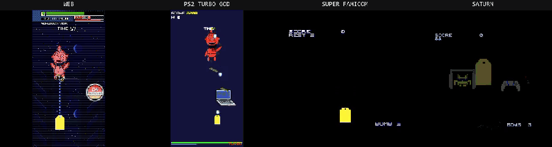

# SQUAD — PlayStation 2



SQUAD's stage-2 boss, Daltonius, on four of the seven targets shmupX exports to, a tool-assisted pilot fighting it: web, PS2, Super Famicom and Saturn.

SQUAD is a shmupX game exported to the PlayStation 2 by
`deno task build:ps2`: [svelte-ps2](https://github.com/easierbycode/svelte-ps2)'s
AthenaEnv port of the shooter, with the level's own art, enemies and bosses.
**One build, three ways to play it:**

- **[⬇ squad.iso](squad.iso)** (13.3 MB) — a bootable disc image for
  PCSX2, or a DVD-R for a softmodded console.
- **[⬇ squad-usb.zip](squad-usb.zip)** (9.7 MB) — the same game as a folder, `SQUAD/`
  (`athena.elf` + `main.js` + `assets/`) to launch from a USB stick with
  wLaunchELF or OPL.
- **[▶ Play in the browser](play/)** — the disc's own `main.js`, unmodified,
  on the web build of AthenaEnv (`lib/ps2/web-host.ts`): Phaser underneath,
  AthenaEnv's globals on top.

The download page is [index.html](index.html).

## Controls

- **Move** — D-pad / left stick (keyboard: Arrow keys)
- **Fire** — CROSS (the ship autofires) (keyboard: Z / Space)
- **Special** — TRIANGLE (keyboard: C)
- **Back** — CIRCLE (keyboard: X)
- **Pause** — START (keyboard: Enter)
- **Turbo** — SELECT on the title (keyboard: Shift on the title)
- **God mode** — Hold L1+R1 while pressing START or SELECT on the title (keyboard: Hold Q+E with Enter or Shift)

## Secrets

- **TURBO** — press SELECT instead of START on the title.
- **God mode** — hold L1 and R1 while pressing START (or SELECT, for both) on
  the title. A chime says it took.

## Rebuilding

```sh
deno task ps2:page gs               # the disc, the USB folder, the web build and this page
deno task testdrive:parity gs       # the preview GIF, every target it can run side by side
deno task ps2:page gs -- --page-only  # that GIF onto this page, around the disc already here
```

Everything here is committed, the ISO, the zip and `play/` included: the site
is deployed from this repository, and a build output git does not carry is a
dead link on the live page.
